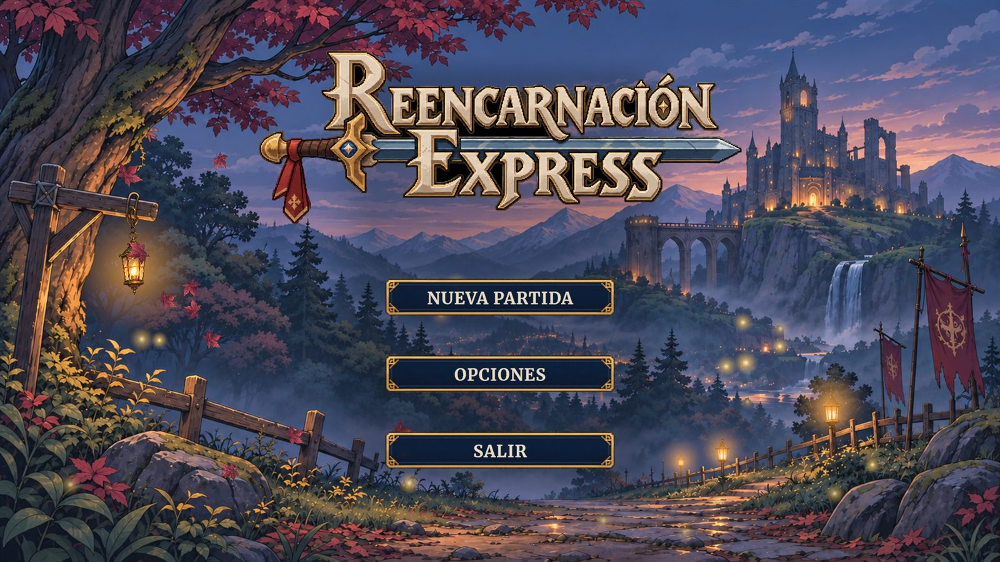
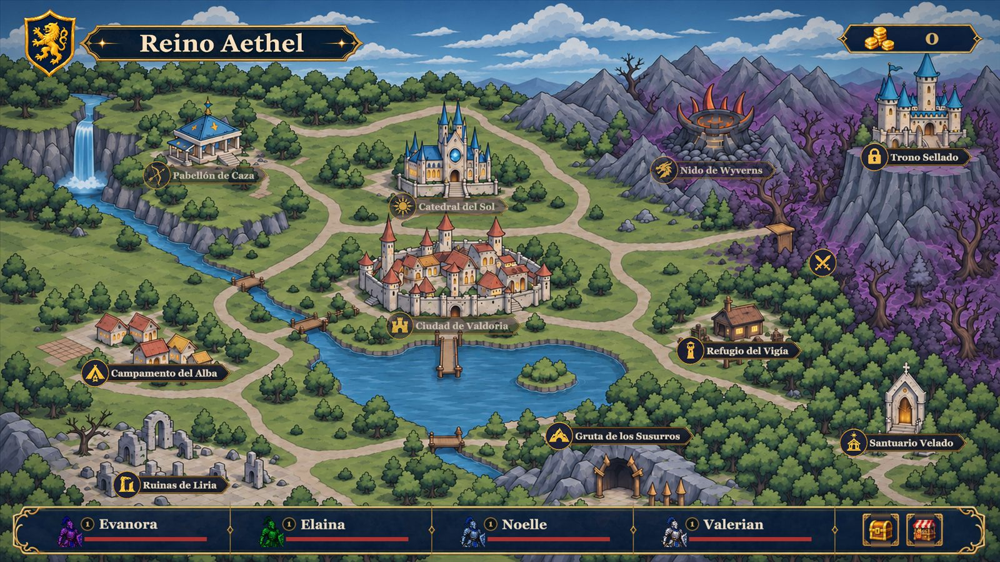

# Reencarnación Express: avance jugable

**GDD 0.2.0 · 2026-11-10 (proyecto de Unity, rama `feature/sistema-combate` @ `88ac6ff`).**

Cuatro almas reencarnadas llegan al reino de Aethel. El jugador recorre un mapa de eventos, combate por turnos en formación, compra y equipa reliquias, completa dos eventos narrativos y llega al Trono Sellado para enfrentar al Capitán de las Fuerzas Expedicionarias. Una partida dura entre 30 minutos y 1 hora, se juega con ratón y teclado, y vive solo en memoria: no hay guardado permanente.

## Recorrido de una sesión

Menú principal → Nueva partida → introducción cinematográfica → primer diálogo en el reino → Altar de los Invocados → primer combate (P1) con tutorial guiado → mapa con tutorial interactivo (tienda, venta, inventario y reliquias) → Pradera (P2 a P4) → Bosque (B1) → evento **La máscara rota** → B2 y B3 → evento **El informe del último vigía** (Valdoria) → Corrupción (C1 y C2) → Trono Sellado y jefe final.

*Menú principal de la versión actual, capturado en el editor de Unity en modo Play.*

*Mapa de la sesión con los nodos de cada región, las Coronas y la barra de héroes.*

| Área | Contenido de esta versión |
| --- | --- |
| Partida | Sesión en memoria. La derrota total o abandonar borra el progreso y devuelve al menú. Empieza con 50 Coronas y una Poción de curación. |
| Control | Todo con el ratón. ESC abre la pausa; en los tutoriales ESPACIO avanza y ENTER salta. |
| Combate | Por turnos, con posiciones, habilidades con recarga, efectos de estado, enemigos de dos posiciones y héroes caídos en lugar de muertos. |
| Héroes | Valerian (caballero), Elaina (arquera), Noelle (clérigo, con evento de transformación) y Evanora (maga), hasta el nivel 10. |
| Enemigos | Once tipos normales repartidos en Pradera, Bosque y Corrupción, y el Capitán como jefe final con fases. |
| Mundo | Tres regiones jugables, nueve encuentros regulares (P1 a P4, B1 a B3, C1 y C2), dos eventos obligatorios y el jefe final. |
| Reliquias | 20 reliquias con dos casillas por héroe, recompensas de combate y de eventos, tienda de cuatro espacios y venta al 50 %. |
| Consumibles | Poción de curación (30 % de la vida; también levanta a un héroe caído) y Antídoto. |
| Presentación | Arte de héroes y enemigos sin tinte, retratos en el orden de turno, fondos propios por región y tutoriales interactivos. |

## Estado y pendientes

- El Capitán todavía usa unidades provisionales en su encuentro.
- Los héroes no tienen animaciones integradas en combate; hay fotogramas de Valerian aún sin conectar.
- No hay pantalla de créditos ni guardado permanente.
- Quedan por ejecutar las pruebas CP-07 a CP-12 de [[02 - Pruebas]].

## Dónde consultar cada parte

- [[01 - Jugabilidad]] y [[01 - UX y Flujo del Jugador]] describen el bucle de juego y los primeros minutos.
- [[04 - Objetos y Coleccionables]] reúne las reliquias, los consumibles y la tienda.
- [[03 - Enemigos y NPC]] contiene los valores y las habilidades de los enemigos.
- [[02 - Personajes y Animación]] reúne las referencias visuales de héroes y enemigos.
- [[06 - Registro visual]] documenta de dónde sale cada captura.

> **Navegación:** [[00 - Índice]]
