# Reencarnación Express — Documento de diseño de videojuego

**GDD 0.2.0 · 2026-11-10 (proyecto de Unity, rama `feature/sistema-combate` @ `88ac6ff`)**

Equipo: Santana Suaste Roger Emanuel, Concepción Jaimes Lizbeth, Reyes Chan Erick Gilberto, Herrera Pérez Ángel Daniel y Romano Chávez Steven.

Plantilla original: Ing. Luis Fernando Villafaña Rejón.

Esta edición reúne en un solo archivo todas las secciones del GDD, con sus capturas y arte de referencia, para exportarlo a PDF. Las exportaciones conservan imágenes estáticas. La referencia vigente son los archivos individuales.

---

# Reencarnación Express: avance jugable

**GDD 0.2.0 · 2026-11-10 (proyecto de Unity, rama `feature/sistema-combate` @ `88ac6ff`).**

Cuatro almas reencarnadas llegan al reino de Aethel. El jugador recorre un mapa de eventos, combate por turnos en formación, compra y equipa reliquias, completa dos eventos narrativos y llega al Trono Sellado para enfrentar al Capitán de las Fuerzas Expedicionarias. Una partida dura entre 30 minutos y 1 hora, se juega con ratón y teclado, y vive solo en memoria: no hay guardado permanente.

## Recorrido de una sesión

Menú principal → Nueva partida → introducción cinematográfica → primer diálogo en el reino → Altar de los Invocados → primer combate (P1) con tutorial guiado → mapa con tutorial interactivo (tienda, venta, inventario y reliquias) → Pradera (P2 a P4) → Bosque (B1) → evento **La máscara rota** → B2 y B3 → evento **El informe del último vigía** (Valdoria) → Corrupción (C1 y C2) → Trono Sellado y jefe final.

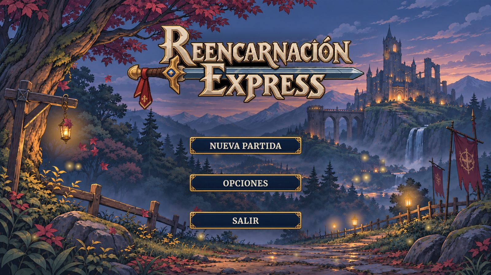
*Menú principal de la versión actual, capturado en el editor de Unity en modo Play.*

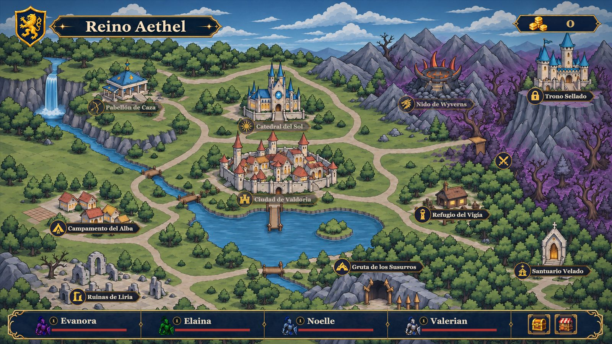
*Mapa de la sesión con los nodos de cada región, las Coronas y la barra de héroes.*

| Área | Contenido de esta versión |
| --- | --- |
| Partida | Sesión en memoria. La derrota total o abandonar borra el progreso y devuelve al menú. Empieza con 50 Coronas y una Poción de curación. |
| Control | Todo con el ratón. ESC abre la pausa; en los tutoriales ESPACIO avanza y ENTER salta. |
| Combate | Por turnos, con posiciones, habilidades con recarga, efectos de estado, enemigos de dos posiciones y héroes caídos en lugar de muertos. |
| Héroes | Valerian (caballero), Elaina (arquera), Noelle (clérigo, con evento de transformación) y Evanora (maga), hasta el nivel 10. |
| Enemigos | Once tipos normales repartidos en Pradera, Bosque y Corrupción, y el Capitán como jefe final con fases. |
| Mundo | Tres regiones jugables, nueve encuentros regulares (P1 a P4, B1 a B3, C1 y C2), dos eventos obligatorios y el jefe final. |
| Reliquias | 20 reliquias con dos casillas por héroe, recompensas de combate y de eventos, tienda de cuatro espacios y venta al 50 %. |
| Consumibles | Poción de curación (30 % de la vida; también levanta a un héroe caído) y Antídoto. |
| Presentación | Arte de héroes y enemigos sin tinte, retratos en el orden de turno, fondos propios por región y tutoriales interactivos. |

## Estado y pendientes

- El Capitán todavía usa unidades provisionales en su encuentro.
- Los héroes no tienen animaciones integradas en combate; hay fotogramas de Valerian aún sin conectar.
- No hay pantalla de créditos ni guardado permanente.
- Quedan por ejecutar las pruebas CP-07 a CP-12 de [[02 - Pruebas]].

## Dónde consultar cada parte

- [[01 - Jugabilidad]] y [[01 - UX y Flujo del Jugador]] describen el bucle de juego y los primeros minutos.
- [[04 - Objetos y Coleccionables]] reúne las reliquias, los consumibles y la tienda.
- [[03 - Enemigos y NPC]] contiene los valores y las habilidades de los enemigos.
- [[02 - Personajes y Animación]] reúne las referencias visuales de héroes y enemigos.
- [[06 - Registro visual]] documenta de dónde sale cada captura.

---

# Sección 01 - Visión

# Ficha del Proyecto

## Información general

| Campo                        | Información                                                                                                                                  |
| ---------------------------- | -------------------------------------------------------------------------------------------------------------------------------------------- |
| **Nombre del proyecto**      | Reencarnación Express                                                                                                                        |
| **Nombre clave**             | RE                                                                                                                                           |
| **Versión del GDD**          | 0.2.0                                                                                                                                        |
| **Estado del proyecto**      | Concepto / Preproducción / **Producción** / Pruebas / Publicado                                                                              |
| **Equipo**                   | Santana Suaste Roger Emanuel<br>Concepción Jaimes Lizbeth<br>Reyes Chan Erick Gilberto<br>Herrera Pérez Ángel Daniel<br>Romano Chávez Steven |
| **Responsable del proyecto** | Santana Suaste Roger Emanuel                                                                                                                 |
| **Fecha de inicio**          | 2026-09-15                                                                                                                                   |
| **Última actualización**     | 2026-11-10                                                                                                                                 |
| **Repositorio**              | github.com/Erick-Reyes-Doc/ReencarnacinExprs (privado)                                                                                       |

## Identidad del videojuego

**Género principal:**  Rol (RPG)

**Subgéneros:** Aventura, Estrategia por turnos.

**Plataforma objetivo:**  PC (Windows).

**Modo de juego:**  Un Jugador

**Perspectiva:**  Top-Down (mapa de eventos) y lateral (combates).

**Clasificaciones y etiquetas adicionales:**  Lineal, inventario, jefes, misiones, combate, mapa de eventos.

**Tecnología principal:**  Unity 6, C#

## Estado actual

- [x] Concepto definido
- [x] Alcance inicial definido
- [x] Mecánica principal definida
- [x] Prototipo funcional
- [x] Vertical slice (Capítulo 1 implementado en Unity; falta verificarlo con una partida completa)
- [x] Producción (en curso: los tres capítulos, el mapa, la tienda y el capitán están en la rama `feature/sistema-combate`)
- [x] Pruebas
- [ ] Versión final

## Criterio de éxito del proyecto

¿Qué tendría que suceder para considerar que el videojuego cumplió su propósito?
 
 El proyecto se considerará exitoso cuando se desarrolle y publique una demo funcional de Reencarnación Express que permita experimentar sus principales mecánicas de juego.

 La demo deberá incluir un mapa interactivo con misiones desbloqueables, escenas narrativas tipo novela visual y cuatro protagonistas jugables. El recorrido tiene nueve combates regulares —P1 a P4 en Llanuras Centrales, B1 a B3 en Bosque Oscuro y C1 a C2 en Corrupción del Bosque—, el evento obligatorio La máscara rota y el enfrentamiento contra el capitán de las fuerzas expedicionarias.

 Asimismo, deberá implementar un sistema de combate por turnos con posicionamiento estratégico, habilidades, efectos de estado, buffs, debuffs y una tienda con dos consumibles (Poción de curación y Antídoto) y un sistema de reliquias equipables que se compran, se venden y se obtienen como recompensa.

 El propósito será presentar una experiencia jugable que integre narrativa, estrategia y progresión, demostrando el potencial del videojuego para continuar su desarrollo.

---

# Visión del Juego

## Concepto central

**El videojuego trata sobre:**

>Reencarnación Express es un RPG de aventura y combates tácticos por turnos en el que el jugador controla a cuatro protagonistas que, tras morir misteriosamente al mismo tiempo, reencarnan en un mundo de fantasía medieval con nuevas habilidades y recuerdos fragmentados de sus vidas anteriores.
>Sin conocer las razones de su llegada ni la identidad de quien los reunió, los protagonistas reciben la misión de enfrentarse al Rey Demonio. En la demo, ese objetivo se concreta al proteger las Llanuras Centrales y derrotar al capitán de sus fuerzas expedicionarias. Avanzan por tres regiones mediante un mapa de eventos, completan nueve encuentros y el evento La máscara rota, y combaten usando las habilidades, el posicionamiento y la cooperación del equipo.
>A medida que completan misiones, los protagonistas obtendrán experiencia (XP) que les permitirá subir de nivel y mejorar sus estadísticas para enfrentar desafíos cada vez más difíciles. Durante su aventura descubrirán historias, conflictos y secretos relacionados con el mundo en el que han reencarnado, mientras intentan comprender el verdadero propósito de su misión.
>

## Experiencia deseada

Completa:

- **Quiero que el jugador se sienta:** Parte de una aventura de fantasía llena de misterios, desafíos y momentos tanto cómicos como trágicos, desarrollando una conexión con los protagonistas y experimentando satisfacción al superar los obstáculos y observar el crecimiento de su equipo.
- **Quiero que el jugador piense:** De manera estratégica durante los enfrentamientos, analizando las posiciones de sus personajes y enemigos, aprovechando las habilidades disponibles, los efectos de estado, buffs y debuffs, así como las ventajas o desventajas que puedan presentarse durante el combate.
- **Quiero que el jugador haga:** Seleccione los encuentros del recorrido desde un mapa interactivo, complete La máscara rota y El informe del último vigía, vea las escenas de diálogo de las misiones principales y participe en combates tácticos por turnos. También deberá administrar Coronas, consumibles y reliquias, preparar al equipo y obtener experiencia para mejorar sus estadísticas.
- **Quiero que el jugador recuerde:** A los cuatro protagonistas por sus personalidades, historias e interacciones, así como los acontecimientos que experimentaron durante la aventura. Además, que recuerde el estilo visual, los combates desafiantes, la música y los momentos narrativos más importantes del videojuego.

## Fantasía del jugador

Asumir el papel de estratega al dirigir a un equipo de cuatro personajes con diferentes funciones de combate: maga, arquera, clérigo y caballero. Deberá aprovechar sus habilidades, administrar recursos, modificar sus posiciones y adaptarse a las condiciones de cada enfrentamiento para conseguir la victoria.

Además, experimentará la satisfacción de fortalecer progresivamente a sus protagonistas mediante un sistema de niveles y experiencia, observando cómo mejoran sus estadísticas y aumentan sus posibilidades de superar enemigos más difíciles.


## Propuesta de valor

¿Por qué alguien querría jugar este videojuego?

A diferencia de una aventura centrada únicamente en los enfrentamientos, cada misión contará con un contexto narrativo presentado mediante escenas de diálogo, permitiendo conocer las motivaciones de los personajes, los conflictos del mundo y las razones detrás de cada combate.

El jugador podrá seleccionar eventos desde un mapa interactivo y desarrollar estrategias con las habilidades de sus protagonistas, los efectos de estado, las mejoras temporales y los dos consumibles de la tienda.

## Características principales

Lista las características que definen la experiencia.

1. Combate por turnos.
2. Mapa interactivo y sistema de eventos.
3. Narrativa estilo novela visual.
4. Habilidades únicas de cada personaje
5. **Sistema de niveles y experiencia:**
6. Administración de inventario y recursos.

## Diferenciadores

¿Qué hace que este videojuego sea reconocible frente a otros del mismo género?

Uno de sus principales elementos distintivos será la integración de escenas de novela visual antes de los enfrentamientos, de manera que los combates no ocurran únicamente como obstáculos, sino como parte de una misión o conflicto con contexto narrativo.

Finalmente, el sistema de combate permitirá desarrollar estrategias a partir de la combinación de habilidades, cambios de posición, efectos de estado y administración de consumibles, haciendo que cada personaje tenga una función importante dentro del equipo.
## Límites del concepto

¿Qué cosas **NO** es este videojuego?

- **No es un videojuego de mundo abierto:** La exploración se realizará principalmente mediante un mapa de eventos, donde el jugador seleccionará misiones disponibles y desbloqueará nuevas ubicaciones conforme avance en la historia.
- **No es un videojuego de combate en tiempo real:** Los enfrentamientos se desarrollarán por turnos, priorizando la planificación, el posicionamiento y la selección estratégica de habilidades.
- **No es un videojuego multijugador:** La experiencia estará diseñada exclusivamente para un jugador, quien controlará a los cuatro protagonistas durante los enfrentamientos.
- **No es un videojuego centrado en la exploración libre:** El avance sigue tres regiones, nueve encuentros, los eventos La máscara rota y El informe del último vigía y el capitán, en el orden de [[01 - Estructura del Contenido]].
- **No es una novela visual tradicional:** Aunque utilizará escenas de diálogo para desarrollar la historia, la jugabilidad principal estará enfocada en los combates tácticos, la progresión de misiones y la administración de recursos.
- **No busca implementar todas las mecánicas de un RPG complejo desde su primera versión:** La demo presenta el combate por turnos, el mapa, las escenas narrativas, nueve combates regulares, los dos eventos narrativos, el capitán, los efectos de estado, una tienda con compra y venta, dos consumibles y reliquias equipables.

---

# Público y Plataforma
## Público objetivo

**Edad aproximada:** 18 - 29 años

**Experiencia esperada:**  Casual - Intermedia. La dificultad sube de baja en Pradera a alta en Corrupción, con enemigos exigentes pero justos.

**Intereses relevantes:**
- Videojuegos RPG y JRPG de fantasía.
- Combates tácticos por turnos y estrategias.
- Historias que combinan comedia, misterio y tragedia.
- Personajes con historias y personalidades desarrolladas.
- Narrativa tipo novela visual.
- Misiones, desbloqueo de eventos y descubrimiento de secretos.
- subida de nivel
- Administración de recursos y objetos consumibles.

**Conocimientos previos necesarios:**
No será necesario tener experiencia avanzada en videojuegos RPG. El jugador deberá contar con conocimientos básicos del uso de teclado y mouse, así como comprender la navegación por menús y la selección de opciones.

## Plataforma

| Elemento                | Decisión        |
| ----------------------- | --------------- |
| Plataforma principal    | Pc (Windows)    |
| Plataformas secundarias | /               |
| Método de entrada       | Teclado / Mouse |
| Resolución objetivo     | 1920 x 1080     |
| Relación de aspecto     | 16:9            |
| Rendimiento objetivo    | 60 FPS          |
| Conexión requerida      | No              |

## Restricciones de plataforma

El videojuego se desarrollará utilizando Unity 6 y estará destinado principalmente a computadoras con sistema operativo Windows.

Al tratarse de un proyecto académico independiente, se priorizará la optimización de recursos para permitir su ejecución en equipos de gama baja y media, evitando el uso excesivo de efectos visuales o procesos que puedan afectar el rendimiento.

Los controles estarán adaptados al uso de teclado y mouse, permitiendo navegar por el mapa, seleccionar eventos, avanzar diálogos, administrar objetos y ejecutar acciones durante los combates.

Los requisitos mínimos de procesador, memoria RAM, tarjeta gráfica y almacenamiento se determinarán durante las pruebas de rendimiento de la demo.

## Sesión de juego

**Duración esperada de una sesión:** 30 min – 1 h

**Duración total estimada del juego:** 30 min – 1 h. La demo no tiene guardado permanente, así que la sesión y el recorrido completo son la misma partida: nueve encuentros, La máscara rota y el capitán.

## Modelo de distribución

> Prototipo académico - Gratuito.

## Consideraciones

- [ ] Controles adaptados a la plataforma
- [ ] Interfaz legible
- [x] Rendimiento considerado
- [x] Resoluciones consideradas
- [ ] Guardado compatible

---

# Pilares de Diseño

## Pilar 1 — Combate táctico y estratégico

**Descripción:**
Ofrecer combates por turnos donde la planificación, el posicionamiento y el uso adecuado de las habilidades sean fundamentales para superar los enfrentamientos.

**¿Cómo se refleja en el juego?**
- Los personajes y enemigos pueden cambiar de posición durante los combates.
- Las habilidades tienen restricciones según la posición del personaje y su objetivo.
- Los efectos de estado, buffs y debuffs influyen en las estrategias.
- Cada protagonista cumple una función específica dentro del equipo.
- El aumento de estadísticas mediante niveles permite enfrentar enemigos de mayor dificultad.
## Pilar 2 — Narrativa y desarrollo de personajes

**Descripción:**
Presentar una historia donde los protagonistas tengan personalidades propias y los acontecimientos narrativos den significado a cada enfrentamiento.

**¿Cómo se refleja en el juego?**
- Escenas de diálogo tipo novela visual antes de los combates.
- Interacciones entre los cuatro protagonistas. La demo no incluye NPC.
- Misiones principales que presentan el contexto y las motivaciones del equipo.
## Pilar 3 — Progresión mediante misiones y crecimiento de personajes

**Descripción:**
Permitir que el jugador avance por la historia mediante un mapa interactivo, completando misiones y desbloqueando nuevos eventos, mientras fortalece a sus protagonistas mediante un sistema de niveles y experiencia.

**¿Cómo se refleja en el juego?**
- Selección de encuentros desde un mapa de eventos.
- Desbloqueo de la siguiente región al completar los encuentros exigidos.
- La máscara rota como único evento narrativo obligatorio: sustituye las cuatro habilidades de Noelle y abre B2.
- Obtención de experiencia y Coronas al completar cada encuentro una sola vez.
- Subida de nivel que aumenta las estadísticas de los protagonistas según su clase.

## Pilar 4 — Administración de recursos y preparación

**Descripción:**

Fomentar la toma de decisiones estratégicas fuera de los combates mediante la administración de recursos y la preparación del equipo para enfrentar diferentes desafíos.

**¿Cómo se refleja en el juego?**
- Tienda para comprar y vender consumibles (Poción de curación y Antídoto) y reliquias.
- Administración de objetos disponibles durante los enfrentamientos.
- Uso estratégico de consumibles para recuperar salud o eliminar efectos negativos.
- Preparación del equipo antes de enfrentar misiones de mayor dificultad.

## Pilar 5 — Identidad visual y ambientación

**Descripción:**

Crear una identidad artística fantasía medieval, utilizando elementos visuales y musicales que refuercen las emociones de la historia.

**¿Cómo se refleja en el juego?**
- Ambientaciones que reflejan la fantasía, el misterio y los conflictos del mundo.
- Música que acompaña los momentos narrativos y los enfrentamientos.
- Interfaces visuales coherentes entre el mapa, las escenas de novela visual y los combates.

---

# Sección 02 - Diseño

# Jugabilidad

## Bucle principal de juego

El ciclo principal consiste en seleccionar un encuentro, conocer su contexto narrativo, combatir y obtener experiencia y Coronas. Con esos recursos el equipo sube de nivel, compra consumibles y reliquias, equipa a sus héroes y desbloquea el siguiente tramo del recorrido.

**Bucle del proyecto:** 

`Seleccionar misión → Escena de diálogo → Combate → Obtener recompensas y XP → Subir de nivel y mejorar estadísticas → Administrar recursos → Desbloquear eventos → Seleccionar nueva misión`


## Acciones principales del jugador

| Acción                   | Propósito                                                              | Resultado                                                                     |
| ------------------------ | ---------------------------------------------------------------------- | ----------------------------------------------------------------------------- |
| Seleccionar Misiones     | Elegir entre los encuentros y eventos disponibles en el mapa.          | Acceder al siguiente paso del recorrido principal.                            |
| Interactuar con diálogos | Conocer la historia, los personajes y los objetivos de cada misión.    | Obtener información narrativa y avanzar en los eventos.                       |
| Combatir                 | Utilizar habilidades, posiciones y estrategias para derrotar enemigos. | Superar desafíos y obtener recompensas.                                       |
| Cambiar posiciones       | Modificar la formación del equipo para aprovechar sus habilidades      | Obtener ventajas tácticas y habilitar acciones específicas.                   |
| Utilizar habilidades     | Atacar, defender, curar o aplicar efectos de estado, buffs y debuffs.  | Modificar las condiciones del enfrentamiento.                                 |
| Administrar recursos     | Comprar, vender y utilizar consumibles; equipar reliquias.                | Curar un 30 % de la vida máxima (y levantar a un héroe caído), eliminar sangrado, veneno y quemadura, o reforzar a un héroe con reliquias.  |
| Subir de nivel           | Acumular experiencia (XP) mediante la finalización de misiones.      | Mejorar automáticamente las estadísticas de los protagonistas según su clase. |
| Desbloquear eventos      | Completar los encuentros exigidos y, en Bosque, La máscara rota.       | Abrir la siguiente región, B2 o el Trono Sellado.                             |


## Experiencia segundo a segundo

Al comenzar la partida, el jugador observará una introducción narrativa que presentará a los cuatro protagonistas y establecerá el contexto inicial de la aventura. Posteriormente accede al mapa interactivo donde se presenta la primera misión disponible iniciando así el tutorial 

Durante el primer enfrentamiento, el jugador aprenderá a seleccionar habilidades, identificar objetivos, comprender el sistema de turnos y reconocer cómo las posiciones influyen en las acciones disponibles.
## Experiencia minuto a minuto

Durante una sesión de juego, el jugador alternará entre el mapa, las escenas de diálogo del recorrido principal, la tienda y los combates. La demo no incluye NPC.

## Experiencia a largo plazo

La motivación de la demo es conocer a los cuatro protagonistas, proteger las Llanuras Centrales y derrotar al capitán de las fuerzas expedicionarias. El Rey Demonio permanece como la amenaza posterior a ese cierre.
El recorrido se sostiene con los nueve encuentros, los dos eventos narrativos, las reliquias y el crecimiento del equipo.

## Condición de victoria

- **Durante los combates:** Derrotar a todos los enemigos o cumplir una condición especial del enfrentamiento.
- **Durante las misiones:** Completar los objetivos establecidos para obtener recompensas y experiencia.
- **Durante la progresión:** Superar las misiones principales para desbloquear nuevas ubicaciones y eventos.
- **Durante la demo:** Completar los nueve encuentros y los dos eventos (La máscara rota y El informe del último vigía), y derrotar al capitán en el Trono Sellado.

## Condición de derrota

La derrota ocurrirá cuando los cuatro protagonistas queden incapacitados durante un enfrentamiento y no puedan continuar combatiendo. Esto podrá suceder cuando sus puntos de salud lleguen a cero como consecuencia de ataques enemigos o efectos de daño progresivo.

## Ritmo

Describe cómo alternan:

- Exploración: El jugador recorre el mapa de Aethel mediante la selección de localizaciones y misiones disponibles. No existe exploración libre; las zonas se desbloquean conforme avanza la historia.

- Acción: Se desarrolla durante los combates por turnos, donde el jugador utiliza las habilidades de los cuatro protagonistas, administra posiciones y aprovecha los efectos de estado para derrotar a los enemigos.

- Descanso: Después de cada combate, el jugador regresa al mapa, donde puede revisar el estado de su equipo, consultar el inventario y comprar consumibles en la tienda antes del siguiente encuentro.

- Desafío: La dificultad aumenta progresivamente. En Pradera se introducen las mecánicas básicas; en Bosque aparecen enemigos con habilidades más estratégicas; y en Corrupción se requiere un mayor dominio de los estados, las curaciones y la protección.

- Recompensa: Al ganar un combate, los protagonistas reciben experiencia para subir de nivel y Coronas para comprar consumibles. También se desbloquean nuevas misiones y regiones.

- Historia: La narrativa acompaña el avance del jugador mediante los acontecimientos principales. Destaca el evento La máscara rota, donde Noelle despierta sus habilidades divinas, y el enfrentamiento contra el Capitán Expedicionario, que representa el cierre de la demo.

El ritmo principal del videojuego sigue el ciclo:

Mapa → Combate → Recompensa → Preparación → Nueva misión

## Principios de interacción

¿Qué reglas debe seguir el juego para que las acciones del jugador sean claras, consistentes y predecibles?

**Claridad visual:** Las opciones, estadísticas, indicadores de salud y efectos de estado deberán ser fáciles de identificar.

**Información de habilidades:** Cada habilidad mostrará su efecto, las posiciones desde las que puede utilizarse y los objetivos que puede alcanzar.

**Retroalimentación inmediata:** Los ataques, curaciones, movimientos y efectos de estado mostrarán una respuesta visual que permita comprender su resultado.

**Restricciones comprensibles:** Las habilidades que no puedan utilizarse mostrarán un bloqueo.

**Progresión clara:** El jugador podrá identificar las misiones disponibles.
**Información de consumibles:** Los objetos indicarán sus efectos y las condiciones que pueden eliminar.

**Aprendizaje progresivo:** Los primeros encuentros introducirán las mecánicas básicas antes de presentar combinaciones más complejas de habilidades y efectos de estado.

---

# Mecánicas

## Mecánicas principales

### Mecánica 01: Combate táctico por turnos

**Propósito:**  
Constituye la mecánica central del videojuego. Permite al jugador enfrentarse a distintos enemigos mediante decisiones estratégicas, considerando los atributos de cada personaje, el orden de los turnos y las acciones disponibles.

**Activación:**  
El jugador selecciona un encuentro disponible en el mapa del mundo y presiona el botón Iniciar combate.

**Reglas:**  
- Los enfrentamientos se desarrollan por turnos.
- El jugador controla un equipo de cuatro protagonistas: Valerian, Elaina, Noelle y Evanora.
- El orden de actuación depende del atributo de velocidad de cada unidad.
- Cada personaje puede realizar una acción por turno, como utilizar una habilidad o consumir un objeto.
- El combate termina cuando todos los enemigos son derrotados o cuando los cuatro protagonistas están caídos.
- Un protagonista que llega a 0 HP no muere: queda caído y fuera de la acción hasta que se le cura.
- Los enemigos grandes (hoy el Guardián Corrupto) ocupan dos posiciones y no se mueven.

**Entrada:**  
Mouse: seleccionar habilidades, objetivos y acciones mediante los botones de la interfaz

**Estado inicial:**
El equipo del jugador y los enemigos aparecen en sus respectivas posiciones de combate, con sus atributos, habilidades y estados correspondientes.

**Estado final:**
El enfrentamiento concluye con una victoria o derrota. En caso de victoria, se procesan las recompensas y se habilita el regreso al mapa.

**Recursos utilizados:**
Puntos de vida (HP), habilidades, turnos, efectos de estado y objetos consumibles.

**Recompensa:**
Experiencia (XP), Coronas y avance en la progresión del mapa.

**Penalización:**
Pérdida de puntos de vida, aplicación de efectos negativos y posible derrota del equipo. Si todos los protagonistas son derrotados, la partida termina y se pierde el progreso de la sesión.

**Interacciones con otras mecánicas:**
Se relaciona directamente con el sistema de habilidades, las posiciones de combate, los efectos de estado, los consumibles y la progresión de personajes.

**Casos límite:**  
- Si un enemigo es derrotado antes de actuar, pierde su turno.
- Si una unidad no tiene objetivos válidos para una habilidad, no puede ejecutarla sobre un objetivo fuera de alcance.
- Si un protagonista llega a 0 HP, queda caído: no actúa ni puede ser objetivo de los enemigos hasta que reciba una Poción de curación o una curación de Noelle.
- Si todos los enemigos son derrotados, el combate termina y no deben generarse recompensas duplicadas.

### Mecánica 02: Sistema de habilidades y posiciones
**Propósito:**  
Aportar profundidad estratégica al combate mediante habilidades únicas para cada protagonista y restricciones de posicionamiento que obliguen al jugador a considerar cómo y cuándo utilizar sus acciones.

**Activación:**  
Durante el turno de un protagonista, el jugador selecciona una de sus habilidades disponibles y, cuando corresponde, elige un objetivo.

**Reglas:**  
- Cada protagonista tiene cuatro habilidades activas.
- Las habilidades pueden causar daño, curar, proteger, aplicar efectos de estado o modificar posiciones.
- Algunas habilidades tienen un tiempo de reutilización o _cooldown_ que impide utilizarlas en turnos consecutivos.
- Las habilidades cuentan con restricciones de posición del usuario y de alcance sobre sus objetivos.
- Los efectos negativos pueden incluir sangrado, veneno, quemadura, debilitamiento, vulnerabilidad y aturdimiento.
- Los efectos de estado tienen una duración determinada.
- Los efectos idénticos no se acumulan de manera ilimitada.
- Algunas habilidades permiten atacar a varios enemigos o modificar la posición de un personaje.
- El sistema de posiciones utiliza cuatro espacios por equipo.

**Entrada:**  
Mouse: seleccionar el botón de habilidad y después el objetivo correspondiente.

**Estado inicial:**
El personaje comienza su turno con sus habilidades disponibles según su posición, sus tiempos de reutilización y los efectos activos.

**Estado final:**
Se ejecuta la habilidad seleccionada, se aplican sus consecuencias y se actualizan los tiempos de reutilización y los estados de las unidades involucradas.

**Recursos utilizados:**
Turno del personaje, disponibilidad de habilidades, tiempos de reutilización, puntos de vida y efectos de estado.

**Recompensa:**
Ventaja táctica, eliminación de amenazas, protección de aliados, recuperación de vida o debilitamiento de enemigos.

**Penalización:**
Una habilidad utilizada en un momento inadecuado puede desperdiciar una oportunidad estratégica. Además, su tiempo de reutilización puede impedir utilizarla cuando resulte más necesaria.

**Interacciones con otras mecánicas:**
Combate por turnos, efectos de estado, inteligencia artificial, consumibles y transformación de Noelle.

**Casos límite:**  
- Una habilidad en cooldown o usada desde una posición no permitida aparece bloqueada y no puede ejecutarse.
- Si no hay objetivos válidos para una habilidad, no puede seleccionarse.
- Un efecto idéntico ya activo no se acumula de forma ilimitada.
- Tras La máscara rota, las habilidades enmascaradas de Noelle dejan de estar disponibles de inmediato.

### Mecánica 03: Exploración y progresión mediante el mapa

**Propósito:**  
Permitir al jugador avanzar a través de las diferentes regiones del videojuego, seleccionando encuentros, descubriendo eventos y desbloqueando nuevas zonas conforme supera desafíos.

**Activación:**  
El jugador accede al mapa al comenzar una nueva partida o después de completar un encuentro.

**Reglas:**  
- El mapa representa diferentes regiones del mundo mediante localizaciones interactivas.
- La progresión inicial se divide en tres zonas: Pradera, Bosque y Corrupción.
- Cada región contiene encuentros que deben completarse en un orden determinado.
- Los encuentros bloqueados pueden consultarse, pero no iniciarse.
- Completar los encuentros requeridos permite desbloquear nuevas localizaciones.
- Algunos lugares contienen eventos especiales en lugar de combates.
- Los encuentros completados permanecen registrados durante la sesión y no pueden otorgar recompensas nuevamente.
- El mapa permite acceder a la tienda (comprar y vender), al inventario y a la ficha de cada héroe, donde se equipan las reliquias. Tras ganar el primer combate, un tutorial interactivo enseña estas opciones.
- El progreso de la partida se mantiene durante la sesión de juego.

**Entrada:**  
Mouse: seleccionar localizaciones, consultar encuentros y utilizar el botón **Iniciar combate**.

**Estado inicial:**
Al iniciar una nueva partida, únicamente el primer encuentro de Pradera está disponible. Las demás localizaciones permanecen bloqueadas.

**Estado final:**
El jugador completa los encuentros disponibles y desbloquea progresivamente Bosque y Corrupción, acercándose al desafío final.

**Recursos utilizados:**
Estado de progresión de la sesión, encuentros disponibles, información del equipo y recursos del inventario.

**Recompensa:**
Acceso a nuevas regiones, encuentros, eventos narrativos, experiencia y Coronas obtenidas mediante combates.

**Penalización:**
El jugador no puede avanzar a una región mientras no cumpla las condiciones de desbloqueo. Si el equipo sufre una derrota total, pierde el progreso de la partida.

**Interacciones con otras mecánicas:**
Combate por turnos, progresión de personajes, economía, consumibles y eventos narrativos.

**Casos límite:**  
- Un encuentro bloqueado no puede iniciarse.
- Un encuentro completado no puede recompensar nuevamente al jugador.
- Si el jugador selecciona repetidamente el botón de iniciar combate, solo debe producirse una transición.
- El evento de Noelle debe completarse antes de continuar con determinados encuentros de Bosque.
- El informe del último vigía (Valdoria) debe completarse después de B3 para abrir C1.
- El capitán es el jefe final de la demo. Su encuentro permanece bloqueado hasta completar C1 y C2.

## Mecánicas secundarias

### 1. Progresión y subida de nivel

Los protagonistas obtienen experiencia al ganar combates. Al alcanzar la cantidad necesaria, suben de nivel y mejoran sus atributos.

Esta mecánica permite que el equipo aumente sus capacidades conforme se enfrenta a enemigos más peligrosos.

### 2. Sistema de economía y tienda

El jugador obtiene una moneda llamada **Coronas (CR)** al completar encuentros.
Las Coronas pueden utilizarse en la tienda del mapa para comprar consumibles y reliquias. También se obtienen vendiendo consumibles y reliquias sin equipar por el 50 % de su precio.
Los precios establecidos son:
- Poción de curación: 35 CR.
- Antídoto: 20 CR.
El jugador comienza una nueva partida con 50 Coronas, una poción y ningún antídoto.

### 3. Uso de consumibles

Los objetos permiten recuperar puntos de vida o eliminar determinados efectos negativos.
**Poción:** recupera el 30 % de la vida máxima de un aliado y levanta a un héroe caído.
**Antídoto:** elimina efectos de sangrado, veneno y quemadura.
Durante el combate, utilizar un consumible consume la acción del personaje correspondiente.
Cada tipo de consumible tiene un límite de cinco unidades en el inventario.
Solo la Poción de curación levanta a un héroe caído; el Antídoto no actúa sobre ellos.

### 4. Héroes caídos y recuperación

Los protagonistas no mueren. Al llegar a 0 HP caen al suelo, se atenúan y pasan a una casilla libre de la retaguardia; no actúan ni pueden ser objetivo. Tras la victoria se levantan con el 30 % de su vida máxima; quienes terminaron en pie conservan exactamente su vida. Durante el combate solo los levanta una Poción de curación o una curación de Noelle. Subir de nivel restaura la vida al 100 % de los héroes que no están caídos. El equipo conserva su progresión para el siguiente encuentro.

### 5. Transformación de Noelle

Noelle comienza la aventura utilizando habilidades convencionales mientras oculta su verdadera identidad.
Después de completar el primer encuentro de Bosque, el jugador puede acceder al evento narrativo **La máscara rota**.
Al completar este evento, Noelle intercambia sus cuatro habilidades convencionales por cuatro habilidades divinas. Sigue teniendo cuatro habilidades activas y las anteriores dejan de estar disponibles.
La transformación se mantiene durante el resto de la partida y no altera su nivel, experiencia ni atributos.
El evento solo puede completarse una vez por sesión y es obligatorio para continuar avanzando en Bosque.

### 6. Inteligencia artificial enemiga

Los enemigos seleccionan acciones automáticamente durante sus turnos.
Su comportamiento considera factores como disponibilidad de habilidades, posiciones, puntos de vida, estados activos y oportunidades estratégicas.
La dificultad aumenta progresivamente entre regiones, y los enemigos de Bosque y Corrupción utilizan decisiones tácticas más exigentes.
La intención es que el jugador deba planificar sus acciones en lugar de depender únicamente de ataques básicos.

### 7. Sistema de derrota y reinicio

Cuando todos los protagonistas son derrotados, la partida termina.
El jugador regresa al menú principal y pierde el progreso acumulado durante esa sesión.
Al comenzar una nueva partida, se reinician los niveles, recursos, encuentros completados y eventos narrativos.
La versión beta no incluye un sistema de guardado permanente.

### 8. Eventos narrativos

Algunas localizaciones del mapa contienen eventos especiales que afectan la historia o el desarrollo de los protagonistas.
Estos eventos pueden desbloquear nuevas capacidades o modificar la progresión.
Hay dos en la demo: **La máscara rota** (después de B1) y **El informe del último vigía**, en Valdoria (después de B3), que entrega el Broche del Vigía, revela al capitán y abre C1.
No todos los eventos necesitan otorgar recompensas económicas o experiencia.

### 9. Efectos de estado

Durante el combate, determinadas habilidades pueden aplicar condiciones temporales a aliados o enemigos.
Los principales efectos incluyen sangrado, veneno, quemadura, debilitamiento, vulnerabilidad, protección, regeneración y aturdimiento.
Cada efecto dispone de reglas de duración y aplicación que afectan las decisiones del jugador.
Estos estados permiten generar ventajas y desventajas tácticas sin depender exclusivamente del daño directo.

### 10. Interacción con localizaciones

El mapa incluye marcadores interactivos que permiten consultar los lugares disponibles y sus encuentros asociados.
Al seleccionar una localización, aparece un panel contextual con información sobre enemigos, recompensas y condiciones de acceso.
Los estados visuales permiten identificar lugares disponibles, completados, bloqueados o relacionados con eventos especiales.
Esta mecánica complementa la exploración y facilita la navegación por el mundo del juego.


### 11. Reliquias

Cada héroe tiene dos casillas de reliquia que se llenan desde el inventario en su ficha (solo fuera de combate). Las reliquias dan bonificaciones y casi siempre una desventaja, y muchas añaden un efecto especial: por ejemplo, el Colmillo de Lobo hace más daño a enemigos con Sangrado, Veneno o Quemadura, y el Ídolo del Último Aliento evita una derrota inmediata una vez por combate. Se obtienen como recompensa de la primera victoria de cada combate, en los eventos o en la tienda, y se pueden vender. Algunos enemigos también portan una durante el combate. El catálogo completo está en [[04 - Objetos y Coleccionables]].

### 12. Enemigos grandes

Un enemigo grande ocupa dos posiciones de la formación, al estilo de los jefes de *Darkest Dungeon*. Hoy solo es grande el Guardián Corrupto: se dibuja centrado entre sus dos posiciones, no se mueve, nadie puede ocupar su segunda posición y las habilidades de área lo alcanzan una sola vez.

### 13. Tutoriales interactivos

El primer combate incluye un tutorial guiado de combate. Al ganarlo, el mapa lanza un segundo tutorial que oscurece la pantalla y resalta cada zona: el jugador abre la tienda, compra, vende, abre el inventario y equipa una reliquia en la ficha de un héroe (el Altar le entrega una reliquia de práctica). Se puede saltar en cualquier momento con ENTER y solo aparece una vez por partida.

---

# Sistemas del Juego

## Inventario de sistemas

| Sistema                          | Propósito                                           | Dependencias                        | Estado |
| -------------------------------- | --------------------------------------------------- | ----------------------------------- | ------ |
| Sistema de combate               | Administrar los enfrentamientos por turnos          | Personajes, habilidades, IA         |        |
| Sistema de habilidades y estados | Ejecutar ataques, curaciones y efectos especiales   | Combate, atributos                  |        |
| Inteligencia artificial enemiga  | Controlar las decisiones de los enemigos            | Combate, habilidades, posiciones    |        |
| Mapa y progresión de zonas       | Administrar encuentros, eventos y desbloqueos       | Sesión, combate                     |        |
| Progresión de personajes         | Administrar experiencia, niveles y estadísticas     | Combate, sesión                     |        |
| Inventario y economía            | Administrar Coronas, compras y consumibles          | Sesión, combate, mapa               |        |
| Sesión de juego                  | Mantener el progreso mientras dure la partida       | Sistemas de progresión e inventario |        |
| Eventos narrativos               | Activar acontecimientos que modifican la progresión | Mapa, sesión, habilidades           |        |
| Interfaz de usuario              | Permitir la interacción con los sistemas            | Combate, mapa, inventario           |        |


### Sistemas añadidos tras la versión inicial

| Sistema | Propósito | Dependencias | Estado |
| --- | --- | --- | --- |
| Reliquias y equipamiento | Mejorar a los héroes con objetos equipables, obtenidos por recompensa, evento o tienda | Sesión, inventario, combate, economía | Implementado |
| Tutorial interactivo | Enseñar tienda, venta, inventario y reliquias justo después del primer combate | Mapa, inventario, reliquias | Implementado |

## Detalle de los sistemas

### Sistema 01: Sistema de combate

**Objetivo:**
Gestionar los enfrentamientos entre los cuatro protagonistas y los enemigos mediante un sistema de turnos estratégicos.

**Entradas:**
- Encuentro seleccionado desde el mapa.
- Estadísticas de protagonistas y enemigos.
- Habilidades disponibles.
- Acciones seleccionadas por el jugador.
- Decisiones de la inteligencia artificial.
    

**Procesamiento / reglas:**
El sistema prepara las unidades correspondientes al encuentro y determina el orden de actuación mediante su velocidad. Durante cada turno permite ejecutar una acción válida, procesa el daño, las curaciones y los efectos aplicados, y verifica si se cumplieron las condiciones para finalizar la batalla.

Cada equipo dispone de cuatro posiciones que afectan las acciones disponibles. Los protagonistas no mueren: a 0 HP quedan caídos, sin turno ni objetivo, hasta que se les cura. Un enemigo grande (Guardián Corrupto) ocupa dos posiciones, no se mueve y nadie puede colocarse en la segunda.

**Salidas:**
- Actualización de vida y estados.
- Cambio de turnos.
- Resultado de victoria o derrota.
- Activación del procesamiento de recompensas.
    

**Estados posibles:**
Preparación, combate activo, turno del jugador, turno enemigo, victoria y derrota.

**Dependencias:**
Sistema de habilidades, personajes, inteligencia artificial y sesión de juego.

**Interacciones:**
Recibe encuentros del mapa, solicita decisiones de la IA y comunica el resultado al sistema de progresión.

**Datos que necesita:**
Vida, ataque, defensa, velocidad, posición, habilidades, enemigos y estado del encuentro.

**Datos que genera:**
Resultado del combate, unidades derrotadas, cambios de HP y eventos de finalización.

**Riesgos:**
Errores en el orden de turnos, acciones duplicadas, habilidades ejecutadas fuera de rango o combates que no terminan correctamente.

**Criterios de aceptación:**
- Todos los participantes actúan respetando el orden de turnos.
- Cada unidad ejecuta como máximo una acción por turno.
- Se respetan las posiciones y restricciones de habilidades.
- El combate termina correctamente cuando un equipo es derrotado.
- No se entregan recompensas duplicadas.
    
---

### Sistema 02: Sistema de habilidades y efectos de estado

**Objetivo:**
Administrar las capacidades de los personajes y enemigos, permitiendo ejecutar ataques, curaciones, protecciones y efectos especiales.

**Entradas:**
Habilidad seleccionada, unidad ejecutora, objetivo, estadísticas y estados activos.

**Procesamiento / reglas:**
El sistema valida la disponibilidad de una habilidad, su tiempo de reutilización, la posición del personaje y los objetivos permitidos.

Después calcula sus efectos y modifica los atributos o condiciones de las unidades afectadas.

Las habilidades pueden producir daño directo, daño periódico, curación, protección o alteraciones temporales.

**Salidas:**
- Daño o curación aplicada.
- Efectos positivos y negativos.
- Actualización de tiempos de reutilización.
- Cambios de posición cuando corresponda.
    

**Estados posibles:**
Habilidad disponible, bloqueada por cooldown, objetivo inválido, habilidad en preparación y habilidad ejecutada.

**Dependencias:**
Sistema de combate, atributos y posiciones de las unidades.

**Interacciones:**
Es utilizado por los protagonistas, la IA enemiga, el sistema de transformación de Noelle y el sistema de diagnóstico.

**Datos que necesita:**
Poder de habilidad, alcance, duración, probabilidad de aplicación, cooldown y estadísticas.

**Datos que genera:**
Daño, curación, modificaciones de atributos y estados temporales.

**Riesgos:**
Aplicación repetida de efectos, errores en el cálculo de daño, habilidades utilizables desde posiciones incorrectas y cooldowns inconsistentes.

**Criterios de aceptación:**
- Las habilidades cumplen sus restricciones.
- El daño y la curación se calculan correctamente.
- Los estados respetan su duración.
- No se acumulan efectos idénticos de manera indebida.
- Los cooldowns se actualizan de acuerdo con las reglas definidas.
    
---

### Sistema 03: Inteligencia artificial enemiga

**Objetivo:**
Controlar automáticamente las acciones de los enemigos y proporcionar enfrentamientos estratégicos con una dificultad Alta — Exigente.

**Entradas:**
- Estadísticas de las unidades.
- Puntos de vida actuales.
- Posiciones de aliados y enemigos.
- Habilidades y cooldowns disponibles.
- Estados positivos y negativos.
    

**Procesamiento / reglas:**
La IA evalúa las acciones disponibles y selecciona una opción considerando factores como el estado de sus aliados, la vulnerabilidad de los protagonistas y el beneficio estratégico de cada habilidad.
Los enemigos de las regiones avanzadas toman decisiones más exigentes, como aprovechar debilidades, curar aliados heridos o utilizar habilidades especiales en momentos oportunos.
Se conserva cierta variabilidad para evitar comportamientos completamente predecibles.

**Salidas:**
Selección de habilidad, selección de objetivo o movimiento de posición.

**Estados posibles:**
Evaluación de acciones, selección de objetivo, ejecución de habilidad, movimiento y finalización de turno.

**Dependencias:**
Sistema de combate, habilidades, posiciones y estados.

**Interacciones:**
Controla los turnos enemigos y utiliza las mismas reglas de combate que se aplican a las demás unidades.

**Datos que necesita:**
HP, atributos, habilidades, cooldowns, posiciones, condiciones y objetivos disponibles.

**Datos que genera:**
Decisión táctica y acción ejecutada por el enemigo.

**Riesgos:**
Acciones inválidas, decisiones repetitivas, concentración excesiva de ataques sobre un personaje o turnos bloqueados.

**Criterios de aceptación:**
- Los enemigos respetan sus limitaciones de habilidad y posición.
- Aprovechan oportunidades estratégicas.
- Utilizan curaciones y protecciones cuando resultan convenientes.
- No ejecutan acciones adicionales fuera de su turno.
- Mantienen un nivel de dificultad desafiante, pero justo.
    

---

### Sistema 04: Mapa interactivo y progresión de zonas

**Objetivo:**
Organizar el recorrido del jugador y administrar el acceso a encuentros y eventos dentro de las diferentes regiones de la demo.

**Entradas:**
- Selección de una localización.
- Encuentros completados.
- Estado de las regiones.
- Acciones del jugador sobre la interfaz.
    

**Procesamiento / reglas:**
El sistema consulta el progreso de la partida para determinar qué encuentros y localizaciones están disponibles.
La demo cuenta con tres regiones principales: Pradera, Bosque y Corrupción.
Pradera contiene cuatro combates; Bosque, tres; y Corrupción, dos. Los encuentros deben superarse siguiendo la progresión establecida.
También existen los eventos La máscara rota (después de B1) y El informe del último vigía (después de B3, que abre C1) y el acceso al jefe final, el capitán, en el Trono Sellado.

**Salidas:**
- Desbloqueo de encuentros y regiones.
- Información de localizaciones.
- Inicio del combate seleccionado.
- Acceso a eventos narrativos.
    

**Estados posibles:**
Localización disponible, bloqueada, completada o asociada a un evento.

**Dependencias:**
Sesión de juego, sistema de combate y eventos narrativos.

**Interacciones:**
Permite iniciar combates, consultar el progreso, acceder a la tienda y activar eventos especiales.

**Datos que necesita:**
Identificador del encuentro, estado de desbloqueo, región, enemigos y recompensas.

**Datos que genera:**
Encuentro seleccionado y actualización de progreso.

**Riesgos:**
Desbloqueos incorrectos, acceso anticipado a regiones, encuentros repetidos o selección de combates equivocados.

**Criterios de aceptación:**
- El jugador solo puede iniciar encuentros disponibles.
- La progresión respeta el orden establecido.
- Los encuentros completados no vuelven a otorgar recompensas.
- El mapa mantiene el progreso al regresar del combate.
- Los eventos especiales respetan sus condiciones de activación.
    

---

### Sistema 05: Progresión de personajes

**Objetivo:**
Permitir que los protagonistas mejoren sus capacidades conforme superan los enfrentamientos.

**Entradas:**
Experiencia obtenida, nivel actual y estadísticas del personaje.

**Procesamiento / reglas:**
Al completar un combate, se otorga la experiencia correspondiente. El sistema comprueba si el personaje acumuló suficiente experiencia para subir de nivel.
Cuando se cumple el requisito, actualiza el nivel y los atributos conforme a las reglas de progresión.

**Salidas:**
Nuevo nivel, estadísticas actualizadas y experiencia acumulada.

**Estados posibles:**
Nivel actual, experiencia insuficiente y subida de nivel.

**Dependencias:**
Combate, recompensas y sesión de juego.

**Interacciones:**
Se relaciona con la dificultad de los encuentros y con la conservación de las estadísticas entre combates.

**Datos que necesita:**
Nivel, experiencia, atributos y umbral necesario para subir de nivel.

**Datos que genera:**
Nivel actualizado y valores nuevos de estadísticas.

**Riesgos:**
Subidas de nivel duplicadas, pérdida de experiencia o atributos inconsistentes entre escenas.

**Criterios de aceptación:**
- La experiencia se entrega únicamente al ganar.
- Las subidas de nivel ocurren al alcanzar los umbrales.
- Los atributos se actualizan correctamente.
- El progreso permanece durante toda la sesión.
    

---

### Sistema 06: Inventario y economía

**Objetivo:**
Administrar los recursos económicos del jugador y permitir la compra y utilización de objetos consumibles.

**Entradas:**
Coronas disponibles, objetos existentes, selección de compra y selección de consumible.

**Procesamiento / reglas:**
El sistema valida el costo y la disponibilidad de los objetos.
La moneda utilizada son las **Coronas (CR)**.
Los consumibles disponibles son:
- Poción de curación: 35 CR (venta 18 CR).
- Antídoto: 20 CR (venta 10 CR).

La tienda tiene cuatro pestañas (Todo, Reliquias, Consumibles y Vender). Las reliquias se compran en cuatro espacios que se renuevan al completar encuentros, y en la pestaña Vender se entregan consumibles y reliquias sin equipar por el 50 % de su precio.

Las pociones recuperan el 30 % del HP máximo de un aliado y levantan a un héroe caído. Los antídotos eliminan sangrado, veneno y quemadura.
El inventario permite almacenar un máximo de cinco unidades por tipo de consumible.

**Salidas:**
- Actualización de Coronas.
- Actualización del inventario.
- Aplicación de efectos de objetos.
- Mensajes de compra o uso inválido.
    

**Estados posibles:**
Inventario disponible, compra válida, fondos insuficientes, inventario lleno y objeto no utilizable.

**Dependencias:**
Sesión de juego, interfaz y combate.

**Interacciones:**
La tienda permite adquirir consumibles desde el mapa; durante los combates, utilizarlos consume la acción del personaje.

**Datos que necesita:**
Cantidad de Coronas, precio, tipo de objeto, cantidad disponible y estado del personaje objetivo.

**Datos que genera:**
Saldo actualizado, cantidades del inventario y efectos aplicados.

**Riesgos:**
Compras sin fondos suficientes, cantidades negativas, duplicación de objetos o utilización sobre objetivos inválidos.

**Criterios de aceptación:**
- No se permiten compras sin Coronas suficientes.
- Se respeta la capacidad máxima del inventario.
- Los objetos aplican correctamente sus efectos.
- El inventario se actualiza al comprar o consumir.
- Solo la Poción de curación levanta a un héroe caído; el Antídoto no.
- La venta paga el 50 % del precio y no se permite vender reliquias equipadas, exclusivas ni de evento.
    

---

### Sistema 07: Sesión de juego

**Objetivo:**
Conservar temporalmente el estado de la partida mientras el jugador avanza entre el menú, el mapa y los combates.

**Entradas:**
Inicio de nueva partida, resultados de combate, cambios de inventario, experiencia, eventos y decisiones de abandonar.

**Procesamiento / reglas:**
El sistema mantiene en memoria los datos de los protagonistas, sus recursos y el progreso del mundo.
Al cambiar entre escenas, utiliza la información almacenada para reconstruir el estado correspondiente.
La beta no cuenta con un sistema de guardado permanente.
Si el equipo es derrotado o el jugador confirma que desea abandonar la partida, se descarta el progreso de la sesión.

**Salidas:**
Estado actualizado del equipo y del progreso; datos necesarios para cargar los encuentros.

**Estados posibles:**
Sesión no iniciada, sesión activa, victoria, derrota y sesión finalizada.

**Dependencias:**
Personajes, combate, mapa, inventario y progresión.

**Interacciones:**
Centraliza la información que necesitan los demás sistemas para mantener la continuidad del juego.

**Datos que necesita:**
Vida, niveles, experiencia, Coronas, inventario, encuentros completados y eventos activados.

**Datos que genera:**
Estado persistente en memoria durante la sesión y datos para inicializar las escenas.

**Riesgos:**
Pérdida inesperada de información, duplicación de recompensas o conservación incorrecta de datos entre partidas.

**Criterios de aceptación:**
- El progreso se conserva entre combates y mapa.
- Los recursos y estadísticas mantienen sus valores.
- Las derrotas descartan correctamente el progreso.
- Nueva partida reinicia todos los datos de la sesión.
- No se conserva información de una partida anterior.
    

---

### Sistema 08: Eventos narrativos

**Objetivo:**
Integrar acontecimientos de la historia que afecten la experiencia, las capacidades de los protagonistas o el avance del jugador.

**Entradas:**
Progreso de encuentros, selección de eventos y confirmaciones del jugador.

**Procesamiento / reglas:**
El sistema verifica si se cumplen las condiciones para activar un evento.
Hay dos eventos. **La máscara rota** está disponible después de completar el primer combate de Bosque. **El informe del último vigía** (Valdoria) aparece después de B3: entrega el Broche del Vigía, revela al capitán y abre C1. Ninguno otorga experiencia ni Coronas.
Al confirmarlo, Noelle intercambia sus cuatro habilidades convencionales por sus cuatro habilidades divinas. Las anteriores dejan de estar disponibles. El cambio permanece activo durante el resto de la sesión.

**Salidas:**
- Evento completado.
- Transformación de Noelle.
- Desbloqueo del siguiente encuentro de Bosque.
- Actualización del mapa.
    

**Estados posibles:**
Evento bloqueado, disponible, abierto, cancelado y completado.

**Dependencias:**
Mapa, sesión de juego, personajes y habilidades.

**Interacciones:**
Modifica las habilidades disponibles de Noelle y determina cuándo puede continuar la progresión.

**Datos que necesita:**
Estado de B1, estado del evento y etapa actual de Noelle.

**Datos que genera:**
Confirmación de transformación y desbloqueo de B2.

**Riesgos:**
Activación anticipada, repetición del evento o pérdida de la transformación al cambiar de escena.

**Criterios de aceptación:**
- El evento aparece después de completar B1.
- No puede completarse antes de cumplir sus requisitos.
- La transformación ocurre una sola vez por sesión.
- Noelle conserva nivel, experiencia y atributos.
- Sus habilidades divinas permanecen disponibles en los combates posteriores.
- Una nueva partida restablece su estado inicial.
    

---

### Sistema 09: Interfaz de usuario

**Objetivo:**
Presentar información relevante y permitir que el jugador interactúe con los sistemas del videojuego de manera clara e intuitiva.

**Entradas:**
Clics del jugador, selección de botones, estado de personajes, recursos y progresión.

**Procesamiento / reglas:**
La interfaz presenta las acciones disponibles dependiendo del contexto.
Durante el combate muestra habilidades, unidades, objetivos y opciones de consumibles.
En el mapa muestra localizaciones, encuentros, progreso, tienda e inventario.
La interfaz también presenta paneles de victoria, derrota y confirmaciones importantes.

**Salidas:**
Información visual actualizada y solicitudes de acciones hacia los sistemas correspondientes.

**Estados posibles:**
Menú principal, mapa, panel contextual, tienda, inventario, combate, victoria, derrota y evento narrativo.

**Dependencias:**
Combate, mapa, inventario, sesión y eventos.

**Interacciones:**
Funciona como medio de comunicación entre el jugador y los sistemas del juego.

**Datos que necesita:**
Vida, habilidades, cooldowns, Coronas, objetos, localizaciones y estados.

**Datos que genera:**
Solicitudes de selección, confirmación y ejecución de acciones.

**Riesgos:**
Información desactualizada, botones incorrectamente habilitados, superposición de paneles o acciones ejecutadas varias veces.

**Criterios de aceptación:**
- La información mostrada coincide con el estado real del juego.
- Los controles permiten ejecutar las acciones correspondientes.
- Las acciones bloqueadas no pueden ejecutarse.
- Los paneles pueden abrirse y cerrarse correctamente.
- La interfaz mantiene su legibilidad en distintas resoluciones.

---

### Sistema 10: Diagnóstico de balance

**Objetivo:**
Facilitar las pruebas del videojuego mediante el registro de información sobre los combates, permitiendo evaluar su dificultad y detectar posibles problemas.

**Entradas:**
Eventos de combate, daño recibido, rondas, consumibles utilizados y recompensas entregadas.

**Procesamiento / reglas:**
El sistema recopila métricas de cada encuentro y genera un resumen para los desarrolladores.
Compara la duración del combate con las rondas esperadas para cada región:

- Pradera: 2–4 rondas.
- Bosque: 4–6 rondas.
- Corrupción: 5–7 rondas.
    
Los resultados pueden consultarse mediante la consola de Unity y exportarse a CSV durante el desarrollo.

**Salidas:**
Informes de combate, estadísticas de rendimiento del equipo y registros CSV.

**Estados posibles:**
Sin registro, recopilando información y reporte generado.

**Dependencias:**
Sistema de combate, unidades, daño, consumibles y recompensas.

**Interacciones:**
Permite al equipo de desarrollo evaluar el equilibrio de encuentros y comparar resultados entre pruebas.

**Datos que necesita:**
Rondas, daño, HP final, personajes derrotados, objetos usados y recompensas.

**Datos que genera:**
Reportes de balance y archivos de diagnóstico.

**Riesgos:**
Registros duplicados, datos incorrectos o diagnósticos que no reflejen correctamente las condiciones del combate.

**Criterios de aceptación:**
- Se genera un informe por combate.
- El daño registrado corresponde a la vida realmente perdida.
- Los HP finales se capturan antes de la recuperación poscombate.
- Los objetos utilizados se contabilizan correctamente.
- Las recompensas registradas coinciden con las entregadas.
- Las métricas no alteran el funcionamiento de los combates.

### Sistema 11: Reliquias y equipamiento

**Objetivo:**
Dar variedad y decisiones de preparación a los héroes mediante objetos equipables con estadísticas y efectos especiales.

**Entradas:**
Reliquias poseídas, casillas del héroe, recompensas de combate y de eventos, productos de la tienda.

**Procesamiento / reglas:**
Cada héroe tiene dos casillas. Las bonificaciones y desventajas se recalculan siempre desde lo equipado. Solo se cambia equipo fuera de combate. Las exclusivas solo las usa su héroe y un héroe no lleva dos reliquias del mismo tipo. Las recompensas de combate se tiran una sola vez por misión, con probabilidad y rareza según la región, una garantía tras dos combates sin reliquia y una exclusiva asegurada en C2. Los efectos especiales se activan mediante ganchos del combate (daño recibido, curación, uso de consumibles, inicio de turno…).

**Salidas:**
Estadísticas efectivas, efectos en combate, inventario actualizado, Coronas por venta.

**Estados posibles:**
En inventario, equipada, en tienda, vendida.

**Dependencias:**
Sesión, combate, tienda, héroes.

**Datos que necesita:**
Catálogo de 20 reliquias (rareza, estadísticas, efecto, exclusividad, precio), inventario y equipamiento por héroe.

**Riesgos:**
Duplicar una unidad en dos héroes, efectos que se acumulen de más, vender una reliquia equipada o un tope de crítico mal aplicado.

**Criterios de aceptación:**
- Una unidad no puede estar en dos héroes ni repetirse en uno.
- No se puede cambiar equipo durante un combate.
- La bonificación de crítico de las reliquias no supera +10 puntos.
- La vida máxima sigue al equipamiento sin curar al héroe.
- La recompensa de un combate se entrega solo la primera vez que se gana.

---

### Sistema 12: Tutorial interactivo

**Objetivo:**
Enseñar a usar la tienda, la venta, el inventario y las reliquias con las ventanas reales del juego.

**Procesamiento / reglas:**
Se activa una sola vez, al llegar al mapa tras ganar el primer combate. Oscurece la pantalla y deja iluminada la zona a la que se refiere cada paso. En los pasos de explicación se avanza con ESPACIO; en los de acción, el paso termina cuando el jugador hace lo pedido (abrir la tienda, comprar, abrir la pestaña Vender, vender, abrir el inventario, abrir la ficha de un héroe y arrastrar una reliquia a una casilla). Entrega una reliquia de práctica y garantiza Coronas para poder comprar. ENTER lo salta.

**Riesgos:**
Bloquear al jugador si una zona no está visible; por eso, si la zona de un paso de acción no existe, el tutorial no bloquea los clics.

**Criterios de aceptación:**
- Aparece una sola vez por partida y solo tras ganar el primer combate.
- Se puede saltar en cualquier momento.
- Usa las mismas reglas de compra, venta y equipamiento que el juego normal.

## Relaciones entre sistemas

1. El **sistema de sesión** funciona como administrador del progreso temporal, conservando la información necesaria para pasar entre el mapa y los combates.

2. El **mapa interactivo** consulta los encuentros disponibles y envía al sistema de combate la información del enfrentamiento seleccionado.

3. Durante el combate, el **sistema de turnos** coordina las acciones del jugador y de la **inteligencia artificial enemiga**, mientras que el **sistema de habilidades** procesa ataques, curaciones y efectos de estado.

4. Al finalizar una victoria, el sistema de **progresión de personajes** procesa la experiencia, mientras que la **economía** actualiza las recompensas obtenidas.

5. El **inventario** permite utilizar objetos durante el combate; desde el mapa se compran y venden consumibles y reliquias y se equipan estas últimas en la ficha de cada héroe.

6. Los **eventos narrativos** interactúan con la progresión y las habilidades, como sucede con la transformación de Noelle.

---

# Controles

## Mapa de controles

| Acción                       | Teclado | Mouse                                            | Control | Táctil |
| ---------------------------- | ------- | ------------------------------------------------ | ------- | ------ |
| Navegar por el mapa          |         | Clic izquierdo en una localización               |         |        |
| Interactuar con elementos    |         | Clic izquierdo                                   |         |        |
| Seleccionar habilidad        |         | Clic izquierdo en el botón de habilidad          |         |        |
| Seleccionar objetivo         |         | Clic izquierdo sobre el objetivo válido          |         |        |
| Ataque principal             |         | Seleccionar habilidad ofensiva y objetivo        |         |        |
| Ataque secundario o especial |         | Seleccionar habilidad especial y objetivo        |         |        |
| Iniciar combate              |         | Clic izquierdo  Botón Iniciar combate            |         |        |
| Confirmar evento narrativo   |         | Clic izquierdo  Botón de confirmación del evento |         |        |
| Cerrar paneles               | ESC     | Clic izquierdo Botón de cerrar                   |         |        |
| Usar consumibles             |         | Panel Consumibles: clic en el consumible y después en la barra o la imagen del aliado         |         |        |


### Controles de tienda, inventario y reliquias

| Acción | Teclado | Mouse |
| --- | --- | --- |
| Abrir la tienda o el inventario | | Clic izquierdo en los botones Tienda e Inventario del HUD inferior del mapa |
| Cambiar de pestaña de la tienda | | Clic izquierdo en Todo, Reliquias, Consumibles o Vender |
| Comprar o vender | | Seleccionar el producto y pulsar COMPRAR o VENDER |
| Abrir la ficha de un héroe | | Clic izquierdo en su tarjeta de la barra inferior |
| Equipar o quitar una reliquia | | Arrastrar desde el inventario a una casilla de la ficha, o de vuelta al inventario |
| Leer qué hace un objeto o reliquia | | Pasar el cursor por encima |
| Ver la ficha de un enemigo en combate | | Pasar el cursor por su sprite o su barra |
| Avanzar el tutorial | ESPACIO | |
| Saltar el tutorial | ENTER | |

## Principios de control

**Consistencia:**
El clic izquierdo funciona como entrada principal para seleccionar acciones tanto en el mapa como durante los combates. Los botones mantienen comportamientos similares en las distintas pantallas.

**Claridad:**
Las acciones disponibles se presentan mediante botones e indicadores visuales. Las habilidades y encuentros bloqueados deben distinguirse claramente de las opciones que sí pueden utilizarse.

**Retroalimentación inmediata:**
La interfaz debe responder a cada acción mediante cambios visuales, actualización de información o ejecución de la acción correspondiente.

Por ejemplo, al seleccionar una habilidad se indica qué objetivos son válidos; al ejecutar un ataque se actualizan los puntos de vida del objetivo.

**Prevención de errores:**
El sistema debe impedir acciones inválidas, como utilizar habilidades en tiempo de reutilización, atacar objetivos fuera de alcance o iniciar encuentros bloqueados.
Las decisiones importantes, como abandonar una partida, requieren confirmación para evitar la pérdida accidental del progreso.

**Simplicidad:**
No se requieren combinaciones complejas de teclas ni reflejos rápidos, ya que el enfoque del videojuego es la estrategia por turnos.

## Reasignación

En la versión beta de Reencarnación Express, no se contempla la reasignación de controles por parte del jugador.

## Entrada y retroalimentación

|Entrada del jugador|Respuesta del sistema|
|---|---|
|Seleccionar una localización del mapa|Se abre un panel con información sobre el lugar y sus encuentros.|
|Seleccionar un encuentro|Se muestran sus enemigos, recompensas y estado de disponibilidad.|
|Presionar Iniciar combate|Se carga la escena de combate correspondiente al encuentro seleccionado.|
|Seleccionar una habilidad|El sistema comprueba su disponibilidad y permite seleccionar un objetivo válido.|
|Seleccionar un enemigo|Si el objetivo es válido, se ejecuta la habilidad y se actualizan sus atributos.|
|Utilizar una curación|Se recuperan puntos de vida sin superar el máximo permitido; la Poción también levanta a un héroe caído.|
|Pasar el cursor sobre un héroe|La ficha de información muestra sus estadísticas y estados; las habilidades están en el panel central.|
|Pasar el cursor sobre un enemigo|La ficha muestra sus estadísticas, estados, habilidades y la reliquia que porta, si la tiene.|
|Abrir la pestaña Vender|Se listan consumibles y reliquias sin equipar con su precio de venta (el 50 % del de compra).|
|Arrastrar una reliquia a una casilla|Se equipa si es válida y se actualizan las estadísticas del héroe; si no, se indica el motivo.|
|Abrir El informe del último vigía|Se presenta la escena de Valdoria; al terminar se entrega el Broche del Vigía y se abre C1.|
|Utilizar un antídoto|Se eliminan los efectos negativos que puede tratar el consumible.|
|Seleccionar un objeto en la tienda|Se verifica el costo y, si la compra es válida, se actualizan las Coronas y el inventario.|
|Presionar un encuentro bloqueado|Se muestra su estado, pero no se permite iniciar el combate.|
|Abrir el evento de Noelle|Se presenta el panel narrativo con opciones para confirmar o regresar.|
|Confirmar La máscara rota|Noelle intercambia sus cuatro habilidades por las divinas y se abre el siguiente encuentro de Bosque.|
|Seleccionar Volver al menú|Se solicita una segunda confirmación antes de descartar la partida.|
|Ganar un combate|Se muestra el resultado y la opción para continuar hacia el mapa.|
|Perder un combate|Se presenta la derrota y la opción de regresar al menú principal.|

---

# Progresión

## Progresión general

Describe las etapas principales del juego.

1. Introducción Narrativa
2. Tutorial Gameplay
3. Desarrollo de Historia y Relación de los Personajes
4. Dominio de Mecánicas
5. Clímax en Forma de Batalla con Jefe Zona
6. Final Demo

## Progresión del jugador

¿Qué aprende el jugador y en qué orden?
Primero aprende la existencia de las mecánicas base.
- Ataques y efectos de estado.
- Limitación de ataques a posición del personaje y del enemigo.
- Diferentes ataques por personaje.
Posteriormente las usa en combate real, y al mismo tiempo obtiene experiencia, la cual al subir de nivel aumenta las estadísticas base de los personajes, y Coronas para comprar consumibles y reliquias.
El jugador entonces aprende a administrar esos consumibles según la situación, y finalmente comienza a dominar las mecánicas de combate que previamente se le enseñaron.
El jugador deberá dominar las mecánicas, acumular la experiencia necesaria y administrar bien sus recursos para que el equipo sea capaz de derrotar al capitán.

## Progresión del personaje

Los cuatro protagonistas suben de nivel al obtener experiencia. **Cada combate entrega su experiencia completa a los cuatro héroes**, incluso a los que están caídos, y el máximo es el **nivel 10**. Al subir de nivel aumentan sus estadísticas de forma automática según su rol y **recuperan el 100 % de su vida** (un héroe caído no se levanta por subir de nivel). En la demo no hay reasignación de puntos ni árboles de habilidades.

### Estadísticas iniciales y crecimiento

| Héroe | Vida | Daño | Protección | Evasión | Velocidad | Crítico | Vida por nivel |
| --- | --- | --- | --- | --- | --- | --- | --- |
| Valerian (caballero) | 35 | 4–6 | 15 % | 3 % | 4 | 4 % | +2 |
| Elaina (arquera) | 26 | 4–7 | 0 % | 10 % | 7 | 8 % | +1 |
| Noelle (clériga) | 28 | 2–4 | 10 % | 5 % | 5 | 5 % | +2 |
| Evanora (maga) | 18 | 5–8 | 0 % | 5 % | 6 | 8 % | +1 |

La fórmula es la misma para todos: el daño mínimo y máximo suben **+1 en cada uno de los niveles 2 a 6**; la velocidad, la protección, la evasión y el crítico no cambian con el nivel (solo con las reliquias). El crítico multiplica el daño por 1,5.

### Curva de experiencia

La experiencia necesaria para pasar del nivel N al siguiente es **100 + 50 × (N − 1)**: 100, 150, 200, 250, 300, 350, 400, 450 y 500 puntos. Los encuentros pagan 50 XP en Pradera, 100 en Bosque, 150 en Corrupción y 200 el capitán (los eventos no pagan), así que la demo entera suma 1000 XP por héroe:

| Tras completar | XP acumulada | Nivel |
| --- | --- | --- |
| P2 | 100 | 2 |
| P4 | 200 | 2 |
| B1 | 300 | 3 |
| B3 | 500 | 4 |
| C1 | 650 | 4 |
| C2 | 800 | 5 |
| Capitán | 1000 | 6 |

El equipo llega al capitán en nivel 5 (Valerian 43 HP, Noelle 36, Elaina 30, Evanora 22 sin reliquias).

### Valerian (caballero)
- **Rol:** Tanque y daño sostenido.
- **Crecimiento:** +2 de vida por nivel (el más alto junto con Noelle) y la mayor vida y protección base del equipo. Su velocidad es la más baja.
- **Habilidades:** Corte del Bastión, Embate de Escudo, Guardia de Trinchera y Herida Profunda. No cambian con el nivel; mejoran su vida y su daño.
- **Función en combate:** Absorbe golpes para proteger al resto del equipo. Su daño no es el más alto por golpe, pero se acumula gracias al Sangrado y a su capacidad de mantenerse en posiciones adelantadas.

### Elaina (arquera)
- **Rol:** Utilidad y daño a objetivos prioritarios.
- **Crecimiento:** +1 de vida por nivel. Parte con la velocidad y la evasión más altas (y 8 % de crítico).
- **Habilidades:** Disparo Certero, Flecha Perforante, Marca del Cazador y Tiro Evasivo. Las usa desde P2, P3 o P4 y alcanzan las cuatro posiciones enemigas durante toda la demo.
- **Función en combate:** Es vulnerable a ataques pesados, pero su agilidad le permite reducir o ignorar el impacto de ataques ligeros. Su valor está en marcar objetivos clave y eliminar enemigos específicos sin depender de la posición.

### Noelle (clériga)
- **Rol:** Soporte.
- **Crecimiento:** +2 de vida por nivel; vida y protección intermedias (por debajo de Valerian, por encima de Elaina y Evanora) y el daño más bajo del equipo.
- **Habilidades:** Antes del intercambio usa el conjunto enmascarado, que incluye el aturdimiento de Impacto Quebrantador. Después de La máscara rota usa solo el conjunto divino. Sus curaciones son un porcentaje de la vida máxima del aliado (25 % y 40 %), así que mejoran con el nivel y las reliquias de quien las recibe.
- **Función en combate:** Reduce la dependencia de pociones de vida. Sus curaciones y buffs permiten que el equipo aguante enfrentamientos más largos o de mayor dificultad. El aturdimiento puede interrumpir el ritmo del enemigo.

### Evanora (maga)
- **Rol:** Daño alto y control.
- **Crecimiento:** +1 de vida por nivel; la menor vida del equipo (18) y el mayor daño base (5–8).
- **Habilidades:** Orbe Arcano, Llamarada, Ruptura Ígnea y Golpe de Meteorito (de área, desde la ronda 3). Las usa desde P3 y P4 y giran en torno a la Quemadura.
- **Función en combate:** Alta vulnerabilidad. Cada ataque aplica un efecto de estado. Su valor está en eliminar amenazas rápidamente o en debilitar grupos enteros para que el resto del equipo pueda aprovecharlo.

### Notas
- El crecimiento de estadísticas es automático y diferente por clase.
- Los efectos de estado de los héroes no escalan con el nivel; lo que crece es la vida y el daño. El daño de Sangrado, Quemadura y Veneno depende de la habilidad (valor fijo o porcentaje del daño del golpe).
- Subir de nivel no enseña habilidades nuevas. El avance de estadísticas y de efectos se siente en los combates posteriores.
- El único intercambio de habilidades de la demo es La máscara rota. Noelle sustituye Golpe de Lucero, Impacto Quebrantador, Resistencia Obstinada y Auxilio Improvisado por Impacto Consagrado, Plegaria Focalizada, Bendición Continua y Amparo Divino. Conserva nivel, experiencia y atributos.
- Los consumibles de la demo son la Poción de curación y el Antídoto, y el equipo adicional son las reliquias (dos casillas por héroe, ver [[04 - Objetos y Coleccionables]]). La base del crecimiento sigue siendo el nivel y la clase.

## Desbloqueos

| Desbloqueo | Requisito | Efecto |
| ---------- | --------- | ------ |
| Bosque Oscuro | Completar P1, P2, P3 y P4 | Abre la segunda región. |
| La máscara rota | Completar B1 | Sustituye las habilidades de Noelle y abre B2. No otorga XP ni Coronas. |
| El informe del último vigía | Completar B3 | Entrega el Broche del Vigía, revela al capitán y abre C1. No otorga XP ni Coronas. |
| Corrupción del Bosque | Completar El informe del último vigía | Abre la tercera región (C1 y C2). |
| Trono Sellado | Completar C1 y C2 | Abre el enfrentamiento contra el capitán. |

## Curva de dificultad

Describe cómo aumenta el desafío y qué nuevos elementos aparecen.
- Sección 0: Tutorial
El jugador es introducido al mundo del juego y se le enseña las mecánicas principales, de esta forma el jugador aprende a utilizar al equipo de héroes.
- Sección 1: Pradera
El jugador pone en práctica el combate en los cuatro encuentros de Pradera. Al ganarlos obtiene experiencia y Coronas, y puede comprar consumibles en la tienda del mapa.
Los enemigos son claramente más débiles que el equipo (12 a 22 HP frente a 18 a 35), el jugador deberá de poder avanzar a la siguiente zona utilizando ataques normales sin demasiada estrategia.
- Sección 2: Bosque
El jugador deberá de haber aprendido las bases del juego y debe de poner en práctica estrategia.
Los enemigos en esta sección serán un cambio en dificultad significativo, los enemigos tendrán estadísticas similares a las del jugador en cuanto a salud y daño. Por lo que, el jugador deberá usar estrategias efectivas para derrotar a los enemigos con ventaja.
En esta sección ocurre La máscara rota. Al completarla, Noelle sustituye sus cuatro habilidades por las divinas. Esa es la ventaja especial de la región y es obligatoria para continuar hacia B2.
- Sección 3: Corrupción
Los enemigos en esta sección tendrán estadísticas de vida y daño superior a las del jugador. El equipo necesita la estrategia aprendida, las habilidades divinas de Noelle y los consumibles acumulados para superar C1 y C2.
El capitán no forma parte de esos dos encuentros. Se desbloquea después, en el Trono Sellado, y es el jefe final de la demo.
## Curva de aprendizaje

¿Qué debe dominar el jugador antes de introducir el siguiente concepto?
Aprendizaje 1:
El jugador deberá aprender las bases del sistema de combate.
- Ataques y sus restricciones: Los ataques, tienen dos restricciones importantes, la primera es, en qué posición se pueden realizar, y la segunda es, en qué posición (de los enemigos) el ataque podrá golpear.
Aprendizaje 2:
Los personajes miembros del equipo, y sus clases. Cada personaje en el equipo tiene una clase distinta, lo cuál significa que sus estadísticas son distintas. Un caballero, por ejemplo, tiene considerablemente mayor defensa que un arquero o mago.
De igual forma, cada clase tiene distintos ataques con distintas funciones que van más allá de hacer daño a un enemigo.
El jugador deberá aprender a usar estas diferencias a su beneficio, empleando estrategia.

Aprendizaje 3:
Consumibles y La máscara rota.
La Poción de curación restaura el 30 % de la vida máxima de un aliado, levanta a un héroe caído y cuesta la acción del turno. El Antídoto elimina sangrado, veneno y quemadura y no actúa sobre héroes caídos.
Después de B1, el jugador confirma La máscara rota. Noelle pasa a combatir con sus cuatro habilidades divinas durante el resto de la sesión.

Aprendizaje 4:
Tienda, venta y reliquias. Justo después de ganar el primer combate, un tutorial interactivo en el mapa guía al jugador para abrir la tienda, comprar, vender, consultar el inventario y equipar una reliquia en la ficha de un héroe. Desde ahí el jugador decide cómo repartir sus Coronas entre consumibles y reliquias y qué reliquia lleva cada héroe.

---

# Economía y Recursos

## Recursos

| Recurso | Obtención | Uso | Límite | Pérdida |
| --- | --- | --- | --- | --- |
| Coronas (CR) | 50 al iniciar la partida, recompensa única por encuentro (25 / 40 / 60 / 100 CR) y venta de objetos | Comprar consumibles y reliquias en la tienda del mapa | Ninguno | Se gastan al comprar. Se pierden si el equipo es derrotado, si termina la partida o si se abandona el juego. |
| Poción de curación | Una al iniciar la partida, y compra en la tienda (35 CR) | Restaurar el 30 % de la vida máxima de un aliado y levantar a un héroe caído | 5 | Se consume al usarse. Las restantes se pierden al terminar la sesión por derrota o abandono. |
| Antídoto | Compra en la tienda (20 CR; 3 unidades por partida) | Eliminar sangrado, veneno y quemadura de un aliado vivo | 5 | Se consume al usarse. Las restantes se pierden al terminar la sesión. |
| Reliquias | Recompensa de combate, eventos narrativos y tienda | Equipar hasta dos por héroe para mejorar sus estadísticas y añadir efectos | Sin límite en el inventario; 2 casillas por héroe | No se consumen. Se pueden vender (50 % del precio) si no están equipadas. Se pierden al terminar la sesión. |

## Precios

| Producto | Compra | Venta |
| --- | --- | --- |
| Poción de curación | 35 CR | 18 CR |
| Antídoto | 20 CR | 10 CR |
| Reliquia común | 45–50 CR | 23–25 CR |
| Reliquia rara | 105–115 CR | 53–58 CR |

La venta paga el 50 % del precio de compra, redondeado, con un mínimo de 1 CR. No se pueden vender reliquias equipadas, exclusivas ni de evento.

## Fuentes y sumideros

**Fuentes:**
- Coronas: 50 al comenzar, recompensas únicas al completar encuentros y ventas en la pestaña **Vender**.
- Poción de curación: una unidad inicial y compras posteriores (existencias ilimitadas).
- Antídoto: solo mediante compra; la partida empieza con cero y la tienda tiene tres unidades.
- Reliquias: recompensa de la primera victoria de cada combate (con probabilidad), eventos narrativos y tienda.

**Sumideros:**
- Coronas: compras en la tienda del mapa.
- Consumibles: se usan durante el combate y cuestan la acción del personaje.
- Reliquias: no se destruyen; el jugador puede convertirlas en Coronas vendiéndolas.

## Reglas

- El jugador puede llevar un máximo de cinco Pociones de curación y cinco Antídotos.
- **Poción de curación:**
  - Solo se usa en combate.
  - Cuesta la acción del personaje que la utiliza.
  - Restaura el 30 % de la vida máxima del aliado elegido (redondeado, mínimo 1 HP).
  - No recupera vida por encima del máximo.
  - **Levanta a un héroe caído** (0 HP), que vuelve con esa cantidad de vida.
- **Antídoto:**
  - Solo se usa en combate.
  - Cuesta la acción del personaje que lo utiliza.
  - Elimina sangrado, veneno y quemadura del aliado elegido.
  - No elimina debilitamiento, vulnerabilidad ni otros efectos, no recupera vida y no actúa sobre héroes caídos.
- **Héroes caídos:** los protagonistas no mueren. Al llegar a 0 HP quedan caídos y, si el equipo gana, reviven al terminar el combate con el 30 % de su vida máxima; durante el combate solo los levanta una Poción de curación o una curación de Noelle. Los que siguen en pie conservan la vida con la que cerraron el combate. Subir de nivel restaura la vida al 100 %, salvo que el héroe esté caído.
- **Recompensas únicas:** las Coronas y la reliquia aleatoria de un combate se entregan solo la primera vez que se gana. Los eventos narrativos no dan Coronas ni experiencia.
- **Tienda de consumibles:** la Poción de curación tiene existencias ilimitadas; el Antídoto, tres por partida sin reposición. No se puede comprar con el inventario lleno (cinco unidades).
- **Tienda de reliquias:** cuatro espacios, una unidad por espacio; se renueva al completar por primera vez cualquier encuentro. Detalle en [[04 - Objetos y Coleccionables]].
- No hay otros consumibles en la demo.

## Balance

**Incentivar:**
- Uso selectivo de los consumibles según la situación del combate.
- Compra de pociones y antídotos antes de entrar a Bosque y a Corrupción.
- Reservar la Poción de curación para levantar a un héroe caído o para los momentos de mayor presión.
- Decidir entre comprar una reliquia, guardar Coronas para consumibles o vender lo que no se usa.

**Evitar:**
- Acumulación de pociones que elimine la presión de los combates.
- Que las Coronas se acumulen sin uso. Con los nueve encuentros normales y sin compras, el jugador llega a 390 CR; con el jefe final, a 490 CR.
- Que la venta de reliquias permita financiar compras sin coste real: por eso se paga solo la mitad.

---

# Reglas y Estados del Juego

## Estados principales

- Menú principal
- Intro (animación de nueva partida)
- Carga
- Mapa
- Diálogo
- Combate (el primero incluye un tutorial interactivo)
- Tienda (compra y venta)
- Inventario y ficha de personaje (reliquias)
- Tutorial del mapa
- Pausa
- Victoria de combate
- Derrota
- Game Over
- Epílogo
- Créditos

## Transiciones

| Estado origen            | Evento                        | Estado destino      | Condición                        |
| ------------------------ | ----------------------------- | ------------------- | -------------------------------- |
| Menú principal           | Nueva partida                 | Intro               | —                                |
| Intro                    | Termina animación             | Mapa                | —                                |
| Mapa                     | Selecciona misión             | Diálogo             | La misión tiene escena previa    |
| Mapa                     | Selecciona misión             | Combate             | La misión no tiene escena previa |
| Diálogo                  | Termina escena                | Combate             | La misión tiene combate          |
| Diálogo                  | Termina escena                | Mapa                | La misión no tiene combate       |
| Combate                  | Todos los enemigos derrotados | Victoria de combate | —                                |
| Combate                  | Los 4 protagonistas caen      | Derrota             | —                                |
| Victoria de combate      | Confirmar recompensas         | Mapa                | Cualquier combate salvo el del capitán |
| Victoria de combate      | Confirmar recompensas         | Epílogo             | Combate contra el capitán        |
| Epílogo                  | Termina o se omite el diálogo | Créditos            | —                                |
| Derrota                  | Salir al menú                 | Menú principal      | —                                |
| Mapa                     | Interactuar con tienda        | Tienda              | —                                |
| Tienda                   | Salir                         | Mapa                | —                                |
| Mapa / Diálogo / Combate | Pausar                        | Pausa               | —                                |
| Pausa                    | Continuar                     | Estado anterior     | —                                |
| Créditos                 | Terminan o se omiten          | Menú principal      | La sesión se cierra              |

### Transiciones adicionales

| Estado origen | Evento | Estado destino | Condición |
| --- | --- | --- | --- |
| Victoria del primer combate | Confirmar recompensas | Mapa con tutorial interactivo | Solo la primera vez de la partida |
| Tutorial del mapa | Completar o saltar con ENTER | Mapa | — |
| Mapa | Botón Inventario o tarjeta de héroe | Inventario / ficha de personaje | — |
| Mapa | Evento narrativo (La máscara rota, El informe del último vigía) | Diálogo | El evento está disponible |
| Combate | Un protagonista llega a 0 HP | Héroe caído (sigue en el combate sin actuar) | — |

## Reglas globales

1. Los protagonistas no mueren: a 0 HP quedan caídos y, si el equipo gana, reviven al terminar el combate con el 30 % de su vida máxima. Quienes siguen en pie conservan la vida con la que cerraron el combate.
2. La Poción de curación solo se usa en combate. Cuesta la acción del personaje, restaura el 30 % de la vida máxima de un aliado y levanta a un héroe caído.
3. El juego se puede pausar desde el mapa, el diálogo y el combate.
4. El inventario admite hasta cinco Pociones de curación y cinco Antídotos. El Antídoto elimina sangrado, veneno y quemadura.
5. Subir de nivel restaura la vida al 100 % de los héroes que siguen en pie.
6. Las Coronas y la reliquia de un combate solo se entregan la primera vez que se gana.
7. Las reliquias solo se equipan o quitan fuera de combate. Cada héroe tiene dos casillas.
8. La tienda se puede usar para vender consumibles y reliquias sin equipar por el 50 % de su precio.
9. Un enemigo grande ocupa dos posiciones, no se mueve y nadie puede colocarse en la segunda.

## Casos especiales

- Si el jugador intenta iniciar un combate sin pociones suficientes o con el equipo en mal estado, el juego no lo impide. La responsabilidad de la preparación es del jugador.
- En la demo no hay guardado manual ni automático entre combates.
- La tienda solo está disponible desde el mapa.

---

# Sección 03 - Historia y Mundo

# Premisa y Trama

## Premisa

Resume el conflicto principal en pocas líneas.

4 protagonistas fallecen en un mismo accidente, son reencarnados en otro mundo, donde el jugador que actúa como un dios de este otro mundo y les confiere poder para derrocar a las fuerzas del Rey Demonio.
## Sinopsis

Describe el argumento completo sin entrar todavía en cada escena.

Los protagonistas reencarnan en otro mundo y se les otorga poderes para enfrentarse a las fuerzas que amenazan con destruir ese mundo. En la demo recorren nueve encuentros y La máscara rota, fortalecen al equipo con experiencia y Coronas, y derrotan al capitán de las fuerzas expedicionarias en las Llanuras Centrales. El Rey Demonio continúa después de ese cierre.

## Estructura narrativa

### Acto / Etapa 1
**Muerte y reencarnación**
Los protagonistas perecen en un accidente y el jugador migra sus almas a otro mundo, donde estos tendrán un poco de tiempo para comprender su nuevo propósito y existencia.
### Acto / Etapa 2
**Llanuras Centrales**
Fuera de tiempo y con las fuerzas de expedición demoniacas a las puertas de los asentamientos humanos, los protagonistas deberán aprender a usar sus nuevas habilidades y a trabajar en equipo sobre la marcha.
Acompañados de un dios (el jugador) para guiarlos, el equipo de protagonistas deberá establecer un lazo de amistad a base de adversidad.
### Acto / Etapa 3
**Bosque Oscuro**
Las fuerzas expedicionarias del Rey Demonio se concentran en un pequeño bosque oscuro al este de las Llanuras Centrales, los protagonistas deberán viajar a este bosque para destruir este puesto de avanzada en un intento de traer paz a la región.
Para este punto los protagonistas deberán de haber aprendido a usar sus poderes y a confiar el uno en el otro, convirtiéndose en un equipo capaz.

### Acto / Etapa 4
**Corrupción del Bosque**
Las fuerzas del Rey Demonio han logrado corromper parte del bosque, convirtiendo parte de este en el lugar ideal para ellos. Empoderados por la corrupta oscuridad, los enemigos de esta área son más poderosos de lo que tanto el jugador como el equipo estaba preparado. El equipo deberá de trabajar en sincronía y coordinación total para derrotar a las fuerzas de esta zona.
El acto finalizará con la derrota del capitán de las fuerzas expedicionarias, poniendo fin al terror que ha caído sobre las Llanuras Centrales.
## Eventos principales

| Orden | Evento                              | Participación del jugador                                                                                                        | Consecuencia                                    |
| ----- | ----------------------------------- | -------------------------------------------------------------------------------------------------------------------------------- | ----------------------------------------------- |
| 1     | Reencarnación de los protagonistas. | El jugador inicia la partida reencarnando a los protagonistas.                                                                   | Comienza la historia del juego.                 |
| 2     | Ruptura de la máscara de Noelle     | La máscara de Noelle se rompe. El jugador confirma el intercambio de sus cuatro habilidades enmascaradas por las cuatro divinas. | Arco de personaje e intercambio de habilidades. |


## Finales

### Derrota
Si durante el gameplay, los protagonistas pierden todos sus puntos de salud, entonces se ejecutará el Final "**Derrota**".
En este final, los protagonistas son derrotados y pierden la vida en combate, con los protagonistas caídos, el jugador pierde su último enlace a el mundo, y su poder, por lo que el jugador deja de ser una entidad divina.

### Victoria
Durante el gameplay, con la ayuda del jugador los protagonistas logran derrotar al capitán de las fuerzas expedicionarias.
En este final, el equipo tiene éxito en su misión, y a pesar de la sorpresa de la corrupción y el capitán, logran ser victoriosos.
La corrupción del bosque se desvanece, el resto de las fuerzas expedicionarias se retiran huyendo hacía el norte en la seguridad de la Forja de Combustión controlada por el Rey Demonio.
Los personajes regresan a los territorios humanos como héroes de leyenda, pero a pesar de que esta batalla se haya ganado, la guerra continúa, y los héroes se preparan para su siguiente incursión para asegurar la seguridad de las Llanuras y el futuro del mundo.

---

# Mundo

## Concepto del mundo

**Época:** Medieval

**Lugar:** Mundo fantástico, llanuras y bosques templados.

**Contexto:** El mundo se encuentra bajo ataque de un poderoso Rey Demonio.

## Historia del mundo

### Antes del juego
En el continente de Aethel existió una Primera Humanidad protegida por el Pilón Primordial, una Segunda Luna que estabilizaba la magia y el clima a cambio de devoción. Cuando esa fe se agotó, el Pilón colapsó. Sus fragmentos cayeron sobre el continente en la Lluvia Cósmica y transformaron a los supervivientes en las razas actuales: elfos, enanos, draconoides, no-muertos y humanos. Cada raza quedó anclada a un Relicario y a un Dragón custodio que mantiene su estabilidad mental.

Con el tiempo, la envidia humana y las guerras generaron un vacío. De ese vacío nació el Rey Demonio, una encarnación de la entropía. Su arma principal es la Niebla del Ocaso, capaz de corromper la conexión entre las razas y sus Relicarios. Cuando corrompió la Forja de Combustión en el norte, el Dragón de Magma enloqueció y los draconoides se masacraron entre sí hasta extinguirse.

El Rey Demonio ya demostró que puede romper el ancla mental de cualquier raza nativa. Si logra tocar los Relicarios de los elfos o los enanos, esas razas sufrirán el mismo destino. Ningún habitante de Aethel puede detenerlo, porque todos dependen del sistema que él sabe cómo destruir.

### Durante el juego
Cuatro personas de otro mundo reencarnan en Aethel. Al no estar ancladas a ningún Relicario, sus mentes no pueden ser rotas de la misma forma, aunque algunas, como Evanora, tengan afinidad con la magia y Elaina habite un cuerpo élfico. Reciben la misión de detener al Rey Demonio antes de que corrompa el resto de los Relicarios. La demo cubre el primer paso: derrotar al capitán de sus fuerzas expedicionarias y proteger las Llanuras Centrales.

### Después del juego
(No definido en la demo.)

| Lugar               | Descripción                                                                                                                                                                    | Función jugable                                                                                                                                                                                                                             | Importancia narrativa                                                                                                                                           |
| ------------------- | ------------------------------------------------------------------------------------------------------------------------------------------------------------------------------ | ------------------------------------------------------------------------------------------------------------------------------------------------------------------------------------------------------------------------------------------- | --------------------------------------------------------------------------------------------------------------------------------------------------------------- |
| Asentamiento Humano | Un asentamiento humano fortificado, el bastión más formidable de las Llanuras Centrales.                                                                                       | No es una zona jugable. La reencarnación se cuenta en la introducción, antes del mapa. El primer recorrido jugable es Llanuras Centrales (Pradera): Campamento del Alba y Ruinas de Liria.                                                  | Contexto de los asentamientos amenazados. La exposición jugable ocurre en las escenas del recorrido principal.                                                   |
| Llanuras Centrales  | Área amplía de nada más que pastos verdes y colinas.                                                                                                                           | Primera sección de gameplay e historia. Enemigos de bajo nivel, funciona como el tutorial.                                                                                                                                                  | Introducción narrativa de los personajes, en este punto es donde interactúan más y discuten su situación previo a y después de un combate.                      |
| Bosque Oscuro       | Un área mucho más pequeña en los bordes del Este de las Llanuras Centrales. Se trata de un bosque denso el cual oscurece la luz del sol.                                       | Segunda sección de gameplay, los enemigos son considerablemente más fuertes e incluso llegan a tener ser equivalentes al jugador.                                                                                                           | Introducción al misterio de la demo, el origen de las fuerzas expedicionarias del Rey Demonio.                                                                  |
| Corrupción del Bosque | Un área aún más pequeña pero peligrosa. Un área del bosque que ha sido corrompida y se encuentra permeada por energías demoniacas que empoderan a las fuerzas del Rey Demonio. | Tercera región jugable. Contiene C1 y C2. Los enemigos son equivalentes o superiores al jugador, así que el equipo usa estrategia y consumibles. El capitán se desbloquea después, en el Trono Sellado.                                      | El capitán se revela como antagonista tangible de la demo. Derrotarlo trae una paz inmediata a las Llanuras Centrales.                                           |

## Facciones

| Facción            | Objetivo                                                                                                                               | Relación con el jugador |
| ------------------ | -------------------------------------------------------------------------------------------------------------------------------------- | ----------------------- |
| Humanos            | Defenderse de las legiones de fuerzas demoniacas que están atacando y destruyendo los asentamientos humanos de las Llanuras Centrales. |                         |
| Fuerzas Demoniacas | Tomar control completo del mundo entero, conquistando cada región de este y corrompiendo los Relicarios.                             |                         |

## Coherencia del mundo

Lista reglas que no deben romperse sin una razón narrativa o de diseño.

---

# Personajes

### Protagonista(s)

### Valerian

**Rol:** Caballero miembro del equipo de héroes reencarnados.

**Función jugable:** Controlado durante combate por turnos por el jugador.

**Función narrativa:** Extraño para el resto de héroes pero encargado de liderar. Actúa como la voz de la razón y el sentido común durante la historia.

**Descripción física:** 1.75 m de estatura. Complexión estándar, con la espalda ligeramente tensa por años de mala postura en sillas ergonómicas baratas y manos que solían tener callos de teclado, no de empuñadura. Su rostro refleja el desgaste de la treintena: ojeras crónicas marcadas, barba descuidada de varios días y cabello castaño revuelto.

**Personalidad:** 
Estoico, decidido, de temperamento rudo. Los años de un trabajo aburrido y tedioso le han dejado con una personalidad que no tolera bromas y errores.
Sin embargo, esta segunda oportunidad le llena de esperanza y determinación. 
**Motivaciones:**
La posibilidad de libertar y de una verdadera jubilación.
**Objetivos:**
Jubilarse de verdad. Su objetivo no es destronar reyes ni salvar continentes, sino acumular el oro suficiente para comprar un pedazo de tierra fértil lejos de cualquier conflicto geopolítico, montar una casa pequeña y pasar el resto de sus días durmiendo sin alarmas.
**Conflicto:**
Cambiar su personalidad cerrada para permitirle liderar al resto de los miembros del equipo.
**Relaciones:**
Un completo desconocido, mientras que los otros miembros del equipo fueron amistades en su anterior vida, el es completamente ajeno.
**Habilidades:**
- **Corte del Bastión:** golpe básico de su espada (100 % del daño). Se usa desde P1–P2 y alcanza P1–P2. Sin recarga.
- **Embate de Escudo:** golpe de escudo (90 % del daño) con 30 % de probabilidad de aturdir un turno; avanza una posición si puede. Recarga: 2 turnos.
- **Guardia de Trinchera:** protege a un aliado durante 2 turnos: Valerian gana +15 % de protección e intercepta el 50 % del daño directo dirigido a ese aliado. Recarga: 2 turnos.
- **Herida Profunda:** golpe (85 % del daño) que provoca Sangrado de 2 de daño durante 2 turnos. Recarga: 1 turno.
**Debilidades:**
No tiene ninguna clase de habilidad o resistencia mágica. Es un hombre mortal con una armadura y una espada.
**Referencias visuales:**

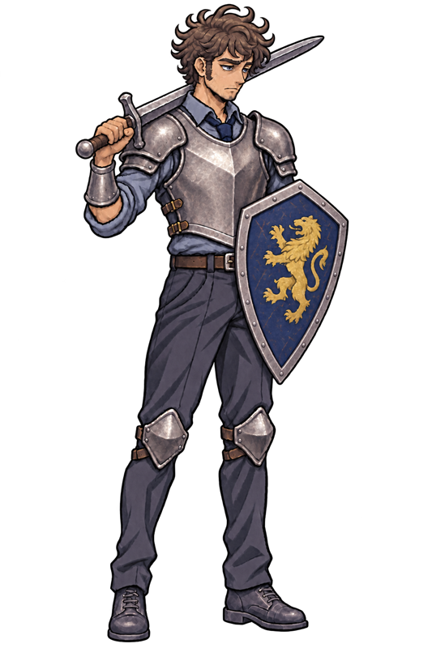
*Imagen base de Valerian.*

### Noelle

**Rol:** Clérigo miembro del equipo de los héroes reencarnados.

**Función jugable:** Controlada por el jugador durante el combate por turnos.

**Función narrativa:** 
Comienza como una mera unidad de apoyo orientada a la restauración; no obstante, conforme profundiza su vínculo con la deidad que encarna el jugador, es capaz de resquebrajar su faceta defensiva y trascender sus inseguridades. Al convertirse en el bastión del equipo, su potencial divino y artes curativas se incrementan exponencialmente.

**Descripción física:** 
Luce una melena castaña oscura y oculta su rostro tras una máscara de hierro marcada por una hendidura oxidada en el flanco derecho. Su atuendo consiste en una túnica desgastada verde olivo sobre pantalones holgados tono caqui.

Protege el torso mediante un chaleco de cuero reforzado por una placa metálica dispuesta sobre el pecho.

**Personalidad:**
Con máscara: Tímida y reservada pero extremadamente determinada, no es expresiva y rara vez se comunica con el equipo, prefiriendo asistir en silencio.

Sin máscara: Expresiva, habladora y con deseo de ayudar e inspirar al equipo durante y fuera de combate.

**Motivaciones:**
Apoyar a sus compañeros para derrotar al rey demonio para poder vivir en paz en el nuevo mundo como una segunda oportunidad en su vida.

**Objetivos:**
Derrotar al rey demonio y buscar un lugar al que pertenezca en este nuevo mundo.
**Conflicto:**
Se le ha dado el rol de clérico sin embargo ella no poseé  la fe necesaria para despertar sus poderes divinos, queda en el jugador ayudar a la clérigo a despertar su fe y permitirle desarrollar su máximo potencial.

**Relaciones:**
Es amiga de la Maga y Arquera mientras que apenas y conoce al caballero. De esta forma, ella tiene una afinidad natural hacía sus amigas y una desconfianza bastante marcada hacía el caballero.

**Arco del personaje:**
Inicia siendo extremadamente desconfiada del jugador y del caballero.

Aprende a confiar en ella misma, en el jugador y en el caballero para finalmente poder trabajar en equipo y tener sinergía.

**Habilidades:**
Noelle mantiene cuatro habilidades activas. En **La máscara rota** ocurre un intercambio de habilidades: el conjunto enmascarado se retira y entra el conjunto divino.

Enmascarada, hasta completar el evento:
- Golpe de Lucero: Ataque físico básico.
- Impacto Quebrantador: Ataque físico contundente, daña la armadura del oponente y aturde.
- Resistencia Obstinada: Aumenta su defensa considerablemente.
- Auxilio Improvisado: Cura a un aliado usando suministros convencionales.

Sin máscara, desde el intercambio y hasta el final de la sesión:
- Impacto Consagrado: Ataque físico con energía sagrada imbuida, debilita a los oponentes.
- Plegaria Focalizada: Cura a un aliado por medio de una plegaria divina.
- Bendición Continua: Cura constantemente al equipo.
- Amparo Divino: Aumenta la resistencia del equipo.

**Debilidades:**
Al inicio su inseguridad y desconfianza reducen la efectividad de sus ataques especiales y mágicos pero fortalecen su defensa y ataque físicos.
Posteriormente, al perder su máscara y armadura, se vuelve más vulnerable al daño físico.
**Frases o tono de diálogo:**
Enmascarada:
- "No tengo suficientes vendas para todas sus heridas."
- "¡Se supone que tienes un escudo, úsalo!"
- "¿Otra vez? Aprende a esquivar mejor."
- "Toma esto bestia inmunda."
- "¡Quiten me estos monstruos de encima!"
- "¡Eso duele!"
**Referencias visuales:**

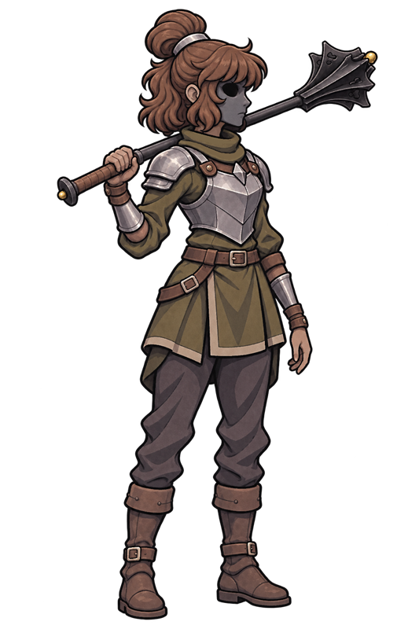
*Imagen base de Noelle.*

### Evanora

**Rol:** Maga miembro del equipo de héroes reencarnados.

**Función jugable:** Controlada por el jugador durante combate.

**Función narrativa:** Entropía del grupo, debido a su amnesia, fuerte poder pero complejidad débil, actúa como una fuente de conflicto y energía constante.

**Descripción física:** 1.62 m de estatura. Su tez es pálida, acentuada por una mirada calculadora, distante y gélida. Destaca su melena ondulada de un matiz lavanda oscuro, entrelazada con destellos magenta extremadamente vibrantes.

Porta un atuendo heterogéneo: la túnica azul clásica de una academia mágica, abierta sobre un uniforme estudiantil compuesto por blusa blanca, chaleco rosado, falda corta en tono púrpura y botas oscuras que se extienden hasta el muslo. Acompaña su figura sosteniendo firmemente su báculo de maga.

**Personalidad:** 

**Motivaciones:** Su equipo es su motivación, la única cosa que conoce en debido a su amnesia.

**Objetivos:** 
- Recuperar su memoria.
- Traer paz a las Llanuras Centrales.
- Proteger a su equipo.

**Conflicto:** Su personalidad es poco constante y cambiante, su estado mental frágil debido a que poco a poco recupera sus recuerdos.

**Relaciones:** Aunque era amiga de la arquera y la clérigo en su anterior vida, al reencarnar la amnesia le hace creer que sus amigas son completas extrañas, mucho menos hablar del caballero, el cual ni siquiera la conoce.

**Arco del personaje:** Recupera sus memorias pero descubre que la persona que solía ser y quien es ahora son fundamentalmente distintas, deberá elegir que lado de ella conservar y cual dejar atrás.

**Habilidades:** Dominio de las artes arcanas por naturaleza, tiene una conexión sobrenatural con el mundo arcano y las extrañas energías del mundo.
Utiliza esta conexión para conjurar poderosos hechizos para arrasar con los enemigos más fuertes.
- **Orbe Arcano:** ataque de energía mágica pura (100 % del daño). Solo desde la retaguardia (P3–P4); alcanza las cuatro posiciones enemigas. Sin recarga.
- **Llamarada:** energía mágica convertida en fuego sobrenatural (85 % del daño) que aplica Quemadura de 2 de daño durante 2 turnos. Alcanza las posiciones enemigas P3–P4. Recarga: 1 turno.
- **Ruptura Ígnea:** golpe arcano (100 % del daño); contra un enemigo con Quemadura causa 150 % y consume la Quemadura. Se usa desde P3–P4 y alcanza P1–P4. Recarga: 2 turnos.
- **Golpe de Meteorito:** conjuración poderosa y agotadora que impacta a **todos** los enemigos (100 % a cada uno) y puede aplicar Quemadura (50 % de probabilidad). Solo puede usarse desde la ronda 3. Recarga: 3 turnos.

**Debilidades:**
Su amnesia la hace un personaje inconstante y dispuesta a cambios.
Su cuerpo es débil y frágil, presentando debilidad ante prácticamente cualquier daño y físico.

**Referencias visuales:**

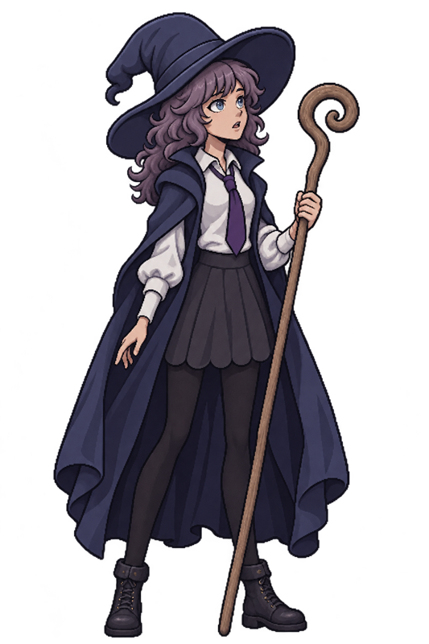
*Imagen base de Evanora.*

### Elaina

**Rol:** 

**Función jugable:** Arquera especializada en ataques a distancia, identificación de objetivos prioritarios y movilidad dentro de la formación

Su función principal es causar daño a enemigos individuales mediante disparos precisos, aplicar marcas que aumentan el daño recibido por los objetivos y utilizar habilidades de reposicionamiento para mantenerse fuera del alcance de los enemigos.

También puede aprovechar las corrientes de viento para potenciar sus flechas y atravesar parcialmente las defensas enemigas.

**Función narrativa:** Elaina representa la perspectiva de una humana que ha sido trasladada a un mundo desconocido, donde las condiciones de su llegada le impidieron conservar su cuerpo original y provocaron que adquiriera la apariencia de una joven elfa.

A través de sus experiencias, el jugador descubre las costumbres, los peligros y las diferencias entre las razas que habitan este mundo.

Su comportamiento contrasta con el de los elfos nativos, ya que conserva recuerdos, emociones y una mentalidad humana que influyen en su manera de interpretar su entorno.

**Descripción física:** Joven de rasgos élficos y contextura esbelta. De mirada expresiva y constante gesto de asombro o ligera incertidumbre, evidencia poca experiencia en el combate real. Su rostro infantil se complementa con orejas largas y puntiagudas, un peinado de cabello corto y claro con una pequeña trenza lateral ajustada por un broche o símbolo geométrico.

Su atuendo es una mezcla funcional de ropa ligera y protecciones improvisadas: viste una túnica de tela suave con bordes desgastados de piel, complementada por un cuello protector verde abotonado al frente. Sobre el hombro lleva una pieza de armadura acolchada con remiendos y costuras visibles, sujetada por un tahalí o correa de cuero ajustada al pecho con una hebilla metálica. Los antebrazos y muslos presentan vendas de soporte, proyectando la imagen de una recluta o aventurera novata que ha tenido que adaptar y reparar sus propias prendas para adentrarse en los caminos.

**Personalidad:** 
- Expresiva: Manifiesta abiertamente sus emociones, especialmente el asombro, la incertidumbre y la curiosidad.
- Inexperta: Aunque posee talento natural, todavía desconoce muchos peligros del mundo y carece de experiencia en situaciones de combate real.
- Perseverante: A pesar de sus limitaciones y temores, continúa esforzándose por superar los obstáculos que encuentra.

Su perspectiva es diferente a la de los elfos nativos, ya que conserva una mentalidad más cercana a la de su vida anterior.

**Motivaciones:** Elaina desea comprender por qué fue enviada a ese mundo y cuál es la razón por la que tuvo que adoptar un cuerpo élfico.

También busca adaptarse a su nueva existencia sin perder los recuerdos y la identidad que la conectan con su vida anterior.

**Objetivos:**

Objetivo principal: Descubrir las circunstancias de su llegada al nuevo mundo y comprender su transformación en elfa.

Objetivos secundarios:

- Aprender a desenvolverse con su nuevo cuerpo.
- Comprender las características y capacidades de la raza élfica.
- Desarrollar sus habilidades como arquera.
- Descubrir si existe alguna posibilidad de regresar a su mundo de origen.
- Construir relaciones de confianza con sus compañeros de aventura.

**Conflicto:**
Conflicto interno: Elaina enfrenta una crisis de identidad al encontrarse en un cuerpo perteneciente a una raza diferente de la suya. Aunque conserva su conciencia y recuerdos humanos, debe acostumbrarse a una apariencia y capacidades que desconoce.

Conflicto externo: Su desconocimiento del mundo y de las costumbres élficas dificulta su adaptación. Además, debe enfrentarse a los peligros de un entorno donde su inexperiencia puede poner en riesgo su vida y la de sus compañeros.

**Relaciones:** Amiga de Noelle (clérigo) y Evanora (maga) en su vida anterior.

**Arco del personaje:**
Inicio: Elaina despierta en un mundo desconocido dentro de un cuerpo élfico. Se siente confundida por su transformación y desconoce las circunstancias que la llevaron hasta allí.

Desarrollo: Durante sus aventuras, comienza a comprender las capacidades de su nuevo cuerpo y a desarrollar sus habilidades como arquera. Al mismo tiempo, descubre las diferencias entre su antigua vida humana y la sociedad élfica.

Clímax: Elaina debe enfrentarse a una situación que pone a prueba su identidad y la obliga a decidir qué significa realmente pertenecer a ese mundo.

Resolución: Aprende a aceptar su nueva existencia sin renunciar a los recuerdos y experiencias que formaron su identidad humana. Su transformación deja de representar únicamente una pérdida y se convierte en parte de su crecimiento personal.

**Habilidades:**
- **Disparo Certero:** disparo básico (100 % del daño) que ignora el 50 % de la evasión del objetivo. Se usa desde P2, P3 o P4 y alcanza las cuatro posiciones enemigas. Sin recarga.
- **Flecha Perforante:** disparo de alta potencia (110 % del daño) impulsado por el viento que ignora el 50 % de la protección del objetivo. Recarga: 2 turnos.
- **Marca del Cazador:** marca a un enemigo durante 3 turnos; su siguiente ataque directo recibido causa ×2 de daño (la marca se consume aunque el ataque falle). Recarga: 2 turnos.
- **Tiro Evasivo:** disparo (80 % del daño) mientras retrocede una posición y gana +15 % de evasión hasta su siguiente turno. Se usa desde P2 o P3. Recarga: 1 turno.

**Debilidades:**
- Al ser reencarnada en un cuerpo élfico, Elaina carece de la fuerza física y resistencia que poseía en su forma humana. Esto la hace más vulnerable a ataques físicos y le dificulta realizar tareas que requieren fuerza bruta.
-
**Referencias visuales:**

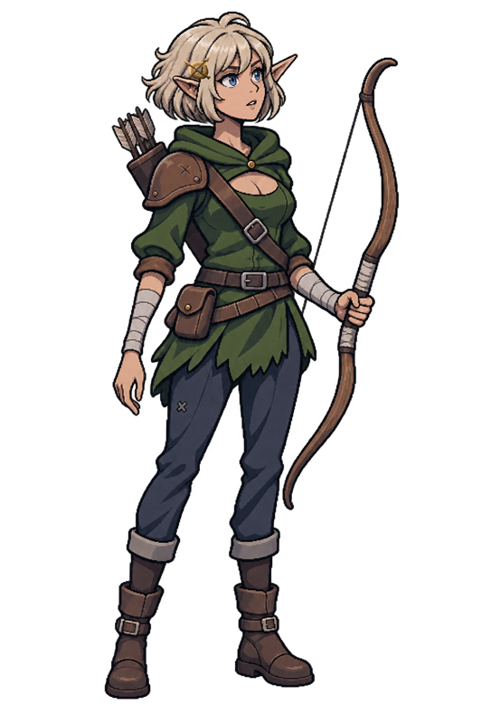
*Imagen base de Elaina.*

### Antagonista

### Capitán de las Fuerzas Expedicionarias

**Rol:** Antagonista principal, líder de las fuerzas del rey demonio.

**Función jugable:** Jefe final de la demo. Se enfrenta en el Trono Sellado después de completar C1 y C2. No es un personaje controlado por el jugador.

**Función narrativa:** Jefe militar del rey demonio, encargado de liderar las fuerzas invasoras y mantener el control sobre los territorios conquistados. Su presencia representa la amenaza constante que enfrenta el grupo de héroes reencarnados. Jefe final del alcance de la demo.

**Descripción física:** Cabeza esquelética con un traje militar oscura, inspirado en las fuerzas expedicionarias británicas de la Primera Guerra Mundial. Gorra de oficial con googles de aviador, bufanda verde y guantes de cuero. Su ojo izquierdo esta vendado por completo, mientras que ojo derecho esta vacío excepto por una púpila espectral de color rojo neón. Su cuerpo es delgado y alto, con una postura rígida y militar. Porta un sable ceremonial. En su hombro derecho porta una pieza de armadura metálica, mismo material plateado que cubre su pecho y parte de su espalda.

**Personalidad:** Frío, extremadamente cínico y calculador. Su lealtad al rey demonio es absoluta, y su objetivo principal es cumplir con las órdenes de su señor: Obtener información y debilitar los asentamientos humanos de las Llanuras Centrales para facilitar la invasión del Rey Demonio.

**Motivaciones:** Lealtad al rey demonio y deseo de cumplir con su deber militar. Busca demostrar su valía como líder y estratega, asegurando la victoria de las fuerzas del rey demonio en la guerra.

**Objetivos:** 
- Obtener información sobre los héroes reencarnados y sus habilidades para anticipar sus movimientos y estrategias.
- Debilitar los asentamientos humanos de las Llanuras Centrales mediante ataques estratégicos y sabotajes.
- Asegurar la victoria de las fuerzas del rey demonio en la guerra, consolidando su posición como líder militar y ganando reconocimiento ante su señor.

**Conflicto:**
- Los héroes reencarnados son entidades completamente ajenas al mundo y la guerra. Siendo completamente impredecibles ante los ojos de un estratega militar cuya experiencia se basa en la guerra actual.
- La naturaleza sobrenatural de los héroes reencarnados hace que sus acciones sean impredecibles y que sus motivaciones no sean comprensibles para un soldado común.
- Los rumores de que los héroes estan siendo guíados por una deidad desconocida generan desconfianza y temor entre las fuerzas del rey demonio, lo que complica la planificación y ejecución de sus estrategias.

**Relaciones:**
- Su relación con el rey demonio es de subordinación absoluta, cumpliendo sus órdenes sin cuestionarlas y buscando siempre la aprobación de su señor.
- Su relación con los héroes reencarnados es de antagonismo, viéndolos como una amenaza directa a los planes del rey demonio y buscando constantemente formas de derrotarlos y obtener información sobre ellos.
- Su relación con sus subordinados es de respeto y autoridad, esperando lealtad y disciplina.

**Arco del personaje:**
Comienza como una figura mística para los héroes reencarnados. Al final de la demo, en el Trono Sellado de la Corrupción del Bosque, se revela como antagonista tangible y el obstáculo más difícil del recorrido.

**Habilidades:**
Seis habilidades repartidas en dos fases (ver [[03 - Enemigos y NPC]]):
- **Sablazo de Campaña:** ataque físico básico (100 % del daño).
- **Interrogatorio Implacable:** golpe (80 % del daño) que reduce el daño del objetivo un 15 % durante 2 turnos. Recarga: 2.
- **Objetivo Prioritario:** golpe (70 % del daño) que marca a un protagonista: el siguiente ataque directo del Capitán contra él causa +35 % de daño. Recarga: 3.
- **Disciplina de Hierro:** gana +15 % de protección durante 2 turnos. Recarga: 3.
- **Fuego de Supresión:** ataque de área anunciado que golpea al siguiente turno a la primera línea (P1–P2) o a la retaguardia (P3–P4). Recarga: 4.
- **Última Orden** (solo en «Última resistencia», al bajar del 50 % de vida): ataque inmediato a todos los protagonistas (60 % del daño) que reduce su daño un 10 % durante 1 turno. Recarga: 4.

Estadísticas: 120 HP, daño 5–8, protección 10 %, evasión 5 %, velocidad 6, crítico 8 %. Es inmune al aturdimiento y lo acompaña un Corrupto Errante.

**Debilidades:**
Su ataque más peligroso se anuncia un turno antes, por lo que se puede esquivar recolocando a los héroes. Al caer, el enemigo restante huye del campo.

**Frases o tono de diálogo:**
- "Tú dios no es más que un mito, y yo soy la prueba de ello."
- "No hay lugar para la misericordia en la guerra, solo para la victoria."
- "La muerte es lo único que los espera."
- "Jamás pondrás un dedo sobre mi señor, y si lo haces, pagarás con tu vida."
### Personajes secundarios

Los personajes secundarios y los NPC quedaron descartados como características del proyecto. No hay una lista pendiente para una versión posterior. La decisión está registrada en [[01 - Alcance]].

---

# Diálogos y Narrativa

## Métodos narrativos

- **Diálogo** (escenas tipo novela visual): retratos de los personajes, placa de nombre y cuadro de texto con efecto de escritura y sonido. Se avanza con ESPACIO.
- **Narración** (introducción): once escenas ilustradas con voz en off de un narrador y de Dios, subtítulos etiquetados y efectos de sonido.
- **Epílogo** (tras vencer al capitán): diálogo breve en el Trono Sellado con narración, donde los héroes constatan que la corrupción se desvanece, que las fuerzas enemigas huyen a la Forja de Combustión y que la guerra contra el Rey Demonio continúa; no muestra al capitán ni su derrota.
- **Texto de tutorial:** líneas sin personaje en el mismo cuadro de diálogo y tarjetas guiadas durante los tutoriales.
- **Audio:** diez locuciones, ocho efectos de la introducción, música de menú y de la introducción, y pistas narrativas ligadas a Valdoria, al primer encuentro y al Santuario Velado.

## Estructura de diálogo

### Introducción cinematográfica

**Participantes:** Narrador y Dios.

**Objetivo de la conversación:** presentar el accidente de la noche lluviosa y la segunda oportunidad.

**Contexto:** a las cuatro de la madrugada Martín (Valerian) sale de treinta y cuatro horas de trabajo; Elaina, Noelle y Evanora, tres amigas que no lo conocen, regresan a casa; un vehículo pierde el control y las cuatro vidas se cruzan. Dios les ofrece cambiar su destino en un mundo, Aethel, amenazado por el Rey Demonio. Despiertan con cuerpos nuevos: Elaina como elfa, Noelle sin recuerdos y tras una máscara, Evanora entre magia y Valerian solo queriendo descansar.

**Opciones del jugador:** omitir la introducción.

**Consecuencias:** al terminar u omitirse comienza el diálogo del Altar.

### El Altar de los Invocados (primer diálogo)

**Participantes:** Elaina, Evanora, Noelle, Valerian y Dios.

**Objetivo de la conversación:** que los héroes asimilen su situación y reciban la misión: encontrar al cobrador desaparecido del Campamento del Alba.

**Contexto:** el Altar de los Invocados; Elaina descubre sus orejas, Evanora siente la magia, Noelle apenas habla y Valerian protesta por trabajar «los domingos».

**Opciones del jugador:** ninguna; solo avanzar.

**Consecuencias:** tras el diálogo, dos líneas de tutorial dan paso al primer combate (P1: «Un mal día para cobrar») con tutorial guiado.

### La máscara rota (evento)

**Participantes:** Noelle, Evanora, Elaina y Valerian (con líneas de narración).

**Objetivo de la conversación:** mostrar cómo Noelle empieza a confiar en el equipo y a despertar su fe.

**Contexto:** un santuario olvidado cubierto de vegetación; Noelle recuerda una calle mojada y una mano extendida; Valerian la tranquiliza («Todos tenemos miedo. Lo importante es qué hacemos a pesar de eso»); la máscara se agrieta con sonido y una luz sagrada la rodea.

**Opciones del jugador:** el mapa pide confirmar el evento o regresar antes de abrirlo.

**Consecuencias:** Noelle cambia sus cuatro habilidades por las divinas, su retrato y su sprite pasan a la versión sin máscara, se entrega el Fragmento de la Máscara y se abre B2. No da experiencia ni Coronas.

### El informe del último vigía (evento)

**Participantes:** Oficial de la ciudad, Elaina, Evanora, Noelle y Valerian.

**Objetivo de la conversación:** revelar quién dirige los ataques y dónde está.

**Contexto:** los informes del Refugio del Vigía llegan a Valdoria. El responsable es el Capitán de las Fuerzas Expedicionarias, localizado en el Trono Sellado, rodeado de criaturas corrompidas.

**Opciones del jugador:** ninguna; solo avanzar.

**Consecuencias:** se entrega el Broche del Vigía, el capitán queda descubierto y se abre C1. No da experiencia ni Coronas.

### Tutoriales

Las tarjetas del tutorial de combate y del tutorial del mapa son texto instructivo breve, en segunda persona, con tono amable y directo («Haz clic en el botón Tienda para abrirla»). No tienen ramificaciones.

## Tono

- **Lenguaje:** español neutro, frases cortas, sin tecnicismos de juego en los diálogos.
- **Humor:** seco y cansado en Valerian («¿Aquí también se trabaja los domingos?»), curioso y asombrado en Elaina, reservado y tímido en Noelle enmascarada, expresivo y seguro en Noelle sin máscara.
- **Formalidad:** el oficial de Valdoria y la voz de Dios hablan con formalidad; los héroes hablan entre sí con confianza creciente.
- **Vocabulario:** términos del GDD escritos siempre igual (ver [[01 - Glosario]]): Llanuras Centrales, Aethel, Trono Sellado, Capitán de las Fuerzas Expedicionarias.

## Decisiones narrativas

| Decisión | Opciones | Consecuencia |
| --- | --- | --- |
| Omitir la introducción | Ver completa u omitir | Ninguna en la historia; llega igual al Altar |
| Abrir La máscara rota | Confirmar o regresar al mapa | Sin confirmar, B2 sigue bloqueado |

La historia de la demo es lineal: no hay ramas ni finales alternativos.

## Localización

¿El juego tendrá diferentes idiomas?

Idiomas previstos: **Español**. Los textos están en los datos de diálogo y en la interfaz, sin sistema de traducción.

---

# Sección 04 - Contenido

# Estructura del Contenido

## Estructura

```Reencarnación Express
Reencarnación Express
│
└── Mundo: Aethel
    │
    ├── Capítulo 1: Llanuras Centrales
    │   ├── Campamento del Alba
    │   │   ├── P1: Dos goblins comunes
    │   │   └── P2: Goblin común y arquero
    │   └── Ruinas de Liria
    │       ├── P3: Dos goblins comunes y arquero
    │       └── P4: Goblin bruto, común y arquero
    │
    ├── Capítulo 2: Bosque Oscuro
    │   ├── Claro del Susurro
    │   │   └── B1: Tres lobos salvajes y chamán
    │   ├── Santuario Velado
    │   │   └── Evento: La máscara rota
    │   │       └── Transformación divina de Noelle
    │   └── Sendero Sombrío
    │       ├── B2: Dos bandidos, lobo y chamán
    │       └── B3: Guardián forestal, dos bandidos y chamán
    │
    ├── Valdoria
    │   └── Evento: El informe del último vigía
    │       └── Revela al capitán y abre Corrupción
    │
    ├── Capítulo 3: Corrupción del Bosque
    │   └── Tierras Marchitas
    │       ├── C1: Dos corruptos errantes, acechador y hechicero
    │       └── C2: Guardián corrupto (ocupa dos posiciones), acechador y hechicero
    │
    └── Jefe final
        └── Capitán de las fuerzas expedicionarias
            ├── Enfrentamiento final
            └── Purificación del bosque
```

## Cantidad estimada

| Tipo                 | Cantidad |
| -------------------- | -------: |
| Mundos               |        1 |
| Zonas jugables       |        3 |
| Niveles / encuentros |        9 |
| Enemigos             | 11 tipos |
| Jefes                |        1 |
| NPC                  |        0 |
| Objetos              |        2 |

## Dependencias

¿Qué contenido debe existir antes de otro?

El contenido de Reencarnación Express sigue una progresión principalmente lineal. Para acceder a determinados encuentros o eventos, el jugador debe haber completado previamente otros desafíos.
### Dependencias entre regiones

**Llanuras Centrales → Bosque Oscuro**

El jugador debe completar P1, P2, P3 y P4 para desbloquear Bosque.

**Bosque  Oscuro→ Corrupción del Bosque**

El jugador debe completar los encuentros de Bosque, el evento obligatorio de Noelle y El informe del último vigía (Valdoria) para desbloquear Corrupción.

**Corrupción del Bosque → Jefe final**

El jugador debe completar C1 y C2 para enfrentar al capitán, jefe final de la demo.
### Dependencias narrativas

El evento La máscara rota solo puede activarse después de completar B1.

Su realización es obligatoria para continuar hacia B2. Noelle intercambia sus cuatro habilidades enmascaradas por cuatro habilidades divinas. Las anteriores dejan de estar disponibles.

La transformación permanece activa durante el resto de la sesión.

El evento El informe del último vigía solo puede activarse después de completar B3. Su realización es obligatoria para abrir C1: entrega el Broche del Vigía y revela que el capitán espera en el Trono Sellado.
### Dependencias de progresión

Los personajes obtienen experiencia y Coronas al completar encuentros.

Los niveles y recursos obtenidos ayudan al equipo a afrontar las siguientes zonas, cuya dificultad aumenta progresivamente.

Los encuentros ya completados no pueden volver a generar recompensas.

---

# Niveles
## Detalle de los niveles

### Capítulo 1: Llanuras Centrales

**Objetivo principal:**
El capítulo se desarrolla en las Llanuras Centrales de Aethel, donde los asentamientos humanos se encuentran amenazados por el avance de las fuerzas expedicionarias del Rey Demonio.

Después de su muerte y reencarnación, los cuatro protagonistas comienzan a comprender sus nuevas capacidades y el propósito de su llegada a este mundo. Guiados por el jugador, deberán enfrentarse a los peligros de la región mientras aprenden a combatir juntos.

Este capítulo representa el inicio de su adaptación a Aethel y de la formación del equipo.

**Objetivos secundarios:**
- Familiarizarse con las habilidades y características de los cuatro protagonistas.
- Aprender a seleccionar objetivos según su posición y nivel de amenaza.
- Comprender el funcionamiento de los turnos, el daño y la defensa.
- Obtener experiencia y Coronas para fortalecer al equipo y adquirir consumibles.

**Duración estimada:**
Entre 2 y 4 rondas por encuentro. El capítulo contiene cuatro combates, por lo que se estima una duración total de 8 a 16 rondas, sin contar el tiempo de navegación por el mapa.

**Dificultad:**
Baja a media. Funciona como la introducción al sistema de combate, aunque los últimos encuentros requieren mayor atención a la selección de enemigos y al uso de habilidades.

**Mecánicas introducidas:**
- Combate táctico por turnos.
- Orden de actuación basado en velocidad.
- Selección de habilidades y objetivos.
- Posiciones de combate y restricciones de alcance.
- Daño, defensa y puntos de vida.
- Recompensas de experiencia y Coronas.

**Mecánicas utilizadas:**
Uso de habilidades ofensivas y defensivas, tiempos de reutilización, selección estratégica de objetivos, progresión de personajes y recuperación después del combate.

**Enemigos / obstáculos:**
El capítulo cuenta con tres tipos de enemigos:
- Goblin común: enemigo básico especializado en ataques cuerpo a cuerpo.
- Goblin arquero: enemigo capaz de realizar ataques a distancia.
- Goblin bruto: enemigo con mayor resistencia y capacidad ofensiva.
Estos enemigos aparecen en diferentes combinaciones durante los cuatro encuentros de la región.

**Recompensas:**
- 200 XP en total por completar los cuatro encuentros.
- 100 Coronas en total.
- Experiencia para mejorar los atributos de los protagonistas.
- Desbloqueo de la región Bosque.
- Una reliquia aleatoria con un 75 % de probabilidad por combate (comunes, con alguna rara).

**Puntos de guardado:**
No existen puntos de guardado. El progreso se conserva temporalmente durante la sesión activa, pero se pierde al abandonar la partida o sufrir una derrota total.

**Condición de entrada:**
Iniciar una nueva partida desde el menú principal. Pradera es la primera región disponible.

**Condición de salida:**
Completar los cuatro encuentros de la región (P1, P2, P3 y P4), derrotando a todos los enemigos correspondientes.

**Eventos narrativos:**
No existe actualmente un evento narrativo independiente implementado en esta región. Su función principal es presentar el sistema de combate y establecer el inicio del recorrido.

**Mapa / diagrama:**
```text
INICIO DE PARTIDA
       |
       v
    PRADERA
       |
       v

    P1 → P2
       |
       v

    P3 → P4
       |
       v
Bosque desbloqueado
```

### Capítulo 2: Bosque Oscuro

**Contexto narrativo:**
Tras superar los peligros de las Llanuras Centrales, los protagonistas se adentran en el Bosque Oscuro, situado al este de la región humana.

Según la historia, este bosque alberga un puesto de avanzada de las fuerzas expedicionarias del Rey Demonio. Los protagonistas deben avanzar por el territorio para debilitar esa presencia enemiga y proteger los asentamientos cercanos.

Durante el recorrido ocurre La máscara rota, un acontecimiento que marca el desarrollo personal de Noelle. Al comenzar a superar sus inseguridades y fortalecer su confianza en el jugador y sus compañeros, logra despertar sus poderes divinos.

En términos jugables, su transformación sustituye sus cuatro habilidades anteriores sin modificar su nivel ni sus estadísticas.

**Objetivos secundarios:**
- Enfrentarse a enemigos con mayor velocidad y nuevas habilidades.
- Aprender a contrarrestar efectos de estado como el veneno y el debilitamiento.
- Priorizar enemigos de apoyo que pueden curar o fortalecer a sus aliados.
- Aprovechar las habilidades de protección y curación.
- Adaptarse al intercambio de habilidades de Noelle después de su transformación.

**Duración estimada:**
Entre 4 y 6 rondas por encuentro. El capítulo contiene tres combates, por lo que se estima una duración total de 12 a 18 rondas, más el tiempo dedicado al evento narrativo.

**Dificultad:**
Media-alta a alta. Los enfrentamientos presentan enemigos con comportamientos más estratégicos y requieren mayor atención a las habilidades, posiciones y estados del equipo.

**Mecánicas introducidas:**
- Enemigos con habilidades de apoyo y curación.
- Mayor presencia de efectos de estado.
- Enemigos capaces de fortalecer su defensa.
- Evento narrativo obligatorio.
- Intercambio de habilidades de Noelle.

**Mecánicas utilizadas:**
Combate táctico, protección de aliados, habilidades curativas, efectos positivos y negativos, administración de cooldowns, uso de consumibles y selección de objetivos prioritarios.

**Enemigos / obstáculos:**
El capítulo cuenta con cuatro tipos de enemigos:
- Lobo salvaje: enemigo veloz con ataques físicos y posibilidad de aplicar veneno.
- Bandido: enemigo ofensivo que puede debilitar a los protagonistas.
- Chamán del bosque: enemigo de apoyo capaz de curar aliados y aplicar efectos negativos.
- Guardián forestal: enemigo resistente que puede aumentar su defensa.

La región también presenta un obstáculo de progresión: el jugador debe completar el evento de Noelle antes de acceder a los últimos encuentros.

**Recompensas:**
- 300 XP en total por los tres encuentros.
- 120 Coronas en total. 
- Intercambio de habilidades de Noelle mediante el evento La máscara rota.
- Desbloqueo de Corrupción.
- Una reliquia aleatoria con un 90 % de probabilidad por combate (comunes o raras).
El evento de Noelle no entrega experiencia ni Coronas adicionales.

**Puntos de guardado:**
No existen puntos de guardado permanentes. Los encuentros completados, la transformación de Noelle y los recursos obtenidos permanecen registrados únicamente durante la sesión activa.

**Condición de entrada:**
Haber completado los cuatro encuentros de Pradera.

**Condición de salida:**
Derrotar a los enemigos de B1, completar La máscara rota y superar B2 y B3.

**Eventos narrativos:**
**La máscara rota:** evento obligatorio disponible después del primer combate de Bosque. El jugador accede al Santuario Velado, donde Noelle intercambia sus cuatro habilidades enmascaradas por las cuatro divinas.

Este cambio permanece durante el resto de la partida y permite continuar hacia el siguiente encuentro.

**Mapa / diagrama:**
```text
Bosque desbloqueado
        |
        v

        B1
        |
        v
   Santuario Velado
   LA MÁSCARA ROTA
        |
        v

      B2 → B3
        |
        v
Corrupción desbloqueada
```

### Capítulo 3: Corrupción del Bosque

**Contexto narrativo:**
El capítulo transcurre en una sección del Bosque Oscuro que ha sido corrompida por la influencia de las fuerzas del Rey Demonio.

La corrupción ha convertido parte del bosque en un territorio más peligroso, donde los protagonistas deben enfrentarse a criaturas de mayor resistencia y poder ofensivo.

Esta región representa la última etapa de los encuentros normales. Los protagonistas deben superar C1 y C2 para enfrentar al capitán de las fuerzas expedicionarias, jefe final de la demo. Su derrota pone fin a la amenaza inmediata sobre las Llanuras Centrales y purifica el bosque.

**Objetivos secundarios:**
- Identificar y eliminar enemigos prioritarios.
- Contrarrestar efectos negativos de mayor peligro.
- Proteger a los personajes más vulnerables.
- Utilizar estratégicamente las habilidades divinas de Noelle.
- Administrar consumibles y curaciones para mantener vivo al equipo.  
- Prepararse para el enfrentamiento contra el capitán, jefe final de la demo.

**Duración estimada:**
Entre 5 y 7 rondas por encuentro como objetivo de balance. El capítulo contiene dos combates, por lo que se estima una duración total de 10 a 14 rondas.

La duración real puede variar según las decisiones del jugador y el comportamiento enemigo.

**Dificultad:**
Alta — Exigente. Es la región de mayor dificultad entre los encuentros normales de la demo.

**Mecánicas introducidas:**
- Combinaciones de enemigos con gran poder ofensivo.
- Mayor presión mediante daño periódico.
- Enemigos con alta resistencia y habilidades defensivas.
- Selección táctica avanzada de objetivos por parte de la IA.

**Mecánicas utilizadas:**
Todas las mecánicas principales aprendidas anteriormente: combate por turnos, posiciones, protección, curación, habilidades ofensivas, estados alterados, administración de cooldowns, consumibles y selección estratégica de objetivos.

**Enemigos / obstáculos:**
El capítulo cuenta con cuatro tipos de enemigos:
- Corrupto errante: enemigo físico capaz de aplicar sangrado.
- Acechador oscuro: enemigo ofensivo de gran velocidad y ataques poderosos.
- Hechicero corrupto: enemigo mágico que utiliza quemaduras y debilitamientos defensivos.
- Guardián corrupto: enemigo de gran resistencia, capaz de fortalecer su defensa y ejecutar ataques de alto daño.

Las diferentes combinaciones enemigas buscan obligar al jugador a administrar sus recursos y tomar decisiones estratégicas.


**Recompensas:**
- 300 XP en total por los dos encuentros.
- 120 Coronas en total.
- Experiencia y progresión adicional para los protagonistas.
- Cumplimiento de los requisitos para acceder al capitán, jefe final de la demo.
- Una reliquia aleatoria con un 100 % de probabilidad por combate (más probable que sea rara).

**Puntos de guardado:**
No existen puntos de guardado. Si el equipo completo es derrotado, termina la sesión y el jugador debe comenzar una nueva partida.

**Condición de entrada:**
Haber completado los tres encuentros de Bosque y los eventos La máscara rota y El informe del último vigía (Valdoria).

**Condición de salida:**
Derrotar a todos los enemigos de C1 y C2.

**Eventos narrativos:**
Esta región no tiene un evento narrativo propio: el informe del último vigía, en Valdoria, la precede y revela dónde está el capitán. Su función es preparar el acceso al capitán, jefe final de la demo.

**Mapa / diagrama:**
```text
Informe de Valdoria (evento)
          |
          v
Corrupción desbloqueada
          |
          v

          |
       C1 → C2
          |
          v
    Trono Sellado
       (Jefe)
```


### Referencias visuales

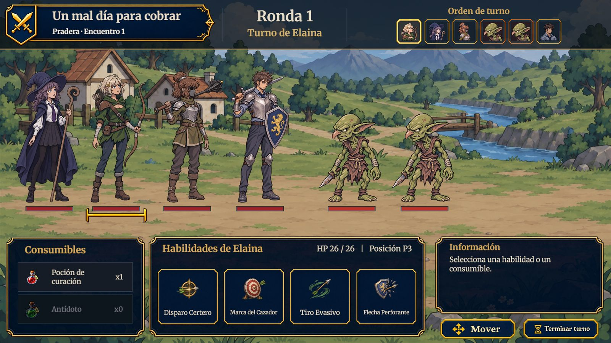
*P1 Un mal día para cobrar (Pradera)*

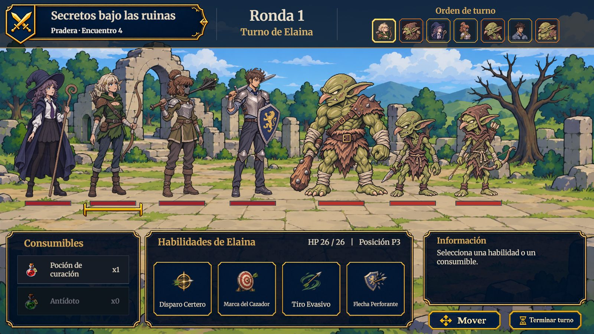
*P4 Secretos bajo las ruinas (Pradera)*

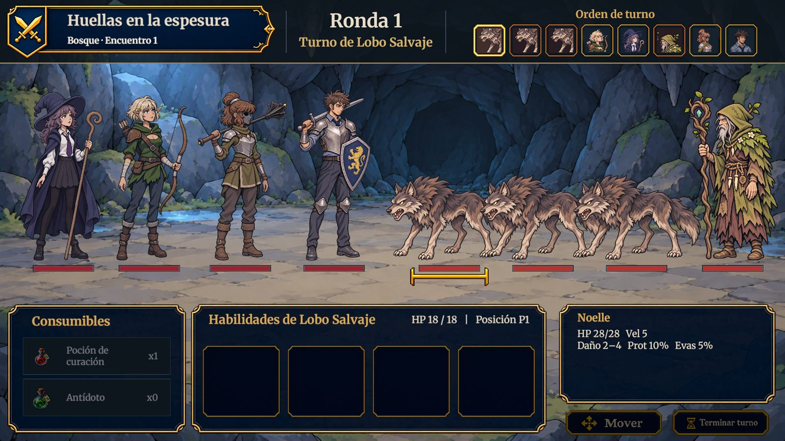
*B1 Huellas en la espesura (Bosque)*

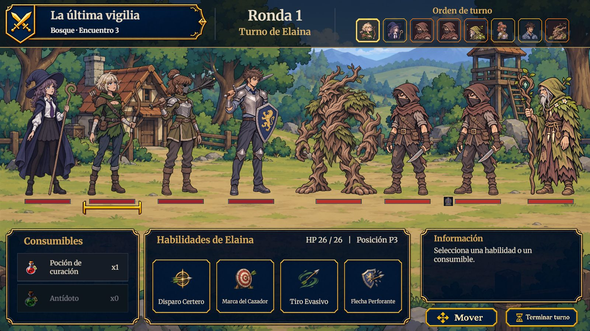
*B3 La última vigilia (Bosque)*

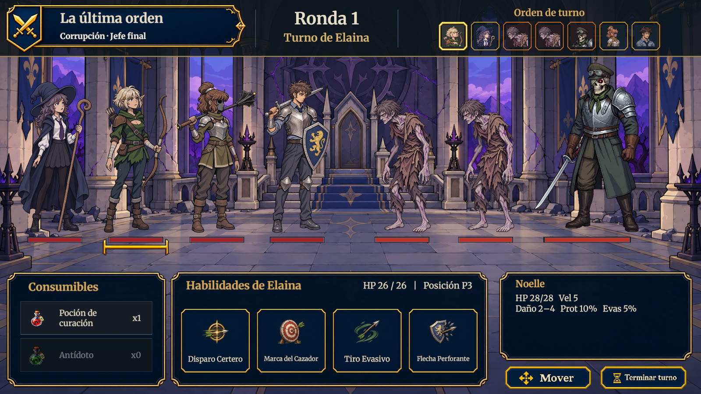
*Jefe final, La última orden: el Capitán con su arte definitivo y dos Corruptos errantes ante el Trono Sellado*

## Criterios de calidad

- El objetivo es comprensible.
- Las reglas se pueden aprender.
- El desafío corresponde al nivel de progresión.
- Existe retroalimentación suficiente.
- El jugador entiende por qué tuvo éxito o fracaso.

---

# Enemigos y NPC

## Cómo leer las estadísticas

- **Vida (HP):** puntos de vida. Un enemigo que llega a 0 es derrotado y desaparece del campo con un efecto de calavera.
- **Daño:** rango de la tirada de un golpe; cada ataque sortea un valor entre el mínimo y el máximo, aplica el porcentaje de la habilidad y suma su daño base. Después se aplican crítico, protección y marcas.
- **Protección:** porcentaje de daño que se descarta (tope de ±50 %). La penetración solo reduce una protección positiva.
- **Evasión:** probabilidad de esquivar un ataque directo (tope de 40 %).
- **Crítico:** probabilidad de que un golpe que acierta cause ×1,5 de daño.
- **Daño periódico:** el Sangrado, la Quemadura y el Veneno de los enemigos usan un porcentaje del daño del golpe que los aplica (Lobo Salvaje, Corrupto Errante y Hechicero Corrupto: 30 %).
- **Posiciones:** cada equipo tiene cuatro posiciones (P1 al frente, P4 al fondo; los enemigos E1 a E4 se leen de izquierda a derecha). Los enemigos pueden atacar a cualquiera de las posiciones de los héroes que su habilidad alcance.

## Relación de los enemigos con la historia

Los enemigos de Reencarnación Express aparecen durante el avance de los protagonistas por las Llanuras Centrales y el Bosque Oscuro, donde se desarrolla el conflicto contra las fuerzas expedicionarias del Rey Demonio.

En Pradera, el equipo se enfrenta a diferentes grupos de goblins mientras aprende a combatir y avanza por los territorios humanos amenazados.

En Bosque, aparecen lobos salvajes, bandidos, chamanes y guardianes forestales. Estos enfrentamientos representan los peligros del territorio en el que operan las fuerzas expedicionarias.

En Corrupción, los protagonistas enfrentan criaturas corruptas que reflejan el deterioro provocado en parte del Bosque Oscuro. Estos enemigos representan una amenaza mayor y preparan al equipo para el enfrentamiento final.

La historia todavía no establece la afiliación individual de todos los tipos de enemigos. Por ello, no se considera automáticamente que cada criatura encontrada sea un miembro directo de las fuerzas del Rey Demonio.

El capitán de las fuerzas expedicionarias es el jefe final de la demo (ficha en el Capítulo 4).

# Capítulo 1: Llanuras Centrales

## Enemigo 01: Goblin común

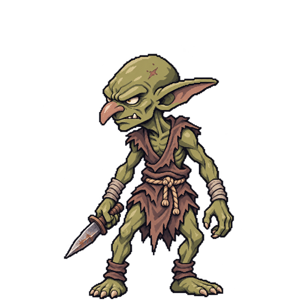
*Sprite actual: Goblin común*


**Rol de combate:**
Atacante cuerpo a cuerpo básico.

**Comportamiento:**
Realiza ataques físicos contra los protagonistas que se encuentran dentro de su alcance. Su inteligencia artificial utiliza principalmente ataques básicos, aunque ocasionalmente puede ejecutar una habilidad más poderosa.

**Vida:** 14 HP.
**Daño:** 3–5 por golpe.
**Protección:** 0 %.
**Evasión:** 3 %.
**Velocidad:** 5.
**Crítico:** 2 % (×1,5).

**Rango de detección:**
No aplica como distancia de exploración. Durante el combate selecciona objetivos válidos según el alcance de sus habilidades.

**Ataques y habilidades:**
- **Garrotazo:** Ataque básico. Sin recarga.
- **Golpe Torpe:** Ataque: +1 de daño base; Debilitamiento (−10 % de daño, 1 turno), 25 % de probabilidad. Recarga: 3 turnos.


**Debilidades:**
Su baja defensa y cantidad de vida lo hacen vulnerable a ataques físicos y mágicos. Su alcance cuerpo a cuerpo también limita los objetivos que puede atacar.

**Recompensa:**
Forma parte de encuentros que entregan 50 XP y 25 Coronas al completarse. No entrega recompensas individuales.

**Estados de IA:**
Evaluar objetivos → Seleccionar ataque disponible → Atacar o reposicionarse → Finalizar turno.

---

## Enemigo 02: Goblin arquero

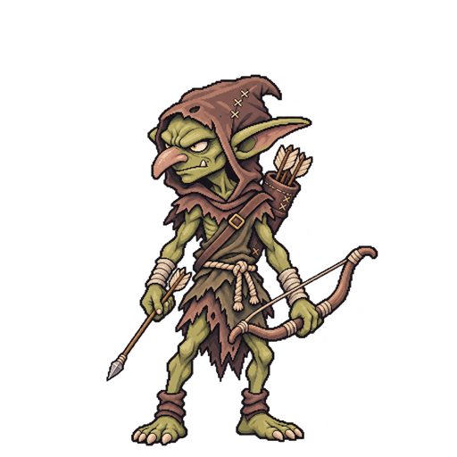
*Sprite actual: Goblin arquero*


**Rol de combate:**
Atacante físico a distancia.

**Comportamiento:**
Utiliza ataques a distancia para dañar a los protagonistas desde posiciones posteriores. Puede atacar a diferentes objetivos según su alcance y aprovechar ataques especiales cuando están disponibles.

**Vida:** 12 HP.
**Daño:** 3–5 por golpe.
**Protección:** 0 %.
**Evasión:** 7 %.
**Velocidad:** 7.
**Crítico:** 4 % (×1,5).

**Rango de detección:**
No aplica como detección en tiempo real. Sus ataques pueden alcanzar distintas posiciones enemigas según las restricciones de sus habilidades.

**Ataques y habilidades:**
- **Disparo Preciso:** Ataque: +1 de daño base; +10 puntos de probabilidad de crítico. Recarga: 3 turnos.
- **Flechazo:** Ataque básico. Sin recarga.


**Debilidades:**
Tiene poca vida y defensa, por lo que puede ser eliminado rápidamente mediante ataques de largo alcance.

**Recompensa:**
Incluida en la recompensa global del encuentro: 50 XP y 25 Coronas.

**Estados de IA:**
Evaluar objetivos → Verificar alcance → Seleccionar disparo → Atacar o reposicionarse → Finalizar turno.

---

## Enemigo 03: Goblin bruto

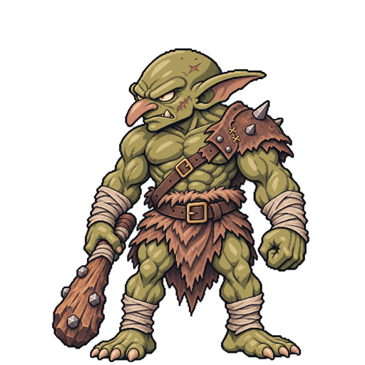
*Sprite actual: Goblin bruto*


**Rol de combate:**
Atacante resistente de primera línea.

**Comportamiento:**
Utiliza ataques físicos potentes y busca presionar a los personajes que se encuentran al frente del equipo. Su resistencia es superior a la de los demás goblins.

**Vida:** 22 HP.
**Daño:** 4–7 por golpe.
**Protección:** 10 %.
**Evasión:** 0 %.
**Velocidad:** 3.
**Crítico:** 3 % (×1,5).

**Rango de detección:**
No aplica como distancia de exploración. Sus ataques son principalmente cuerpo a cuerpo.

**Ataques y habilidades:**
- **Mazazo:** Ataque básico. Sin recarga.
- **Pisotón:** Ataque: +1 de daño base; Debilitamiento (−15 % de daño, 1 turno), 40 % de probabilidad. Recarga: 3 turnos.


**Debilidades:**
Su velocidad reducida permite que varios protagonistas actúen antes que él. Puede ser debilitado mediante efectos negativos y ataques concentrados.

**Recompensa:**
Forma parte de los encuentros de Pradera, que otorgan 50 XP y 25 Coronas por victoria.

**Estados de IA:**
Evaluar objetivos → Seleccionar ataque → Atacar o reposicionarse → Finalizar turno.

---

# Capítulo 2: Bosque Oscuro

## Enemigo 04: Lobo salvaje

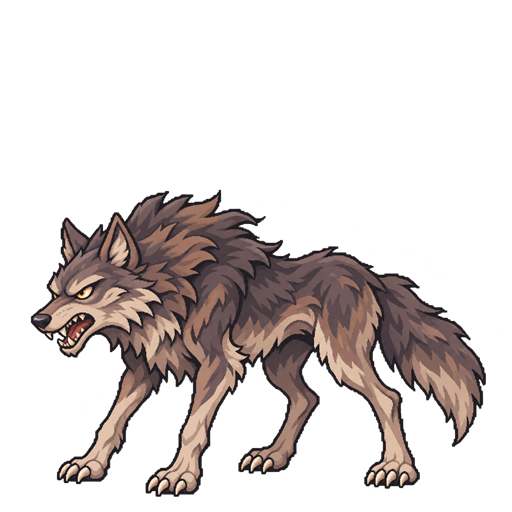
*Sprite actual: Lobo salvaje*


**Rol de combate:**
Atacante rápido de cuerpo a cuerpo.

**Comportamiento:**
Aprovecha su velocidad para atacar y puede concentrar ocasionalmente sus ataques sobre protagonistas debilitados. Sus habilidades pueden provocar daño periódico.

**Vida:** 18 HP.
**Daño:** 4–6 por golpe.
**Protección:** 0 %.
**Evasión:** 12 %.
**Velocidad:** 8.
**Crítico:** 5 % (×1,5).

**Rango de detección:**
No aplica en exploración. Sus habilidades ofensivas tienen alcance cuerpo a cuerpo.

**Ataques y habilidades:**
- **Colmillo Venenoso:** Ataque: Veneno (30 % del daño del golpe por turno, 3 turnos), 50 % de probabilidad. Recarga: 2 turnos.
- **Mordida:** Ataque básico. Sin recarga.


**Debilidades:**
Depende de su alcance cuerpo a cuerpo y puede ser neutralizado mediante protección, control de posiciones y ataques concentrados.

**Recompensa:**
Incluida en los encuentros de Bosque, que entregan 100 XP y 40 Coronas por victoria.

**Estados de IA:**
Evaluar objetivos → Identificar oportunidad → Seleccionar ataque → Atacar o reposicionarse → Finalizar turno.

---

## Enemigo 05: Bandido

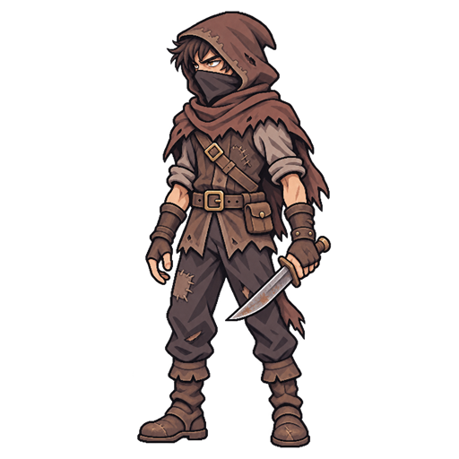
*Sprite actual: Bandido*


**Rol de combate:**
Atacante físico con capacidad de debilitamiento.

**Comportamiento:**
Ataca a los protagonistas y utiliza habilidades que reducen su capacidad ofensiva. Su IA puede priorizar personajes que representen una amenaza estratégica.

**Vida:** 26 HP.
**Daño:** 5–7 por golpe.
**Protección:** 5 %.
**Evasión:** 6 %.
**Velocidad:** 6.
**Crítico:** 4 % (×1,5).

**Rango de detección:**
No aplica como distancia de exploración. Utiliza ataques principalmente cuerpo a cuerpo.

**Ataques y habilidades:**
- **Ataque Sucio:** Ataque: +1 de daño base; Debilitamiento (−20 % de daño, 2 turnos). Recarga: 3 turnos.
- **Cuchillada:** Ataque básico. Sin recarga.


**Debilidades:**
Su dependencia del combate cercano puede limitar sus opciones cuando los objetivos están fuera de alcance. También puede ser afectado por habilidades de debilitamiento y protección.

**Recompensa:**
Incluida en la recompensa del encuentro: 100 XP y 40 Coronas.

**Estados de IA:**
Evaluar amenazas → Seleccionar objetivo → Aplicar ataque o debilitamiento → Finalizar turno.

---

## Enemigo 06: Chamán del bosque

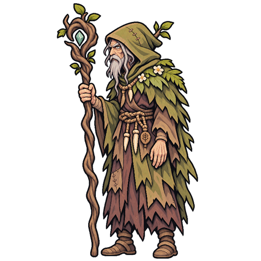
*Sprite actual: Chamán del bosque*


**Rol de combate:**
Unidad de apoyo mágico y curación.

**Comportamiento:**
Analiza el estado de sus aliados para determinar cuándo utilizar habilidades curativas. También puede atacar a distancia o debilitar la defensa de los protagonistas.

**Vida:** 20 HP.
**Daño:** 3–5 por golpe.
**Protección:** 0 %.
**Evasión:** 4 %.
**Velocidad:** 6.
**Crítico:** 3 % (×1,5).

**Rango de detección:**
No aplica en exploración. Utiliza habilidades de ataque y apoyo desde las posiciones permitidas.

**Ataques y habilidades:**
- **Curación Primitiva:** Curación: cura 5 HP. Recarga: 3 turnos.
- **Descarga Natural:** Ataque básico. Sin recarga.
- **Maldición:** Ataque: Vulnerabilidad (−10 % de protección, 2 turnos). Recarga: 3 turnos.


**Debilidades:**
Posee poca vida y defensa. Eliminarlo de manera temprana puede impedir que continúe recuperando a sus aliados o debilitando al equipo.

**Recompensa:**
Forma parte de encuentros que otorgan 100 XP y 40 Coronas.

**Estados de IA:**
Evaluar aliados y enemigos → Priorizar curación o ataque → Seleccionar habilidad válida → Ejecutar acción → Finalizar turno.

---

# Capítulo 3: Corrupción del Bosque

## Enemigo 08: Corrupto errante

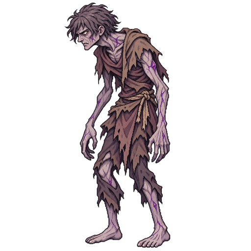
*Sprite actual: Corrupto errante*


**Rol de combate:**
Atacante físico resistente con daño periódico.

**Comportamiento:**
Busca presionar constantemente al equipo mediante ataques físicos y la aplicación de sangrado.

**Vida:** 28 HP.
**Daño:** 5–7 por golpe.
**Protección:** 5 %.
**Evasión:** 4 %.
**Velocidad:** 6.
**Crítico:** 4 % (×1,5).

**Rango de detección:**
No aplica como detección en tiempo real. Sus ataques dependen del alcance establecido en sus habilidades.

**Ataques y habilidades:**
- **Herida Infectada:** Ataque: +1 de daño base; Sangrado (30 % del daño del golpe por turno, 3 turnos). Recarga: 2 turnos.
- **Zarpazo Corrupto:** Ataque básico. Sin recarga.


**Debilidades:**
Puede ser controlado mediante efectos negativos y habilidades que reduzcan su daño. El sangrado aplicado por este enemigo puede eliminarse mediante antídotos.

**Recompensa:**
Forma parte de encuentros que otorgan 150 XP y 60 Coronas por victoria.

**Estados de IA:**
Evaluar objetivos → Identificar oportunidades → Seleccionar ataque → Atacar o reposicionarse → Finalizar turno.

---

## Enemigo 09: Acechador oscuro

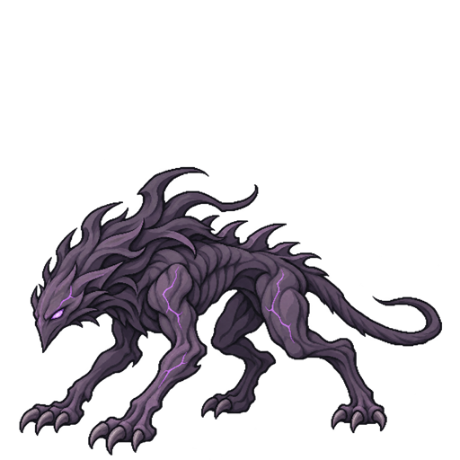
*Sprite actual: Acechador oscuro*


**Rol de combate:**
Atacante rápido de alto daño.

**Comportamiento:**
Prioriza oportunidades ofensivas y puede utilizar ataques poderosos contra protagonistas vulnerables. Representa una amenaza importante por su velocidad y capacidad de daño.

**Vida:** 26 HP.
**Daño:** 6–8 por golpe.
**Protección:** 0 %.
**Evasión:** 12 %.
**Velocidad:** 8.
**Crítico:** 8 % (×1,5).

**Rango de detección:**
No aplica en exploración. Sus ataques pueden alcanzar diferentes posiciones dependiendo de la habilidad.

**Ataques y habilidades:**
- **Ataque Letal:** Ataque: +2 de daño base. Recarga: 3 turnos.
- **Corte Sombrío:** Ataque básico. Sin recarga.


**Debilidades:**
Aunque es veloz y ofensivo, posee menor resistencia que los enemigos defensivos de Corrupción. Puede ser prioritario para habilidades que reduzcan su ataque o permitan eliminarlo rápidamente.

**Recompensa:**
Incluida en la recompensa global del encuentro: 150 XP y 60 Coronas.

**Estados de IA:**
Evaluar vulnerabilidades → Seleccionar objetivo válido → Priorizar ataque ofensivo → Ejecutar acción → Finalizar turno.

---

## Enemigo 10: Hechicero corrupto

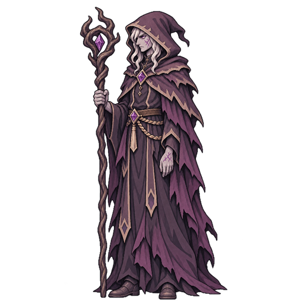
*Sprite actual: Hechicero corrupto*


**Rol de combate:**
Atacante mágico y debilitador.

**Comportamiento:**
Utiliza magia ofensiva y efectos negativos para aumentar el daño que recibe el equipo del jugador. Su inteligencia artificial aprovecha objetivos vulnerables y las oportunidades para aplicar alteraciones de estado.

**Vida:** 25 HP.
**Daño:** 5–7 por golpe.
**Protección:** 0 %.
**Evasión:** 4 %.
**Velocidad:** 7.
**Crítico:** 7 % (×1,5).

**Rango de detección:**
No aplica como detección en tiempo real. Sus habilidades mágicas tienen alcance determinado por las reglas del combate.

**Ataques y habilidades:**
- **Llama Corrupta:** Ataque: +1 de daño base; Quemadura (30 % del daño del golpe por turno, 3 turnos). Recarga: 2 turnos.
- **Maleficio:** Ataque: Vulnerabilidad (−10 % de protección, 2 turnos). Recarga: 3 turnos.
- **Orbe Maldito:** Ataque básico. Sin recarga.


**Debilidades:**
Posee una vida y defensa relativamente bajas. El jugador puede disminuir su impacto mediante ataques prioritarios, protección y habilidades que afecten su capacidad ofensiva.

**Recompensa:**
Forma parte de encuentros que entregan 150 XP y 60 Coronas.

**Estados de IA:**
Evaluar objetivos → Revisar estados activos → Seleccionar ataque o debilitamiento → Ejecutar acción → Finalizar turno.

---

## Enemigo 11: Guardián corrupto

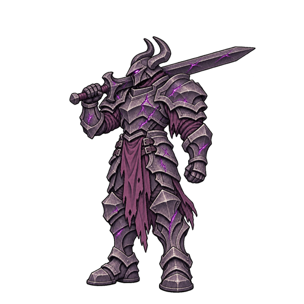
*Sprite actual: Guardián corrupto*


**Rol de combate:**
Defensor de alta resistencia y atacante pesado.

**Comportamiento:**
Utiliza ataques físicos poderosos y habilidades defensivas para prolongar su supervivencia. Su inteligencia artificial decide cuándo fortalecer su defensa y cuándo aprovechar sus ataques de mayor potencia.

**Vida:** 65 HP.
**Daño:** 6–8 por golpe.
**Protección:** 20 %.
**Evasión:** 0 %.
**Velocidad:** 3.
**Crítico:** 6 % (×1,5).
**Tamaño:** ocupa dos posiciones de la formación (ver «Enemigos grandes»).

**Rango de detección:**
No aplica en exploración. Sus ataques son principalmente cuerpo a cuerpo.

**Ataques y habilidades:**
- **Coraza Corrupta:** Apoyo a sí mismo: Protección (+10 %, 2 turnos). Recarga: 3 turnos.
- **Golpe Devastador:** Ataque: +2 de daño base. Recarga: 4 turnos.
- **Impacto Pesado:** Ataque básico. Sin recarga.


**Debilidades:**
Su baja velocidad y dependencia de habilidades defensivas permiten utilizar ataques con penetración de defensa y efectos de vulnerabilidad para reducir su resistencia.

**Recompensa:**
Incluida en la recompensa global del encuentro: 150 XP y 60 Coronas.

**Estados de IA:**
Evaluar amenazas → Revisar protección activa → Seleccionar ataque o defensa → Ejecutar acción → Finalizar turno.


# Capítulo 4: Trono Sellado

## Enemigo 12: Capitán de las Fuerzas Expedicionarias (jefe final)

**Rol de combate:**
Jefe táctico que marca objetivos, debilita al equipo y prepara ataques de área.

**Comportamiento:**
Opera en dos fases. En **Comandante calculador** (100 % de vida) alterna golpes, debilitamientos y marcas. Al bajar al 50 % de vida entra en **Última resistencia**: anuncia el cambio con un aviso en pantalla, desbloquea *Última Orden* y su IA prioriza el ataque, los objetivos marcados y los ataques preparados en lugar de reforzarse. Ocupa dos casillas (E3 y E4) y lo acompañan dos Corruptos Errantes en E1 y E2. Si el Capitán cae, los enemigos restantes huyen del campo y el combate termina en victoria sin recompensas adicionales.

**Vida:** 120 HP.
**Daño:** 5–8 por golpe.
**Protección:** 10 %.
**Evasión:** 5 %.
**Velocidad:** 6.
**Crítico:** 8 % (×1,5).

**Inmunidades:** los jefes son inmunes al aturdimiento.

**Ataques y habilidades:**
- **Disciplina de Hierro:** Apoyo a sí mismo: Protección (+15 %, 2 turnos). Recarga: 3 turnos.
- **Fuego de Supresión:** Ataque a todos los enemigos: se anuncia y golpea en el siguiente turno. Recarga: 4 turnos.
- **Interrogatorio Implacable:** Ataque: 80 % del daño; Debilitamiento (−15 % de daño, 2 turnos). Recarga: 2 turnos.
- **Objetivo Prioritario:** Ataque: 70 % del daño; Objetivo prioritario (+35 % de daño del Capitán, 2 turnos). Recarga: 3 turnos.
- **Sablazo de Campaña:** Ataque básico. Sin recarga.
- **Última Orden:** Ataque a todos los enemigos: 60 % del daño; Debilitamiento (−10 % de daño, 1 turno). Recarga: 4 turnos.

**Debilidades:**
No tiene evasión alta ni protección extrema; su amenaza viene de los estados que impone y del ataque preparado (*Fuego de Supresión*), que se puede esquivar cambiando de posición a los héroes amenazados.

**Recompensa:**
Encuentro final: 200 XP y 100 Coronas.

**Estados de IA:**
Evaluar fase → Revisar marcas y ataque preparado → Seleccionar habilidad → Ejecutar → Finalizar turno.

---

## Enemigos grandes

Un enemigo grande ocupa **dos posiciones** de la formación, como los jefes de *Darkest Dungeon*. Hoy solo lo es el **Guardián Corrupto** (65 HP, la unidad más resistente de la demo):

- Se dibuja centrado entre sus dos posiciones y su barra de vida es más ancha.
- No se mueve, y ninguna otra unidad puede colocarse en su segunda posición; los demás enemigos se reparten el espacio restante.
- Las habilidades de área alcanzan a ambos huecos pero lo golpean una sola vez; las de un solo objetivo lo seleccionan por su posición principal.
- Su encuentro (C2) se diseñó sin Corrupto Errante para dejar su segunda posición libre.

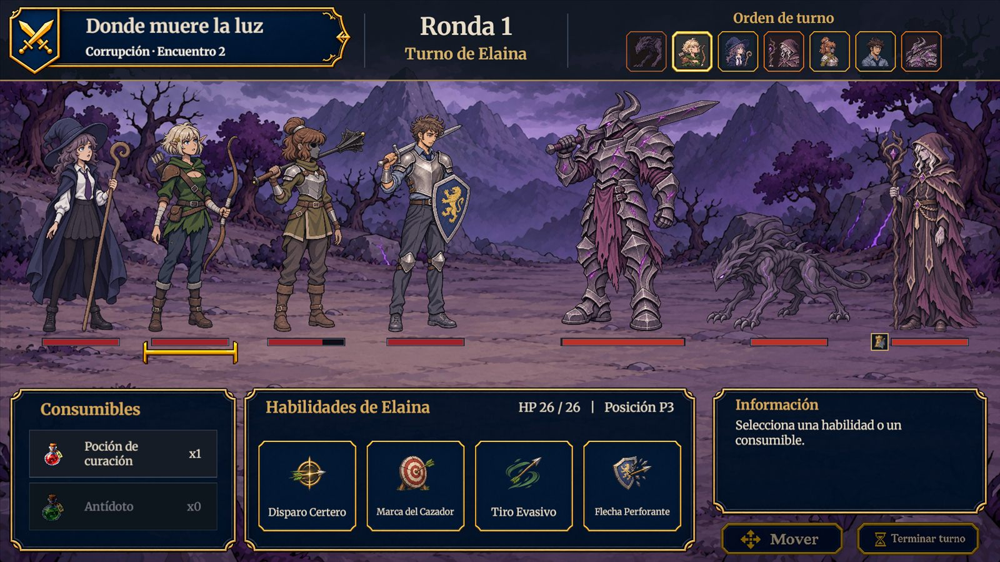
*El Guardián Corrupto ocupa dos posiciones de la formación (Corrupción, encuentro 2)*

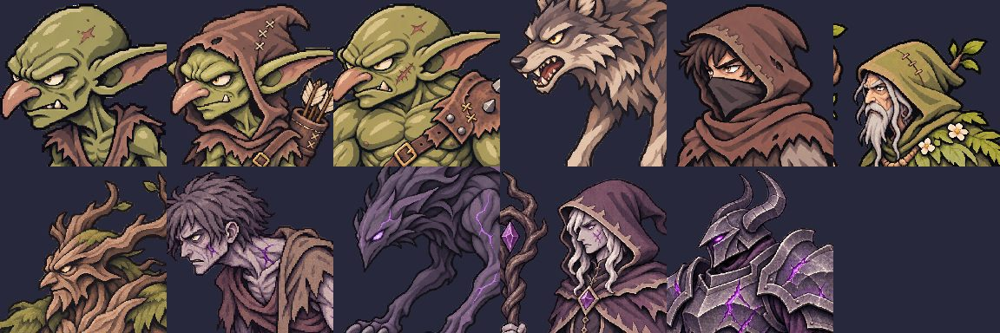
*Retratos de los enemigos usados en la barra de orden de turno*

## Reliquias que portan los enemigos

Para variar los combates normales, al cargar un encuentro cada enemigo tiene un 25 % de portar una reliquia (máximo dos por combate). No ocurre en el jefe, en el prólogo (P1–P4) ni en B1. La lista es corta y excluye las reliquias exclusivas y las que solo tienen sentido para los héroes (consumibles, curación o golpes directos): Amuleto de Corteza, Broche del Vigía, Espina del Juramento, Ídolo del Último Aliento y Reloj de Arena Roto. Sus bonificaciones y desventajas cuentan en las estadísticas del enemigo y su efecto usa las mismas reglas que en los héroes. Un icono pequeño junto a su barra de vida y su ficha de información indican la reliquia que lleva. La reliquia solo existe durante el combate: no se entrega al derrotarlo.

## Composición de los encuentros

| Encuentro | Título | E1 | E2 | E3 | E4 | XP | Coronas |
| --- | --- | --- | --- | --- | --- | --- | --- |
| P1 | Un mal día para cobrar | Goblin común | Goblin común | — | — | 50 | 25 |
| P2 | Flechas en el camino | Goblin común | Goblin arquero | — | — | 50 | 25 |
| P3 | Ecos de Liria | Goblin común | Goblin común | Goblin arquero | — | 50 | 25 |
| P4 | Secretos bajo las ruinas | Goblin bruto | Goblin común | Goblin arquero | — | 50 | 25 |
| B1 | Huellas en la espesura | Lobo salvaje | Lobo salvaje | Lobo salvaje | Chamán | 100 | 40 |
| B2 | Susurros en la oscuridad | Bandido | Bandido | Lobo salvaje | Chamán | 100 | 40 |
| B3 | La última vigilia | Guardián forestal | Bandido | Bandido | Chamán | 100 | 40 |
| C1 | El aliento del Ocaso | Corrupto errante | Corrupto errante | Acechador | Hechicero | 150 | 60 |
| C2 | Donde muere la luz | Guardián corrupto (E1+E2) | — | Acechador | Hechicero | 150 | 60 |
| BOSS | Trono Sellado | Corrupto errante | Corrupto errante | Capitán (E3+E4) | — | 200 | 100 |

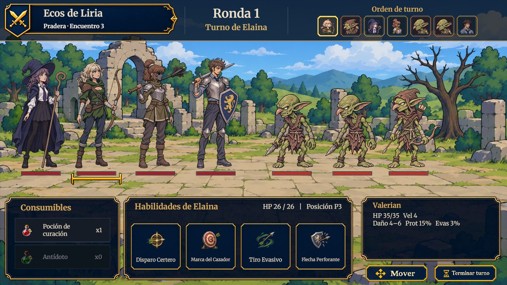
*Encuentro de Pradera con goblins: formación, orden de turno y paneles de información*

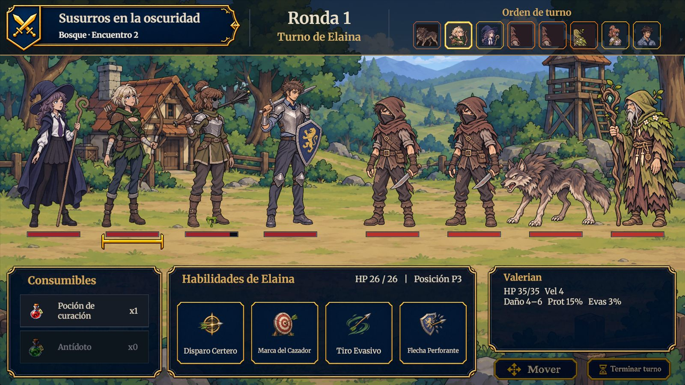
*Encuentro de Bosque: lobo, bandidos y chamán frente a los héroes*

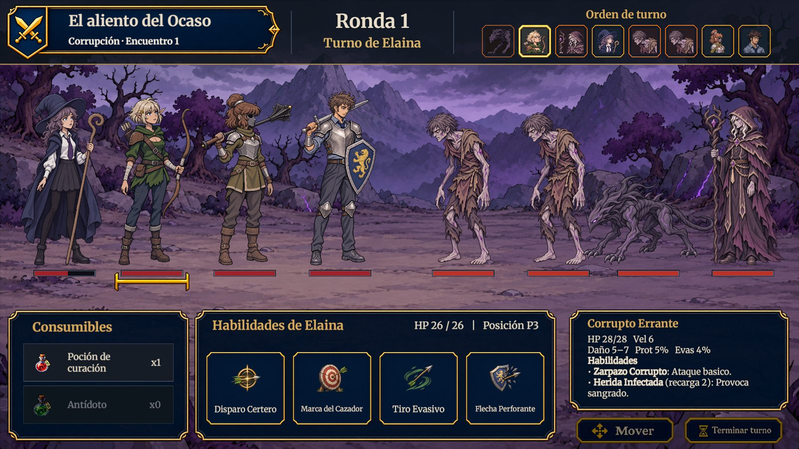
*Encuentro de Corrupción (C1): errantes, acechador y hechicero*

# Funcionamiento general de la inteligencia artificial

A diferencia de los videojuegos con desplazamiento libre, Reencarnación Express no utiliza un sistema de patrullaje, persecución o detección de enemigos en tiempo real.

Los enfrentamientos ocurren dentro de un escenario de combate por turnos, donde los enemigos conocen las unidades participantes y evalúan sus acciones durante el turno correspondiente.

## Diagrama de estados de IA

```text
INICIO DEL TURNO ENEMIGO
           |
           v
   Evaluar estado actual
           |
           v
   Consultar habilidades
       disponibles
           |
           v
   Identificar objetivos
         válidos
           |
           v
   Seleccionar la acción
      más conveniente
           |
       ┌───┴────┐
       |        |
       v        v
   Atacar /   Reposicionarse
   Apoyar      si hace falta
       |        |
       └───┬────┘
           |
           v
     Ejecutar acción
           |
           v
     Finalizar turno
```

---

# Objetos y Coleccionables

## Objeto 01: Poción de curación

**Tipo:**
Consumible de recuperación.

**Descripción:**
Frasco de líquido rojo que permite recuperar vida de un protagonista durante un combate y, además, **levanta a un héroe caído**. Es el recurso de emergencia del equipo cuando las curaciones de Noelle no están disponibles.

**Función:**
Restaura el **30 %** de la vida máxima efectiva (nivel + reliquias) del héroe elegido, redondeado al entero más cercano y con un mínimo de 1 HP. No supera la vida máxima. Si el héroe estaba caído (0 HP), se levanta con esa cantidad de vida.

**Cómo se obtiene:**
- El jugador empieza la partida con una poción.
- Se compra en la tienda del mapa (existencias ilimitadas) por **35 CR**.

**Cómo se utiliza:**
Durante el combate, el jugador abre el panel **Consumibles**, elige la poción y selecciona al aliado: puede hacer clic en su barra de vida o en la imagen del héroe. Usarla consume la acción del turno del personaje que la utiliza.

**Cantidad máxima:**
5 en el inventario.

**Valor:**
Compra: 35 CR. Venta: 18 CR (el 50 % del precio, redondeado).

**Rareza:**
Común.

**Restricciones:**
- Solo se usa en combate; en el mapa el inventario es de consulta.
- No se puede usar sobre un héroe con la vida completa.
- Es el único consumible que levanta a un héroe caído.
- Cuesta la acción del turno.

**Interacciones:**
Se relaciona con los héroes caídos, la Campana del Socorro y las Botas del Mensajero (que reaccionan al uso de consumibles) y con las curaciones de Noelle.

**Representación visual:**
Ícono de un frasco pequeño con líquido rojo. Su cantidad aparece en el panel de consumibles y en el inventario.

---

## Objeto 02: Antídoto

**Tipo:**
Consumible de eliminación de efectos negativos.

**Descripción:**
Contrarresta el daño periódico que producen algunos enemigos.

**Función:**
Elimina **Sangrado, Veneno y Quemadura** del héroe elegido.

**Cómo se obtiene:**
Se compra en la tienda del mapa por **20 CR**. La partida empieza con cero. La tienda tiene **3 unidades** por partida y no las repone.

**Cómo se utiliza:**
En combate, se elige el Antídoto y un héroe vivo que sufra alguno de esos estados. Consume la acción del turno.

**Cantidad máxima:**
5 en el inventario.

**Valor:**
Compra: 20 CR. Venta: 10 CR.

**Restricciones:**
- Solo elimina Sangrado, Veneno y Quemadura; no quita Debilitamiento, Vulnerabilidad ni otros efectos.
- No recupera vida ni levanta héroes caídos.
- Requiere que el objetivo tenga uno de los tres estados.

**Representación visual:**
Ícono de un frasco con líquido verde.

---

## Objeto 03: Reliquias

**Tipo:**
Equipo pasivo.

**Descripción:**
Objetos antiguos que se equipan en la ficha de un personaje. Cada una suma bonificaciones a las estadísticas, casi siempre con una **desventaja**, y muchas añaden un efecto especial que cambia cómo se juega al héroe. Hay reliquias **universales** (las usa cualquiera) y **exclusivas** de un héroe.

**Reglas de equipamiento:**
- Cada héroe tiene **2 casillas** de reliquia.
- Solo se pueden cambiar **fuera de combate**: en la ficha del personaje, arrastrando la reliquia desde el inventario a una casilla (o de vuelta al inventario para quitarla).
- Una unidad concreta solo puede estar en un héroe a la vez, y un héroe no puede llevar dos reliquias del mismo tipo. Dos héroes distintos sí pueden llevar el mismo tipo (una unidad cada uno).
- Las exclusivas solo las equipa su héroe; las que tienen propiedad única no se pueden tener dos veces.
- Las bonificaciones y desventajas se calculan siempre desde lo equipado en ese momento. Daño suma a mínimo y máximo; Protección, Evasión y Crítico son puntos porcentuales. La bonificación de crítico de las reliquias está limitada a +10 puntos en conjunto.
- Cambiar la vida máxima mediante una reliquia no cura: la vida actual solo se recorta si supera el nuevo máximo.

**Cómo se obtienen:**
- **Recompensa de combate (primera victoria de cada encuentro):** una sola tirada por misión. Probabilidad de reliquia: Pradera 75 %, Bosque 90 %, Corrupción 100 %, Jefe 100 %. Rareza: Pradera 75 % comunes y 25 % raras; Bosque 45 % comunes y 55 % raras; Corrupción 20 % y 80 %; el jefe da una rara o una exclusiva disponible. Desde B1 hay un 40 % de que la recompensa sea una exclusiva no poseída; en C2 se garantiza una exclusiva si aún no se consiguió ninguna. Tras dos combates seguidos sin reliquia, el tercero entrega una.
- **Eventos:** «La máscara rota» entrega el Fragmento de la Máscara (Noelle) y «El informe del último vigía» entrega el Broche del Vigía.
- **Tienda:** cuatro espacios, una unidad por espacio (ver Recurso 02).

**Valor:**
Compra: 45–115 CR según la reliquia. Venta: el 50 % del precio de compra (mínimo 1 CR) y solo si no está equipada; las exclusivas y las de evento no se pueden vender.

**Catálogo (20 reliquias: 6 comunes, 6 raras y 8 épicas exclusivas):**

| Reliquia | Rareza | Estadísticas | Efecto | Quién la usa | Cómo se obtiene |
| --- | --- | --- | --- | --- | --- |
| **Amuleto de Corteza Universal** | Común | −1 Velocidad | Cuando recibes daño y quedas por debajo del 50 % de vida, obtienes 10 % de Protección durante 1 turno. Una vez por combate. | Cualquiera | Tienda (45 CR) o recompensa |
| **Anillo del Segundo Intento** | Común | −1 % Protección | Si fallas un ataque directo, tu siguiente ataque directo gana +2 de daño si acierta. Solo una activación por ronda. | Cualquiera | Tienda (45 CR) o recompensa |
| **Botas del Mensajero Universal** | Común | −2 Vida | Después de usar un consumible, el portador obtiene +2 de Velocidad durante sus próximos 2 turnos. | Cualquiera | Tienda (45 CR) o recompensa |
| **Broche del Vigía** | Común | −1 Velocidad | Si terminas tu turno sin causar daño directo, obtienes 15 % de Protección hasta tu siguiente turno. | Cualquiera | Evento «El informe del último vigía», tienda o recompensa |
| **Campana del Socorro Universal** | Común | −1 Daño | La primera curación de cada turno dirigida a un aliado con 50 % o menos de vida restaura 3 HP adicionales. Funciona con habilidades y con consumibles. | Cualquiera | Tienda (45 CR) o recompensa |
| **Colmillo de Lobo Universal** | Común | −3 Vida | El primer ataque directo acertado de cada turno contra un enemigo con Sangrado, Veneno o Quemadura causa 2 puntos de daño adicionales. | Cualquiera | Tienda (50 CR) o recompensa |
| **Dado del Ocaso** | Rara | −1 Velocidad | En tu primer ataque directo que acierte de cada combate, tienes un 50 % de probabilidad de infligir +3 de daño o un 50 % de obtener 15 % de Protección durante 1 turno. | Cualquiera | Tienda (105 CR) o recompensa |
| **Espejo del Dolor Universal** | Rara | −4 Vida | Cuando recibes daño directo, tu siguiente ataque directo acertado inflige +4 de daño. Máximo una vez por ronda; el bono desaparece si no atacas en tu siguiente turno. | Cualquiera | Recompensa de combate |
| **Espina del Juramento** | Rara | −3 Vida | La primera vez que recibes daño directo en cada ronda, el atacante sufre Sangrado de 1 de daño durante 2 turnos. | Cualquiera | Recompensa de combate |
| **Ídolo del Último Aliento Universal** | Rara | −5 Vida | La primera vez que un ataque directo debería derrotarte, sobrevives con 1 HP y después sufres Debilitamiento (−20 % de Ataque) durante 1 turno. Una vez por combate. No protege contra el daño periódico. | Cualquiera | Recompensa de combate |
| **Reloj de Arena Roto Universal** | Rara | −1 % Protección | La primera vez en cada combate que usas tu habilidad de mayor enfriamiento (mínimo 2 turnos), su enfriamiento se reduce en 1. | Cualquiera | Tienda (110 CR) o recompensa |
| **Sello del Desollador Universal** | Rara | −1 Velocidad | Al acertar un ataque directo contra un enemigo que sufre Sangrado, recuperas 3 HP. Una vez por turno. | Cualquiera | Tienda (115 CR) o recompensa |
| **Cadena del Bastión** | Épica | −3 Vida | Cuando protege a un aliado con Guardia de Trinchera, otro aliado recibe 10 % de Protección durante 1 turno. Una vez por ronda. | Valerian | Recompensa de combate (exclusiva) |
| **Corazón de Carbón** | Épica | −5 Vida | Cuando Evanora acierta un ataque directo contra un enemigo que ya tiene Quemadura, consume uno de sus pulsos pendientes y lo aplica de inmediato con +2 de daño. Una vez por turno; ese pulso no vuelve a ocurrir. | Evanora | Recompensa de combate (exclusiva) |
| **Fragmento de la Máscara** | Épica | −2 Vida | Cambia de efecto con su transformación. Antes de «La máscara rota»: Impacto Quebrantador obtiene +10 puntos de probabilidad de Aturdimiento (los jefes inmunes siguen inmunes). Después: la primera curación de cada turno también concede al objetivo 10 % de Protección durante 1 turno. | Noelle | Evento «La máscara rota» (única) |
| **Insignia de la Trinchera** | Épica | −1 Velocidad | Cuando Valerian intercepta un golpe dirigido a un aliado, devuelve al atacante el 30 % del daño que realmente recibió (mínimo 2, máximo 8). Una vez por ronda. | Valerian | Recompensa de combate (exclusiva) |
| **Ojo del Acechador** | Épica | −1 % Protección | Si un enemigo marcado muere, la Marca se transfiere a otro enemigo vivo. Una vez por combate. | Elaina | Recompensa de combate (exclusiva) |
| **Pluma del Último Halcón** | Épica | −4 Vida | Cuando un ataque directo acertado consume la Marca del Cazador, el enemigo también recibe Sangrado de 2 HP por turno durante 2 turnos. Si el ataque falla, la Marca se consume normalmente y no aplica Sangrado. | Elaina | Recompensa de combate (exclusiva) |
| **Rosario de la Aurora** | Épica | −1 Velocidad | Su primera curación de cada turno también concede Regeneración de 1 vida durante 2 turnos al objetivo. | Noelle | Recompensa de combate (exclusiva) |
| **Velo de Ascuas** | Épica | −1 % Protección | Al comenzar su turno, si hay algún enemigo con Quemadura, Evanora recupera 2 de vida. | Evanora | Recompensa de combate (exclusiva) |

Notas del catálogo:
- Las reliquias de enemigos usan los mismos datos (ver [[03 - Enemigos y NPC]]).
- Las ocho épicas son exclusivas de un héroe (dos por héroe) y solo se consiguen como recompensa de combate o de evento; la tienda vende comunes y raras universales.
- El Fragmento de la Máscara cambia de efecto con la transformación de Noelle.

**Representación visual:**
Icono propio por reliquia con un marco del color de su rareza (común gris, rara azul, épica violeta).

---

### Iconos de las reliquias

|   |   |   |   |   |
| --- | --- | --- | --- | --- |
| 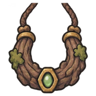 | 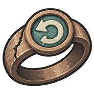 | 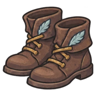 | 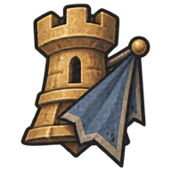 | 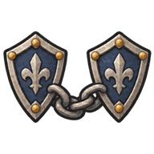 |
| **Amuleto de Corteza** | **Anillo del Segundo Intento** | **Botas del Mensajero** | **Broche del Vigía** | **Cadena del Bastión** |
| 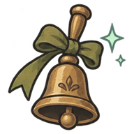 | 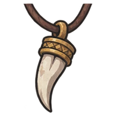 | 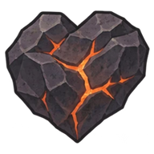 | 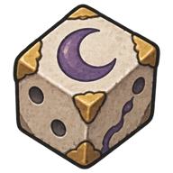 | 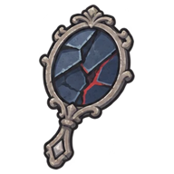 |
| **Campana del Socorro** | **Colmillo de Lobo** | **Corazón de Carbón** | **Dado del Ocaso** | **Espejo del Dolor** |
| 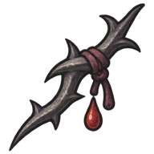 | 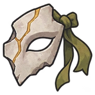 | 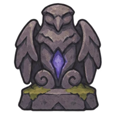 | 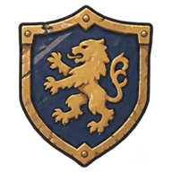 |  |
| **Espina del Juramento** | **Fragmento de la Máscara** | **Ídolo del Último Aliento** | **Insignia de la Trinchera** | **Ojo del Acechador** |
|  | 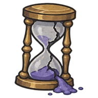 | 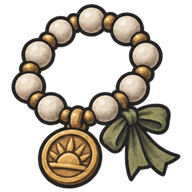 |  | 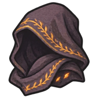 |
| **Pluma del Último Halcón** | **Reloj de Arena Roto** | **Rosario de la Aurora** | **Sello del Desollador** | **Velo de Ascuas** |

*Iconos de las 20 reliquias del juego (copias reducidas).*

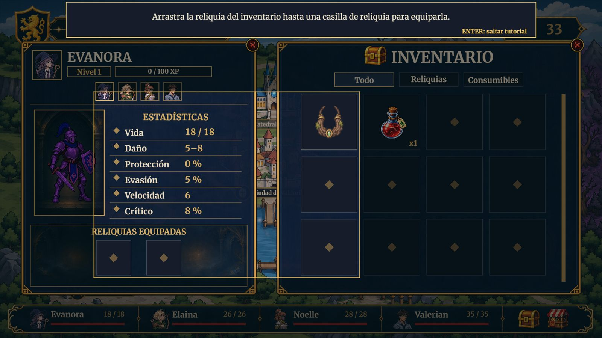
*Inventario abierto con una reliquia lista para arrastrarse a la ficha de un héroe*

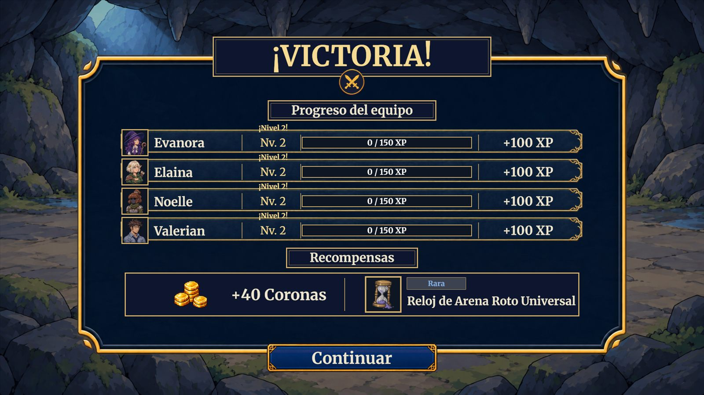
*Pantalla de victoria con Coronas y una reliquia como recompensa*

## Recurso 01: Coronas (CR)

**Tipo:**
Moneda y recurso económico.

**Descripción:**
Moneda del juego. Se gana al completar encuentros y al vender, y se gasta en la tienda del mapa.

**Cómo se obtiene:**
Se empieza con 50 Coronas. Cada combate entrega Coronas **solo la primera vez que se gana**:

| Región | Coronas por encuentro | Total de la región |
| --- | --- | --- |
| Pradera | 25 CR | 100 CR |
| Bosque | 40 CR | 120 CR |
| Corrupción | 60 CR | 120 CR |
| Jefe final | 100 CR | 100 CR |
| **Total de encuentros** | | **440 CR** |

Con las 50 iniciales y sin compras ni ventas, el jugador llega a 490 CR al terminar la demo. Los eventos narrativos no dan Coronas ni experiencia. También se obtienen Coronas vendiendo consumibles y reliquias (50 % del precio).

**Cómo se utiliza:**
Desde el botón Tienda del mapa. La ventana tiene cuatro pestañas: **Todo**, **Reliquias**, **Consumibles** y **Vender**. En las tres primeras se selecciona un producto, se lee su descripción y se pulsa COMPRAR; en **Vender** se entregan consumibles y reliquias sin equipar por la mitad de su precio.

**Cantidad máxima:**
Sin límite.

**Restricciones:**
- No se permiten compras sin Coronas suficientes, con el inventario lleno (5 por consumible) ni con la existencia agotada.
- La tienda no se abre durante un combate.
- Las Coronas se pierden si el equipo es derrotado o se abandona la sesión.

**Representación visual:**
Ícono de moneda dorada junto a la cantidad, visible en el mapa y en la tienda.

---

## Recurso 02: Tienda de reliquias

**Descripción:**
Cuatro espacios con una unidad cada uno. Un producto comprado queda agotado hasta la siguiente renovación.

**Renovación:**
Solo al completar por primera vez cualquier encuentro (combates y eventos obligatorios; no la introducción). No cambia al abrir o cerrar la tienda ni al cambiar de escena.

**Contenido según el avance:**

| Avance | Comunes | Raras |
| --- | --- | --- |
| Inicio y Pradera | 4 | 0 |
| Tras completar P4 (Bosque) | 3 | 1 |
| Desde el informe de Valdoria (Corrupción) | 2 | 2 |

Solo salen reliquias universales marcadas como disponibles en tienda: comunes (Amuleto de Corteza, Anillo del Segundo Intento, Botas del Mensajero, Broche del Vigía, Campana del Socorro y Colmillo de Lobo) y raras (Dado del Ocaso, Reloj de Arena Roto y Sello del Desollador). En una misma renovación no se repite una reliquia.

---

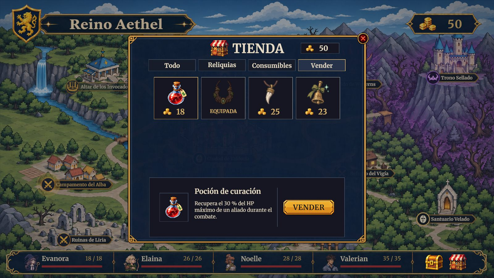
*Pestaña Vender de la tienda: consumibles y reliquias sin equipar con su precio de venta*

## Héroes caídos

Los protagonistas no mueren. Al llegar a 0 HP **caen**: el sprite se tumba, se atenúa y pasa a una casilla libre de la retaguardia; no actúan ni pueden ser objetivo de los enemigos. Siguen caídos al terminar el combate hasta que reciben una curación: una Poción de curación (con el 30 %) o una curación de Noelle. Subir de nivel restaura la vida al 100 %, pero no levanta a un héroe caído. Si los cuatro héroes caen, el combate se pierde.

---

# Misiones y Desafíos


## Detalle de las misiones

### Misión 01: Primeros pasos en Llanuras

**Tipo:** Principal

**Objetivo:**
Superar los cuatro encuentros de Pradera para familiarizarse con las mecánicas del combate y desbloquear la región Bosque.

**Contexto:**

Después de fallecer en un mismo accidente, Valerian, Elaina, Noelle y Evanora son reencarnados en el continente de Aethel. El jugador, quien actúa como una deidad, los guía y les concede poder para enfrentarse a las fuerzas del Rey Demonio.

Los protagonistas comienzan su aventura en las Llanuras Centrales, donde los asentamientos humanos están amenazados por una expedición demoníaca.

Sin tiempo suficiente para prepararse, deberán aprender a utilizar sus nuevas habilidades y trabajar en equipo mientras superan los peligros de las praderas.

**Requisitos:**
Iniciar una nueva partida desde el menú principal.

**Pasos:**
1. Acceder al Campamento del Alba y completar los encuentros P1 y P2.
2. Desbloquear las Ruinas de Liria y superar los encuentros P3 y P4.
3. Derrotar a todos los enemigos para habilitar el acceso a Bosque.

**Condición de éxito:**
Completar los cuatro encuentros de Pradera mediante victorias en combate.

**Condición de fracaso:**
Que todos los protagonistas sean derrotados durante cualquiera de los enfrentamientos.

**Recompensa:**
- 200 puntos de experiencia en total.
- 100 Coronas en total.
- Desbloqueo de la región Bosque.
- Progresión de niveles y atributos de los protagonistas.

**Consecuencias:**
El jugador adquiere experiencia con las mecánicas básicas y obtiene acceso a enemigos de mayor dificultad.

Si el equipo completo es derrotado, la sesión termina y el progreso debe reiniciarse desde una nueva partida.

**Personajes relacionados:**
Valerian, Elaina, Noelle y Evanora.

**Nivel relacionado:**
Capítulo 1: Pradera, encuentros P1–P4.

## Misión 02: Los peligros del Bosque Oscuro

**Tipo:** Principal.

**Objetivo:**
Superar los tres encuentros de Bosque y completar el evento obligatorio de Noelle para desbloquear la región Corrupción.

**Contexto:**
Después de superar los desafíos de las Llanuras Centrales, los protagonistas avanzan hacia el Bosque Oscuro, situado al este de los territorios humanos.

En este lugar se concentra un puesto de avanzada de las fuerzas expedicionarias del Rey Demonio. El equipo deberá superar los peligros del bosque para continuar su misión de detener la amenaza.

Durante esta etapa ocurre un acontecimiento importante para Noelle: La máscara rota, que representa su desarrollo personal y el despertar de sus habilidades divinas.

Durante su recorrido, el grupo se enfrenta a lobos salvajes, bandidos, chamanes y guardianes forestales.

**Requisitos:**
Haber completado los cuatro encuentros de Pradera.

**Pasos:**
1. Acceder al Claro del Susurro y superar el encuentro B1 contra dos lobos salvajes.
2. Visitar el Santuario Velado y completar el evento La máscara rota.
3. Utilizar las habilidades divinas de Noelle, ya intercambiadas, para superar B2 y B3 en el Sendero Sombrío.
4. Completar todos los encuentros para desbloquear Corrupción.
    

**Condición de éxito:**
Derrotar a todos los enemigos de Bosque y completar el evento obligatorio de Noelle.

**Condición de fracaso:**
Que todos los protagonistas sean derrotados durante uno de los enfrentamientos.

**Recompensa:**
- 300 puntos de experiencia en total.
- 120 Coronas en total.
- Intercambio de las cuatro habilidades de Noelle.
- Acceso a la región Corrupción.
    

**Consecuencias:**
Noelle combate el resto de la sesión con sus cuatro habilidades divinas. Las cuatro enmascaradas ya no están disponibles.

Los protagonistas pueden avanzar hacia encuentros más exigentes.

Si el jugador sufre una derrota total, se pierde la progresión y Noelle vuelve a su etapa enmascarada al iniciar otra partida.

**Personajes relacionados:**
Valerian, Elaina, Noelle y Evanora.

Noelle tiene una participación central en el evento narrativo de este capítulo.

**Nivel relacionado:**
Capítulo 2: Bosque, encuentros B1–B3 y evento La máscara rota.

---

## Misión 03: Adentrarse en la Corrupción

**Tipo:** Principal.

**Objetivo:**
Superar los dos encuentros de Corrupción mediante el uso estratégico de habilidades, protecciones, curaciones y recursos del equipo.

**Contexto:**
Los protagonistas llegan a una sección del Bosque Oscuro afectada por la corrupción de las fuerzas del Rey Demonio.

El territorio se ha convertido en un lugar especialmente peligroso, habitado por enemigos con mayor resistencia y poder ofensivo. Para continuar, el equipo deberá actuar de manera coordinada y aprovechar las habilidades desarrolladas durante la aventura.

La superación de esta región permitirá acercarse al enfrentamiento contra el capitán de las fuerzas expedicionarias.


**Requisitos:**
Haber completado los encuentros de Bosque y el evento La máscara rota.

**Pasos:**
1. Acceder a Tierras Marchitas y superar el encuentro C1.
2. Administrar los recursos del equipo y utilizar las habilidades disponibles para enfrentar a los enemigos de C2.
3. Derrotar al Guardián corrupto y a sus aliados para completar los encuentros normales de la región.
    

**Condición de éxito:**
Completar C1 y C2 mediante victorias en combate.

**Condición de fracaso:**
Que todos los protagonistas sean derrotados durante cualquiera de los encuentros.

**Recompensa:**
- 300 puntos de experiencia en total.
- 120 Coronas en total.
- Cumplimiento del requisito de progresión hacia el jefe final.
    
**Consecuencias:**
Al completar los dos encuentros de Corrupción, el jugador habrá superado los nueve enfrentamientos normales de la demo y cumplido los requisitos de progresión hacia el jefe final.

Narrativamente, los protagonistas habrán avanzado hasta el último tramo de su misión contra las fuerzas expedicionarias.

El capitán es el jefe final de la demo. Si el equipo sufre una derrota total, la sesión termina y debe reiniciarse.

**Personajes relacionados:**
Valerian, Elaina, Noelle y Evanora.

**Nivel relacionado:**
Capítulo 3: Corrupción, encuentros C1 y C2.

## Misión 04: La máscara rota

**Tipo:** Principal — evento narrativo obligatorio.

**Objetivo:**
Intercambiar las cuatro habilidades de Noelle por sus habilidades divinas para que el equipo pueda continuar por Bosque.

**Contexto:**
Noelle comienza la aventura como una clérigo que todavía no ha logrado despertar sus verdaderas habilidades divinas. Su inseguridad y falta de confianza en el jugador y en algunos de sus compañeros dificultan que acepte plenamente su nuevo papel.

Durante el recorrido por el Bosque Oscuro, las experiencias compartidas con el equipo contribuyen a su desarrollo personal.

Después de superar el primer encuentro de esta región, el jugador puede acceder al evento La máscara rota en el Santuario Velado.

La ruptura de la máscara representa el momento en que Noelle empieza a superar sus inseguridades, fortalece su fe y confianza, y consigue manifestar sus poderes divinos.

Este acontecimiento marca un cambio en su personalidad y en sus habilidades de combate. La transformación no modifica sus estadísticas actuales, nivel ni experiencia.

**Requisitos:**
- Haber completado el encuentro B1.
- Mantener una sesión activa.
- No haber completado previamente el evento.


**Pasos:**
1. Completar B1 en el Claro del Susurro. 
2. Seleccionar el Santuario Velado desde el mapa.
3. Abrir el evento La máscara rota.
4. Confirmar la opción Romper la máscara.

**Condición de éxito:**
Confirmar el evento y activar la transformación de Noelle.

**Condición de fracaso:**
No tiene una condición de derrota propia.
Si el jugador selecciona Volver, el evento permanece pendiente y puede abrirse nuevamente.

**Recompensa:**
- Intercambio de habilidades. Salen Golpe de Lucero, Impacto Quebrantador, Resistencia Obstinada y Auxilio Improvisado.
- Entran Impacto Consagrado, Plegaria Focalizada, Bendición Continua y Amparo Divino.
- Acceso al encuentro B2.
No otorga XP ni Coronas.

**Consecuencias:**
Noelle reemplaza sus cuatro habilidades enmascaradas por cuatro habilidades divinas.

Conserva su nivel, experiencia, vida y estadísticas.

La transformación permanece activa durante el resto de la sesión y no puede repetirse.

**Personajes relacionados:**
Noelle, protagonista central del evento.

**Nivel relacionado:**
Capítulo 2: Bosque.

## Misión 05: El capitán de la expedición

**Tipo:** Principal — planeada.

**Objetivo:**
Derrotar al capitán de las fuerzas expedicionarias del Rey Demonio para detener la amenaza inmediata sobre las Llanuras Centrales.

**Contexto:**
Después de superar los peligros del Bosque Oscuro y su sector corrompido, los cuatro protagonistas se preparan para enfrentar al capitán que dirige las fuerzas expedicionarias del Rey Demonio.

Este enfrentamiento representa el último desafío de la demo. Aunque los protagonistas han desarrollado sus habilidades y fortalecido su trabajo en equipo, deberán utilizar todo lo aprendido para obtener la victoria.

La derrota del capitán no representa el fin del Rey Demonio, sino una victoria importante dentro de un conflicto mucho mayor.

**Requisitos:**
Haber completado los nueve encuentros normales de Pradera, Bosque y Corrupción, además de los eventos obligatorios La máscara rota y El informe del último vigía.

**Pasos:**
1. Completar los encuentros de Corrupción.
2. Acceder al Trono Sellado, que se desbloquea al completar C2.
3. Enfrentar al capitán de las fuerzas expedicionarias.
4. Derrotarlo para completar el objetivo principal de la demo.

**Condición de éxito:**
Derrotar al capitán de las fuerzas expedicionarias del Rey Demonio.

**Condición de fracaso:**
Que todos los protagonistas sean derrotados durante el enfrentamiento final.

**Recompensa:**
- 200 XP y 100 Coronas.
- Una reliquia rara o exclusiva (la recompensa del jefe es la única con probabilidad del 100 %).
- Victoria narrativa sobre las fuerzas expedicionarias.
- Purificación del sector afectado del Bosque Oscuro.
- Conclusión del recorrido principal de la demo.

**Consecuencias:**
Con la derrota del capitán, la corrupción del bosque comienza a desaparecer y las fuerzas expedicionarias supervivientes se retiran hacia el norte, buscando refugio en la región de la Forja de Combustión, controlada por el Rey Demonio.

## Misión 06: El informe del último vigía

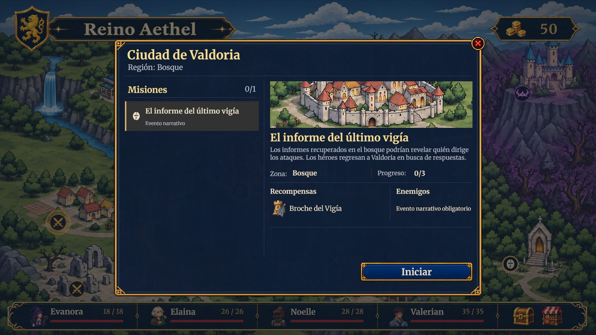
*Ventana de misión de Ciudad de Valdoria para el evento*


**Tipo:** Principal — evento narrativo obligatorio (ocurre entre B3 y C1, antes de la Misión 05).

**Objetivo:**
Conocer la identidad y la ubicación del responsable de los ataques para abrir el camino hacia la Corrupción del Bosque.

**Contexto:**
Los informes recuperados en el Refugio del Vigía llegan a Valdoria. Un oficial de la ciudad confirma que los ataques de la pradera y el bosque no son incidentes aislados: los dirige el Capitán de las Fuerzas Expedicionarias, un comandante del Rey Demonio, localizado por los exploradores en el Trono Sellado. Las Tierras Marchitas que lo rodean están infestadas de criaturas corrompidas, así que los héroes tendrán que atravesarlas.

**Personajes relacionados:**
Oficial de la ciudad, Elaina, Evanora, Noelle y Valerian.

**Requisitos:**
Haber completado B3. El evento se selecciona en el mapa (Valdoria) y no es un combate.

**Condición de éxito:**
Terminar la escena de diálogo.

**Recompensa:**
- Broche del Vigía (reliquia común que entrega el evento una sola vez).
- Revelación del capitán y paso del Trono Sellado al estado de «jefe descubierto».
- Desbloqueo de C1 y de la tercera región. No otorga experiencia ni Coronas.
- La tienda de reliquias pasa a mostrar dos comunes y dos raras.

**Consecuencias:**
La narrativa pasa de una serie de ataques sin autor a una amenaza concreta, y el jugador ya sabe contra quién se prepara.

**Nivel relacionado:**
Capítulo 3: Corrupción del Bosque (precede a C1).

Los protagonistas regresan a los territorios humanos como héroes después de proteger las Llanuras Centrales.

Sin embargo, la amenaza del Rey Demonio continúa, por lo que esta victoria representa únicamente el cierre de la primera etapa de su aventura.

**Personajes relacionados:**
Valerian, Elaina, Noelle, Evanora y el capitán de las fuerzas expedicionarias.

**Nivel relacionado:**
Enfrentamiento final de la demo, posterior a Corrupción. 


**Consecuencia narrativa de la derrota:**

Según la historia de la demo, cuando los cuatro protagonistas pierden la vida en combate, el jugador pierde su último vínculo con el mundo de Aethel y deja de actuar como una entidad divina.

En términos jugables, esta consecuencia se representa mediante el final de la sesión y el regreso al menú principal. Una nueva partida reinicia el recorrido desde Pradera.

---

# Sección 05 - Arte y Audio

# Dirección de Arte

## Identidad visual

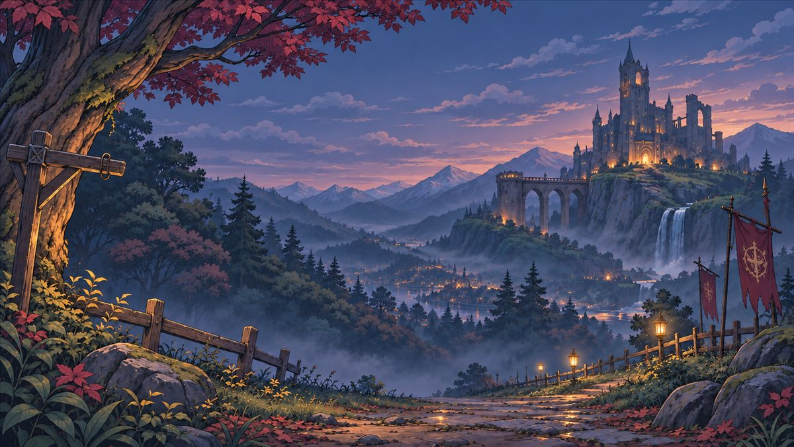
*Fondo del menú principal*


**Estilo:** Anime con influencia de fantasía medieval. Formas limpias, proporciones ligeramente estilizadas y contornos definidos. No busca realismo.

**Referencias:** RPGs de combate por turnos con estética anime (finales de los 90 y principios de los 2000), ilustración de fantasía medieval rústica.

**Sensación buscada:** Aventura, exploración y fantasía con un tono cálido y algo rústico. Los momentos narrativos deben sentirse íntimos; los combates, claros y legibles.

**Nivel de realismo:** Bajo. Prioriza claridad visual y expresividad sobre detalle realista.

**Formas predominantes:** Orgánicas y redondeadas en personajes y naturaleza. Formas más geométricas y sólidas en arquitectura, armaduras y elementos de UI.

**Iluminación:** Suave y cálida en la mayoría de escenarios. Contraste más marcado en combates y en zonas afectadas por la corrupción.

**Materiales:** Metal, madera, piedra, cuero y tela. Deben leerse con claridad tanto en personajes como en escenarios e interfaces.

## Personajes

- Proporciones anime, pero no extremadamente deformadas.
- Siluetas claras que permitan distinguir de un vistazo el rol de cada protagonista (tanque, distancia, soporte, magia).
- Armaduras y ropa con materiales reconocibles (metal, cuero, tela). Evitar diseños excesivamente recargados que dificulten la lectura en combate.
- Expresiones faciales legibles en escenas de diálogo. En combate se prioriza la pose y el efecto visual de la habilidad sobre la expresión.

## Escenarios y mapa

- Estética de fantasía medieval rústica: aldeas de madera y piedra, bosques densos, praderas abiertas y zonas visiblemente afectadas por la corrupción.
- El mapa de eventos debe comunicar claramente qué zonas están disponibles, cuáles están bloqueadas y cuál es el siguiente objetivo.
- La corrupción se representa visualmente con cambios de color, niebla y deterioro en el entorno, no solo con enemigos distintos.

## Interfaz

- Estilo coherente con el mundo: marcos de metal, madera o piedra, tipografía clara y elementos decorativos discretos.
- Botones principales con borde dorado; botones secundarios con borde plateado.
- Información jugable (vida, efectos de estado, posiciones, habilidades) debe destacarse con los colores definidos para UI y no mezclarse con la decoración.
- Arte en pixel art para elementos interactivos o animados que lo requieran (iconos de habilidades, efectos de estado, ciertos elementos de combate).

## Paleta de color

**Colores principales:** Oro, rojo oscuro, verde bosque, marrón y gris.

**Colores secundarios:** Plata, azul oscuro, azul claro y beige.

**Colores para información jugable:** Oro, rojo oscuro, verde bosque y azul claro.

## Reglas visuales

1. Priorizar la legibilidad en combate. Las posiciones, las áreas de efecto y los estados deben leerse de un vistazo.
2. Mantener coherencia de materiales y formas entre personajes, escenarios e interfaz.
3. Usar pixel art de forma selectiva en elementos interactivos o animados, no como estilo general del juego.
4. La corrupción debe tener un lenguaje visual propio y reconocible en todos los elementos que afecte.
5. Evitar saturación excesiva de efectos visuales que dificulten seguir el combate.

---

# Personajes y Animación
## Requisitos por personaje

| Personaje | Sprite de combate | Retrato e icono | Animaciones | VFX | Estado |
| --- | --- | --- | --- | --- | --- |
| Valerian | Sí (estático) | Sí | Pendiente | Sí (compartidos) | Sprite base final; animaciones por producir |
| Noelle | Sí (estático, con y sin máscara) | Sí (con y sin máscara) | Pendiente | Sí (compartidos) | Sprite base final; cambia a sin máscara tras La máscara rota |
| Elaina | Sí (estático) | Sí | Pendiente | Sí (compartidos) | Sprite base final; animaciones por producir |
| Evanora | Sí (estático) | Sí | Pendiente | Sí (compartidos) | Sprite base final; animaciones por producir |
| Enemigos normales (11) | Sí (estático) | Recorte de rostro | Pendiente | Sí (compartidos) | Sprite final; animaciones por producir |
| Capitán de Fuerzas Expedicionarias | Provisional | Provisional | Pendiente | Sí (compartidos) | Falta el sprite final |

## Sprites actuales

- **Héroes:** imagen de cuerpo completo de 1024 × 1536 con fondo transparente (`ElainaBase`, `EvanoraBase`, `NoelleBase`, `NoelleSinBase`, `ValerianBase`), más un icono de 1254 × 1254 y un sprite de diálogo por personaje. Noelle tiene dos versiones: con máscara y sin máscara; el juego cambia de una a otra al completar el evento.
- **Enemigos:** once imágenes de 1536 × 1536 recortadas de una hoja de 6144 × 4608, cada una en su carpeta (`Enemigos/<Región>/<Nombre>/`). Todos se dibujan sin tinte.
- **Escala en combate:** los héroes miden unas 3,8 unidades de alto; los enemigos se ajustan a su papel (Goblin común 2,6; Bandido 3,4; Chamán del Bosque 3,85; Guardián forestal 4,0; Lobo salvaje 1,95 de alto por 2,9 de largo; Guardián corrupto 4,3 y ocupa dos posiciones).
- **Pivote:** los pies de héroes y enemigos descansan sobre la misma línea de suelo; la barra de vida queda centrada bajo la figura.

### Referencias visuales

|   |   |   |   |   |
| --- | --- | --- | --- | --- |
| 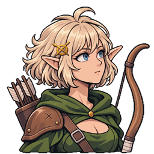 |  | 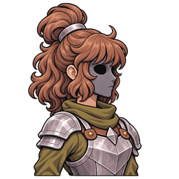 |  |  |
| **Elaina** | **Evanora** | **Noelle (con máscara)** | **Noelle (sin máscara)** | **Valerian** |

*Iconos oficiales de los héroes, usados en el orden de turno, las tarjetas y las fichas.*

|   |   |   |   |   |
| --- | --- | --- | --- | --- |
|  |  |  |  |  |
| **Valerian** | **Elaina** | **Evanora** | **Noelle (con máscara)** | **Noelle (sin máscara)** |

*Imágenes base de cuerpo completo de los héroes (copia reducida del original de 1024 × 1536).*


*Los cuatro héroes en combate (Corrupción, encuentro 1)*


*Ficha de Noelle en el mapa: retrato, estadísticas, habilidades y casillas de reliquia*

El origen y la fecha de cada captura están en [[06 - Registro visual]].

## Animaciones

### Movimiento
- **Idle:** pendiente para los cuatro héroes y los enemigos. Se evaluó generarlo con Ludo.ai (modelo Griffin HD) a partir del sprite estático; todavía no hay resultado integrado.
- No hay animaciones de desplazamiento: el mapa es de eventos y el combate es por turnos.

### Interacción
- Ninguna. Los diálogos usan retratos estáticos.

### Combate
- Por ahora los ataques no tienen animación de personaje: la acción se comunica con el efecto de impacto sobre el objetivo (tajo u onda de choque), el sonido, el texto flotante y la barra de vida.
- Prevista: una animación de ataque por héroe y una genérica para enemigos.

### Daño
- Hoy: texto flotante y cambio de la barra. Prevista: una animación de daño por héroe y una genérica para enemigos.

### Caída / derrota
- **Héroe caído (implementado):** el sprite gira 90°, se atenúa y pasa a una casilla libre de la retaguardia en 0,35 s. Es provisional hasta que exista la animación de caída.
- **Enemigo derrotado (implementado):** el sprite se oscurece hasta negro, aparece una calavera y se desvanece.
- **Derrota total:** pantalla propia con las sombras de los héroes caídos sobre el escenario.

### Efectos de presentación por código
Transición de inicio de combate con espadas cruzadas, texto flotante (daño, curación, crítico, esquiva, estados), iconos de estado sobre los sprites, destello al equipar una reliquia y resaltado del turno activo.

## Convenciones

- **Nombres:** `<Personaje>Base.png` para héroes (por ejemplo `ValerianBase.png`) y `<Enemigo>.png` dentro de su carpeta; los iconos oficiales viven en `Sprites/Personajes/Iconos`.
- **Formato:** PNG con transparencia, un solo sprite por archivo, sin compresión de textura ni recortes de importación.
- **Orientación:** los enemigos miran a la izquierda, hacia el equipo; los héroes miran a la derecha.
- **Resolución:** héroes a 131 píxeles por unidad y enemigos a 122,5; no se amplían ni deforman.
- **Animación futura:** hoja de frames por acción y personaje, conservando el tamaño del cuadro para no mover el pivote.

---

# Entornos

## Zonas

| Zona            | Estilo                                                                                                                                                                                                       | Elementos                                                            | Función |
| --------------- | ------------------------------------------------------------------------------------------------------------------------------------------------------------------------------------------------------------ | -------------------------------------------------------------------- | ------- |
| Llanuras Centrales (Pradera) | Vibrante, vivo, verde. Plano y amplio.                                                                                                                                                                       | Pocos árboles, arbustos, rocas grandes, colinas.                     |         |
| Bosque Oscuro            | Oscuro, frío, uso de colores marrón oscuro y rango de verdes, entre verde claro a verde oscuro con tonos azules para sombras. Generar una sensación de frío por medio de teoría de colores.                  | Árboles cubren el horizonte en el arte. Rocas medianas en el fondo.0 |         |
| Corrupción del Bosque    | Oscuridad fría, tonos azules y morados reemplazan el rango de verdes y marrones para los colores de los árboles, pasto toma un color morado poco saturado, para dar una sensación de muerte y/o podredumbre. | Campamentos militares, fogatas, antorchas, estantes de armas.        |         |

### Referencias visuales

|   |   |   |
| --- | --- | --- |
|  |  |  |
| **Campamento del Alba** | **Gruta de los Susurros** | **Refugio del Vigía** |
|  |  |  |
| **Ruinas de Lira** | **Trono Sellado** | **Zona Corrupta** |

*Fondos de combate usados en el juego (copias reducidas).*


*Mapa general con las regiones del reino*

## Modularidad

¿Qué elementos pueden reutilizarse?

## Iluminación

Describe iluminación global, fuentes de luz y cambios durante el juego.

## Efectos visuales

- Partículas
- Clima
- Humo
- Fuego
- Agua
- Magia / energía
- Impactos

## Recursos requeridos

Lista los modelos, sprites, texturas, materiales y efectos necesarios.

**Sprites**
Idle, ataque, recibir daño.
- Enemigos débiles
- Enemigos fuertes
- Capitán Fuerzas Expedicionarias
Protagonistas:
- Valerian
- Evanora
- Noelle
- Elaina

---

# Interfaz Visual

## HUD

### HUD del combate


*HUD de combate actual*


| Zona | Contenido |
| --- | --- |
| Encabezado izquierdo | Escudo con espadas cruzadas, título narrativo del encuentro, región y número de encuentro |
| Encabezado central | Número de ronda y «Turno de <unidad>» |
| Encabezado derecho | **Orden de turno**: un retrato por unidad (héroes con marco azul, enemigos con marco rojo; el retrato enemigo es un recorte de su rostro) |
| Campo | Héroes a la izquierda y enemigos a la derecha; bajo cada unidad su barra de vida, estados (iconos) y, si lo lleva, el icono de su reliquia |
| Panel inferior izquierdo | **Consumibles**: Poción de curación y Antídoto con su cantidad |
| Panel inferior central | **Habilidades** del héroe activo: cuatro botones con icono, nombre y recarga, además de su HP y posición |
| Panel inferior derecho | **Información**: ficha de la unidad o de la habilidad bajo el cursor y los botones Mover y Terminar turno |

### HUD del mapa


*HUD del mapa actual*


Título del reino arriba a la izquierda, contador de Coronas arriba a la derecha, barra inferior con las cuatro tarjetas de héroe (retrato, nombre, vida y barra) y los atajos Inventario y Tienda, y el botón de pausa.

## Jerarquía visual

1. **Primero:** quién actúa y qué puede hacer (turno actual, resalte del héroe activo, habilidades disponibles).
2. **Segundo:** el estado del combate (barras de vida, estados alterados, orden de turno).
3. **Tercero:** el contexto (título del encuentro, información detallada, recompensas, descripciones al pasar el cursor).

## Estados

| Estado | Tratamiento visual |
| --- | --- |
| Normal | Panel azul marino con borde fino azul grisáceo |
| Seleccionado | Borde dorado |
| Cursor encima | Borde dorado envejecido y recuadro con la descripción |
| Objetivo válido | Marco rojo (ataque) o indicador verde (apoyo); el objetivo señalado se resalta |
| Bloqueado (recarga, posición, agotado, ya poseída) | Icono atenuado y etiqueta o texto que explica el motivo |
| Daño | Texto flotante del daño; crítico en grande con temblor |
| Curación | Texto flotante verde con la cantidad |
| Éxito | Mensaje de compra o venta, destello breve al equipar |
| Error | Mensaje en la ficha o en la ventana (por ejemplo, el motivo por el que una reliquia no se puede equipar), precio en rojo si faltan Coronas |
| Héroe caído | Sprite tumbado y atenuado en la retaguardia, tarjeta marcada como CAÍDO |
| Peligro de área | Etiqueta FUEGO sobre las unidades amenazadas por un ataque preparado |

### Iconos de estado

|                                                                                  |                                                                                      |                                                                                  |                                                                          |                                                                                      |                                                                                |
| -------------------------------------------------------------------------------- | ------------------------------------------------------------------------------------ | -------------------------------------------------------------------------------- | ------------------------------------------------------------------------ | ------------------------------------------------------------------------------------ | ------------------------------------------------------------------------------ |
|  |  |            |        |     |  |
| **Aturdimiento**                                                                 | **Debilitamiento**                                                                   | **Evasión**                                                                      | **Marca**                                                                | **Marca táctica**                                                                    | **Preparación**                                                                |
|      |            |  |  |  |            |
| **Protección**                                                                   | **Quemadura**                                                                        | **Regeneración**                                                                 | **Sangrado**                                                             | **Vulnerabilidad**                                                                   | **Veneno**                                                                     |
|                                                                                  |                                                                                      |                                                                                  |                                                                          |                                                                                      |                                                                                |

*Iconos de estado usados en el juego (copias reducidas).*

## Convenciones

**Tipografía:** Merriweather (regular y negrita) en toda la interfaz; títulos en negrita y marfil, textos en marfil sobre fondos oscuros.

**Paleta:** azul marino oscuro para paneles, dorado para acentos y bordes de selección, marfil para el texto, rojo para vida y enemigos. El color de la rareza de las reliquias es común gris, poco común verde, rara azul y épica violeta.

**Iconografía:** iconos propios de habilidades, estados (Aturdimiento, Debilitamiento, Defensa elevada, Evasión, Marca, Protección, Quemadura, Regeneración, Sangrado, Veneno, Vulnerabilidad), consumibles y reliquias. Los retratos oficiales de los héroes se usan en la barra de orden de turno, las tarjetas y las fichas.

**Tamaños mínimos:** texto principal de los paneles de combate entre 26 y 30 px en el lienzo de 1080 p; botones con zonas de clic amplias.

**Contraste:** texto claro sobre fondos azul marino casi negros.

**Animaciones:** las ventanas se abren con un fundido y una escala de 0,95 a 1 en 0,3 s; el marco de las tarjetas pulsa con suavidad; los textos flotantes suben y se desvanecen; el tutorial resalta con un borde dorado que pulsa. Los tutoriales y las ventanas no se animan con tiempo escalado, así que funcionan también en pausa.

## Pantallas

- Menú principal
- Pausa (con Ayuda y Opciones)
- Configuración (volumen general y música)
- Inventario y ficha de héroe
- Mapa
- Diálogo
- Tienda
- Evento La máscara rota
- Combate
- Victoria
- Derrota

El detalle funcional de cada una está en [[02 - UI y Menús]].

---

# Audio y Música
## Música

Estilo: El estilo musical varía mucho según el entorno y momento, a veces puede ser algo Luffy, a veces puede ser más ambiental y en ocasiones puede ser tipo opera, blues, jazz y rock, a veces suele ser una fusión de varios géneros para lograr tramitar más sobre el entorno.

Instrumentación: guitarra eléctrica, sintetizadores virtuales, percusiones, voces corales, bajos, orquestas.

Temas principales:  
Tema del Menú Principal: Melodía introductoria, atmosférica, ambiental, sentimiento melancólico.

Tema de los actos:  
Muerte y reencarnación: Ambientación constante, staccatos para dar sensación de alerta, sentimiento de melancolía, violines trágicos, en la reencarnación la melodía es agridulce, hay más rítmica pero se nota que algo no anda bien.

Llanuras Centrales: Algo tranquilo, alegre, inspiración de island song de Adventure Time, percusiones sencillas y animadas, con una tensión ligera para dar a entender que aun siendo una llanura alegre, hay peligros de que cuidarse.  
  
Bosque Oscuro: Modo lidio para dar esa sensación de magia pero también de oscuridad, dar sensación de alerta de forma discreta, generar algo de tensión con Cheelos para dar ese toque mágico oscuro y fantasioso.  
  
Corrupción del Bosque: Modo Locrio, violines chillantes, notas agudas y graves de forma sincopadas, percusiones pesadas generando alerta a cada rato, notas super tensas con una melodía disonante que indican que algo no va bien.

  

Tema de Combate: High-tempo, percusivo y urgente, guitarras con distorsión generando entorno épico, recordándote que estás bajo ataque pero que aun tienes el control, tomando inspiración de Life Will Change de persona 5 royale.

  

Música dinámica: La música será dinámica según lo que pase en pantalla, según los escenarios y eventos, además se prioriza los efectos especiales como al comprar un objeto o desbloquear una región.

Tema Game over: Piano melancólico con violines exagerados entendiendo que todo terminó y no hay vuelta atrás.

Pistas implementadas en la demo: tema del menú, tema del mapa (entra con fundido), tema de combate y música de la introducción. Los créditos reutilizan el tema del menú. Los temas por región descritos arriba siguen siendo la intención de diseño.

## Efectos de sonido

Estado en la demo: todos los efectos de la tabla están implementados en Unity. Se crearon a partir de descripciones (generación con IA) y se ajustaron a mano a la animación: cada sonido de golpe se adelanta lo necesario para coincidir con el impacto visual.

| Evento                     | Sonido                                                                                                                                                                                                                  | Propósito                                                                      |
| -------------------------- | ----------------------------------------------------------------------------------------------------------------------------------------------------------------------------------------------------------------------- | ------------------------------------------------------------------------------ |
| Conversación de personajes | Cuatro voces sintéticas muy breves; cada pocas letras suena una al azar (sin repetir la anterior) mientras el texto se escribe, con volumen bajo.                                                                        | Dar a entender que los personajes hablan sin voces grabadas.                   |
| Botones y menús            | Un sonido de cursor al entrar en un botón y otro de clic al pulsar (también en Volver y en la X de Opciones); Nueva partida tiene su propio sonido. Suenan igual en introducción, mapa, tienda, combate, habilidades y reliquias de la ficha. En el mapa no suena el cursor sobre lugares bloqueados o ya completados. | Respuesta inmediata a cada interacción; el mapa solo suena donde hay misión.   |
| Inicio de combate          | Choque de espadas.                                                                                                                                                                                                      | Marcar la entrada al combate.                                                  |
| Selección de habilidad     | Sonido grave de selección inspirado en Darkest Dungeon, a volumen muy bajo.                                                                                                                                             | Confirmar la habilidad elegida.                                                |
| Ataque y habilidades       | Efecto propio para cada una de las 20 habilidades de los cuatro héroes y para todas las de los enemigos (incluido el capitán), con un adelanto por habilidad para coincidir con el golpe. Suenan de fondo, por debajo de la música. | Que cada ataque se identifique por el oído.                                    |
| Capitán (jefe)             | Sonidos propios de cada habilidad, de la entrada a fase 2, del aura de fase 2 (bucle suave) y de su derrota.                                                                                                             | Dar peso al jefe y señalar el cambio de fase.                                  |
| Curación                   | Un único sonido de curación compartido por las pociones, las habilidades de curación de los héroes (Auxilio improvisado, Plegaria focalizada, Bendición continua) y la del chamán enemigo.                                  | Reconocer cualquier curación al instante.                                      |
| Refuerzo                   | Sonido de mejora al recibir un beneficio de estado.                                                                                                                                                                      | Señalar que una unidad se fortalece.                                           |
| Cofre y tienda             | Efecto corto (0,4 s) de apertura, el mismo para ambos.                                                                                                                                                                   | Confirmar que se abre el panel.                                                |
| Comprar y vender           | Monedas que se gastan al comprar y monedas que se reciben al vender.                                                                                                                                                      | Dar sensación de intercambio.                                                  |
| Subida de nivel            | Efecto ascendente en la pantalla de Victoria cuando una barra se llena y el héroe sube de nivel.                                                                                                                         | Celebrar el progreso.                                                          |
| Equipar reliquia           | Deslizamiento metálico de anillo con un brillo mágico suave, al soltar la reliquia en una casilla válida.                                                                                                                | Confirmar el equipamiento.                                                     |
| Ataque crítico, fallo, estado alterado, objeto adquirido, pausa | Sin sonido propio todavía (se apoyan en el texto flotante y en los sonidos de interfaz).                                                                                                                    | Pendiente de diseño.                                                           |
## Audio espacial

No se utilizara audio espacial, se utilizara audio plano plano típico de juegos RPG 2D.


## Voz

Para diálogos hablados tanto para narradores y personajes, se utilizará un sintetizador grabe para voces hombre, sintesidar medio / agudo para voz de mujer, ambos son notas aleatorizadas en el sintetizador. 

Idiomas: El videojuego estará principalmente en Español, para la demo no habrá más idiomas.


## Mezcla

Prioridades y volumen relativo: la música de mapa y combate suena al mismo nivel que la del menú (ajustable en Opciones); los efectos de habilidad quedan de fondo, por debajo de la música; los sonidos de interfaz (cursor y clic) son moderados y las voces de escritura son las más bajas. En la introducción, la música y los ambientes bajan mientras habla el narrador.

Comportamiento ante eventos: no hay reducción automática de la música ante los efectos de combate; la jerarquía se consigue con los volúmenes fijos de cada grupo. La música del mapa y del combate entra con un fundido para no empezar de golpe.

---

# Registro visual

## Estructura de la carpeta Media

| Carpeta | Contenido |
| --- | --- |
| `Media/Avance_2026-11-10/Interfaz` | Capturas del mapa, la tienda, la ficha de héroe, el tutorial, la victoria y la derrota |
| `Media/Avance_2026-11-10/Combate` | Capturas de combates de las tres regiones jugables |
| `Media/Avance_2026-11-10/Enemigos` | Hoja de retratos de los enemigos |
| `Media/Avance_2026-11-13/Interfaz` | Capturas del epílogo y de los créditos |
| `Media/Avance_2026-11-13/Combate` | Captura del combate contra el capitán con su arte definitivo |
| `Media/Audio/Musica` | Pistas de música del juego en MP3, por carpetas (Menu, Mapa, Combate, Introduccion, Narrativas) |
| `Media/Audio/Efectos` | Efectos de sonido en MP3, por categorías (Habilidades, Enemigos, Interfaz, Dialogos, Combate, Eventos, Introduccion, Victoria) |
| `Media/Arte/Personajes` | Imágenes base de los héroes (copias reducidas) |
| `Media/Arte/Iconos` | Iconos oficiales de los héroes |
| `Media/Arte/Enemigos` | Los once sprites de enemigos |
| `Media/Arte/Reliquias` | Iconos de 20 reliquias |
| `Media/Arte/Estados` | Iconos de estado |
| `Media/Arte/Fondos` | Fondos de combate, menú principal, Santuario y Valdoria |
| `Sprites/` | Imágenes originales de héroes (con y sin máscara), iconos y los once enemigos, sin reducir |

## Condiciones de captura

- **Origen de las capturas:** ventana Game del editor de Unity 6 en modo Play, con la versión del proyecto del 2026-11-10 (las capturas de epílogo, créditos y jefe final son del 2026-11-13). No son maquetas ni arte conceptual: muestran el juego tal como se ejecuta.
- **Relación de aspecto:** 16:9. Las copias del repositorio se reducen a 1600 px de ancho como máximo y se guardan en JPEG para mantener el repositorio ligero.
- **Arte original:** los sprites y fondos se guardan reducidos (PNG con transparencia hasta 512–600 px; fondos en JPEG de 1200 px). Los originales están en `Assets/Sprites/` del proyecto de Unity y no se duplican aquí.

## Inventario de capturas

| Archivo | Qué muestra | Sección donde se usa |
| --- | --- | --- |
| `Interfaz/Mapa_Mundo.jpg` | Mapa del Reino Aethel | [[02 - UI y Menús]], [[04 - Interfaz Visual]], [[03 - Entornos]] |
| `Interfaz/Ficha_Heroe_Noelle.jpg` | Ficha de héroe sin habilidades repetidas en el panel | [[02 - UI y Menús]], [[02 - Personajes y Animación]] |
| `Interfaz/Tienda_Vender.jpg` | Pestaña Vender | [[04 - Objetos y Coleccionables]] |
| `Interfaz/Tutorial_Tienda.jpg`, `Tutorial_Altar_Reliquia.jpg`, `Tutorial_Inventario.jpg`, `Tutorial_Final.jpg` | Pasos del tutorial interactivo del mapa | [[01 - UX y Flujo del Jugador]], [[02 - UI y Menús]] |
| `Interfaz/Evento_Valdoria.jpg` | Misión El informe del último vigía | [[05 - Misiones y Desafíos]] |
| `Interfaz/Victoria_Recompensas.jpg`, `Victoria_Nivel.jpg` | Victoria con recompensas y con subida de nivel | [[04 - Objetos y Coleccionables]], [[02 - UI y Menús]] |
| `Interfaz/Derrota.jpg` | Pantalla de derrota | [[02 - UI y Menús]] |
| `Interfaz/Reliquias_Hoja.jpg` | Hoja de iconos de reliquias | Referencia |
| `Interfaz/Menu_Principal.jpg`, `Introduccion_Cinematica_1.jpg`, `Introduccion_Dialogo.jpg`, `Dialogo_Santuario.jpg` | Menú principal, introducción y diálogos | [[02 - UI y Menús]] |
| `Interfaz/Pausa_Mapa.jpg`, `Ayuda_Mapa.jpg`, `Combate/Pausa_Combate.jpg` | Pausa y ayuda | [[02 - UI y Menús]] |
| `Combate/Pradera_P1.jpg`, `Pradera_P4.jpg`, `Bosque_B1.jpg`, `Bosque_B3.jpg`, `Jefe_Final.jpg` | Combates de Pradera, Bosque y una primera captura del jefe final (sustituida por `Jefe_Final_Capitan.jpg`) | [[02 - Niveles]] |
| `Combate/Heroes_Combate.jpg` | Los cuatro héroes en C1 | [[02 - Personajes y Animación]], [[04 - Interfaz Visual]] |
| `Combate/Corrupcion_C1.jpg`, `Corrupcion_C2_Guardian.jpg` | Combates de Corrupción; el segundo con el Guardián Corrupto de dos posiciones | [[03 - Enemigos y NPC]] |
| `Combate/Pradera_Orden_Turno.jpg`, `Bosque_B2_Barras.jpg` | Combates de Pradera y Bosque | [[03 - Enemigos y NPC]] |
| `Enemigos/Retratos_Enemigos.jpg` | Retratos de los enemigos en el orden de turno | [[03 - Enemigos y NPC]] |
| `Avance_2026-11-13/Combate/Jefe_Final_Capitan.jpg` | Combate final «La última orden»: el capitán con su arte definitivo y dos Corruptos errantes | [[02 - Niveles]] |
| `Avance_2026-11-13/Interfaz/Epilogo_Trono_Sellado.jpg`, `Creditos.jpg` | Epílogo en el Trono Sellado y pantalla de créditos | [[02 - UI y Menús]] |

## Cómo actualizar

1. Ejecutar el juego en el editor y capturar la pantalla en 16:9.
2. Guardar la imagen en una carpeta `Avance_AAAA-MM-DD` con la fecha de la captura, en la categoría que corresponda.
3. Sustituir el enlace en la sección que la usa y actualizar este inventario.
4. Conservar el pie de imagen en cursiva: debe describir qué se ve, no solo el nombre de la pantalla.

## Pendiente

- Capturas de los combates P2, P3, B2, C1 y C2 con el arte actual, y del evento del Santuario.
- Capturas del tutorial de combate.
- Animaciones en GIF: el proyecto ya contiene fotogramas de animación de Valerian (reposo, ataques, defensa y heridas) que aún no se han convertido a GIF.

---

# Sección 06 - Experiencia

# UX y Flujo del Jugador

## Flujo principal

```text
Menú principal → Nueva partida → Introducción cinematográfica (se puede omitir)
   → Diálogo del Altar de los Invocados → Primer combate (P1) con tutorial guiado
   → Victoria → Mapa con tutorial interactivo (tienda, venta, inventario, reliquias)
   → P2 → P3 → P4 → B1 → La máscara rota → B2 → B3 → El informe del último vigía
   → C1 → C2 → Trono Sellado (capitán) → Victoria final → Epílogo → Créditos → Menú principal
```

Pausa disponible en el mapa, el diálogo y el combate (tecla Esc). Una derrota total lleva a la pantalla de Derrota y de ahí al menú principal. Al vencer al capitán, el botón Continuar de la pantalla de Victoria lleva a un epílogo en el Trono Sellado (diálogo de los cuatro héroes sobre el desenlace, que se puede omitir) y de ahí a los créditos; al terminar o saltarlos (ESPACIO, ENTER, ESC o clic) la partida se cierra y se vuelve al menú principal.

## Primeros minutos

| Momento | Qué ve | Qué aprende |
| --- | --- | --- |
| Menú principal | Tres botones: Nueva partida, Opciones y Salir, con música de menú | Que el juego se maneja con el ratón |
| Introducción | Escenas ilustradas con voz de narrador, subtítulos y efectos (lluvia, accidente, llegada a Aethel) | Quiénes son los cuatro héroes y por qué están en otro mundo; se puede omitir con el botón de salto |
| Altar de los Invocados | Diálogo tipo novela visual: retratos, placa de nombre y texto que aparece letra a letra con sonido | Quién guía al equipo (Dios), la misión inicial y cómo avanzar con ESPACIO |
| Primer combate (P1) | Tutorial guiado que oscurece la pantalla y resalta una zona cada vez | Orden de turno, posiciones, habilidades y su recarga, ficha de información, mover, consumibles y terminar turno |
| Primer retorno al mapa | Segundo tutorial, esta vez sobre el mapa | Abrir la tienda, comprar, vender, usar el inventario y equipar una reliquia arrastrándola a la ficha de un héroe |


*Tutorial del mapa: venta de un consumible en la tienda*


*Cierre del tutorial: el jugador elige su siguiente misión*

## Retroalimentación

Para cada acción importante: **Entrada → Respuesta visual → Respuesta sonora → Resultado**.

| Entrada | Respuesta visual | Respuesta sonora | Resultado |
| --- | --- | --- | --- |
| Elegir una habilidad | Marco rojo en los objetivos válidos (indicador verde para apoyo); la ficha de información muestra la habilidad | — | Se espera la elección del objetivo |
| Atacar | Barra de vida que baja, texto flotante con el daño, destello de impacto (tajo u onda de choque) | Efecto de corte o de embate de escudo en las habilidades de Valerian que lo tienen | Daño aplicado; el turno pasa |
| Crítico o esquiva | Marcador flotante «¡Crítico!» (con temblor) o «Esquiva» | — | El resultado se lee sin consultar el registro |
| Aplicar un estado | Icono sobre el sprite y marcador flotante con el nombre del estado | — | El estado se ve y se explica al pasar el cursor |
| Un héroe llega a 0 HP | El sprite se tumba, se atenúa y pasa a una casilla de la retaguardia | — | Queda caído hasta que lo curan |
| Derrotar a un enemigo | El sprite se oscurece, aparece una calavera y se desvanece | — | La formación enemiga se reordena |
| Comprar o vender | Las Coronas cambian y un mensaje confirma el resultado; los precios en rojo avisan de fondos insuficientes | — | Inventario actualizado |
| Pasar el cursor por un enemigo | La ficha de información muestra sus estadísticas, estados, habilidades y reliquia | — | El jugador decide con datos reales |
| Subir de nivel | La pantalla de victoria muestra, de forma discreta, qué estadísticas mejoraron | — | Vida restaurada al 100 % |

## Fricción intencional

**Dificultad que forma parte del diseño:**
- Las habilidades solo funcionan desde ciertas posiciones y alcanzan ciertas posiciones: obliga a pensar la formación.
- Los héroes caídos no se recuperan solos: obliga a administrar pociones y curaciones.
- Las Coronas y la tienda de reliquias son limitadas; hay que elegir entre consumibles y reliquias.
- La IA enemiga prepara ataques de área (Fuego de Supresión) con un turno de aviso.

**Dificultad que sería mala experiencia y se evita:**
- Ningún enemigo se salta su turno ni actúa fuera de él.
- Las acciones inválidas aparecen bloqueadas en vez de fallar al pulsarlas.
- Los tutoriales no pueden dejar al jugador atascado: ENTER los salta y, si una zona resaltada no existe, no se bloquean los clics.
- El tiempo entre acciones enemigas deja leer lo que ocurre (2 s antes y 3 s después de la acción).

## Descubrimiento

- **Qué hacer:** el panel de misión del mapa, el título narrativo de cada encuentro y el marcador de la siguiente ubicación disponible; la ayuda de la pausa resume controles, navegación, combates y objetivo.
- **Dónde ir:** las ubicaciones bloqueadas se ven distintas de las disponibles y completadas; el Trono Sellado cambia de estado al descubrir al capitán.
- **Qué se puede usar:** los elementos interactivos se agrandan o iluminan al pasar el cursor y muestran un recuadro con su descripción (reliquias, habilidades, consumibles, enemigos, héroes).
- **Qué ocurrió:** marcadores flotantes de daño, curación, crítico, esquiva y estados; mensajes de la tienda; pantalla de victoria con experiencia, Coronas y reliquia obtenidas.
- **Por qué ganó o perdió:** la pantalla de victoria desglosa la experiencia por héroe; la de derrota muestra a los héroes caídos sobre el escenario del encuentro perdido.

---

# UI y Menús

## Mapa de navegación

```text
Menú principal
├── Nueva partida → Introducción → Diálogo del Altar → Combate P1 → Victoria → Mapa
├── Opciones
│   ├── Volumen general
│   └── Música
└── Salir

Mapa
├── Panel de ubicación / misión (Iniciar combate)
├── Tienda (Todo · Reliquias · Consumibles · Vender)
├── Inventario (reliquias y consumibles)
├── Ficha de héroe (estadísticas, habilidades, reliquias equipadas, inventario)
├── Eventos narrativos (diálogo)
└── Pausa (Regresar · Ayuda · Opciones · Menú principal)

Combate → Victoria → Mapa
Combate (capitán) → Victoria → Epílogo → Créditos → Menú principal
Combate → Derrota → Menú principal
```

## Pantallas

### Menú principal


*Menú principal con el logo y los botones Nueva partida, Opciones y Salir*


**Propósito:** entrada al juego.

**Elementos:** logo, fondo animado con luces ambientales y tres botones: NUEVA PARTIDA, OPCIONES y SALIR.

**Acciones disponibles:** iniciar una partida nueva; abrir Opciones (VOLUMEN GENERAL, MÚSICA, VOLVER); salir.

**Estados:** normal, opciones abiertas.

**Transiciones:** Nueva partida lleva a la introducción.

### Introducción


*Introducción cinematográfica con narrador y botones Pausa y Omitir introducción*


*Primer diálogo en el reino sobre el mapa, con retratos y cuadro de texto*


**Propósito:** contar el accidente y la reencarnación.

**Elementos:** escenas ilustradas con fundidos, voz de narrador y de Dios, subtítulos etiquetados y efectos de sonido.

**Acciones disponibles:** omitir con el botón de salto (fundido a negro) o pausar para omitir.

**Transiciones:** al terminar u omitir pasa al diálogo del Altar.

### Diálogo


*Diálogo del santuario: retratos de los héroes, narración y aviso Continuar con espacio*


**Propósito:** escenas narrativas (Altar de los Invocados, La máscara rota, El informe del último vigía).

**Elementos:** retratos de los personajes, placa con el nombre de quien habla, cuadro de texto con efecto de escritura y sonido, pista «ESPACIO», luz y sonidos especiales en La máscara rota.

**Acciones disponibles:** ESPACIO completa el texto o avanza.

**Transiciones:** al terminar vuelve al mapa o inicia el combate asociado.

### Mapa


*Mapa del Reino Aethel con los nodos de cada región, las Coronas y la barra de héroes*


**Propósito:** elegir el siguiente encuentro y preparar al equipo.

**Elementos:** título «Reino Aethel», marcadores de ubicación con etiqueta, panel de misión con título, descripción, enemigos y recompensas, contador de Coronas (arriba a la derecha), barra inferior con las tarjetas de los cuatro héroes (nombre y vida) y los botones Inventario y Tienda, y el botón de pausa.

**Acciones disponibles:** seleccionar ubicación, Iniciar combate, abrir tienda, inventario o ficha, pausar.

**Estados:** ubicación disponible, bloqueada, completada o de evento.

### Tienda


*Tienda con la pestaña Vender durante el tutorial interactivo*


**Propósito:** comprar y vender.

**Elementos:** título, contador de Coronas, cuatro pestañas (Todo, Reliquias, Consumibles, Vender), cuadrícula de tarjetas con icono y precio, recuadro emergente con la descripción, panel de detalle con el botón COMPRAR o VENDER y mensaje de estado.

**Estados:** producto seleccionado, agotado, ya poseída, fondos insuficientes (precio en rojo), reliquia equipada (en Vender).

**Transiciones:** se cierra con la X o Esc.

### Inventario y ficha de héroe


*Ficha de héroe: estadísticas, habilidades y casillas de reliquia*


*Mensaje del tutorial tras recibir la primera reliquia en el Altar*


**Propósito:** consultar objetos y equipar reliquias.

**Elementos:** ventana de inventario con filtros (Todo, Reliquias, Consumibles) y cuadrícula de casillas; ficha con retrato, nivel, barra de experiencia, estadísticas, las cuatro habilidades y dos casillas de reliquia; selector para cambiar de héroe.

**Acciones disponibles:** arrastrar reliquias a una casilla o de vuelta al inventario; pasar el cursor para leer.

**Estados:** casilla vacía, equipada, destino válido (marco dorado) o inválido (marco rojo, con el motivo).

### Combate


*Pantalla de combate: encabezado, orden de turno, consumibles, habilidades e información*


**Propósito:** resolver el encuentro por turnos.

**Elementos:** encabezado con el título del encuentro, la región, la ronda, el turno actual y la barra de orden de turno (retratos de héroes con marco azul y enemigos con marco rojo); campo con las barras de vida bajo cada unidad; panel Consumibles; panel de habilidades del héroe activo (nombre, recarga, HP y posición); panel de Información; botones Mover y Terminar turno.

**Acciones disponibles:** elegir habilidad y objetivo, mover al héroe una posición, usar un consumible (clic en la barra o en la imagen del héroe), terminar turno.

**Estados:** habilidad disponible, en recarga o fuera de posición (bloqueada), objetivo válido, héroe caído, enemigo con reliquia (icono junto a la barra).

### Victoria


*Victoria con subida de nivel y bonos al equipo*


**Propósito:** mostrar el resultado y las recompensas.

**Elementos:** título enmarcado, fila por héroe con nivel, barra de experiencia y XP ganada, mejoras de estadísticas al subir de nivel (discretas), Coronas y reliquia obtenida con recuadro de descripción.

**Sonido:** al subir de nivel un héroe suena un efecto único (una sola vez aunque suban varios a la vez); la pantalla no lleva otra música ni efectos.

**Transiciones:** Continuar lleva al mapa (con tutorial la primera vez). Tras vencer al capitán lleva al epílogo y a los créditos.

### Derrota


*Pantalla de derrota con los héroes caídos*


**Propósito:** cerrar la sesión.

**Elementos:** fondo oscuro del encuentro perdido, sombras de los héroes caídos, título y un único botón.

**Transiciones:** vuelve al menú principal y descarta la partida.

### Epílogo


*Epílogo en el Trono Sellado tras vencer al capitán: los cuatro héroes, la línea de narración y el cuadro de diálogo*


**Propósito:** cerrar la historia de la demo sin mostrar la derrota del capitán.

**Elementos:** fondo del Trono Sellado, retratos de los cuatro héroes, cuadro de texto con efecto de escritura, narración en cursiva y botón para omitir el diálogo.

**Transiciones:** al terminar o al omitir lleva a los créditos.

### Créditos


*Pantalla de créditos: logo, «Fin de la demo», frase de cierre y equipo de desarrollo sobre fondo oscuro*


**Propósito:** cerrar la demo y devolver al jugador al menú.

**Elementos:** logo del juego, texto que sube despacio (fin de la demo, equipo de desarrollo, estudio y agradecimiento) y música del menú.

**Transiciones:** al terminar o al pulsar ESPACIO, ENTER, ESC o clic, funde a negro, cierra la sesión y vuelve al menú principal.
### Pausa


*Menú de pausa en el mapa*


*Pantalla de ayuda abierta desde la pausa*


*Pausa durante un combate, con Continuar y Menú principal*


**Propósito:** detener el juego y consultar ayuda.

**Elementos:** cuatro botones (REGRESAR AL JUEGO, AYUDA, OPCIONES, MENÚ PRINCIPAL); la ayuda tiene cuatro apartados (Controles, Navegación, Combates, Objetivo); las opciones tienen VOLUMEN GENERAL y MÚSICA.

## Confirmaciones

- **Menú principal desde la pausa:** «¿Salir al menú principal? Se perderá el progreso de la partida.» (CONFIRMAR / CANCELAR).
- **Salir al escritorio:** misma advertencia; en el Editor muestra un aviso porque solo funciona en una build.
- Las compras y ventas no piden confirmación: se pueden repetir y el resultado se ve de inmediato.

---

# Accesibilidad

## Opciones previstas

| Opción | Estado | Detalle |
| --- | --- | --- |
| Volumen independiente | Implementada | Volumen general y música en Opciones (menú principal y pausa) |
| Indicadores visuales para sonidos importantes | Implementada | Daño, curación, crítico, esquiva y estados aparecen como texto flotante; los eventos narrativos llevan luz y subtítulos |
| Subtítulos | Parcial | La introducción tiene subtítulos con la etiqueta de quien habla; los diálogos son texto; las voces de la intro no se pueden desactivar |
| Tamaño de texto | No incluida | Un solo tamaño por pantalla, con tipografía grande y legible (Merriweather) |
| Contraste | Parcial | Texto claro sobre paneles azul marino oscuros; las reliquias se distinguen también por forma e icono, no solo por color |
| Modo para daltonismo | No incluida | Los estados llevan icono y nombre; el marco de objetivo usa rojo y verde y se acompaña del resaltado de la barra |
| Reasignación de controles | No incluida | Todo con el ratón; Esc, ESPACIO y ENTER como únicas teclas |
| Sensibilidad | No aplica | No hay apuntado ni cámara libre |
| Reducción de movimiento | No incluida | Hay temblor breve en los críticos y fundidos en las transiciones |
| Reducción de destellos | No incluida | Hay un destello de luz en La máscara rota y destellos de impacto cortos |
| Asistencia de apuntado | No aplica | El combate es por turnos y por selección |
| Dificultad ajustable | No incluida | Una dificultad única (Alta — Exigente) |

## Consideraciones

- **Sin presión de tiempo:** el combate es por turnos y no hay reflejos que cumplir; el jugador decide a su ritmo.
- **Todo con un clic:** no hay combinaciones de teclas ni arrastres obligatorios, salvo equipar reliquias (se puede probar la compra y la venta sin arrastrar).
- **Información disponible a demanda:** al pasar el cursor, las fichas explican habilidades, estados, reliquias y enemigos.
- **Tutorial que se puede saltar:** ENTER lo omite en cualquier momento.
- **Pendiente para una versión posterior:** tamaño de texto ajustable, modo para daltonismo, reducción de destellos y movimiento, y subtítulos para todas las voces.

---

# Guardado y Configuración

## Guardado

**Tipo:** No hay.

**NO SE PLANEA INCLUIR SISTEMA DE GUARDADO EN ESTA DEMO.**

**Cuándo se guarda:** nunca. El progreso vive en memoria durante la sesión (clase estática `GameSession`) y se descarta al volver al menú, al ser derrotado o al cerrar el juego.

**Qué datos se mantienen durante la sesión:** niveles, experiencia y vida de los cuatro héroes (incluidos los caídos), Coronas, consumibles, reliquias poseídas y equipadas, existencias de la tienda, encuentros y eventos completados, estado de Noelle (enmascarada o no) y los avisos de tutorial pendientes.

**Cantidad de ranuras:** no aplica.

**Qué ocurre si el guardado falla:** no aplica; no se escribe a disco ni se usa `PlayerPrefs`. El progreso del jugador no se corrompe porque no se guarda.

## Configuración

| Categoría | Opciones |
| --- | --- |
| Audio | Volumen general y volumen de la música (controles deslizantes en Opciones del menú principal y de la pausa). Los efectos y las voces siguen el volumen general. |
| Video | Sin opciones. Resolución de referencia 1920 × 1080, ventana a pantalla completa. |
| Controles | Sin reasignación. Ratón para todo; Esc (pausa), ESPACIO (avanzar diálogo y tutorial), ENTER (saltar tutorial). |
| Accesibilidad | Ver [[03 - Accesibilidad]]. |
| Jugabilidad | Sin opciones: dificultad única. |

El volumen de la música se recuerda entre escenas durante la sesión, pero no se escribe a disco.

## Restablecimiento

Al iniciar una **Nueva partida** se reinician niveles, experiencia, vida, Coronas, consumibles, reliquias, tienda, encuentros, eventos y tutoriales. Los volúmenes conservan su valor de la sesión.

---

# Sección 07 - Tecnología

# Arquitectura Técnica

## Arquitectura

```text
Entrada (mouse, ESC)
  ↓
Interfaz (Scripts/UI: menú, mapa, tienda, pausa · Scripts/Combat/UI: HUD de combate)
  ↓
Lógica de juego (TurnManager, PositionManager, MapProgression)
  ↓
Sistemas (AbilitySystem, estados, IA enemiga, progresión, consumibles)
  ↓
Datos (ScriptableObjects) + Sesión en memoria (GameSession)
  ↓
Presentación (escenas, sprites, audio)
```

## Componentes principales

| Componente | Responsabilidad | Dependencias |
|---|---|---|
| `GameSession` (estática) | Sesión en memoria: Coronas, consumibles, existencias de la tienda, encuentros completados, estado de cada protagonista (nivel, XP, vida, transformación). Se descarta con `EndSession()`. Sin `PlayerPrefs`. | Ninguna |
| `MapProgression` (estática) | Orden secuencial P1 → P4, B1, evento de Noelle, B2, B3, C1, C2 y BOSS. Deduce Bloqueado, Disponible o Completado a partir de `GameSession`. | `GameSession` |
| `WorldMapController` (parcial) | Mapa: localizaciones, ventana de misión, HUD, medallones, pausa y visuales. | `MapProgression`, `GameSession` |
| `MapShopController`, `ConsumableService` | Tienda e inventario. Compra con validación y uso de consumibles. | `GameSession` |
| `MainMenuController`, `MapPauseMenu` | Menú principal, pausa y confirmaciones. | `GameSession` |
| `TurnManager` | Orden por velocidad, un turno por unidad, victoria y derrota (`OnBattleWon`, `OnPartyDefeated`). | `BattleUnit`, `PositionManager` |
| `PositionManager`, `TargetSelector` | Posiciones de combate y validación de objetivos. | `BattleUnit` |
| `AbilitySystem`, `AbilityData`, `AbilityCooldownController`, `PreparedAbilityController` | Ejecución de habilidades, cooldowns, ataques anunciados y habilidades de área. | `StatusEffectController`, `DamageCalculator` |
| `StatusEffectController`, `StatusEffectType` | Aplicar y expirar estados: sangrado, marca, regeneración, aturdimiento, quemadura, debilitamiento, vulnerabilidad, veneno, aumento de defensa, guardia y objetivo prioritario. | `BattleUnit` |
| `EnemyAIController` (con `.Tactical` y `.Boss`), `EnemyAISettings` | IA enemiga que puntúa pares habilidad-objetivo, más lógica del jefe. | `AbilitySystem`, `TurnManager` |
| `BossPhaseController`, `BossPhaseData` | Fases del jefe según su vida. | `BattleUnit` |
| `EncounterData`, `EncounterLoader`, `CombatSessionBinder` | Carga del encuentro seleccionado y entrega de XP, Coronas y recuperación al terminar el combate. | `GameSession`, `TurnManager` |
| `CharacterProgression`, `CharacterProgressionData` | XP, subida de nivel y crecimiento por clase. | `GameSession` |
| `CombatMetrics`, `CombatMetricsCollector` | Diagnóstico de balance y exportación a CSV. | `TurnManager` |
| `CombatHudController` | HUD de combate. | Todos los de combate |

Escenas incluidas en la build: `Menu`, `IntroCinematic`, `Map` y `CombateIntegracion`.

## Comunicación

- **Estado compartido:** solo en `GameSession`. Las escenas lo leen al abrir y le devuelven resultados al cerrar. Por ser estática, no se duplica al cambiar de escena.
- **Eventos de C#:** los componentes se avisan con eventos (`OnBattleWon`, `OnPartyDefeated`, `OnBattleStarted`, `OnDefeated`, `OnEffectApplied`, `OnLevelUp`, `PhaseChanged`, etc.). La interfaz se suscribe a ellos.
- **Datos:** habilidades, unidades, encuentros, enemigos y progresión se definen como **ScriptableObjects** (`AbilityData`, `UnitData`, `EncounterData`, `EnemyArchetypeData`, `CharacterProgressionData`), separados de la lógica.
- **Mapa → combate:** el identificador del encuentro (P1, B2, BOSS…) viaja a `EncounterLoader`. El resultado vuelve a `GameSession`.

## Principios técnicos

- Bajo acoplamiento cuando sea razonable.
- Responsabilidades claras.
- Código mantenible.
- Datos separados de lógica cuando corresponda.
- Evitar dependencias innecesarias.
- Clases grandes divididas en archivos parciales (por ejemplo, `WorldMapController.*`).
- Los ids de encuentros y los valores serializados no se renombran para no romper assets y escenas. Los enums nuevos se agregan al final.

## Pendientes y diferencias con el GDD

- La tienda tiene existencias por producto (`StartingShopStock = 3`, sin reposición). El GDD no lo menciona.
- Hay una escena `IntroCinematic` y un `BossPhaseController` con fases para el capitán. El GDD todavía no documenta las fases ni la ficha de combate del capitán.
- El orden narrativo y de desbloqueo coincide con el GDD (P1 … B1 → La máscara rota → B2 … C2 → capitán).

---

# Motor y Herramientas

## Motor

**Motor:** Unity 6

**Versión:** 6000.6.4f1

**Renderizado:** Universal Render Pipeline (URP 17.6.0) con renderer 2D.

**Física:** Física 2D de Unity. El combate es por turnos y no depende de colisiones.

**Sistema de entrada:** Input System 1.20.0 (`activeInputHandler` = Input System). Mouse como entrada principal y ESC para cerrar paneles (ver [[04 - Controles]]).

## Lenguajes

| Lenguaje | Uso |
|---|---|
| C# | Toda la lógica de juego, sistemas, IA e interfaz (≈ 67 scripts en `Assets/Scripts` y `Assets/Editor`). |

## Herramientas

| Herramienta | Propósito | Versión |
|---|---|---|
| Unity Editor | Motor y editor del proyecto | 6000.6.4f1 |
| Visual Studio / Visual Studio Code / Rider | Edición de código C# (el proyecto incluye integración con Visual Studio y Rider) | Sin fijar |
| Git y Git LFS | Control de versiones. LFS para imágenes, sprites y música | Sin fijar |
| GitHub | Repositorio privado `ReencarnacinExprs` | — |
| GitHub Actions | CI sobre la rama `develop` (rama `feature/configurar-ci`): comprueba estructura, versión de Unity y Git LFS | — |
| Herramientas de editor propias | `BossBalanceHarness` (balance del jefe), `CombatHudPreviewWindow`, `SceneGuides`, `SceneViewFraming`, `GameViewResolution` | — |
| Obsidian | Edición y navegación del GDD | — |

## Dependencias

Paquetes de Unity (`Packages/manifest.json`):

| Paquete | Versión | Uso |
|---|---|---|
| Universal Render Pipeline | 17.6.0 | Renderizado 2D |
| Input System | 1.20.0 | Entrada |
| uGUI | 2.6.0 | Botones y paneles (incluye TextMeshPro) |
| 2D Animation | 16.0.1 | Animación de sprites |
| 2D Sprite, Tilemap, Tilemap Extras, SpriteShape, Tooling | 1.0.0 / 1.0.0 / 9.0.1 / 16.0.0 / 4.0.1 | Arte 2D y mapa |
| 2D PSD Importer, 2D Aseprite Importer | 15.0.1 / 6.0.0 | Importación de arte |
| Timeline | 6.6.0 | Secuencias |
| Test Framework | 1.8.0 | Pruebas (aún no hay pruebas en el proyecto) |
| AI Assistant, AI Inference | 2.20.0-pre.2 / 2.6.1 | Herramientas de editor; no forman parte del juego |
| Visual Scripting, Collaborate, Learn IET | 1.9.12 / 2.13.6 / 6.0.7 | Heredados de la plantilla; sin uso en el diseño |

No hay servicios externos ni conexión a internet ([[03 - Público y Plataforma]]).

## Convenciones del proyecto

- **Estructura de carpetas:**
  - `Assets/Scripts`: `Combat` (Abilities, Core, Diagnostics, Effects, Encounters, UI, Units), `Core`, `UI`.
  - `Assets/ScriptableObjects`: Abilities, Encounters, Enemies, Players, UI.
  - `Assets/Sprites`, `Assets/Art`, `Assets/Audio`, `Assets/Fonts`, `Assets/Prefabs`, `Assets/Scenes`, `Assets/Editor`.
  - `Docs`: documentos de diseño y balance, y capturas.
- **Nomenclatura:** clases en PascalCase. Los datos usan el prefijo del personaje o enemigo (por ejemplo, `Elaina_MarcaDelCazador`) y los encuentros usan sus ids (P1, B2, C1, BOSS).
- **Control de versiones:** ramas `main`, `develop` y `feature/*` (por ejemplo, `feature/sistema-combate`, `feature/menu-principal`). Commits en formato `feat:` y `merge:`.
- **Formato de assets:** pixel art para iconos y efectos ([[01 - Dirección de Arte]]); música en WAV.
- **Convenciones de código:** comentarios en español al inicio de cada clase, clases estáticas para la sesión y eventos de C# para comunicar componentes.

---

# Requisitos Técnicos

## Requisitos mínimos

**Sistema operativo:** Windows (PC).

**CPU:** Por determinar.

**GPU:** Por determinar.

**RAM:** Por determinar.

**Almacenamiento:** Por determinar.

**Resolución:** 1920 x 1080 (16:9).

**Conexión:** No requerida.

## Requisitos recomendados

**Sistema operativo:** Windows.

**CPU:** Por determinar.

**GPU:** Por determinar.

**RAM:** Por determinar.

**Almacenamiento:** Por determinar.

## Objetivos de rendimiento

**FPS objetivo:** 60 FPS, incluso en equipos de gama baja y media.

**Tiempo de carga objetivo:** Por determinar. Las transiciones entre menú, mapa y combate deben ser breves.

**Memoria máxima:** Por determinar.

## Restricciones

- Un jugador, sin multijugador ni funciones en línea.
- Una sola plataforma: PC (Windows). Sin otras plataformas en la demo.
- Teclado y mouse. Sin reasignación de controles.
- Sin guardado permanente: todo el progreso vive en memoria durante la sesión.
- Idioma único: español.
- Se evitan efectos visuales o procesos pesados para no afectar el rendimiento en equipos modestos.
- Desarrollo con Unity 6000.6.4f1 y Git LFS instalado en cada equipo.
- Resolución por defecto del proyecto: 1920 x 1080 en pantalla completa en ventana.

---

# Datos y Persistencia

## Datos de la sesión

La demo no tiene guardado permanente. Estos datos permanecen en memoria mientras la sesión está activa y se descartan si el equipo es derrotado o si el jugador abandona la partida:

- Progreso de los nueve encuentros, de La máscara rota y de El informe del último vigía; héroes caídos; reliquias poseídas y equipadas; existencias de la tienda.
- Inventario, Coronas y consumibles.
- Niveles, experiencia, vida y estadísticas.
- Regiones desbloqueadas y habilidades actuales de Noelle.

## Modelo de datos

Datos de contenido (fijos, definidos antes de jugar):

| Entidad | Campos principales |
|---|---|
| Protagonista | Nombre, clase, estadísticas base (vida, daño mínimo y máximo, protección, evasión, velocidad, crítico), crecimiento por nivel (vida por nivel y niveles en los que sube el daño) y habilidades (cuatro activas; Noelle tiene además el conjunto divino) |
| Enemigo | Nombre, vida, daño mínimo y máximo, protección, evasión, velocidad, crítico, jefe, ocupa dos posiciones, tamaño de la barra de vida, recorte del retrato, desplazamiento tras una unidad grande y habilidades |
| Habilidad | Tipo (ataque, curación, apoyo), objetivo, porcentaje de daño, daño base, posiciones del usuario y alcanzables, penetración, estados (potencia, duración, probabilidad), curación, movimiento, recarga y si se prepara |
| Encuentro | Identificador (P1 a C2, capitán), título, región, fondo, enemigos y posiciones, XP, Coronas, huida de los secuaces al caer el jefe |
| Reliquia | Identificador, nombre, descripción, icono, rareza, bonificaciones, desventajas, efecto especial, héroe exclusivo, disponible en tienda, precio, propiedad única, solo evento |
| Diálogo | Líneas con hablante, texto, luz y acción (por ejemplo, la máscara que se agrieta) |
| Consumible | Nombre, efecto, precio de compra y de venta, límite por inventario, existencias de la tienda |

Datos de la sesión (cambian al jugar):

| Entidad | Campos principales |
|---|---|
| Sesión | Coronas, consumibles, existencias de la tienda, encuentros y eventos completados, reliquias poseídas y equipadas, contador de combates sin reliquia, avisos de tutorial pendientes |
| Estado del protagonista | Id, nivel, XP, HP actual y máximo, caído (HP = 0), transformado (sí/no), estado curable |

Relaciones: la sesión contiene el estado de los cuatro protagonistas y la lista de encuentros completados. Cada encuentro referencia a sus enemigos, y cada enemigo y protagonista a sus habilidades.

## Formato

**Formato de guardado:** No aplica en la demo. El progreso no se escribe a disco ni usa `PlayerPrefs`.

**Ubicación:** Memoria de la sesión activa (`GameSession`, clase estática). Los datos de contenido son ScriptableObjects incluidos en la build.

**Excepción:** el diagnóstico de balance puede exportar `combat_metrics.csv` a `Application.persistentDataPath` durante el desarrollo. No es progreso del jugador.

**Versionado de datos:** No aplica en la demo. Los datos de contenido viajan dentro de la build.

## Migraciones

No aplica. Al no existir archivos de guardado, un cambio en la estructura de datos entre versiones no afecta a partidas anteriores.

---

# Seguridad y Riesgos Técnicos

## Riesgos

| Riesgo | Probabilidad | Impacto | Mitigación |
|---|---|---|---|
| Errores en el orden de turnos o acciones duplicadas | Media | Alto | Una sola cola de turnos y verificación de una acción por unidad. Pruebas del criterio de aceptación de [[03 - Sistemas]]. |
| Recompensas duplicadas al repetir o cerrar un combate | Media | Alto | Marcar el encuentro como completado en la sesión antes de entregar XP y Coronas, y entregarlas en un único punto. |
| Pérdida o inconsistencia del estado al cambiar de escena | Media | Alto | Sesión centralizada en memoria; las escenas leen y devuelven datos a ella. |
| Desbloqueos incorrectos (B2 sin La máscara rota, capitán sin C1 y C2) | Media | Alto | Prueba de la puerta narrativa y del orden de desbloqueo ([[03 - Roadmap]]). |
| Doble clic en Iniciar combate o en la tienda | Alta | Medio | Deshabilitar el botón tras el primer clic y validar compras. |
| Balance de dificultad fuera de los rangos de rondas | Alta | Medio | Sistema de diagnóstico de balance con exportación a CSV. |
| Rendimiento por debajo de 60 FPS en equipos de gama baja | Baja | Medio | Uso limitado de efectos, pruebas de rendimiento en Windows a 1920 x 1080. |
| Conflictos y pérdida de archivos binarios en Git | Media | Medio | Git LFS para imágenes, sprites y música; escenas editadas por una sola persona a la vez. |
| Paquetes de la plantilla sin uso que aumentan el tamaño de la build | Baja | Bajo | Retirar paquetes innecesarios antes de la entrega. |
| Rama de combate sin integrar a `develop` ni `main` | Media | Alto | Integrar `feature/sistema-combate` por pull request y ejecutar el CI de `develop`. |
| Cambios de escena y assets que producen conflictos de merge | Media | Medio | Editar cada escena una persona a la vez; no renombrar ids ni valores serializados. |
| No hay pruebas automáticas (Test Framework instalado, sin tests) | Alta | Medio | Cubrir al menos turnos, recompensas únicas y desbloqueos con pruebas de editor. |

## Datos sensibles

No. La demo no almacena información personal, cuentas ni estadísticas en línea. El progreso no se escribe a disco ([[04 - Datos y Persistencia]]). La única escritura es el CSV opcional de diagnóstico de balance en `persistentDataPath`, que no contiene datos personales.

## Multijugador

No aplica. El juego es de un jugador y no requiere conexión.

## Recuperación

- Si el equipo es derrotado, el jugador abandona la partida o el programa se cierra, la sesión se pierde y se vuelve al menú principal. No existe corrupción de datos posible porque no hay archivos de guardado.
- No hay pérdida de conexión porque el juego no usa red.
- Ante un fallo de escena, el jugador puede iniciar una nueva partida desde el menú.

---

# Sección 08 - Producción

# Alcance

## Alcance de la versión objetivo

La versión objetivo es una demo de un jugador para PC (Windows), hecha en Unity 6 y C#. Se juega con teclado y ratón, en español, a 1920×1080, y no requiere conexión. Una partida dura entre 30 minutos y 1 hora: no hay guardado permanente, así que la sesión y el recorrido completo son la misma partida.

El recorrido está fijado en [[01 - Estructura del Contenido]] y en [[03 - Sistemas]].

### Incluido

- Mundo de Aethel y tres regiones jugables: Llanuras Centrales (Pradera), Bosque Oscuro y Corrupción del Bosque.
- Nueve encuentros regulares: P1 a P4, B1 a B3 y C1 a C2. Cada encuentro completado paga experiencia y Coronas una sola vez.
- Evento obligatorio **La máscara rota**, después de B1. Noelle intercambia sus cuatro habilidades enmascaradas por Impacto Consagrado, Plegaria Focalizada, Bendición Continua y Amparo Divino. Conserva nivel, experiencia y estadísticas. El intercambio abre B2.
- Evento obligatorio **El informe del último vigía** (Valdoria), después de B3: entrega el Broche del Vigía, revela al capitán y abre C1. No da experiencia ni Coronas.
- El capitán de las fuerzas expedicionarias como jefe final, en el Trono Sellado, después de C1 y C2. La victoria purifica el bosque y muestra el epílogo y los créditos. La guerra contra el Rey Demonio continúa fuera de esta demo. En el proyecto de Unity el capitán otorga 200 XP y 100 Coronas, tiene fases de jefe y es inmune al aturdimiento.
- Cuatro protagonistas jugables: Valerian (caballero), Elaina (arquera), Noelle (clérigo) y Evanora (maga). La subida de nivel mejora las estadísticas según la clase.
- Once tipos de enemigos normales, con combate por turnos, posiciones, habilidades, efectos de estado e inteligencia artificial.
- Mapa de la sesión, escenas de diálogo del recorrido principal, tienda e inventario.
- Dos consumibles: Poción de curación (30 % de la vida máxima de un aliado; también levanta a un héroe caído; 35 Coronas, máximo cinco) y Antídoto (sangrado, veneno y quemadura, 20 Coronas, máximo cinco). La partida empieza con 50 Coronas y una poción.
- Reliquias: catálogo de 20 (12 universales y 8 exclusivas, dos por héroe), dos casillas por héroe, recompensa de combate y de eventos, y una tienda de cuatro espacios que se renueva con el avance. Consumibles y reliquias sin equipar se pueden vender por el 50 % de su precio.
- Tutoriales interactivos: uno en el primer combate y otro en el mapa, justo después de ganarlo (tienda, venta, inventario y reliquias).
- Héroes caídos en lugar de muertos: los enemigos no pueden atacarlos ni ellos actúan hasta que se les cura.
- Sesión en memoria. La derrota total, o abandonar la partida, borra el progreso y devuelve al menú principal. Los protagonistas no mueren: a 0 HP quedan caídos y reviven con el 30 % de su vida máxima al ganar el combate. Subir de nivel restaura la vida al 100 % de quien siga en pie, y quienes terminan el combate vivos conservan su vida.

### No incluido

- Misiones secundarias. Quedaron descartadas como característica del proyecto, no reservadas para una versión posterior.
- NPC y personajes secundarios. Quedaron descartados como característica del proyecto. El recuento de la demo es cero y no hay una lista pendiente de diseño.
- Guardado permanente, continuación de partida y varias ranuras.
- Multijugador, otras plataformas, otros idiomas y funciones en línea.
- Mundo abierto, exploración libre y el Asentamiento Humano como zona jugable.
- Combate en tiempo real.
- Árboles de habilidades, reparto manual de puntos y desbloqueo de habilidades distintas del intercambio de Noelle.
- Armas y armaduras como objetos separados. El único equipo son las reliquias (dos casillas por héroe).
- Consumibles distintos de la Poción de curación y el Antídoto. No hay vendas ni pociones de daño extra.
- Combate contra el Rey Demonio y regiones posteriores, incluida la Forja de Combustión. Aparecen solo como contexto del cierre.
- Repetir las recompensas de un encuentro ya completado. Levantar a un héroe caído con la Poción de curación sí está permitido.

## MVP

El **Producto Mínimo Viable** debe contener únicamente lo necesario para demostrar que la experiencia principal funciona.

**MVP del proyecto:**

Una partida nueva llega al mapa, se juega P1 con los cuatro protagonistas y termina en victoria o en derrota total. La victoria entrega experiencia y Coronas, permite comprar en la tienda y devuelve al mapa. La derrota total cierra la sesión. Con eso queda demostrado el bucle de [[01 - Jugabilidad]]: mapa, combate por turnos, recompensa y preparación.

## Vertical Slice

El corte vertical es el Capítulo 1 completo, de punta a punta y con la dirección visual y sonora de las Llanuras Centrales.

Incluye Campamento del Alba (P1 y P2), Ruinas de Liria (P3 y P4), los tres tipos de goblin, 200 XP, 100 Coronas, la tienda, la introducción narrativa y el desbloqueo de Bosque Oscuro. El combate, el mapa y la interfaz deben poder leerse en una partida real. Este corte todavía no incluye La máscara rota ni al capitán.

## Criterios de recorte

Si el tiempo o los recursos no alcanzan, se recorta en este orden:

1. Variedad de animaciones, música adicional y pulido visual que no cambie la lectura del combate, del mapa o de los efectos de estado.
2. Extensión de las escenas de diálogo. Se conservan la introducción, **La máscara rota** y los cierres de victoria y derrota.
3. Complejidad del kit del capitán. El enfrentamiento se mantiene, aunque use menos habilidades que los once enemigos ya descritos.
4. El diagnóstico de balance exportado a CSV. Puede quedar como herramienta interna y salir de la build entregada.

No se recortan el combate por turnos, los cuatro protagonistas, los dos consumibles, las reglas de sesión, el intercambio de habilidades de Noelle ni el capitán como jefe final. Tampoco se reintroducen misiones secundarias ni NPC para sustituir contenido.

---

# Roles y Responsabilidades

## Equipo

| Integrante                    | Rol principal | Responsabilidades                      |
| ----------------------------- | ------------- | -------------------------------------- |
| Concepción Jaimes Lizbeth     | QA            | Arte, Animación, Diseño                |
| Herrera Pérez Ángel Daniel    | Narrativa     | Programación, QA                       |
| Reyes Chan Erick Gilberto     | Programación  | Arte, QA, Diseño, Gestión              |
| Romano Chávez Steven          | Audio         | QA, Diseño                             |
| Santana Suaste Roger Emanuel | Gestión       | Arte, Animación, Narrativa, QA, Diseño |

## Áreas

- Diseño
- Programación
- Arte
- Animación
- Audio
- Narrativa
- QA
- Gestión

## Responsabilidad

Cada entregable importante debe tener una persona responsable de coordinarlo, aunque varias personas participen en su elaboración.

### Concepto

**Encargado:** Santana Suaste Roger Emanuel

### Preproducción

**Encargado:** Herrera Pérez Ángel Daniel

### Producción

**Encargado:** Reyes Chan Erick Gilberto

### Pruebas

**Encargado:** Concepción Jaimes Lizbeth

### Publicación / Entrega

**Encargado:** Santana Suaste Roger Emanuel

---

# Roadmap

## Etapas

La demo recorre un solo mundo, Aethel, en tres capítulos, nueve encuentros, el evento obligatorio **La máscara rota** y el enfrentamiento contra el capitán de las fuerzas expedicionarias. El orden de trabajo sigue las dependencias de [[01 - Estructura del Contenido]]: Llanuras Centrales, Bosque Oscuro, Corrupción del Bosque y, al final, el Trono Sellado.

Cada etapa indica a su encargado según [[02 - Roles y Responsabilidades]]. El estado del proyecto parte de la ficha: el concepto, el alcance inicial, la mecánica principal y el prototipo funcional ya existen, y el proyecto está en Producción. Al 2 de noviembre de 2026, el proyecto de Unity (rama `feature/sistema-combate`) ya implementa el menú, el mapa con los nueve encuentros y el Trono Sellado, el combate con IA, la tienda y el capitán con fases. Falta documentar al capitán en el GDD, integrar la rama a `develop`, probar el recorrido completo y preparar la entrega.

### Concepto

**Objetivo:**
Definir qué demo se va a construir y qué experiencia debe demostrar. El encargado de la etapa es Santana Suaste Roger Emanuel. Esta etapa está cerrada.

**Entregables:**

- Ficha del proyecto: RPG de combate por turnos, un jugador, PC (Windows), Unity 6 y C#.
- Visión y pilares: cuatro protagonistas reencarnados, el jugador como deidad que los guía, combate táctico, mapa de eventos, progresión y administración de consumibles.
- Premisa de la demo: detener la amenaza inmediata sobre las Llanuras Centrales al derrotar al capitán. La guerra contra el Rey Demonio continúa después de ese cierre.
- Bucle principal: seleccionar una misión en el mapa, combatir, obtener experiencia y Coronas, preparar al equipo y desbloquear el siguiente tramo.
- Criterio de éxito: una demo jugable que integre narrativa, estrategia y progresión, con mapa, cuatro protagonistas, combates regulares, jefe final, efectos de estado y tienda.

### Preproducción

**Objetivo:**
Convertir el prototipo de combate en un corte vertical del Capítulo 1 y dejar cerrado todo el diseño que la producción necesita para no detenerse. El encargado de la etapa es Herrera Pérez Ángel Daniel. El corte vertical ya está implementado en Unity; queda abierta la documentación de la ficha del capitán en el GDD.

**Entregables:**

- Prototipo funcional del combate por turnos, con orden por velocidad, posiciones, habilidades, daño, defensa y fin del encuentro. Este entregable ya existe y sirve de base al corte vertical.
- Corte vertical del Capítulo 1, Llanuras Centrales: Campamento del Alba (P1 y P2), Ruinas de Liria (P3 y P4), los tres tipos de goblin, recompensas de 200 XP y 100 Coronas, tienda accesible desde el mapa y desbloqueo de Bosque Oscuro.
- Reglas de sesión aplicables a toda la demo: sin guardado permanente, recompensas únicas por encuentro, derrota total de regreso al menú principal y pérdida del progreso de esa partida. Tras una victoria, los personajes derrotados regresan con el 40 % de su vida máxima y quienes siguen en pie conservan la vida del cierre del combate.
- Economía cerrada para la demo: el jugador empieza con 50 Coronas y una Poción de curación; el Antídoto se compra; cada consumible admite hasta cinco unidades, a 35 y 20 Coronas. La poción restaura el 30 % de la vida máxima de un aliado y levanta a un héroe caído. El Antídoto solo quita sangrado, veneno y quemadura. Consumibles y reliquias sin equipar se venden por el 50 % de su precio.
- Ficha de combate del capitán, con el mismo nivel de detalle que los once enemigos ya documentados: rol, estadísticas, habilidades, inteligencia artificial y condición de victoria. El capitán ya está implementado en Unity (prefab, datos, fases de jefe y balance); falta pasar esos datos a [[03 - Enemigos y NPC]].
- Dirección de arte y temas musicales por zona, suficientes para distinguir Llanuras, Bosque, Corrupción, combate, menú y derrota.

### Producción

**Objetivo:**
Construir el recorrido completo de la demo en el orden en que el jugador lo desbloquea. El encargado de la etapa es Reyes Chan Erick Gilberto. El audio de cada bloque lo coordina Romano Chávez Steven.

**Entregables:**

- Cuatro protagonistas jugables, con su rol de combate: Valerian como caballero, Elaina como arquera, Noelle como clérigo y Evanora como maga. La subida de nivel mejora las estadísticas según la clase. En la demo no hay reparto manual de puntos ni árboles de habilidades.
- Mapa de la sesión, con las localizaciones del recorrido: Campamento del Alba, Ruinas de Liria, Claro del Susurro, Santuario Velado, Sendero Sombrío, Tierras Marchitas y Trono Sellado. Cada lugar muestra si está disponible, bloqueado o completado.
- Capítulo 2, Bosque Oscuro. Después de P4 se abre el Claro del Susurro (B1, dos lobos salvajes). **La máscara rota** se activa en el Santuario Velado, sustituye las cuatro habilidades de Noelle por Impacto Consagrado, Plegaria Focalizada, Bendición Continua y Amparo Divino, no otorga experiencia ni Coronas y es obligatorio para entrar a B2. El Sendero Sombrío contiene B2 y B3, con bandido, lobo, chamán y guardián forestal. Las recompensas del capítulo son 300 XP y 120 Coronas. Al terminar se desbloquea Corrupción.
- Capítulo 3, Corrupción del Bosque. Tierras Marchitas contiene C1 y C2, con corrupto errante, acechador oscuro, hechicero corrupto y guardián corrupto. Las recompensas del capítulo son 300 XP y 120 Coronas. Completar ambos encuentros habilita al capitán.
- Jefe y desenlace en el Trono Sellado. La victoria purifica el sector corrompido del bosque, las fuerzas supervivientes se retiran hacia la Forja de Combustión y los protagonistas regresan como héroes del primer tramo. La derrota total corta el vínculo del jugador con Aethel y devuelve al menú principal.
- Escenas narrativas del recorrido principal: introducción de la reencarnación, **La máscara rota** y los cierres de victoria y derrota. El texto de cada misión principal acompaña a su encuentro. El proyecto no incluye NPC ni misiones secundarias.
- Tienda del mapa (compra y venta), inventario, reliquias equipables y uso de la Poción de curación y del Antídoto durante el turno de un protagonista.
- Pase visual y sonoro de las tres zonas, de los once enemigos, de los cuatro protagonistas, del capitán y de la interfaz de mapa, combate y tienda. El idioma de la demo es español.

### Pruebas

**Objetivo:**
Recorrer la demo de principio a fin y comprobar que la progresión, la economía y la dificultad coinciden con lo documentado. La encargada de la etapa es Concepción Jaimes Lizbeth.

**Entregables:**

- Partida completa sin interrupciones: menú, P1 a P4, B1, **La máscara rota**, B2, B3, C1, C2 y capitán.
- Prueba de la puerta narrativa: B2 permanece cerrado hasta confirmar **Romper la máscara**. La opción **Volver** deja el evento pendiente. La transformación de Noelle se conserva el resto de la sesión y no cambia su nivel ni sus estadísticas.
- Prueba de recompensas: 200 XP y 100 Coronas en Llanuras, 300 XP y 120 Coronas en Bosque, 300 XP y 120 Coronas en Corrupción. Un encuentro ya completado no vuelve a pagar. El evento de Noelle no entrega experiencia ni Coronas.
- Prueba de economía: con 50 Coronas iniciales y ninguna compra, el recorrido de los nueve encuentros termina en 390 Coronas (490 con el jefe final). La tienda rechaza compras sin fondos y respeta el tope de cinco unidades por consumible.
- Prueba de derrota: si los cuatro protagonistas caen, la sesión termina y una partida nueva empieza otra vez en Llanuras Centrales, con Noelle enmascarada.
- Revisión de dificultad por capítulo: Llanuras en dificultad baja a media, Bosque en media-alta a alta y Corrupción en dificultad alta. Los encuentros deben poder resolverse dentro de los rangos de rondas documentados en [[02 - Niveles]].
- Informe de bloqueantes, balance y rendimiento en Windows a 1920×1080, con el objetivo de 60 FPS en equipos de gama baja y media. Los requisitos mínimos de hardware se anotan a partir de estas pruebas.

### Publicación / Entrega

**Objetivo:**
Entregar una demo de Windows que pueda jugarse de principio a fin y cuyo GDD describa esa misma versión. El encargado de la etapa es Santana Suaste Roger Emanuel.

**Entregables:**

- Build de Windows, en español, jugable con teclado y ratón.
- Recorrido verificable de Aethel: nueve encuentros, **La máscara rota**, jefe y los dos cierres de la demo.
- Epílogo y créditos al completar la victoria contra el capitán.
- Lista de problemas conocidos que no impiden terminar la demo.
- GDD actualizado a la versión entregada, con el historial de versiones y el estado del proyecto alineados a la build.
- Paquete de entrega académica: build, instrucciones de ejecución y enlace o copia del repositorio.

## Hitos

| Hito | Entregable | Criterio de finalización | Estado |
|---|---|---|---|
| Concepto de la demo | Ficha, visión, pilares y premisa | El equipo puede explicar el bucle, la plataforma y el cierre de la demo sin recurrir a decisiones orales | Terminada |
| Prototipo de combate | Encuentro jugable por turnos | Un combate se resuelve con velocidad, posiciones, habilidades, daño y una condición clara de victoria o derrota | Terminada |
| Contenido de la demo | Estructura, niveles, enemigos, objetos y misiones | Quedan descritos un mundo, tres zonas, nueve encuentros, once enemigos, dos consumibles, 20 reliquias, el intercambio de habilidades de Noelle y el capitán como jefe final | Terminada |
| Corte vertical | Capítulo 1 jugable de punta a punta | P1, P2, P3 y P4 se completan en una sesión, pagan 200 XP y 100 Coronas, permiten usar la tienda y desbloquean Bosque Oscuro | En progreso: implementado en Unity, falta verificarlo con una partida |
| Ficha del capitán | Diseño de combate del jefe | Rol, estadísticas, habilidades e inteligencia artificial quedan documentados al mismo nivel que el resto de enemigos | En progreso: implementado en Unity, falta documentarlo en el GDD |
| Bosque Oscuro | Capítulo 2 integrado | B1, **La máscara rota**, B2 y B3 se juegan en ese orden; Noelle intercambia sus cuatro habilidades y Corrupción queda desbloqueada | En progreso: implementado en Unity, falta verificarlo |
| Corrupción del Bosque | Capítulo 3 integrado | C1 y C2 se vencen con los cuatro tipos de enemigos corruptos y habilitan el Trono Sellado | En progreso: implementado en Unity, falta verificarlo |
| Desenlace de la demo | Jefe, victoria y derrota | Derrotar al capitán purifica el bosque y muestra el epílogo y los créditos. La caída del equipo devuelve al menú y borra la sesión | En progreso: capitán y derrota implementados; epílogo y créditos implementados; falta probar el recorrido completo |
| Pase de pruebas | Informe del recorrido completo | No quedan errores bloqueantes en progresión, economía, evento, jefe ni rendimiento acordado | Pendiente |
| Entrega | Build de Windows y GDD de esa versión | Una persona ajena al desarrollo ejecuta la demo y completa el recorrido de Aethel con las instrucciones entregadas | Pendiente |

---

# Backlog del Proyecto

## Backlog

Responsable: *por asignar*. Las prioridades son una propuesta basada en el estado del proyecto al 2 de noviembre de 2026.

| Tarea | Prioridad | Estado | Dependencias | Criterio de aceptación |
|---|---|---|---|---|
| Documentar al capitán en [[03 - Enemigos y NPC]] (rol, estadísticas, habilidades, fases, IA) a partir de Unity | Alta | Pendiente | Datos del capitán en Unity | Misma estructura que los once enemigos |
| Documentar estadísticas base y crecimiento de los cuatro protagonistas | Alta | Pendiente | ScriptableObjects de Players | Cada protagonista tiene HP, ATK, DEF, SPD y XP por nivel en el GDD |
| Definir la recompensa del capitán en [[06 - Economía y Recursos]] (200 XP y 100 Coronas en el código) | Alta | Pendiente | — | Total de Coronas con jefe coherente en Economía, Niveles y Roadmap |
| Confirmar las existencias de la tienda (3 por producto en el código) y reflejarlas en el GDD | Media | Pendiente | — | GDD y código dicen lo mismo |
| Integrar `feature/sistema-combate` a `develop` por pull request | Alta | Pendiente | Revisión del equipo | CI de `develop` en verde |
| Partida completa de prueba: P1 a capitán | Alta | Pendiente | Integración | Recorrido sin errores bloqueantes |
| Prueba de desbloqueos y de La máscara rota | Alta | Pendiente | Partida de prueba | B2 cerrado hasta confirmar; Volver deja el evento pendiente |
| Pruebas automáticas de turnos, recompensas únicas y desbloqueos | Media | Pendiente | Test Framework (instalado) | Pruebas ejecutables en el editor |
| Confirmar pantalla de créditos tras vencer al capitán | Media | Terminada (2026-11-13) | — | Epílogo, créditos y regreso al menú; falta probarlo en la partida completa |
| Pruebas de rendimiento a 1920x1080 y requisitos mínimos de hardware | Media | Pendiente | Build de Windows | 60 FPS en equipos de gama baja y media |
| Retirar paquetes de plantilla sin uso | Baja | Pendiente | — | Manifest sin Visual Scripting, Collaborate ni Learn IET |
| Completar secciones vacías del GDD (Trama, UI y Menús, UX, Guardado) | Media | Terminada (2026-11-10) | — | Sin plantillas vacías |
| Paquete de entrega: build, instrucciones y repositorio | Media | Pendiente | Pruebas | Persona ajena completa la demo |

## Priorización

Prioriza aquello que desbloquea otras tareas o valida primero las partes más riesgosas del proyecto. Primero se alinea el GDD con lo ya implementado, después se integra y prueba el recorrido completo.

---

# Gestión de Cambios

## Registro

Decisiones ya aplicadas al GDD.

| Fecha      | Cambio                                           | Motivo                                                                                                                                                                                                | Impacto                                                                                                                                                                                                                           | Estado   |
| ---------- | ------------------------------------------------ | ----------------------------------------------------------------------------------------------------------------------------------------------------------------------------------------------------- | --------------------------------------------------------------------------------------------------------------------------------------------------------------------------------------------------------------------------------- | -------- |
| 2026-10-30 | Alcance de la demo fijado en [[01 - Alcance]]    | Visión, Diseño, Historia y Contenido describían recorridos y reglas distintas: de cinco a siete combates frente a nueve, otra economía, otro uso de las pociones y otra consecuencia para la derrota. | La demo queda en tres regiones, nueve encuentros, **La máscara rota**, el capitán como jefe final, dos consumibles y una sesión sin guardado. Esas reglas se alinearon con [[03 - Sistemas]] y [[01 - Estructura del Contenido]]. | Aplicado |
| 2026-10-30 | Misiones secundarias y NPC descartados           | Se habían contemplado como contenido posible. El equipo decidió que no forman parte del proyecto.                                                                                                     | No hay misiones secundarias, personajes secundarios ni fichas de NPC pendientes. El mapa y los diálogos cubren solo el recorrido principal.                                                                                       | Aplicado |
| 2026-10-30 | La máscara rota es un intercambio de habilidades | Varias notas lo presentaban como un desbloqueo de poderes adicionales.                                                                                                                                | Noelle sustituye sus cuatro habilidades enmascaradas por las cuatro divinas. Conserva nivel, experiencia y estadísticas.                                                                                                          | Aplicado |
| 2026-11-10 | Reliquias y tienda con venta añadidas al alcance | El juego incorpora 20 reliquias (dos casillas por héroe), recompensas, tienda de cuatro espacios y venta al 50 %; el alcance las excluía como «equipo». | Alcance, Economía, Objetos y Sistemas actualizados. | Aplicado |
| 2026-11-10 | Héroes caídos en lugar de derrota individual | Los protagonistas no mueren: caen y esperan una curación. Sustituye la regla de revivir al 40 % tras la victoria. | Reglas, Economía, Mecánicas y Alcance actualizados. | Aplicado |
| 2026-11-10 | Poción de curación al 30 % y levanta héroes caídos | Reemplaza el 50 % que no revivía; la Poción pasa a ser el único consumible que levanta a un héroe. | Economía, Objetos, Sistemas, Progresión y Roadmap actualizados. | Aplicado |
| 2026-11-10 | Evento El informe del último vigía añadido a la progresión | Es un nodo obligatorio entre B3 y C1 que entrega el Broche del Vigía. | Niveles, Misiones, Estructura, Progresión y Mecánicas actualizados. | Aplicado |
| 2026-11-10 | Estadísticas del GDD sustituidas por las del juego | Las fichas usaban vida, ataque y defensa de otra escala; el juego usa daño mínimo-máximo, protección, evasión y crítico. | Enemigos, Personajes y Progresión muestran los valores reales. | Aplicado |
| 2026-11-02 | Estado del proyecto actualizado a Producción     | El Roadmap y la Ficha indicaban Preproducción, pero el proyecto de Unity ya implementa el recorrido completo, la tienda y el capitán. | Ficha, Roadmap y hitos reflejan el avance real. Pendiente documentar al capitán y probar el recorrido. | Aplicado |
|            |                                                  |                                                                                                                                                                                                       |                                                                                                                                                                                                                                   |          |

---

# Sección 09 - Calidad

# Criterios de Calidad


## Calidad funcional

- [ ] Funciona según las reglas documentadas en el GDD (los números del juego y los del documento coinciden).
- [ ] No produce errores conocidos críticos ni mensajes de error en la consola de Unity.
- [ ] Maneja casos límite importantes: inventario lleno, fondos insuficientes, héroe caído, objetivo fuera de alcance, pulsaciones repetidas.
- [ ] No entrega recompensas duplicadas ni permite repetir un encuentro completado.
- [ ] Respeta el orden de turnos y el máximo de una acción por unidad y turno.

## Calidad de experiencia

- [ ] El jugador entiende el objetivo de cada pantalla sin leer el código ni el GDD.
- [ ] Las respuestas del juego son claras: cada acción produce un cambio visible (barra, texto flotante, mensaje).
- [ ] La dificultad es coherente con la región: Pradera 2 a 4 rondas, Bosque 4 a 6, Corrupción 5 a 7.
- [ ] La interfaz es comprensible: las opciones bloqueadas se distinguen y explican su motivo.
- [ ] Los textos no se cortan ni se solapan a 1920 × 1080.
- [ ] Los tutoriales no pueden dejar al jugador atascado.

## Calidad técnica

- [ ] Rendimiento aceptable: 60 FPS objetivo.
- [ ] Sin errores críticos en la consola durante un recorrido completo.
- [ ] No existen dependencias rotas: referencias de escena, sprites y datos de contenido enlazados.
- [ ] La sesión se reinicia por completo al empezar una nueva partida.
- [ ] La build de Windows arranca y recorre menú, mapa, combate y victoria.

## Definición de terminado

Una característica se considera terminada cuando:

1. Está implementada en Unity y conectada a sus escenas y datos, sin pasos manuales pendientes.
2. Se probó en modo Play sin errores en la consola y, si afecta al combate, con al menos un encuentro de cada región que la use.
3. Sus reglas y números están reflejados en el GDD y en el [[04 - Historial de Versiones]] cuando cambian.
4. Cumple sus criterios de [[04 - Criterios de Aceptación]].
5. Los fallos encontrados quedaron registrados en [[03 - Bugs y Seguimiento]] y no queda ninguno crítico abierto.

---

# Pruebas

## Tipos de prueba

### Pruebas funcionales

Comprueban que una característica haga lo que debe. Se ejecutan en modo Play de Unity y con las herramientas de prueba del proyecto (`BattleTest`, `AbilityTest`, `MovementTest`, `StatusEffectTest` y `ExperienceTest`).

### Pruebas de integración

Comprueban que varios sistemas funcionen juntos: combate con sesión, mapa con tienda, tutorial con ventanas reales, reliquias con estadísticas. Se recorren los flujos mapa → combate → victoria → mapa.

### Pruebas de usabilidad

Comprueban si los jugadores entienden y pueden utilizar el sistema: primeros minutos, tutoriales, tienda y ficha de héroe. Se hacen con integrantes del equipo y con jugadores externos que no han leído el GDD.

### Pruebas de rendimiento

Comprueban FPS, memoria, tiempos de carga y estabilidad. Objetivo: 60 FPS a 1920 × 1080.

### Diagnóstico de balance

El sistema de métricas de combate genera un informe por encuentro (rondas, daño real, vida final, consumibles usados, recompensas) y puede exportar `combat_metrics.csv`. Las rondas esperadas son 2–4 en Pradera, 4–6 en Bosque y 5–7 en Corrupción.

## Casos de prueba

| ID | Caso | Resultado esperado | Estado |
| --- | --- | --- | --- |
| CP-01 | Vender una Poción de curación y otra vez sin existencias | +18 CR la primera vez; la segunda se rechaza con mensaje | Correcto (Play, 2026-11-10) |
| CP-02 | Vender una reliquia equipada, una libre y una ya vendida | La equipada se rechaza; la libre paga el 50 % (por ejemplo 25 CR); la vendida se rechaza | Correcto (Play, 2026-11-10) |
| CP-03 | Recorrer el tutorial del mapa completo | Abrir tienda, comprar, vender, cerrar, abrir inventario, abrir ficha, abrir inventario desde la casilla y equipar la reliquia de práctica; termina en el mensaje final | Correcto (Play automatizado, 2026-11-10) |
| CP-04 | C2: movimiento con el Guardián Corrupto de dos posiciones | El Guardián no se mueve y el Acechador no puede entrar en su segunda posición | Correcto (Play, 2026-11-10) |
| CP-05 | Usar una Poción sobre un héroe caído | El héroe se levanta con el 30 % de su vida máxima | Correcto (Play, al implementarlo) |
| CP-06 | Subir de nivel con el héroe vivo y con el héroe caído | El vivo recupera el 100 %; el caído sigue caído | Correcto el caso vivo (Play); caso caído pendiente |
| CP-07 | Antídoto sobre un héroe caído | Se rechaza con mensaje | Pendiente |
| CP-08 | Repetir un encuentro completado | No se puede iniciar ni entrega recompensas | Pendiente |
| CP-09 | Derrota total | Pantalla de Derrota y vuelta al menú con la sesión descartada | Pendiente (recorrido completo) |
| CP-10 | Recorrido completo P1 → capitán | Los diez encuentros y los dos eventos se completan en orden sin errores | Pendiente |
| CP-11 | Balance por región | Rondas dentro de los rangos esperados | Pendiente (tras subir el Guardián Corrupto a 65 HP) |
| CP-12 | Rendimiento | 60 FPS en el mapa y el combate | Pendiente |

---

# Bugs y Seguimiento

## Registro

| ID | Bug | Severidad | Responsable | Estado |
| --- | --- | --- | --- | --- |
| BUG-001 | Algunos enemigos no atacaban y se saltaban su turno | Alta | Programación | Resuelto: el turno enemigo siempre actúa y deja pausas legibles antes y después |
| BUG-002 | La animación de muerte del primer enemigo no se veía cuando caía uno de tres | Media | Programación | Resuelto |
| BUG-003 | Sprites de iconos y diálogos importados como «Multiple» dejaban referencias de escena rotas | Media | Programación | Resuelto: se importan como sprite único |
| BUG-004 | El tutorial del mapa podía bloquear los clics si la zona resaltada no existía | Alta | Programación | Resuelto (2026-11-10): sin zona, el paso no bloquea |
| BUG-005 | El Acechador Oscuro se solapaba con el Corrupto errante en C1 | Baja | Programación | Resuelto: el desplazamiento solo se aplica detrás de una unidad grande |
| BUG-006 | El nombre del encuentro C2 aún mencionaba al Corrupto errante | Baja | Programación | Resuelto (2026-11-10) |
| BUG-008 | El Capitán usa un sprite provisional | Media | Arte | Resuelto (2026-11-13): el sprite actual es el definitivo |
| BUG-009 | Los héroes y enemigos no tienen animaciones propias (idle, ataque, daño, caída) | Media | Arte y Animación | Resuelto (2026-11-13): héroes, enemigos y capitán tienen animaciones por fotogramas |
| BUG-010 | La pantalla de créditos está prevista y no existe; tras el capitán se vuelve al mapa | Media | Programación | Resuelto (2026-11-13): epílogo y créditos implementados; falta probar el recorrido completo |
| BUG-011 | Requisitos mínimos de hardware sin medir | Media | QA | Abierto: depende de CP-12 |

---

# Criterios de Aceptación

## Criterios por característica

### Orden de turnos

**Dado que** hay un combate en curso, **cuando** empieza una ronda, **entonces** las unidades vivas actúan de mayor a menor velocidad y cada una hace como máximo una acción.

### Habilidades y posiciones

**Dado que** un héroe está en una posición no permitida o su habilidad está en recarga, **cuando** el jugador abre su panel, **entonces** la habilidad aparece bloqueada y no se puede ejecutar.

### Héroe caído

**Dado que** un héroe llega a 0 HP, **cuando** termina esa acción, **entonces** queda caído, no actúa ni es objetivo de los enemigos, y sigue caído al ganar hasta que recibe una Poción de curación o una curación de Noelle.

### Poción de curación

**Dado que** el jugador tiene una poción, **cuando** la usa sobre un aliado, **entonces** restaura el 30 % de su vida máxima sin superarla, levanta al héroe si estaba caído y consume la acción del turno.

### Recompensas únicas

**Dado que** un encuentro ya fue completado, **cuando** se vuelve a ganar o a cargar, **entonces** no entrega Coronas, reliquia ni se puede iniciar de nuevo.

### Tienda

**Dado que** el jugador abre la tienda, **cuando** compra con fondos suficientes y espacio, **entonces** se descuentan las Coronas y el objeto entra en el inventario; sin fondos, sin espacio o agotado, la compra se rechaza con un mensaje.

### Venta

**Dado que** el jugador tiene un consumible o una reliquia sin equipar, **cuando** la vende, **entonces** recibe el 50 % del precio; una reliquia equipada, exclusiva o de evento no se puede vender.

### Reliquias

**Dado que** el jugador abre la ficha de un héroe fuera de combate, **cuando** arrastra una reliquia válida a una casilla, **entonces** se equipa y las estadísticas cambian; si no es válida, no se mueve y se indica el motivo. En combate no se puede cambiar el equipo.

### Subida de nivel

**Dado que** un héroe vivo alcanza la experiencia necesaria, **cuando** termina el combate, **entonces** sube de nivel, mejora sus estadísticas y recupera el 100 % de su vida.

### Eventos narrativos

**Dado que** se completó el combate previo, **cuando** el jugador abre el evento, **entonces** se muestra la escena una sola vez, se aplican sus efectos (La máscara rota: habilidades de Noelle y Fragmento; El informe del último vigía: Broche del Vigía) y se abre el siguiente encuentro.

### Enemigo grande

**Dado que** el Guardián Corrupto está en el campo, **cuando** se mueve cualquier unidad, **entonces** nadie ocupa su segunda posición y él no se mueve; las habilidades de área lo golpean una sola vez.

### Tutoriales

**Dado que** es la primera victoria de la partida, **cuando** el jugador llega al mapa, **entonces** se lanza el tutorial una sola vez, se puede saltar con ENTER y nunca bloquea los clics.

### Derrota

**Dado que** los cuatro héroes están caídos, **cuando** termina la acción, **entonces** se muestra la pantalla de Derrota y, al continuar, se vuelve al menú con la sesión descartada.

## Criterios del proyecto

| Criterio | Estado |
| --- | --- |
| El bucle principal funciona (mapa, combate, recompensa, preparación) | Cumplido en las pruebas parciales; falta el recorrido completo (CP-10) |
| Las condiciones de victoria y derrota funcionan | Cumplido; pendiente probar el flujo completo de derrota (CP-09) |
| Los sistemas principales están integrados | Cumplido: combate, sesión, tienda, reliquias, eventos y tutoriales |
| Las pruebas críticas están aprobadas | Parcial: CP-01 a CP-05 correctos; CP-07 a CP-12 pendientes |
| El rendimiento cumple el objetivo definido | Sin medir (CP-12) |
| No existen errores bloqueantes conocidos | Cumplido: sin bloqueantes abiertos (ver [[03 - Bugs y Seguimiento]]) |

---

# Sección 10 - Referencia

# Glosario

| Término | Definición |
|---|---|
| GDD | Documento de Diseño de Videojuego. |
| Mecánica | Regla o interacción mediante la cual el jugador puede actuar. |
| Sistema | Conjunto de componentes y reglas que trabajan juntos. |
| MVP | Producto Mínimo Viable. |
| Vertical Slice | Muestra pequeña pero representativa del producto final. |
| Aethel | Mundo al que reencarnan los protagonistas. |
| Altar de los Invocados | Lugar de llegada de los héroes; escenario del primer diálogo. |
| Trono Sellado | Ubicación del capitán y del combate final. |
| Capitán de las Fuerzas Expedicionarias | Jefe final de la demo. |
| Encuentro | Combate identificado por código: P1–P4 (Pradera), B1–B3 (Bosque), C1–C2 (Corrupción) y BOSS. |
| Evento | Escena narrativa del mapa que no es un combate: La máscara rota y El informe del último vigía. |
| Posición | Casilla de la formación: P1 a P4 en el equipo del jugador (P1 al frente) y E1 a E4 en el enemigo. |
| Ronda | Ciclo en el que cada unidad viva actúa una vez, de mayor a menor velocidad. |
| Recarga (cooldown) | Turnos propios que deben pasar antes de repetir una habilidad. |
| Coronas (CR) | Moneda del juego. |
| Poción de curación | Consumible que restaura el 30 % de la vida máxima y levanta a un héroe caído. |
| Antídoto | Consumible que elimina Sangrado, Veneno y Quemadura. |
| Reliquia | Objeto equipable pasivo con bonificaciones, desventajas y, a veces, un efecto especial. |
| Reliquia universal / exclusiva | La usa cualquier héroe / solo la usa un héroe concreto. |
| Héroe caído | Protagonista a 0 HP: no actúa ni es objetivo hasta recibir una curación. |
| Enemigo grande | Enemigo que ocupa dos posiciones de la formación (el Guardián Corrupto). |
| Protección | Porcentaje de daño que se descarta (tope de ±50 %). |
| Evasión | Probabilidad de esquivar un ataque directo (tope de 40 %). |
| Crítico | Golpe que acierta y causa ×1,5 de daño. |
| Daño base | Daño fijo que una habilidad suma a la tirada del atacante. |
| Sangrado, Quemadura, Veneno | Estados que causan daño al inicio de cada turno del afectado. |
| Debilitamiento | Reduce el daño que causa la unidad. |
| Vulnerabilidad | Reduce la protección de la unidad. |
| Aturdimiento | La unidad pierde su acción; los jefes son inmunes. |
| Marca | El siguiente ataque directo que recibe la unidad causa ×2 de daño. |
| Guardia | Un héroe protege a un aliado e intercepta parte del daño dirigido a él. |
| Ataque preparado | Habilidad que se anuncia y golpea en el siguiente turno (Fuego de Supresión). |
| Primera victoria | Primera vez que se gana un encuentro: la única que da Coronas y reliquia. |
| Sesión | Partida en curso almacenada en memoria; se descarta al salir o perder. |
| Tutorial interactivo | Guía que resalta zonas del juego real y espera a que el jugador actúe. |

## Convenciones de nombres

Documenta aquí términos que el equipo debe escribir siempre de la misma manera.

- **Llanuras Centrales / Pradera:** misma región. Usar "Llanuras Centrales" en narrativa y "Pradera" como alias en tablas de diseño.
- **Relicario** (no "Reliquiario").
- **Reliquia:** objeto equipable. No confundir con el Relicario.
- **Debilitamiento:** reduce el daño. **Vulnerabilidad:** reduce la protección.
- **Caído** (héroes) y **derrotado** (enemigos): los protagonistas no mueren.
- **Clases:** Valerian es caballero, Elaina arquera, Noelle clérigo y Evanora maga.

---

# Referencias e Inspiración

## Referencia

### Darkest Dungeon

**Tipo:** Videojuego (RPG táctico por turnos).

**Enlace:** https://www.darkestdungeon.com/

**Qué nos interesa:** la formación por posiciones con habilidades que dependen de dónde está cada unidad; la ficha del enemigo al pasar el cursor; los textos flotantes de daño, crítico y estados; y los enemigos grandes que ocupan dos casillas.

**Qué NO queremos copiar:** su dirección de arte, su tono, el sistema de estrés ni la muerte permanente. En Reencarnación Express los héroes caen y se pueden levantar.

### Novelas visuales

**Tipo:** Género de videojuego.

**Qué nos interesa:** la presentación de los diálogos con retratos, placa de nombre y texto que se escribe letra a letra.

**Qué NO queremos copiar:** las ramas y los finales múltiples; la historia de la demo es lineal.

### Narrativa de reencarnación (isekai)

**Tipo:** Género narrativo.

**Qué nos interesa:** la premisa de reencarnar tras un accidente en otro mundo, con humor sobre la vida anterior.

**Qué NO queremos copiar:** los tópicos del protagonista invencible; aquí el equipo es frágil y cada héroe tiene un conflicto propio.


## Herramientas

| Herramienta | Uso |
| --- | --- |
| Unity 6000.6.4f1 | Motor del juego |
| Obsidian | Redacción del GDD (plantilla de Ing. Luis Fernando Villafaña Rejón) |
| Ludo.ai | Evaluada para generar las animaciones Idle de los héroes |

## Referencias visuales

Añade imágenes utilizando la sintaxis de Obsidian:

```markdown
![[imagen.png]]
```

## Referencias externas

Puedes utilizar enlaces normales:

```markdown
[Nombre de la referencia](https://ejemplo.com)
```

> [!warning] Propiedad intelectual
> Una referencia sirve para analizar y comunicar una idea. No implica que el proyecto pueda copiar recursos protegidos.

---

# Registro de Decisiones

## Registro

| Fecha | Tema | Decisión | Responsable |
|---|---|---|---|
| 2026-11-10 | Héroes caídos | Los protagonistas no mueren: a 0 HP quedan caídos, sin turno ni objetivo, hasta recibir una Poción de curación o una curación de Noelle. No revivir solos tras la victoria. | |
| 2026-11-10 | Reliquias | Sistema de equipo pasivo con dos casillas por héroe, ventajas con desventaja y efectos especiales; obtención por recompensa, evento y tienda; venta al 50 %. El catálogo del juego tiene 20 reliquias (6 comunes, 6 raras y 8 épicas exclusivas). | |
| 2026-11-10 | Enemigos grandes | Un enemigo muy resistente ocupa dos posiciones, como en Darkest Dungeon. Hoy solo el Guardián Corrupto. | |
| 2026-11-10 | Tutorial tras el primer combate | La tienda, la venta, el inventario y las reliquias se enseñan con un tutorial interactivo en el mapa, no con instrucciones en la introducción. | |
| 2026-11-10 | Venta al 50 % | La venta paga la mitad del precio para que no financie compras sin coste real. | |

---

# Historial de Versiones

## Formato

| Versión | Fecha | Cambios principales | Responsable |
|---|---|---|---|
| 0.1.0 | 2026-09-15 | Creación del documento | |
| 0.1.1 | 2026-10-30 | Alcance fijado en nueve encuentros y capitán; NPC y misiones secundarias descartados; La máscara rota como intercambio de habilidades | |
| 0.1.2 | 2026-11-02 | Revisión de consistencia, sección Tecnología documentada desde el proyecto de Unity y estado actualizado a Producción | |
| 0.2.0 | 2026-11-10 | Sincronización con el juego: sistema de reliquias (20) y tienda con venta; Poción al 30 % que levanta héroes caídos; héroes caídos en lugar de derrotados; curación total al subir de nivel; evento El informe del último vigía; tutorial del mapa; Guardián Corrupto de dos posiciones; reliquias de enemigos; estadísticas y habilidades reales de héroes, enemigos y capitán | |
| 0.2.1 | 2026-11-10 | Referencias visuales (carpeta Media y Registro visual), Avance jugable, GDD completo para exportar, README renovado y limpieza de preguntas guía y plantillas vacías | |

## Convención sugerida

- **MAJOR:** cambios estructurales importantes.
- **MINOR:** nuevas secciones o características relevantes.
- **PATCH:** correcciones, aclaraciones y pequeños ajustes.
