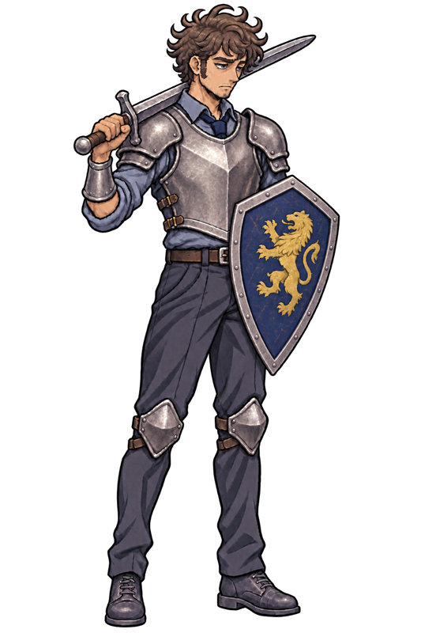
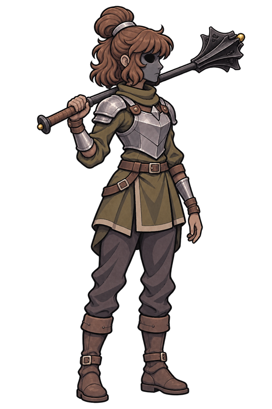
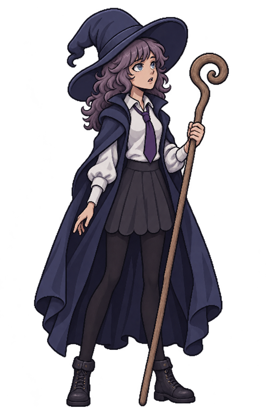
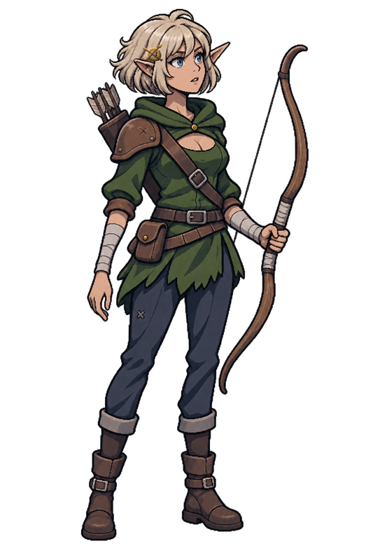

# Personajes

### Protagonista(s)

### Valerian

**Rol:** Caballero miembro del equipo de héroes reencarnados.

**Función jugable:** Controlado durante combate por turnos por el jugador.

**Función narrativa:** Extraño para el resto de héroes pero encargado de liderar. Actúa como la voz de la razón y el sentido común durante la historia.

**Descripción física:** 1.75 m de estatura. Complexión estándar, con la espalda ligeramente tensa por años de mala postura en sillas ergonómicas baratas y manos que solían tener callos de teclado, no de empuñadura. Su rostro refleja el desgaste de la treintena: ojeras crónicas marcadas, barba descuidada de varios días y cabello castaño revuelto.

**Personalidad:** 
Estoico, decidido, de temperamento rudo. Los años de un trabajo aburrido y tedioso le han dejado con una personalidad que no tolera bromas y errores.
Sin embargo, esta segunda oportunidad le llena de esperanza y determinación. 
**Motivaciones:**
La posibilidad de libertar y de una verdadera jubilación.
**Objetivos:**
Jubilarse de verdad. Su objetivo no es destronar reyes ni salvar continentes, sino acumular el oro suficiente para comprar un pedazo de tierra fértil lejos de cualquier conflicto geopolítico, montar una casa pequeña y pasar el resto de sus días durmiendo sin alarmas.
**Conflicto:**
Cambiar su personalidad cerrada para permitirle liderar al resto de los miembros del equipo.
**Relaciones:**
Un completo desconocido, mientras que los otros miembros del equipo fueron amistades en su anterior vida, el es completamente ajeno.
**Habilidades:**
- **Corte del Bastión:** golpe básico de su espada (100 % del daño). Se usa desde P1–P2 y alcanza P1–P2. Sin recarga.
- **Embate de Escudo:** golpe de escudo (90 % del daño) con 30 % de probabilidad de aturdir un turno; avanza una posición si puede. Recarga: 2 turnos.
- **Guardia de Trinchera:** protege a un aliado durante 2 turnos: Valerian gana +15 % de protección e intercepta el 50 % del daño directo dirigido a ese aliado. Recarga: 2 turnos.
- **Herida Profunda:** golpe (85 % del daño) que provoca Sangrado de 2 de daño durante 2 turnos. Recarga: 1 turno.
**Debilidades:**
No tiene ninguna clase de habilidad o resistencia mágica. Es un hombre mortal con una armadura y una espada.
**Referencias visuales:**

*Imagen base de Valerian.*

### Noelle

**Rol:** Clérigo miembro del equipo de los héroes reencarnados.

**Función jugable:** Controlada por el jugador durante el combate por turnos.

**Función narrativa:** 
Comienza como una mera unidad de apoyo orientada a la restauración; no obstante, conforme profundiza su vínculo con la deidad que encarna el jugador, es capaz de resquebrajar su faceta defensiva y trascender sus inseguridades. Al convertirse en el bastión del equipo, su potencial divino y artes curativas se incrementan exponencialmente.

**Descripción física:** 
Luce una melena castaña oscura y oculta su rostro tras una máscara de hierro marcada por una hendidura oxidada en el flanco derecho. Su atuendo consiste en una túnica desgastada verde olivo sobre pantalones holgados tono caqui.

Protege el torso mediante un chaleco de cuero reforzado por una placa metálica dispuesta sobre el pecho.

**Personalidad:**
Con máscara: Tímida y reservada pero extremadamente determinada, no es expresiva y rara vez se comunica con el equipo, prefiriendo asistir en silencio.

Sin máscara: Expresiva, habladora y con deseo de ayudar e inspirar al equipo durante y fuera de combate.

**Motivaciones:**
Apoyar a sus compañeros para derrotar al rey demonio para poder vivir en paz en el nuevo mundo como una segunda oportunidad en su vida.

**Objetivos:**
Derrotar al rey demonio y buscar un lugar al que pertenezca en este nuevo mundo.
**Conflicto:**
Se le ha dado el rol de clérico sin embargo ella no poseé  la fe necesaria para despertar sus poderes divinos, queda en el jugador ayudar a la clérigo a despertar su fe y permitirle desarrollar su máximo potencial.

**Relaciones:**
Es amiga de la Maga y Arquera mientras que apenas y conoce al caballero. De esta forma, ella tiene una afinidad natural hacía sus amigas y una desconfianza bastante marcada hacía el caballero.

**Arco del personaje:**
Inicia siendo extremadamente desconfiada del jugador y del caballero.

Aprende a confiar en ella misma, en el jugador y en el caballero para finalmente poder trabajar en equipo y tener sinergía.

**Habilidades:**
Noelle mantiene cuatro habilidades activas. En **La máscara rota** ocurre un intercambio de habilidades: el conjunto enmascarado se retira y entra el conjunto divino.

Enmascarada, hasta completar el evento:
- Golpe de Lucero: Ataque físico básico.
- Impacto Quebrantador: Ataque físico contundente, daña la armadura del oponente y aturde.
- Resistencia Obstinada: Aumenta su defensa considerablemente.
- Auxilio Improvisado: Cura a un aliado usando suministros convencionales.

Sin máscara, desde el intercambio y hasta el final de la sesión:
- Impacto Consagrado: Ataque físico con energía sagrada imbuida, debilita a los oponentes.
- Plegaria Focalizada: Cura a un aliado por medio de una plegaria divina.
- Bendición Continua: Cura constantemente al equipo.
- Amparo Divino: Aumenta la resistencia del equipo.

**Debilidades:**
Al inicio su inseguridad y desconfianza reducen la efectividad de sus ataques especiales y mágicos pero fortalecen su defensa y ataque físicos.
Posteriormente, al perder su máscara y armadura, se vuelve más vulnerable al daño físico.
**Frases o tono de diálogo:**
Enmascarada:
- "No tengo suficientes vendas para todas sus heridas."
- "¡Se supone que tienes un escudo, úsalo!"
- "¿Otra vez? Aprende a esquivar mejor."
- "Toma esto bestia inmunda."
- "¡Quiten me estos monstruos de encima!"
- "¡Eso duele!"
**Referencias visuales:**

*Imagen base de Noelle.*

### Evanora

**Rol:** Maga miembro del equipo de héroes reencarnados.

**Función jugable:** Controlada por el jugador durante combate.

**Función narrativa:** Entropía del grupo, debido a su amnesia, fuerte poder pero complejidad débil, actúa como una fuente de conflicto y energía constante.

**Descripción física:** 1.62 m de estatura. Su tez es pálida, acentuada por una mirada calculadora, distante y gélida. Destaca su melena ondulada de un matiz lavanda oscuro, entrelazada con destellos magenta extremadamente vibrantes.

Porta un atuendo heterogéneo: la túnica azul clásica de una academia mágica, abierta sobre un uniforme estudiantil compuesto por blusa blanca, chaleco rosado, falda corta en tono púrpura y botas oscuras que se extienden hasta el muslo. Acompaña su figura sosteniendo firmemente su báculo de maga.

**Personalidad:** 

**Motivaciones:** Su equipo es su motivación, la única cosa que conoce en debido a su amnesia.

**Objetivos:** 
- Recuperar su memoria.
- Traer paz a las Llanuras Centrales.
- Proteger a su equipo.

**Conflicto:** Su personalidad es poco constante y cambiante, su estado mental frágil debido a que poco a poco recupera sus recuerdos.

**Relaciones:** Aunque era amiga de la arquera y la clérigo en su anterior vida, al reencarnar la amnesia le hace creer que sus amigas son completas extrañas, mucho menos hablar del caballero, el cual ni siquiera la conoce.

**Arco del personaje:** Recupera sus memorias pero descubre que la persona que solía ser y quien es ahora son fundamentalmente distintas, deberá elegir que lado de ella conservar y cual dejar atrás.

**Habilidades:** Dominio de las artes arcanas por naturaleza, tiene una conexión sobrenatural con el mundo arcano y las extrañas energías del mundo.
Utiliza esta conexión para conjurar poderosos hechizos para arrasar con los enemigos más fuertes.
- **Orbe Arcano:** ataque de energía mágica pura (100 % del daño). Solo desde la retaguardia (P3–P4); alcanza las cuatro posiciones enemigas. Sin recarga.
- **Llamarada:** energía mágica convertida en fuego sobrenatural (85 % del daño) que aplica Quemadura de 2 de daño durante 2 turnos. Alcanza las posiciones enemigas P3–P4. Recarga: 1 turno.
- **Ruptura Ígnea:** golpe arcano (100 % del daño); contra un enemigo con Quemadura causa 150 % y consume la Quemadura. Se usa desde P3–P4 y alcanza P1–P4. Recarga: 2 turnos.
- **Golpe de Meteorito:** conjuración poderosa y agotadora que impacta a **todos** los enemigos (100 % a cada uno) y puede aplicar Quemadura (50 % de probabilidad). Solo puede usarse desde la ronda 3. Recarga: 3 turnos.

**Debilidades:**
Su amnesia la hace un personaje inconstante y dispuesta a cambios.
Su cuerpo es débil y frágil, presentando debilidad ante prácticamente cualquier daño y físico.

**Referencias visuales:**

*Imagen base de Evanora.*

### Elaina

**Rol:** 

**Función jugable:** Arquera especializada en ataques a distancia, identificación de objetivos prioritarios y movilidad dentro de la formación

Su función principal es causar daño a enemigos individuales mediante disparos precisos, aplicar marcas que aumentan el daño recibido por los objetivos y utilizar habilidades de reposicionamiento para mantenerse fuera del alcance de los enemigos.

También puede aprovechar las corrientes de viento para potenciar sus flechas y atravesar parcialmente las defensas enemigas.

**Función narrativa:** Elaina representa la perspectiva de una humana que ha sido trasladada a un mundo desconocido, donde las condiciones de su llegada le impidieron conservar su cuerpo original y provocaron que adquiriera la apariencia de una joven elfa.

A través de sus experiencias, el jugador descubre las costumbres, los peligros y las diferencias entre las razas que habitan este mundo.

Su comportamiento contrasta con el de los elfos nativos, ya que conserva recuerdos, emociones y una mentalidad humana que influyen en su manera de interpretar su entorno.

**Descripción física:** Joven de rasgos élficos y contextura esbelta. De mirada expresiva y constante gesto de asombro o ligera incertidumbre, evidencia poca experiencia en el combate real. Su rostro infantil se complementa con orejas largas y puntiagudas, un peinado de cabello corto y claro con una pequeña trenza lateral ajustada por un broche o símbolo geométrico.

Su atuendo es una mezcla funcional de ropa ligera y protecciones improvisadas: viste una túnica de tela suave con bordes desgastados de piel, complementada por un cuello protector verde abotonado al frente. Sobre el hombro lleva una pieza de armadura acolchada con remiendos y costuras visibles, sujetada por un tahalí o correa de cuero ajustada al pecho con una hebilla metálica. Los antebrazos y muslos presentan vendas de soporte, proyectando la imagen de una recluta o aventurera novata que ha tenido que adaptar y reparar sus propias prendas para adentrarse en los caminos.

**Personalidad:** 
- Expresiva: Manifiesta abiertamente sus emociones, especialmente el asombro, la incertidumbre y la curiosidad.
- Inexperta: Aunque posee talento natural, todavía desconoce muchos peligros del mundo y carece de experiencia en situaciones de combate real.
- Perseverante: A pesar de sus limitaciones y temores, continúa esforzándose por superar los obstáculos que encuentra.

Su perspectiva es diferente a la de los elfos nativos, ya que conserva una mentalidad más cercana a la de su vida anterior.

**Motivaciones:** Elaina desea comprender por qué fue enviada a ese mundo y cuál es la razón por la que tuvo que adoptar un cuerpo élfico.

También busca adaptarse a su nueva existencia sin perder los recuerdos y la identidad que la conectan con su vida anterior.

**Objetivos:**

Objetivo principal: Descubrir las circunstancias de su llegada al nuevo mundo y comprender su transformación en elfa.

Objetivos secundarios:

- Aprender a desenvolverse con su nuevo cuerpo.
- Comprender las características y capacidades de la raza élfica.
- Desarrollar sus habilidades como arquera.
- Descubrir si existe alguna posibilidad de regresar a su mundo de origen.
- Construir relaciones de confianza con sus compañeros de aventura.

**Conflicto:**
Conflicto interno: Elaina enfrenta una crisis de identidad al encontrarse en un cuerpo perteneciente a una raza diferente de la suya. Aunque conserva su conciencia y recuerdos humanos, debe acostumbrarse a una apariencia y capacidades que desconoce.

Conflicto externo: Su desconocimiento del mundo y de las costumbres élficas dificulta su adaptación. Además, debe enfrentarse a los peligros de un entorno donde su inexperiencia puede poner en riesgo su vida y la de sus compañeros.

**Relaciones:** Amiga de Noelle (clérigo) y Evanora (maga) en su vida anterior.

**Arco del personaje:**
Inicio: Elaina despierta en un mundo desconocido dentro de un cuerpo élfico. Se siente confundida por su transformación y desconoce las circunstancias que la llevaron hasta allí.

Desarrollo: Durante sus aventuras, comienza a comprender las capacidades de su nuevo cuerpo y a desarrollar sus habilidades como arquera. Al mismo tiempo, descubre las diferencias entre su antigua vida humana y la sociedad élfica.

Clímax: Elaina debe enfrentarse a una situación que pone a prueba su identidad y la obliga a decidir qué significa realmente pertenecer a ese mundo.

Resolución: Aprende a aceptar su nueva existencia sin renunciar a los recuerdos y experiencias que formaron su identidad humana. Su transformación deja de representar únicamente una pérdida y se convierte en parte de su crecimiento personal.

**Habilidades:**
- **Disparo Certero:** disparo básico (100 % del daño) que ignora el 50 % de la evasión del objetivo. Se usa desde P2, P3 o P4 y alcanza las cuatro posiciones enemigas. Sin recarga.
- **Flecha Perforante:** disparo de alta potencia (110 % del daño) impulsado por el viento que ignora el 50 % de la protección del objetivo. Recarga: 2 turnos.
- **Marca del Cazador:** marca a un enemigo durante 3 turnos; su siguiente ataque directo recibido causa ×2 de daño (la marca se consume aunque el ataque falle). Recarga: 2 turnos.
- **Tiro Evasivo:** disparo (80 % del daño) mientras retrocede una posición y gana +15 % de evasión hasta su siguiente turno. Se usa desde P2 o P3. Recarga: 1 turno.

**Debilidades:**
- Al ser reencarnada en un cuerpo élfico, Elaina carece de la fuerza física y resistencia que poseía en su forma humana. Esto la hace más vulnerable a ataques físicos y le dificulta realizar tareas que requieren fuerza bruta.
-
**Referencias visuales:**

*Imagen base de Elaina.*

### Antagonista

### Capitán de las Fuerzas Expedicionarias

**Rol:** Antagonista principal, líder de las fuerzas del rey demonio.

**Función jugable:** Jefe final de la demo. Se enfrenta en el Trono Sellado después de completar C1 y C2. No es un personaje controlado por el jugador.

**Función narrativa:** Jefe militar del rey demonio, encargado de liderar las fuerzas invasoras y mantener el control sobre los territorios conquistados. Su presencia representa la amenaza constante que enfrenta el grupo de héroes reencarnados. Jefe final del alcance de la demo.

**Descripción física:** Cabeza esquelética con un traje militar oscura, inspirado en las fuerzas expedicionarias británicas de la Primera Guerra Mundial. Gorra de oficial con googles de aviador, bufanda verde y guantes de cuero. Su ojo izquierdo esta vendado por completo, mientras que ojo derecho esta vacío excepto por una púpila espectral de color rojo neón. Su cuerpo es delgado y alto, con una postura rígida y militar. Porta un sable ceremonial. En su hombro derecho porta una pieza de armadura metálica, mismo material plateado que cubre su pecho y parte de su espalda.

**Personalidad:** Frío, extremadamente cínico y calculador. Su lealtad al rey demonio es absoluta, y su objetivo principal es cumplir con las órdenes de su señor: Obtener información y debilitar los asentamientos humanos de las Llanuras Centrales para facilitar la invasión del Rey Demonio.

**Motivaciones:** Lealtad al rey demonio y deseo de cumplir con su deber militar. Busca demostrar su valía como líder y estratega, asegurando la victoria de las fuerzas del rey demonio en la guerra.

**Objetivos:** 
- Obtener información sobre los héroes reencarnados y sus habilidades para anticipar sus movimientos y estrategias.
- Debilitar los asentamientos humanos de las Llanuras Centrales mediante ataques estratégicos y sabotajes.
- Asegurar la victoria de las fuerzas del rey demonio en la guerra, consolidando su posición como líder militar y ganando reconocimiento ante su señor.

**Conflicto:**
- Los héroes reencarnados son entidades completamente ajenas al mundo y la guerra. Siendo completamente impredecibles ante los ojos de un estratega militar cuya experiencia se basa en la guerra actual.
- La naturaleza sobrenatural de los héroes reencarnados hace que sus acciones sean impredecibles y que sus motivaciones no sean comprensibles para un soldado común.
- Los rumores de que los héroes estan siendo guíados por una deidad desconocida generan desconfianza y temor entre las fuerzas del rey demonio, lo que complica la planificación y ejecución de sus estrategias.

**Relaciones:**
- Su relación con el rey demonio es de subordinación absoluta, cumpliendo sus órdenes sin cuestionarlas y buscando siempre la aprobación de su señor.
- Su relación con los héroes reencarnados es de antagonismo, viéndolos como una amenaza directa a los planes del rey demonio y buscando constantemente formas de derrotarlos y obtener información sobre ellos.
- Su relación con sus subordinados es de respeto y autoridad, esperando lealtad y disciplina.

**Arco del personaje:**
Comienza como una figura mística para los héroes reencarnados. Al final de la demo, en el Trono Sellado de la Corrupción del Bosque, se revela como antagonista tangible y el obstáculo más difícil del recorrido.

**Habilidades:**
Seis habilidades repartidas en dos fases (ver [[03 - Enemigos y NPC]]):
- **Sablazo de Campaña:** ataque físico básico (100 % del daño).
- **Interrogatorio Implacable:** golpe (80 % del daño) que reduce el daño del objetivo un 15 % durante 2 turnos. Recarga: 2.
- **Objetivo Prioritario:** golpe (70 % del daño) que marca a un protagonista: el siguiente ataque directo del Capitán contra él causa +35 % de daño. Recarga: 3.
- **Disciplina de Hierro:** gana +15 % de protección durante 2 turnos. Recarga: 3.
- **Fuego de Supresión:** ataque de área anunciado que golpea al siguiente turno a la primera línea (P1–P2) o a la retaguardia (P3–P4). Recarga: 4.
- **Última Orden** (solo en «Última resistencia», al bajar del 50 % de vida): ataque inmediato a todos los protagonistas (60 % del daño) que reduce su daño un 10 % durante 1 turno. Recarga: 4.

Estadísticas: 120 HP, daño 5–8, protección 10 %, evasión 5 %, velocidad 6, crítico 8 %. Es inmune al aturdimiento y lo acompaña un Corrupto Errante.

**Debilidades:**
Su ataque más peligroso se anuncia un turno antes, por lo que se puede esquivar recolocando a los héroes. Al caer, el enemigo restante huye del campo.

**Frases o tono de diálogo:**
- "Tú dios no es más que un mito, y yo soy la prueba de ello."
- "No hay lugar para la misericordia en la guerra, solo para la victoria."
- "La muerte es lo único que los espera."
- "Jamás pondrás un dedo sobre mi señor, y si lo haces, pagarás con tu vida."
### Personajes secundarios

Los personajes secundarios y los NPC quedaron descartados como características del proyecto. No hay una lista pendiente para una versión posterior. La decisión está registrada en [[01 - Alcance]].

> **Navegación:** [[00 - Índice]] · ← [[02 - Mundo]] · [[04 - Diálogos y Narrativa]] →
