# Enemigos y NPC

## Cómo leer las estadísticas

- **Vida (HP):** puntos de vida. Un enemigo que llega a 0 es derrotado y desaparece del campo con un efecto de calavera.
- **Daño:** rango de la tirada de un golpe; cada ataque sortea un valor entre el mínimo y el máximo, aplica el porcentaje de la habilidad y suma su daño base. Después se aplican crítico, protección y marcas.
- **Protección:** porcentaje de daño que se descarta (tope de ±50 %). La penetración solo reduce una protección positiva.
- **Evasión:** probabilidad de esquivar un ataque directo (tope de 40 %).
- **Crítico:** probabilidad de que un golpe que acierta cause ×1,5 de daño.
- **Daño periódico:** el Sangrado, la Quemadura y el Veneno de los enemigos usan un porcentaje del daño del golpe que los aplica (Lobo Salvaje, Corrupto Errante y Hechicero Corrupto: 30 %).
- **Posiciones:** cada equipo tiene cuatro posiciones (P1 al frente, P4 al fondo; los enemigos E1 a E4 se leen de izquierda a derecha). Los enemigos pueden atacar a cualquiera de las posiciones de los héroes que su habilidad alcance.

## Relación de los enemigos con la historia

Los enemigos de Reencarnación Express aparecen durante el avance de los protagonistas por las Llanuras Centrales y el Bosque Oscuro, donde se desarrolla el conflicto contra las fuerzas expedicionarias del Rey Demonio.

En Pradera, el equipo se enfrenta a diferentes grupos de goblins mientras aprende a combatir y avanza por los territorios humanos amenazados.

En Bosque, aparecen lobos salvajes, bandidos, chamanes y guardianes forestales. Estos enfrentamientos representan los peligros del territorio en el que operan las fuerzas expedicionarias.

En Corrupción, los protagonistas enfrentan criaturas corruptas que reflejan el deterioro provocado en parte del Bosque Oscuro. Estos enemigos representan una amenaza mayor y preparan al equipo para el enfrentamiento final.

La historia todavía no establece la afiliación individual de todos los tipos de enemigos. Por ello, no se considera automáticamente que cada criatura encontrada sea un miembro directo de las fuerzas del Rey Demonio.

El capitán de las fuerzas expedicionarias es el jefe final de la demo (ficha en el Capítulo 4).

# Capítulo 1: Llanuras Centrales

## Enemigo 01: Goblin común

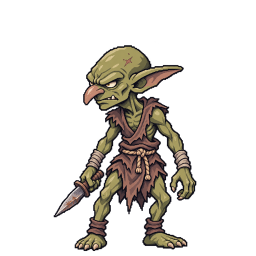
*Sprite actual: Goblin común*


**Rol de combate:**
Atacante cuerpo a cuerpo básico.

**Comportamiento:**
Realiza ataques físicos contra los protagonistas que se encuentran dentro de su alcance. Su inteligencia artificial utiliza principalmente ataques básicos, aunque ocasionalmente puede ejecutar una habilidad más poderosa.

**Vida:** 14 HP.
**Daño:** 3–5 por golpe.
**Protección:** 0 %.
**Evasión:** 3 %.
**Velocidad:** 5.
**Crítico:** 2 % (×1,5).

**Rango de detección:**
No aplica como distancia de exploración. Durante el combate selecciona objetivos válidos según el alcance de sus habilidades.

**Ataques y habilidades:**
- **Garrotazo:** Ataque básico. Sin recarga.
- **Golpe Torpe:** Ataque: +1 de daño base; Debilitamiento (−10 % de daño, 1 turno), 25 % de probabilidad. Recarga: 3 turnos.


**Debilidades:**
Su baja defensa y cantidad de vida lo hacen vulnerable a ataques físicos y mágicos. Su alcance cuerpo a cuerpo también limita los objetivos que puede atacar.

**Recompensa:**
Forma parte de encuentros que entregan 50 XP y 25 Coronas al completarse. No entrega recompensas individuales.

**Estados de IA:**
Evaluar objetivos → Seleccionar ataque disponible → Atacar o reposicionarse → Finalizar turno.

---

## Enemigo 02: Goblin arquero

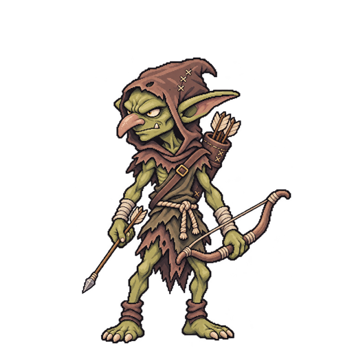
*Sprite actual: Goblin arquero*


**Rol de combate:**
Atacante físico a distancia.

**Comportamiento:**
Utiliza ataques a distancia para dañar a los protagonistas desde posiciones posteriores. Puede atacar a diferentes objetivos según su alcance y aprovechar ataques especiales cuando están disponibles.

**Vida:** 12 HP.
**Daño:** 3–5 por golpe.
**Protección:** 0 %.
**Evasión:** 7 %.
**Velocidad:** 7.
**Crítico:** 4 % (×1,5).

**Rango de detección:**
No aplica como detección en tiempo real. Sus ataques pueden alcanzar distintas posiciones enemigas según las restricciones de sus habilidades.

**Ataques y habilidades:**
- **Disparo Preciso:** Ataque: +1 de daño base; +10 puntos de probabilidad de crítico. Recarga: 3 turnos.
- **Flechazo:** Ataque básico. Sin recarga.


**Debilidades:**
Tiene poca vida y defensa, por lo que puede ser eliminado rápidamente mediante ataques de largo alcance.

**Recompensa:**
Incluida en la recompensa global del encuentro: 50 XP y 25 Coronas.

**Estados de IA:**
Evaluar objetivos → Verificar alcance → Seleccionar disparo → Atacar o reposicionarse → Finalizar turno.

---

## Enemigo 03: Goblin bruto

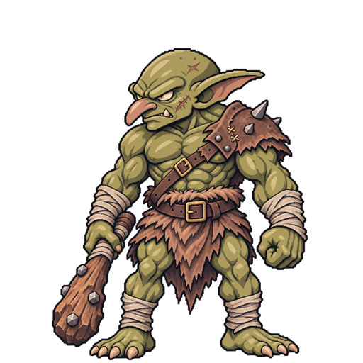
*Sprite actual: Goblin bruto*


**Rol de combate:**
Atacante resistente de primera línea.

**Comportamiento:**
Utiliza ataques físicos potentes y busca presionar a los personajes que se encuentran al frente del equipo. Su resistencia es superior a la de los demás goblins.

**Vida:** 22 HP.
**Daño:** 4–7 por golpe.
**Protección:** 10 %.
**Evasión:** 0 %.
**Velocidad:** 3.
**Crítico:** 3 % (×1,5).

**Rango de detección:**
No aplica como distancia de exploración. Sus ataques son principalmente cuerpo a cuerpo.

**Ataques y habilidades:**
- **Mazazo:** Ataque básico. Sin recarga.
- **Pisotón:** Ataque: +1 de daño base; Debilitamiento (−15 % de daño, 1 turno), 40 % de probabilidad. Recarga: 3 turnos.


**Debilidades:**
Su velocidad reducida permite que varios protagonistas actúen antes que él. Puede ser debilitado mediante efectos negativos y ataques concentrados.

**Recompensa:**
Forma parte de los encuentros de Pradera, que otorgan 50 XP y 25 Coronas por victoria.

**Estados de IA:**
Evaluar objetivos → Seleccionar ataque → Atacar o reposicionarse → Finalizar turno.

---

# Capítulo 2: Bosque Oscuro

## Enemigo 04: Lobo salvaje

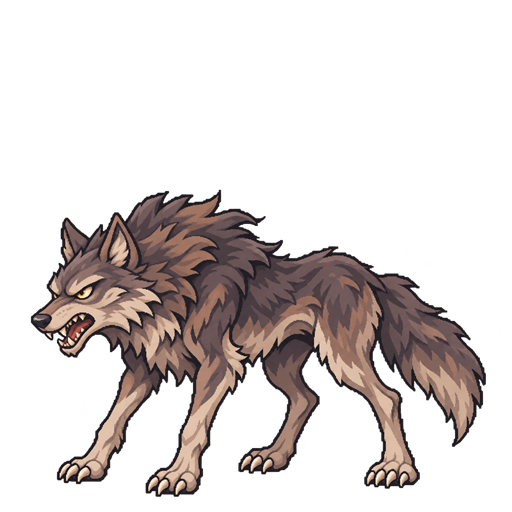
*Sprite actual: Lobo salvaje*


**Rol de combate:**
Atacante rápido de cuerpo a cuerpo.

**Comportamiento:**
Aprovecha su velocidad para atacar y puede concentrar ocasionalmente sus ataques sobre protagonistas debilitados. Sus habilidades pueden provocar daño periódico.

**Vida:** 18 HP.
**Daño:** 4–6 por golpe.
**Protección:** 0 %.
**Evasión:** 12 %.
**Velocidad:** 8.
**Crítico:** 5 % (×1,5).

**Rango de detección:**
No aplica en exploración. Sus habilidades ofensivas tienen alcance cuerpo a cuerpo.

**Ataques y habilidades:**
- **Colmillo Venenoso:** Ataque: Veneno (30 % del daño del golpe por turno, 3 turnos), 50 % de probabilidad. Recarga: 2 turnos.
- **Mordida:** Ataque básico. Sin recarga.


**Debilidades:**
Depende de su alcance cuerpo a cuerpo y puede ser neutralizado mediante protección, control de posiciones y ataques concentrados.

**Recompensa:**
Incluida en los encuentros de Bosque, que entregan 100 XP y 40 Coronas por victoria.

**Estados de IA:**
Evaluar objetivos → Identificar oportunidad → Seleccionar ataque → Atacar o reposicionarse → Finalizar turno.

---

## Enemigo 05: Bandido

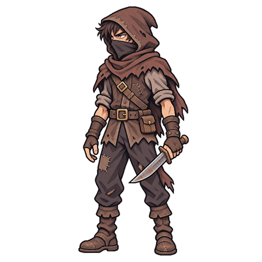
*Sprite actual: Bandido*


**Rol de combate:**
Atacante físico con capacidad de debilitamiento.

**Comportamiento:**
Ataca a los protagonistas y utiliza habilidades que reducen su capacidad ofensiva. Su IA puede priorizar personajes que representen una amenaza estratégica.

**Vida:** 26 HP.
**Daño:** 5–7 por golpe.
**Protección:** 5 %.
**Evasión:** 6 %.
**Velocidad:** 6.
**Crítico:** 4 % (×1,5).

**Rango de detección:**
No aplica como distancia de exploración. Utiliza ataques principalmente cuerpo a cuerpo.

**Ataques y habilidades:**
- **Ataque Sucio:** Ataque: +1 de daño base; Debilitamiento (−20 % de daño, 2 turnos). Recarga: 3 turnos.
- **Cuchillada:** Ataque básico. Sin recarga.


**Debilidades:**
Su dependencia del combate cercano puede limitar sus opciones cuando los objetivos están fuera de alcance. También puede ser afectado por habilidades de debilitamiento y protección.

**Recompensa:**
Incluida en la recompensa del encuentro: 100 XP y 40 Coronas.

**Estados de IA:**
Evaluar amenazas → Seleccionar objetivo → Aplicar ataque o debilitamiento → Finalizar turno.

---

## Enemigo 06: Chamán del bosque

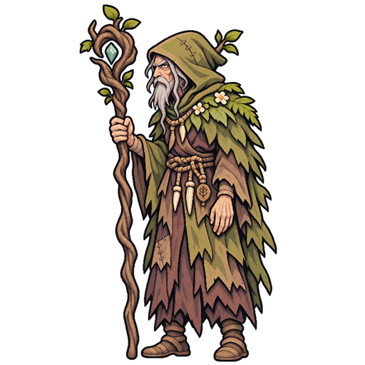
*Sprite actual: Chamán del bosque*


**Rol de combate:**
Unidad de apoyo mágico y curación.

**Comportamiento:**
Analiza el estado de sus aliados para determinar cuándo utilizar habilidades curativas. También puede atacar a distancia o debilitar la defensa de los protagonistas.

**Vida:** 20 HP.
**Daño:** 3–5 por golpe.
**Protección:** 0 %.
**Evasión:** 4 %.
**Velocidad:** 6.
**Crítico:** 3 % (×1,5).

**Rango de detección:**
No aplica en exploración. Utiliza habilidades de ataque y apoyo desde las posiciones permitidas.

**Ataques y habilidades:**
- **Curación Primitiva:** Curación: cura 5 HP. Recarga: 3 turnos.
- **Descarga Natural:** Ataque básico. Sin recarga.
- **Maldición:** Ataque: Vulnerabilidad (−10 % de protección, 2 turnos). Recarga: 3 turnos.


**Debilidades:**
Posee poca vida y defensa. Eliminarlo de manera temprana puede impedir que continúe recuperando a sus aliados o debilitando al equipo.

**Recompensa:**
Forma parte de encuentros que otorgan 100 XP y 40 Coronas.

**Estados de IA:**
Evaluar aliados y enemigos → Priorizar curación o ataque → Seleccionar habilidad válida → Ejecutar acción → Finalizar turno.

---

# Capítulo 3: Corrupción del Bosque

## Enemigo 08: Corrupto errante

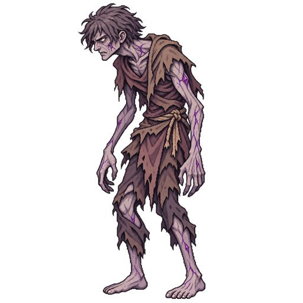
*Sprite actual: Corrupto errante*


**Rol de combate:**
Atacante físico resistente con daño periódico.

**Comportamiento:**
Busca presionar constantemente al equipo mediante ataques físicos y la aplicación de sangrado.

**Vida:** 28 HP.
**Daño:** 5–7 por golpe.
**Protección:** 5 %.
**Evasión:** 4 %.
**Velocidad:** 6.
**Crítico:** 4 % (×1,5).

**Rango de detección:**
No aplica como detección en tiempo real. Sus ataques dependen del alcance establecido en sus habilidades.

**Ataques y habilidades:**
- **Herida Infectada:** Ataque: +1 de daño base; Sangrado (30 % del daño del golpe por turno, 3 turnos). Recarga: 2 turnos.
- **Zarpazo Corrupto:** Ataque básico. Sin recarga.


**Debilidades:**
Puede ser controlado mediante efectos negativos y habilidades que reduzcan su daño. El sangrado aplicado por este enemigo puede eliminarse mediante antídotos.

**Recompensa:**
Forma parte de encuentros que otorgan 150 XP y 60 Coronas por victoria.

**Estados de IA:**
Evaluar objetivos → Identificar oportunidades → Seleccionar ataque → Atacar o reposicionarse → Finalizar turno.

---

## Enemigo 09: Acechador oscuro

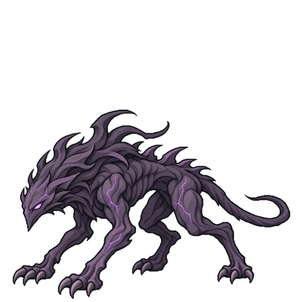
*Sprite actual: Acechador oscuro*


**Rol de combate:**
Atacante rápido de alto daño.

**Comportamiento:**
Prioriza oportunidades ofensivas y puede utilizar ataques poderosos contra protagonistas vulnerables. Representa una amenaza importante por su velocidad y capacidad de daño.

**Vida:** 26 HP.
**Daño:** 6–8 por golpe.
**Protección:** 0 %.
**Evasión:** 12 %.
**Velocidad:** 8.
**Crítico:** 8 % (×1,5).

**Rango de detección:**
No aplica en exploración. Sus ataques pueden alcanzar diferentes posiciones dependiendo de la habilidad.

**Ataques y habilidades:**
- **Ataque Letal:** Ataque: +2 de daño base. Recarga: 3 turnos.
- **Corte Sombrío:** Ataque básico. Sin recarga.


**Debilidades:**
Aunque es veloz y ofensivo, posee menor resistencia que los enemigos defensivos de Corrupción. Puede ser prioritario para habilidades que reduzcan su ataque o permitan eliminarlo rápidamente.

**Recompensa:**
Incluida en la recompensa global del encuentro: 150 XP y 60 Coronas.

**Estados de IA:**
Evaluar vulnerabilidades → Seleccionar objetivo válido → Priorizar ataque ofensivo → Ejecutar acción → Finalizar turno.

---

## Enemigo 10: Hechicero corrupto

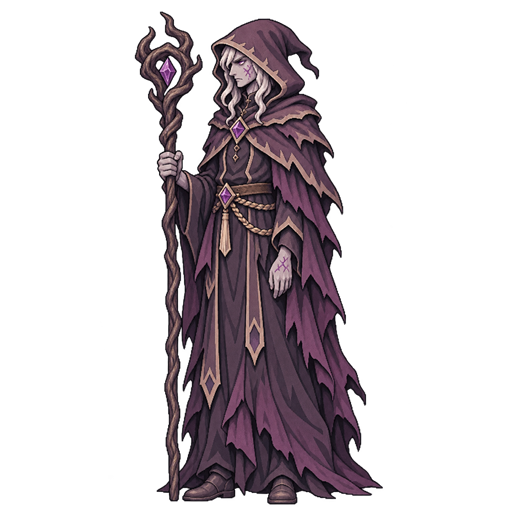
*Sprite actual: Hechicero corrupto*


**Rol de combate:**
Atacante mágico y debilitador.

**Comportamiento:**
Utiliza magia ofensiva y efectos negativos para aumentar el daño que recibe el equipo del jugador. Su inteligencia artificial aprovecha objetivos vulnerables y las oportunidades para aplicar alteraciones de estado.

**Vida:** 25 HP.
**Daño:** 5–7 por golpe.
**Protección:** 0 %.
**Evasión:** 4 %.
**Velocidad:** 7.
**Crítico:** 7 % (×1,5).

**Rango de detección:**
No aplica como detección en tiempo real. Sus habilidades mágicas tienen alcance determinado por las reglas del combate.

**Ataques y habilidades:**
- **Llama Corrupta:** Ataque: +1 de daño base; Quemadura (30 % del daño del golpe por turno, 3 turnos). Recarga: 2 turnos.
- **Maleficio:** Ataque: Vulnerabilidad (−10 % de protección, 2 turnos). Recarga: 3 turnos.
- **Orbe Maldito:** Ataque básico. Sin recarga.


**Debilidades:**
Posee una vida y defensa relativamente bajas. El jugador puede disminuir su impacto mediante ataques prioritarios, protección y habilidades que afecten su capacidad ofensiva.

**Recompensa:**
Forma parte de encuentros que entregan 150 XP y 60 Coronas.

**Estados de IA:**
Evaluar objetivos → Revisar estados activos → Seleccionar ataque o debilitamiento → Ejecutar acción → Finalizar turno.

---

## Enemigo 11: Guardián corrupto

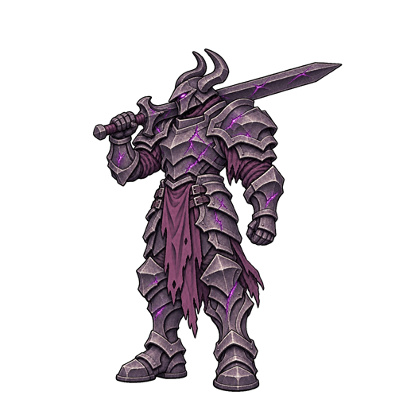
*Sprite actual: Guardián corrupto*


**Rol de combate:**
Defensor de alta resistencia y atacante pesado.

**Comportamiento:**
Utiliza ataques físicos poderosos y habilidades defensivas para prolongar su supervivencia. Su inteligencia artificial decide cuándo fortalecer su defensa y cuándo aprovechar sus ataques de mayor potencia.

**Vida:** 65 HP.
**Daño:** 6–8 por golpe.
**Protección:** 20 %.
**Evasión:** 0 %.
**Velocidad:** 3.
**Crítico:** 6 % (×1,5).
**Tamaño:** ocupa dos posiciones de la formación (ver «Enemigos grandes»).

**Rango de detección:**
No aplica en exploración. Sus ataques son principalmente cuerpo a cuerpo.

**Ataques y habilidades:**
- **Coraza Corrupta:** Apoyo a sí mismo: Protección (+10 %, 2 turnos). Recarga: 3 turnos.
- **Golpe Devastador:** Ataque: +2 de daño base. Recarga: 4 turnos.
- **Impacto Pesado:** Ataque básico. Sin recarga.


**Debilidades:**
Su baja velocidad y dependencia de habilidades defensivas permiten utilizar ataques con penetración de defensa y efectos de vulnerabilidad para reducir su resistencia.

**Recompensa:**
Incluida en la recompensa global del encuentro: 150 XP y 60 Coronas.

**Estados de IA:**
Evaluar amenazas → Revisar protección activa → Seleccionar ataque o defensa → Ejecutar acción → Finalizar turno.


# Capítulo 4: Trono Sellado

## Enemigo 12: Capitán de las Fuerzas Expedicionarias (jefe final)

**Rol de combate:**
Jefe táctico que marca objetivos, debilita al equipo y prepara ataques de área.

**Comportamiento:**
Opera en dos fases. En **Comandante calculador** (100 % de vida) alterna golpes, debilitamientos y marcas. Al bajar al 50 % de vida entra en **Última resistencia**: anuncia el cambio con un aviso en pantalla, desbloquea *Última Orden* y su IA prioriza el ataque, los objetivos marcados y los ataques preparados en lugar de reforzarse. Ocupa dos casillas (E3 y E4) y lo acompañan dos Corruptos Errantes en E1 y E2. Si el Capitán cae, los enemigos restantes huyen del campo y el combate termina en victoria sin recompensas adicionales.

**Vida:** 120 HP.
**Daño:** 5–8 por golpe.
**Protección:** 10 %.
**Evasión:** 5 %.
**Velocidad:** 6.
**Crítico:** 8 % (×1,5).

**Inmunidades:** los jefes son inmunes al aturdimiento.

**Ataques y habilidades:**
- **Disciplina de Hierro:** Apoyo a sí mismo: Protección (+15 %, 2 turnos). Recarga: 3 turnos.
- **Fuego de Supresión:** Ataque a todos los enemigos: se anuncia y golpea en el siguiente turno. Recarga: 4 turnos.
- **Interrogatorio Implacable:** Ataque: 80 % del daño; Debilitamiento (−15 % de daño, 2 turnos). Recarga: 2 turnos.
- **Objetivo Prioritario:** Ataque: 70 % del daño; Objetivo prioritario (+35 % de daño del Capitán, 2 turnos). Recarga: 3 turnos.
- **Sablazo de Campaña:** Ataque básico. Sin recarga.
- **Última Orden:** Ataque a todos los enemigos: 60 % del daño; Debilitamiento (−10 % de daño, 1 turno). Recarga: 4 turnos.

**Debilidades:**
No tiene evasión alta ni protección extrema; su amenaza viene de los estados que impone y del ataque preparado (*Fuego de Supresión*), que se puede esquivar cambiando de posición a los héroes amenazados.

**Recompensa:**
Encuentro final: 200 XP y 100 Coronas.

**Estados de IA:**
Evaluar fase → Revisar marcas y ataque preparado → Seleccionar habilidad → Ejecutar → Finalizar turno.

---

## Enemigos grandes

Un enemigo grande ocupa **dos posiciones** de la formación, como los jefes de *Darkest Dungeon*. Hoy solo lo es el **Guardián Corrupto** (65 HP, la unidad más resistente de la demo):

- Se dibuja centrado entre sus dos posiciones y su barra de vida es más ancha.
- No se mueve, y ninguna otra unidad puede colocarse en su segunda posición; los demás enemigos se reparten el espacio restante.
- Las habilidades de área alcanzan a ambos huecos pero lo golpean una sola vez; las de un solo objetivo lo seleccionan por su posición principal.
- Su encuentro (C2) se diseñó sin Corrupto Errante para dejar su segunda posición libre.

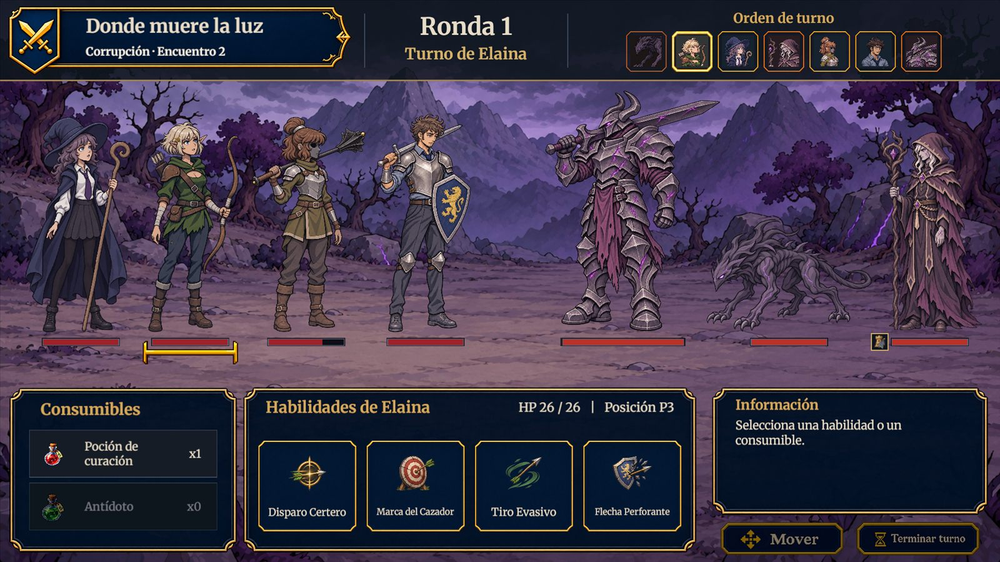
*El Guardián Corrupto ocupa dos posiciones de la formación (Corrupción, encuentro 2)*

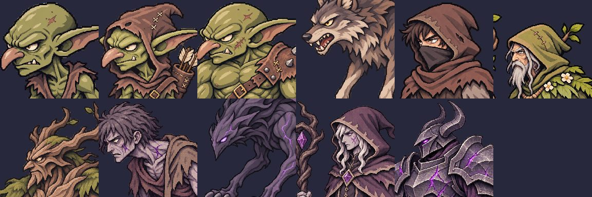
*Retratos de los enemigos usados en la barra de orden de turno*

## Reliquias que portan los enemigos

Para variar los combates normales, al cargar un encuentro cada enemigo tiene un 25 % de portar una reliquia (máximo dos por combate). No ocurre en el jefe, en el prólogo (P1–P4) ni en B1. La lista es corta y excluye las reliquias exclusivas y las que solo tienen sentido para los héroes (consumibles, curación o golpes directos): Amuleto de Corteza, Broche del Vigía, Espina del Juramento, Ídolo del Último Aliento y Reloj de Arena Roto. Sus bonificaciones y desventajas cuentan en las estadísticas del enemigo y su efecto usa las mismas reglas que en los héroes. Un icono pequeño junto a su barra de vida y su ficha de información indican la reliquia que lleva. La reliquia solo existe durante el combate: no se entrega al derrotarlo.

## Composición de los encuentros

| Encuentro | Título | E1 | E2 | E3 | E4 | XP | Coronas |
| --- | --- | --- | --- | --- | --- | --- | --- |
| P1 | Un mal día para cobrar | Goblin común | Goblin común | — | — | 50 | 25 |
| P2 | Flechas en el camino | Goblin común | Goblin arquero | — | — | 50 | 25 |
| P3 | Ecos de Liria | Goblin común | Goblin común | Goblin arquero | — | 50 | 25 |
| P4 | Secretos bajo las ruinas | Goblin bruto | Goblin común | Goblin arquero | — | 50 | 25 |
| B1 | Huellas en la espesura | Lobo salvaje | Lobo salvaje | Lobo salvaje | Chamán | 100 | 40 |
| B2 | Susurros en la oscuridad | Bandido | Bandido | Lobo salvaje | Chamán | 100 | 40 |
| B3 | La última vigilia | Guardián forestal | Bandido | Bandido | Chamán | 100 | 40 |
| C1 | El aliento del Ocaso | Corrupto errante | Corrupto errante | Acechador | Hechicero | 150 | 60 |
| C2 | Donde muere la luz | Guardián corrupto (E1+E2) | — | Acechador | Hechicero | 150 | 60 |
| BOSS | Trono Sellado | Corrupto errante | Corrupto errante | Capitán (E3+E4) | — | 200 | 100 |

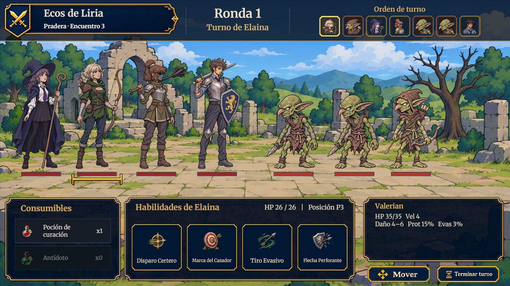
*Encuentro de Pradera con goblins: formación, orden de turno y paneles de información*

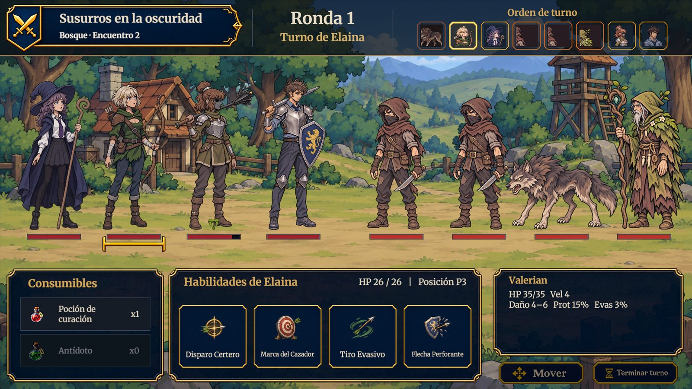
*Encuentro de Bosque: lobo, bandidos y chamán frente a los héroes*

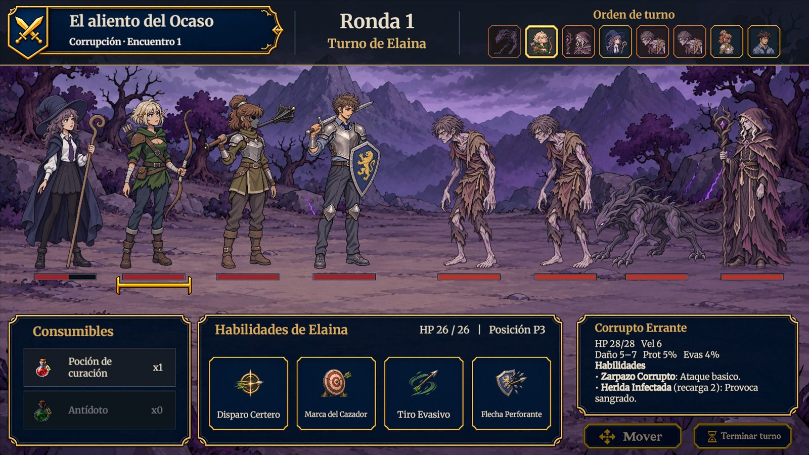
*Encuentro de Corrupción (C1): errantes, acechador y hechicero*

# Funcionamiento general de la inteligencia artificial

A diferencia de los videojuegos con desplazamiento libre, Reencarnación Express no utiliza un sistema de patrullaje, persecución o detección de enemigos en tiempo real.

Los enfrentamientos ocurren dentro de un escenario de combate por turnos, donde los enemigos conocen las unidades participantes y evalúan sus acciones durante el turno correspondiente.

## Diagrama de estados de IA

```text
INICIO DEL TURNO ENEMIGO
           |
           v
   Evaluar estado actual
           |
           v
   Consultar habilidades
       disponibles
           |
           v
   Identificar objetivos
         válidos
           |
           v
   Seleccionar la acción
      más conveniente
           |
       ┌───┴────┐
       |        |
       v        v
   Atacar /   Reposicionarse
   Apoyar      si hace falta
       |        |
       └───┬────┘
           |
           v
     Ejecutar acción
           |
           v
     Finalizar turno
```

> **Navegación:** [[00 - Índice]] · ← [[02 - Niveles]] · [[04 - Objetos y Coleccionables]] →
