# Objetos y Coleccionables

## Descripción de la sección

Define los objetos que el jugador puede recoger, utilizar, equipar, comprar o vender: dos consumibles, un catálogo de 20 reliquias y la moneda del juego (Coronas). Las cifras proceden de los datos reales de Unity (`ConsumableService`, `RelicData`, `RelicShopStock`, `RelicRewards`).

## Objeto 01: Poción de curación

**Tipo:**
Consumible de recuperación.

**Descripción:**
Frasco de líquido rojo que permite recuperar vida de un protagonista durante un combate y, además, **levanta a un héroe caído**. Es el recurso de emergencia del equipo cuando las curaciones de Noelle no están disponibles.

**Función:**
Restaura el **30 %** de la vida máxima efectiva (nivel + reliquias) del héroe elegido, redondeado al entero más cercano y con un mínimo de 1 HP. No supera la vida máxima. Si el héroe estaba caído (0 HP), se levanta con esa cantidad de vida.

**Cómo se obtiene:**
- El jugador empieza la partida con una poción.
- Se compra en la tienda del mapa (existencias ilimitadas) por **35 CR**.

**Cómo se utiliza:**
Durante el combate, el jugador abre el panel **Consumibles**, elige la poción y selecciona al aliado: puede hacer clic en su barra de vida o en la imagen del héroe. Usarla consume la acción del turno del personaje que la utiliza.

**Cantidad máxima:**
5 en el inventario.

**Valor:**
Compra: 35 CR. Venta: 18 CR (el 50 % del precio, redondeado).

**Rareza:**
Común.

**Restricciones:**
- Solo se usa en combate; en el mapa el inventario es de consulta.
- No se puede usar sobre un héroe con la vida completa.
- Es el único consumible que levanta a un héroe caído.
- Cuesta la acción del turno.

**Interacciones:**
Se relaciona con los héroes caídos, la Campana del Socorro y las Botas del Mensajero (que reaccionan al uso de consumibles) y con las curaciones de Noelle.

**Representación visual:**
Ícono de un frasco pequeño con líquido rojo. Su cantidad aparece en el panel de consumibles y en el inventario.

---

## Objeto 02: Antídoto

**Tipo:**
Consumible de eliminación de efectos negativos.

**Descripción:**
Contrarresta el daño periódico que producen algunos enemigos.

**Función:**
Elimina **Sangrado, Veneno y Quemadura** del héroe elegido.

**Cómo se obtiene:**
Se compra en la tienda del mapa por **20 CR**. La partida empieza con cero. La tienda tiene **3 unidades** por partida y no las repone.

**Cómo se utiliza:**
En combate, se elige el Antídoto y un héroe vivo que sufra alguno de esos estados. Consume la acción del turno.

**Cantidad máxima:**
5 en el inventario.

**Valor:**
Compra: 20 CR. Venta: 10 CR.

**Restricciones:**
- Solo elimina Sangrado, Veneno y Quemadura; no quita Debilitamiento, Vulnerabilidad ni otros efectos.
- No recupera vida ni levanta héroes caídos.
- Requiere que el objetivo tenga uno de los tres estados.

**Representación visual:**
Ícono de un frasco con líquido verde.

---

## Objeto 03: Reliquias

**Tipo:**
Equipo pasivo.

**Descripción:**
Objetos antiguos que se equipan en la ficha de un personaje. Cada una suma bonificaciones a las estadísticas, casi siempre con una **desventaja**, y muchas añaden un efecto especial que cambia cómo se juega al héroe. Hay reliquias **universales** (las usa cualquiera) y **exclusivas** de un héroe.

**Reglas de equipamiento:**
- Cada héroe tiene **2 casillas** de reliquia.
- Solo se pueden cambiar **fuera de combate**: en la ficha del personaje, arrastrando la reliquia desde el inventario a una casilla (o de vuelta al inventario para quitarla).
- Una unidad concreta solo puede estar en un héroe a la vez, y un héroe no puede llevar dos reliquias del mismo tipo. Dos héroes distintos sí pueden llevar el mismo tipo (una unidad cada uno).
- Las exclusivas solo las equipa su héroe; las que tienen propiedad única no se pueden tener dos veces.
- Las bonificaciones y desventajas se calculan siempre desde lo equipado en ese momento. Daño suma a mínimo y máximo; Protección, Evasión y Crítico son puntos porcentuales. La bonificación de crítico de las reliquias está limitada a +10 puntos en conjunto.
- Cambiar la vida máxima mediante una reliquia no cura: la vida actual solo se recorta si supera el nuevo máximo.

**Cómo se obtienen:**
- **Recompensa de combate (primera victoria de cada encuentro):** una sola tirada por misión. Probabilidad de reliquia: Pradera 65 %, Bosque 80 %, Corrupción 90 %, Jefe 100 %. Rareza: Pradera solo comunes; Bosque 60 % comunes y 40 % raras; Corrupción 30 % y 70 %; el jefe da una rara o una exclusiva disponible. Desde B2 hay un 20 % de que la recompensa sea una exclusiva no poseída; en C2 se garantiza una exclusiva si aún no se consiguió ninguna. Tras dos combates seguidos sin reliquia, el tercero entrega una.
- **Eventos:** «La máscara rota» entrega el Fragmento de la Máscara (Noelle) y «El informe del último vigía» entrega el Broche del Vigía.
- **Tienda:** cuatro espacios, una unidad por espacio (ver Recurso 02).

**Valor:**
Compra: 45–115 CR según la reliquia. Venta: el 50 % del precio de compra (mínimo 1 CR) y solo si no está equipada; las exclusivas y las de evento no se pueden vender.

**Catálogo (20 reliquias: 6 comunes, 6 raras y 8 épicas exclusivas):**

| Reliquia | Rareza | Estadísticas | Efecto | Quién la usa | Cómo se obtiene |
| --- | --- | --- | --- | --- | --- |
| **Amuleto de Corteza Universal** | Común | −1 Velocidad | Cuando recibes daño y quedas por debajo del 50 % de vida, obtienes 10 % de Protección durante 1 turno. Una vez por combate. | Cualquiera | Tienda (45 CR) o recompensa |
| **Anillo del Segundo Intento** | Común | −1 % Protección | Si fallas un ataque directo, tu siguiente ataque directo gana +2 de daño si acierta. Solo una activación por ronda. | Cualquiera | Tienda (45 CR) o recompensa |
| **Botas del Mensajero Universal** | Común | −2 Vida | Después de usar un consumible, el portador obtiene +2 de Velocidad durante sus próximos 2 turnos. | Cualquiera | Tienda (45 CR) o recompensa |
| **Broche del Vigía** | Común | −1 Velocidad | Si terminas tu turno sin causar daño directo, obtienes 15 % de Protección hasta tu siguiente turno. | Cualquiera | Evento «El informe del último vigía», tienda o recompensa |
| **Campana del Socorro Universal** | Común | −1 Daño | La primera curación de cada turno dirigida a un aliado con 50 % o menos de vida restaura 3 HP adicionales. Funciona con habilidades y con consumibles. | Cualquiera | Tienda (45 CR) o recompensa |
| **Colmillo de Lobo Universal** | Común | −3 Vida | El primer ataque directo acertado de cada turno contra un enemigo con Sangrado, Veneno o Quemadura causa 2 puntos de daño adicionales. | Cualquiera | Tienda (50 CR) o recompensa |
| **Dado del Ocaso** | Rara | −1 Velocidad | En tu primer ataque directo que acierte de cada combate, tienes un 50 % de probabilidad de infligir +3 de daño o un 50 % de obtener 15 % de Protección durante 1 turno. | Cualquiera | Tienda (105 CR) o recompensa |
| **Espejo del Dolor Universal** | Rara | −4 Vida | Cuando recibes daño directo, tu siguiente ataque directo acertado inflige +4 de daño. Máximo una vez por ronda; el bono desaparece si no atacas en tu siguiente turno. | Cualquiera | Recompensa de combate |
| **Espina del Juramento** | Rara | −3 Vida | La primera vez que recibes daño directo en cada ronda, el atacante sufre Sangrado de 1 de daño durante 2 turnos. | Cualquiera | Recompensa de combate |
| **Ídolo del Último Aliento Universal** | Rara | −5 Vida | La primera vez que un ataque directo debería derrotarte, sobrevives con 1 HP y después sufres Debilitamiento (−20 % de Ataque) durante 1 turno. Una vez por combate. No protege contra el daño periódico. | Cualquiera | Recompensa de combate |
| **Reloj de Arena Roto Universal** | Rara | −1 % Protección | La primera habilidad que uses en cada combate con enfriamiento de 2 turnos o más reduce su enfriamiento en 1. | Cualquiera | Tienda (110 CR) o recompensa |
| **Sello del Desollador Universal** | Rara | −1 Velocidad | Al acertar un ataque directo contra un enemigo que sufre Sangrado, recuperas 3 HP. Una vez por turno. | Cualquiera | Tienda (115 CR) o recompensa |
| **Cadena del Bastión** | Épica | −3 Vida | Cuando protege a un aliado con Guardia de Trinchera, otro aliado recibe 10 % de Protección durante 1 turno. Una vez por ronda. | Valerian | Recompensa de combate (exclusiva) |
| **Corazón de Carbón** | Épica | −5 Vida | Cuando Evanora acierta un ataque directo contra un enemigo que ya tiene Quemadura, consume uno de sus pulsos pendientes y lo aplica de inmediato con +2 de daño. Una vez por turno; ese pulso no vuelve a ocurrir. | Evanora | Recompensa de combate (exclusiva) |
| **Fragmento de la Máscara** | Épica | −2 Vida | Cambia de efecto con su transformación. Antes de «La máscara rota»: Impacto Quebrantador obtiene +10 puntos de probabilidad de Aturdimiento (los jefes inmunes siguen inmunes). Después: la primera curación de cada turno también concede al objetivo 10 % de Protección durante 1 turno. | Noelle | Evento «La máscara rota» (única) |
| **Insignia de la Trinchera** | Épica | −1 Velocidad | Cuando Valerian intercepta un golpe dirigido a un aliado, devuelve al atacante el 30 % del daño que realmente recibió (mínimo 2, máximo 8). Una vez por ronda. | Valerian | Recompensa de combate (exclusiva) |
| **Ojo del Acechador** | Épica | −1 % Protección | Si un enemigo marcado muere, la Marca se transfiere a otro enemigo vivo. Una vez por combate. | Elaina | Recompensa de combate (exclusiva) |
| **Pluma del Último Halcón** | Épica | −4 Vida | Cuando un ataque directo acertado consume la Marca del Cazador, el enemigo también recibe Sangrado de 2 HP por turno durante 2 turnos. Si el ataque falla, la Marca se consume normalmente y no aplica Sangrado. | Elaina | Recompensa de combate (exclusiva) |
| **Rosario de la Aurora** | Épica | −1 Velocidad | Su primera curación de cada turno también concede Regeneración de 1 vida durante 2 turnos al objetivo. | Noelle | Recompensa de combate (exclusiva) |
| **Velo de Ascuas** | Épica | −1 % Protección | Al comenzar su turno, si hay algún enemigo con Quemadura, Evanora recupera 2 de vida. | Evanora | Recompensa de combate (exclusiva) |

Notas del catálogo:
- Las reliquias de enemigos usan los mismos datos (ver [[03 - Enemigos y NPC]]).
- Las ocho épicas son exclusivas de un héroe (dos por héroe) y solo se consiguen como recompensa de combate o de evento; la tienda vende comunes y raras universales.
- El Fragmento de la Máscara cambia de efecto con la transformación de Noelle.

**Representación visual:**
Icono propio por reliquia con un marco del color de su rareza (común gris, rara azul, épica violeta).

---

### Iconos de las reliquias

|   |   |   |   |   |
| --- | --- | --- | --- | --- |
| 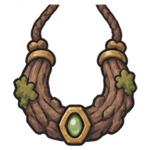 | 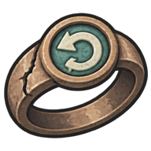 | 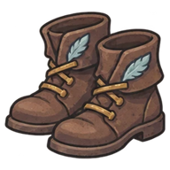 | 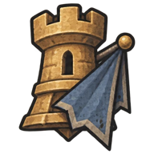 | 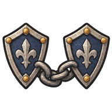 |
| **Amuleto de Corteza** | **Anillo del Segundo Intento** | **Botas del Mensajero** | **Broche del Vigía** | **Cadena del Bastión** |
| 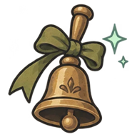 | 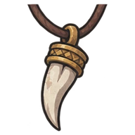 | 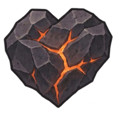 | 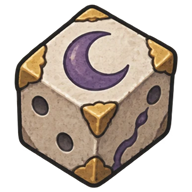 | 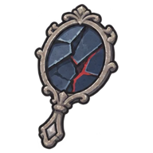 |
| **Campana del Socorro** | **Colmillo de Lobo** | **Corazón de Carbón** | **Dado del Ocaso** | **Espejo del Dolor** |
| 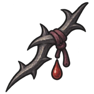 | 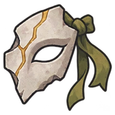 | 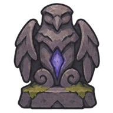 | 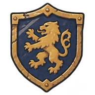 |  |
| **Espina del Juramento** | **Fragmento de la Máscara** | **Ídolo del Último Aliento** | **Insignia de la Trinchera** | **Ojo del Acechador** |
| 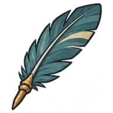 | 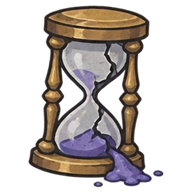 | 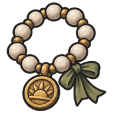 | 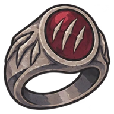 | 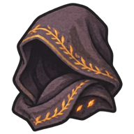 |
| **Pluma del Último Halcón** | **Reloj de Arena Roto** | **Rosario de la Aurora** | **Sello del Desollador** | **Velo de Ascuas** |

*Iconos de las 20 reliquias del juego (copias reducidas).*

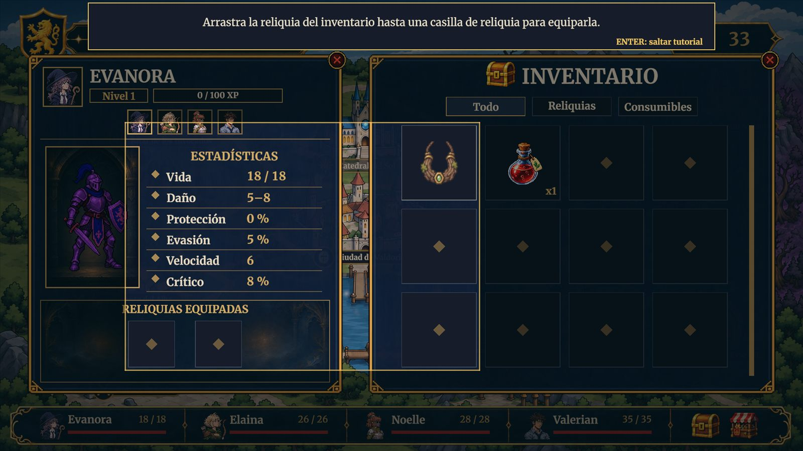
*Inventario abierto con una reliquia lista para arrastrarse a la ficha de un héroe*

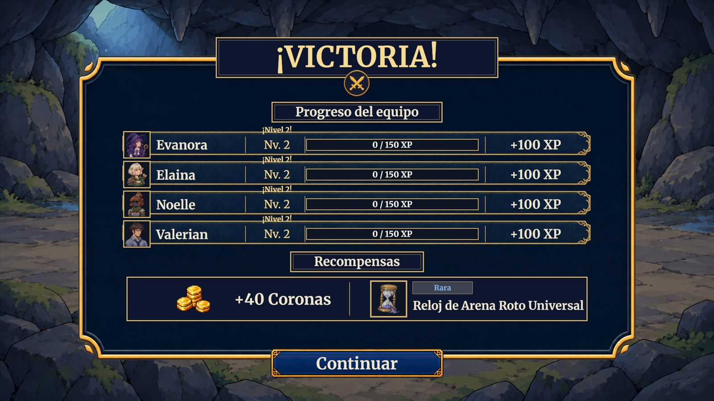
*Pantalla de victoria con Coronas y una reliquia como recompensa*

## Recurso 01: Coronas (CR)

**Tipo:**
Moneda y recurso económico.

**Descripción:**
Moneda del juego. Se gana al completar encuentros y al vender, y se gasta en la tienda del mapa.

**Cómo se obtiene:**
Se empieza con 50 Coronas. Cada combate entrega Coronas **solo la primera vez que se gana**:

| Región | Coronas por encuentro | Total de la región |
| --- | --- | --- |
| Pradera | 25 CR | 100 CR |
| Bosque | 40 CR | 120 CR |
| Corrupción | 60 CR | 120 CR |
| Jefe final | 100 CR | 100 CR |
| **Total de encuentros** | | **440 CR** |

Con las 50 iniciales y sin compras ni ventas, el jugador llega a 490 CR al terminar la demo. Los eventos narrativos no dan Coronas ni experiencia. También se obtienen Coronas vendiendo consumibles y reliquias (50 % del precio).

**Cómo se utiliza:**
Desde el botón Tienda del mapa. La ventana tiene cuatro pestañas: **Todo**, **Reliquias**, **Consumibles** y **Vender**. En las tres primeras se selecciona un producto, se lee su descripción y se pulsa COMPRAR; en **Vender** se entregan consumibles y reliquias sin equipar por la mitad de su precio.

**Cantidad máxima:**
Sin límite.

**Restricciones:**
- No se permiten compras sin Coronas suficientes, con el inventario lleno (5 por consumible) ni con la existencia agotada.
- La tienda no se abre durante un combate.
- Las Coronas se pierden si el equipo es derrotado o se abandona la sesión.

**Representación visual:**
Ícono de moneda dorada junto a la cantidad, visible en el mapa y en la tienda.

---

## Recurso 02: Tienda de reliquias

**Descripción:**
Cuatro espacios con una unidad cada uno. Un producto comprado queda agotado hasta la siguiente renovación.

**Renovación:**
Solo al completar por primera vez cualquier encuentro (combates y eventos obligatorios; no la introducción). No cambia al abrir o cerrar la tienda ni al cambiar de escena.

**Contenido según el avance:**

| Avance | Comunes | Raras |
| --- | --- | --- |
| Inicio y Pradera | 4 | 0 |
| Tras completar P4 (Bosque) | 3 | 1 |
| Desde el informe de Valdoria (Corrupción) | 2 | 2 |

Solo salen reliquias universales marcadas como disponibles en tienda: comunes (Amuleto de Corteza, Anillo del Segundo Intento, Botas del Mensajero, Broche del Vigía, Campana del Socorro y Colmillo de Lobo) y raras (Dado del Ocaso, Reloj de Arena Roto y Sello del Desollador). En una misma renovación no se repite una reliquia.

---

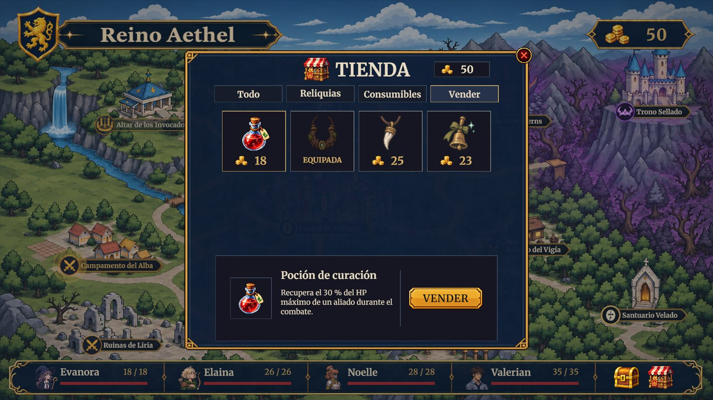
*Pestaña Vender de la tienda: consumibles y reliquias sin equipar con su precio de venta*

## Héroes caídos

Los protagonistas no mueren. Al llegar a 0 HP **caen**: el sprite se tumba, se atenúa y pasa a una casilla libre de la retaguardia; no actúan ni pueden ser objetivo de los enemigos. Siguen caídos al terminar el combate hasta que reciben una curación: una Poción de curación (con el 30 %) o una curación de Noelle. Subir de nivel restaura la vida al 100 %, pero no levanta a un héroe caído. Si los cuatro héroes caen, el combate se pierde.

> **Navegación:** [[00 - Índice]] · ← [[03 - Enemigos y NPC]] · [[05 - Misiones y Desafíos]] →
