# Personajes y Animación

## Descripción de la sección

Documenta cómo deben verse y comportarse visualmente los personajes y qué hay hecho hoy.

## Requisitos por personaje

| Personaje | Sprite de combate | Retrato e icono | Animaciones | VFX | Estado |
| --- | --- | --- | --- | --- | --- |
| Valerian | Sí (estático) | Sí | Pendiente | Sí (compartidos) | Sprite base final; animaciones por producir |
| Noelle | Sí (estático, con y sin máscara) | Sí (con y sin máscara) | Pendiente | Sí (compartidos) | Sprite base final; cambia a sin máscara tras La máscara rota |
| Elaina | Sí (estático) | Sí | Pendiente | Sí (compartidos) | Sprite base final; animaciones por producir |
| Evanora | Sí (estático) | Sí | Pendiente | Sí (compartidos) | Sprite base final; animaciones por producir |
| Enemigos normales (11) | Sí (estático) | Recorte de rostro | Pendiente | Sí (compartidos) | Sprite final; animaciones por producir |
| Capitán de Fuerzas Expedicionarias | Provisional | Provisional | Pendiente | Sí (compartidos) | Falta el sprite final |

## Sprites actuales

- **Héroes:** imagen de cuerpo completo de 1024 × 1536 con fondo transparente (`ElainaBase`, `EvanoraBase`, `NoelleBase`, `NoelleSinBase`, `ValerianBase`), más un icono de 1254 × 1254 y un sprite de diálogo por personaje. Noelle tiene dos versiones: con máscara y sin máscara; el juego cambia de una a otra al completar el evento.
- **Enemigos:** once imágenes de 1536 × 1536 recortadas de una hoja de 6144 × 4608, cada una en su carpeta (`Enemigos/<Región>/<Nombre>/`). Todos se dibujan sin tinte.
- **Escala en combate:** los héroes miden unas 3,8 unidades de alto; los enemigos se ajustan a su papel (Goblin común 2,6; Bandido 3,4; Chamán del Bosque 3,85; Guardián forestal 4,0; Lobo salvaje 1,95 de alto por 2,9 de largo; Guardián corrupto 4,3 y ocupa dos posiciones).
- **Pivote:** los pies de héroes y enemigos descansan sobre la misma línea de suelo; la barra de vida queda centrada bajo la figura.

### Referencias visuales

|   |   |   |   |   |
| --- | --- | --- | --- | --- |
| 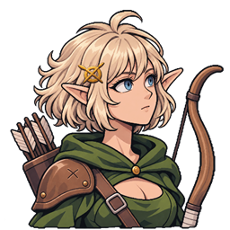 | 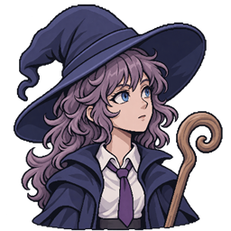 | 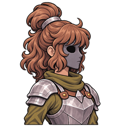 | 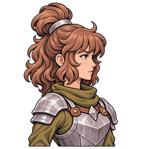 | 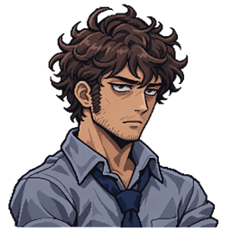 |
| **Elaina** | **Evanora** | **Noelle (con máscara)** | **Noelle (sin máscara)** | **Valerian** |

*Iconos oficiales de los héroes, usados en el orden de turno, las tarjetas y las fichas.*

|   |   |   |   |   |
| --- | --- | --- | --- | --- |
| 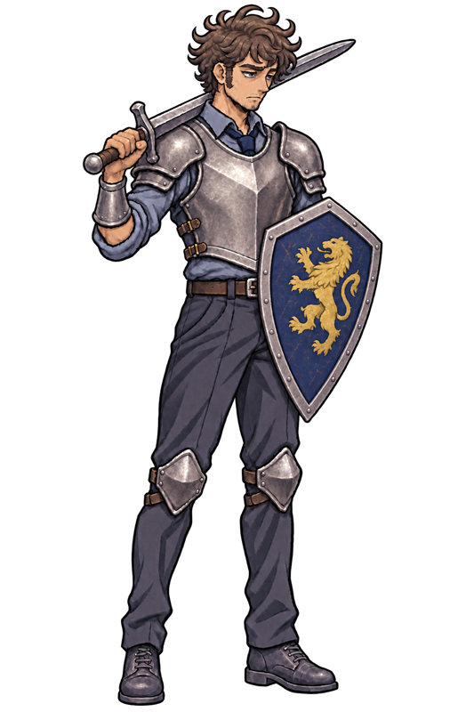 | 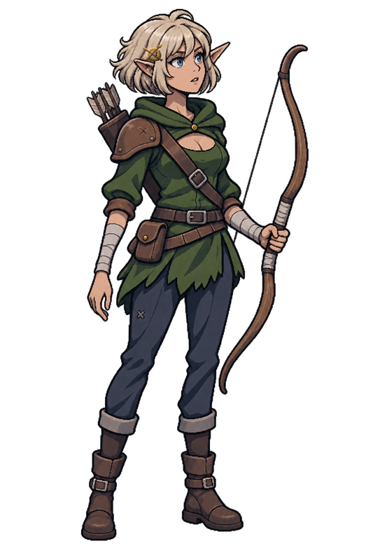 | 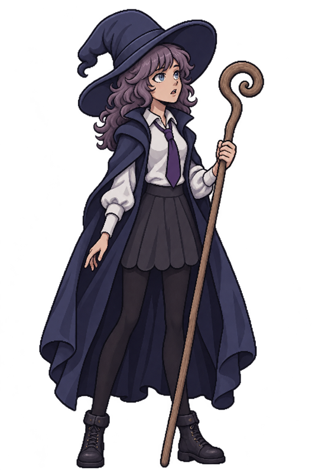 | 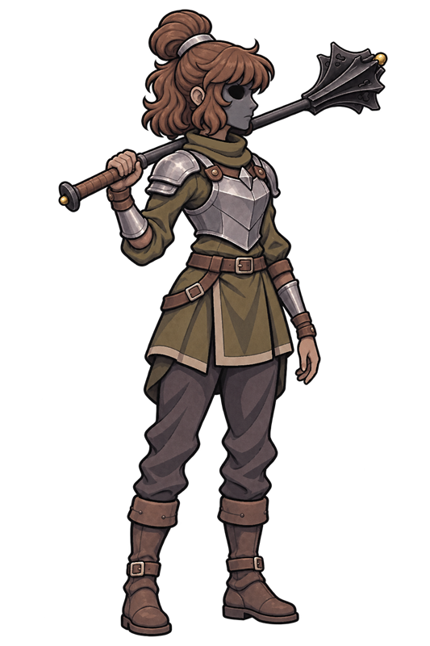 | 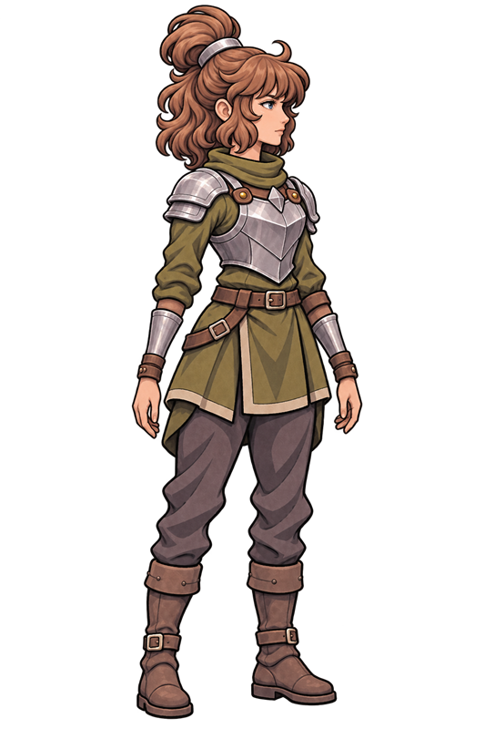 |
| **Valerian** | **Elaina** | **Evanora** | **Noelle (con máscara)** | **Noelle (sin máscara)** |

*Imágenes base de cuerpo completo de los héroes (copia reducida del original de 1024 × 1536).*

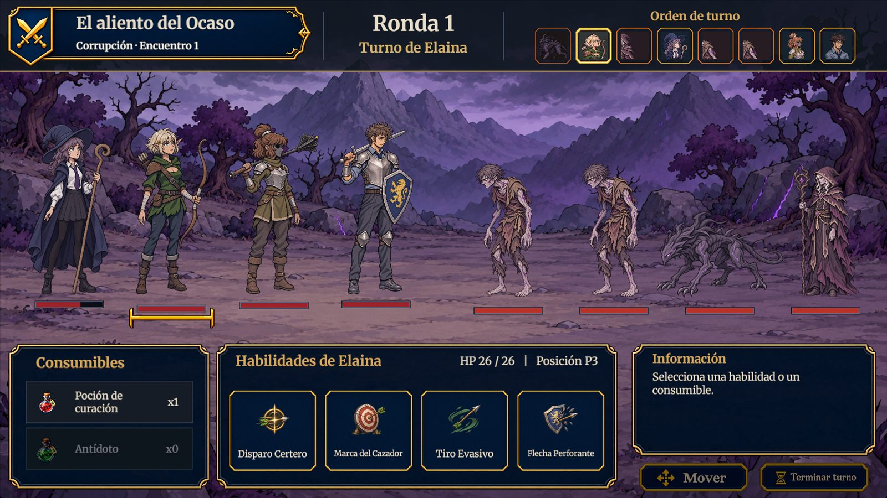
*Los cuatro héroes en combate (Corrupción, encuentro 1)*

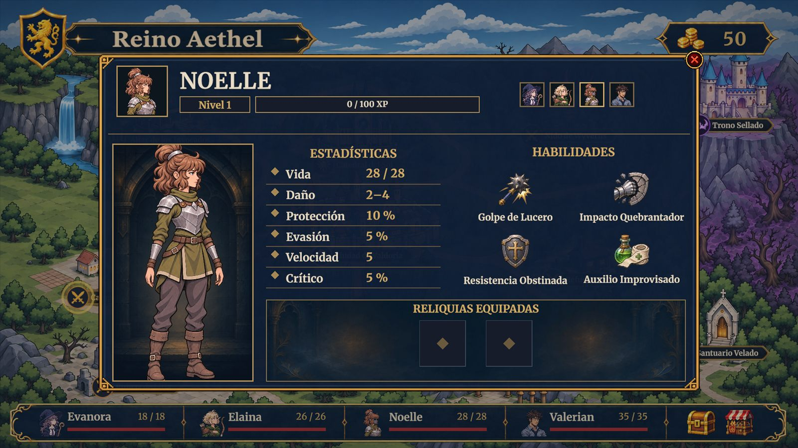
*Ficha de Noelle en el mapa: retrato, estadísticas, habilidades y casillas de reliquia*

El origen y la fecha de cada captura están en [[06 - Registro visual]].

## Animaciones

### Movimiento
- **Idle:** pendiente para los cuatro héroes y los enemigos. Se evaluó generarlo con Ludo.ai (modelo Griffin HD) a partir del sprite estático; todavía no hay resultado integrado.
- No hay animaciones de desplazamiento: el mapa es de eventos y el combate es por turnos.

### Interacción
- Ninguna. Los diálogos usan retratos estáticos.

### Combate
- Por ahora los ataques no tienen animación de personaje: la acción se comunica con el efecto de impacto sobre el objetivo (tajo u onda de choque), el sonido, el texto flotante y la barra de vida.
- Prevista: una animación de ataque por héroe y una genérica para enemigos.

### Daño
- Hoy: texto flotante y cambio de la barra. Prevista: una animación de daño por héroe y una genérica para enemigos.

### Caída / derrota
- **Héroe caído (implementado):** el sprite gira 90°, se atenúa y pasa a una casilla libre de la retaguardia en 0,35 s. Es provisional hasta que exista la animación de caída.
- **Enemigo derrotado (implementado):** el sprite se oscurece hasta negro, aparece una calavera y se desvanece.
- **Derrota total:** pantalla propia con las sombras de los héroes caídos sobre el escenario.

### Efectos de presentación por código
Transición de inicio de combate con espadas cruzadas, texto flotante (daño, curación, crítico, esquiva, estados), iconos de estado sobre los sprites, destello al equipar una reliquia y resaltado del turno activo.

## Convenciones

- **Nombres:** `<Personaje>Base.png` para héroes (por ejemplo `ValerianBase.png`) y `<Enemigo>.png` dentro de su carpeta; los iconos oficiales viven en `Sprites/Personajes/Iconos`.
- **Formato:** PNG con transparencia, un solo sprite por archivo, sin compresión de textura ni recortes de importación.
- **Orientación:** los enemigos miran a la izquierda, hacia el equipo; los héroes miran a la derecha.
- **Resolución:** héroes a 131 píxeles por unidad y enemigos a 122,5; no se amplían ni deforman.
- **Animación futura:** hoja de frames por acción y personaje, conservando el tamaño del cuadro para no mover el pivote.

> **Navegación:** [[00 - Índice]] · ← [[01 - Dirección de Arte]] · [[03 - Entornos]] →
