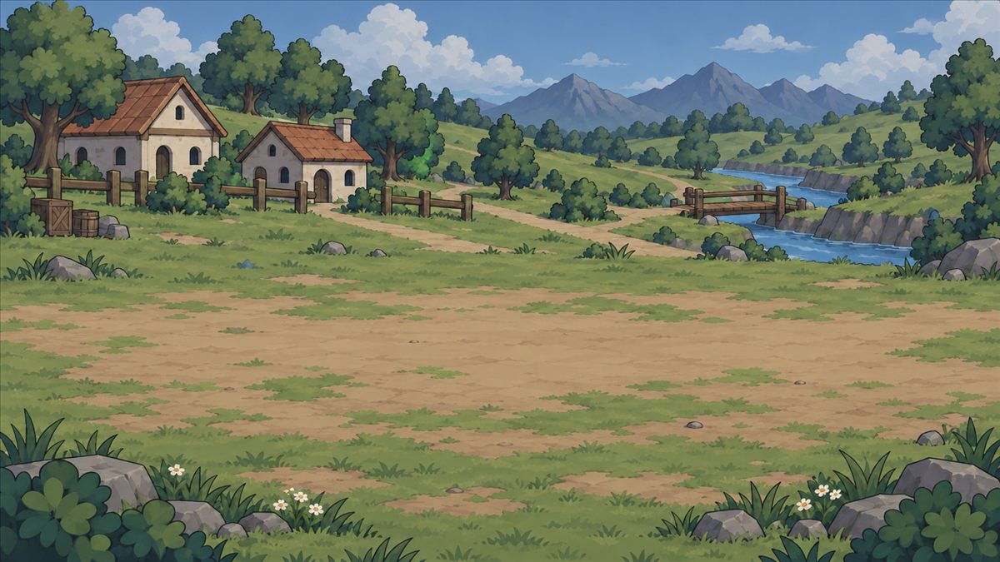
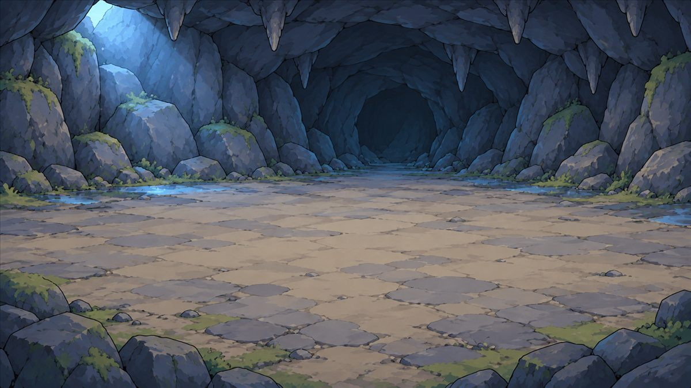
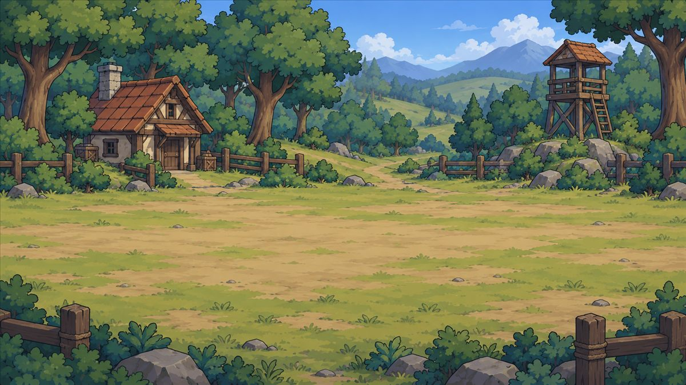
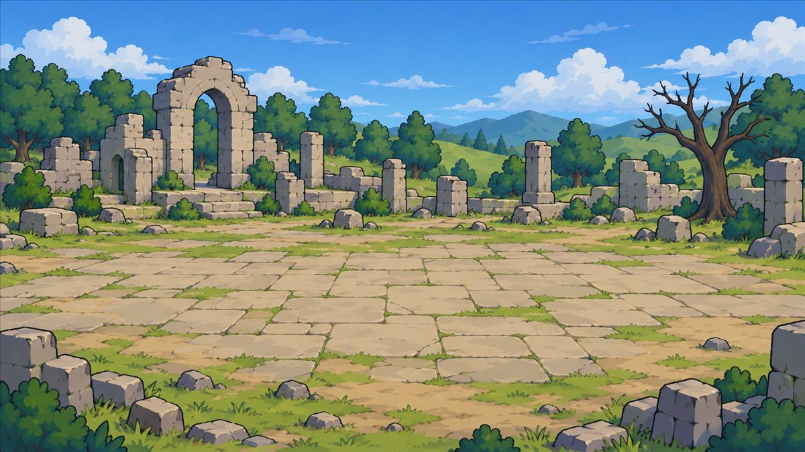
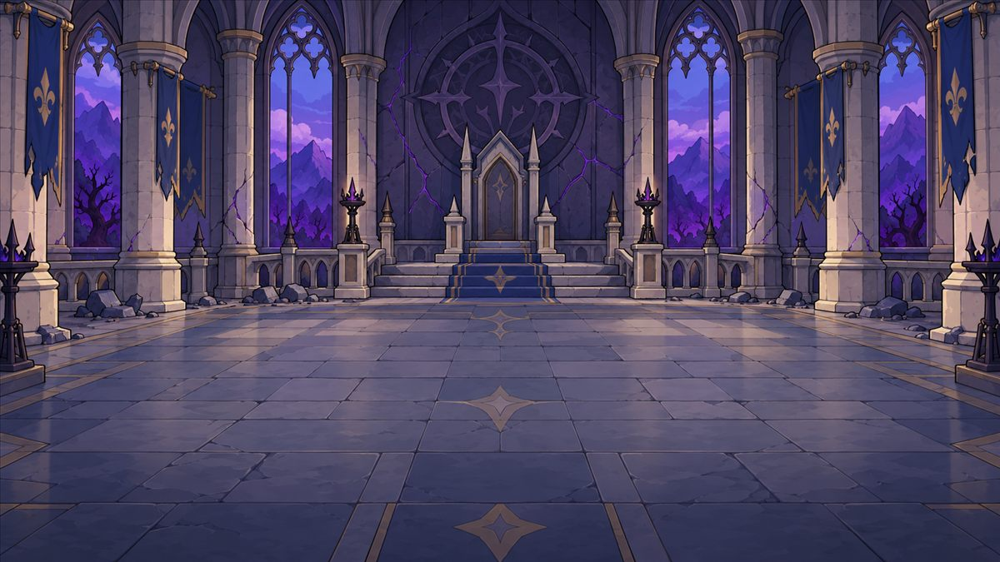
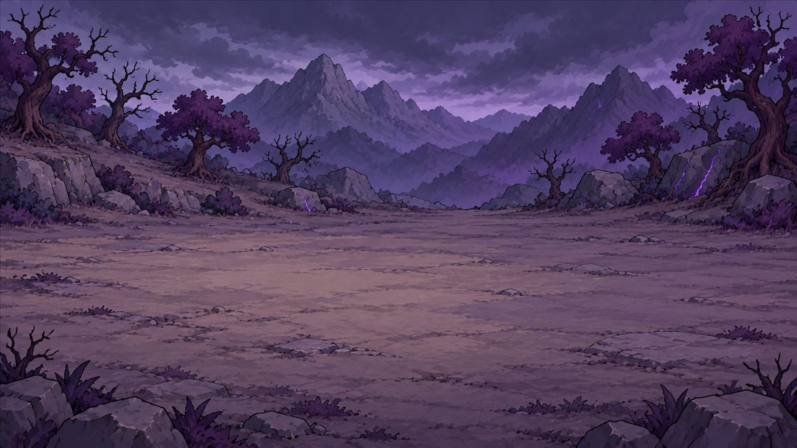
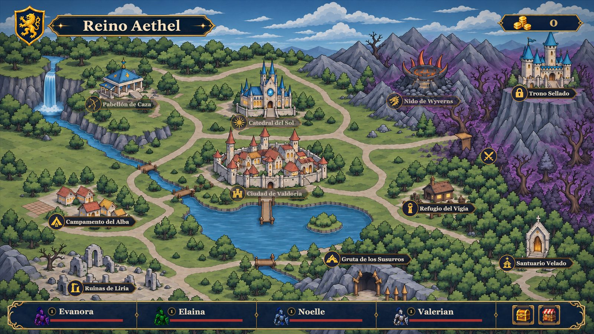

# Entornos

## Zonas

| Zona            | Estilo                                                                                                                                                                                                       | Elementos                                                            | Función |
| --------------- | ------------------------------------------------------------------------------------------------------------------------------------------------------------------------------------------------------------ | -------------------------------------------------------------------- | ------- |
| Llanuras Centrales (Pradera) | Vibrante, vivo, verde. Plano y amplio.                                                                                                                                                                       | Pocos árboles, arbustos, rocas grandes, colinas.                     |         |
| Bosque Oscuro            | Oscuro, frío, uso de colores marrón oscuro y rango de verdes, entre verde claro a verde oscuro con tonos azules para sombras. Generar una sensación de frío por medio de teoría de colores.                  | Árboles cubren el horizonte en el arte. Rocas medianas en el fondo.0 |         |
| Corrupción del Bosque    | Oscuridad fría, tonos azules y morados reemplazan el rango de verdes y marrones para los colores de los árboles, pasto toma un color morado poco saturado, para dar una sensación de muerte y/o podredumbre. | Campamentos militares, fogatas, antorchas, estantes de armas.        |         |

### Referencias visuales

|   |   |   |
| --- | --- | --- |
|  |  |  |
| **Campamento del Alba** | **Gruta de los Susurros** | **Refugio del Vigía** |
|  |  |  |
| **Ruinas de Lira** | **Trono Sellado** | **Zona Corrupta** |

*Fondos de combate usados en el juego (copias reducidas).*

*Mapa general con las regiones del reino*

## Modularidad

¿Qué elementos pueden reutilizarse?

## Iluminación

Describe iluminación global, fuentes de luz y cambios durante el juego.

## Efectos visuales

- Partículas
- Clima
- Humo
- Fuego
- Agua
- Magia / energía
- Impactos

## Recursos requeridos

Lista los modelos, sprites, texturas, materiales y efectos necesarios.

**Sprites**
Idle, ataque, recibir daño.
- Enemigos débiles
- Enemigos fuertes
- Capitán Fuerzas Expedicionarias
Protagonistas:
- Valerian
- Evanora
- Noelle
- Elaina

> **Navegación:** [[00 - Índice]] · ← [[02 - Personajes y Animación]] · [[04 - Interfaz Visual]] →
