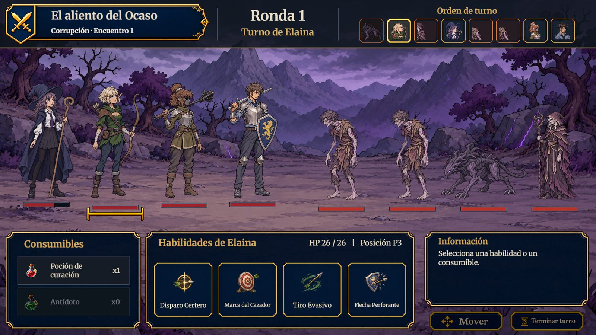
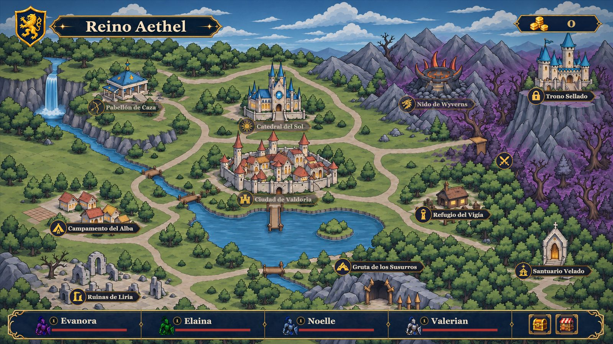
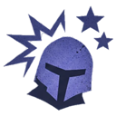
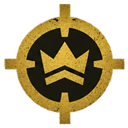
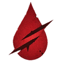
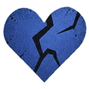

# Interfaz Visual

## Descripción de la sección

Documenta la información que el juego muestra al jugador y las reglas visuales de la interfaz. Todas las pantallas se diseñan sobre un lienzo de 1920 × 1080 con escalado por altura.

## HUD

### HUD del combate

*HUD de combate actual*

| Zona | Contenido |
| --- | --- |
| Encabezado izquierdo | Escudo con espadas cruzadas, título narrativo del encuentro, región y número de encuentro |
| Encabezado central | Número de ronda y «Turno de <unidad>» |
| Encabezado derecho | **Orden de turno**: un retrato por unidad (héroes con marco azul, enemigos con marco rojo; el retrato enemigo es un recorte de su rostro) |
| Campo | Héroes a la izquierda y enemigos a la derecha; bajo cada unidad su barra de vida, estados (iconos) y, si lo lleva, el icono de su reliquia |
| Panel inferior izquierdo | **Consumibles**: Poción de curación y Antídoto con su cantidad |
| Panel inferior central | **Habilidades** del héroe activo: cuatro botones con icono, nombre y recarga, además de su HP y posición |
| Panel inferior derecho | **Información**: ficha de la unidad o de la habilidad bajo el cursor y los botones Mover y Terminar turno |

### HUD del mapa

*HUD del mapa actual*

Título del reino arriba a la izquierda, contador de Coronas arriba a la derecha, barra inferior con las cuatro tarjetas de héroe (retrato, nombre, vida y barra) y los atajos Inventario y Tienda, y el botón de pausa.

## Jerarquía visual

1. **Primero:** quién actúa y qué puede hacer (turno actual, resalte del héroe activo, habilidades disponibles).
2. **Segundo:** el estado del combate (barras de vida, estados alterados, orden de turno).
3. **Tercero:** el contexto (título del encuentro, información detallada, recompensas, descripciones al pasar el cursor).

## Estados

| Estado | Tratamiento visual |
| --- | --- |
| Normal | Panel azul marino con borde fino azul grisáceo |
| Seleccionado | Borde dorado |
| Cursor encima | Borde dorado envejecido y recuadro con la descripción |
| Objetivo válido | Marco rojo (ataque) o indicador verde (apoyo); el objetivo señalado se resalta |
| Bloqueado (recarga, posición, agotado, ya poseída) | Icono atenuado y etiqueta o texto que explica el motivo |
| Daño | Texto flotante del daño; crítico en grande con temblor |
| Curación | Texto flotante verde con la cantidad |
| Éxito | Mensaje de compra o venta, destello breve al equipar |
| Error | Mensaje en la ficha o en la ventana (por ejemplo, el motivo por el que una reliquia no se puede equipar), precio en rojo si faltan Coronas |
| Héroe caído | Sprite tumbado y atenuado en la retaguardia, tarjeta marcada como CAÍDO |
| Peligro de área | Etiqueta FUEGO sobre las unidades amenazadas por un ataque preparado |

### Iconos de estado

|                                                                                  |                                                                                      |                                                                                  |                                                                          |                                                                                      |                                                                                |
| -------------------------------------------------------------------------------- | ------------------------------------------------------------------------------------ | -------------------------------------------------------------------------------- | ------------------------------------------------------------------------ | ------------------------------------------------------------------------------------ | ------------------------------------------------------------------------------ |
|  |  |            |        |     |  |
| **Aturdimiento**                                                                 | **Debilitamiento**                                                                   | **Evasión**                                                                      | **Marca**                                                                | **Marca táctica**                                                                    | **Preparación**                                                                |
|      |            |  |  |  |            |
| **Protección**                                                                   | **Quemadura**                                                                        | **Regeneración**                                                                 | **Sangrado**                                                             | **Vulnerabilidad**                                                                   | **Veneno**                                                                     |
|                                                                                  |                                                                                      |                                                                                  |                                                                          |                                                                                      |                                                                                |

*Iconos de estado usados en el juego (copias reducidas).*

## Convenciones

**Tipografía:** Merriweather (regular y negrita) en toda la interfaz; títulos en negrita y marfil, textos en marfil sobre fondos oscuros.

**Paleta:** azul marino oscuro para paneles, dorado para acentos y bordes de selección, marfil para el texto, rojo para vida y enemigos. El color de la rareza de las reliquias es común gris, poco común verde, rara azul y épica violeta.

**Iconografía:** iconos propios de habilidades, estados (Aturdimiento, Debilitamiento, Defensa elevada, Evasión, Marca, Protección, Quemadura, Regeneración, Sangrado, Veneno, Vulnerabilidad), consumibles y reliquias. Los retratos oficiales de los héroes se usan en la barra de orden de turno, las tarjetas y las fichas.

**Tamaños mínimos:** texto principal de los paneles de combate entre 26 y 30 px en el lienzo de 1080 p; botones con zonas de clic amplias.

**Contraste:** texto claro sobre fondos azul marino casi negros.

**Animaciones:** las ventanas se abren con un fundido y una escala de 0,95 a 1 en 0,3 s; el marco de las tarjetas pulsa con suavidad; los textos flotantes suben y se desvanecen; el tutorial resalta con un borde dorado que pulsa. Los tutoriales y las ventanas no se animan con tiempo escalado, así que funcionan también en pausa.

## Pantallas

- Menú principal
- Pausa (con Ayuda y Opciones)
- Configuración (volumen general y música)
- Inventario y ficha de héroe
- Mapa
- Diálogo
- Tienda
- Evento La máscara rota
- Combate
- Victoria
- Derrota

El detalle funcional de cada una está en [[02 - UI y Menús]].

> **Navegación:** [[00 - Índice]] · ← [[03 - Entornos]] · [[05 - Audio y Música]] →
