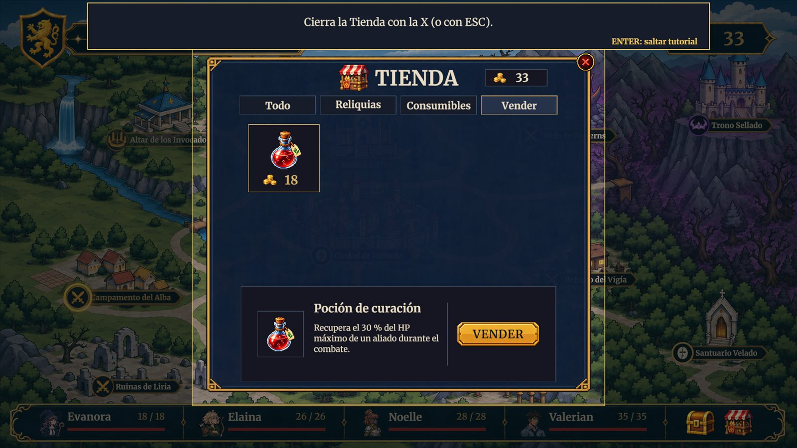
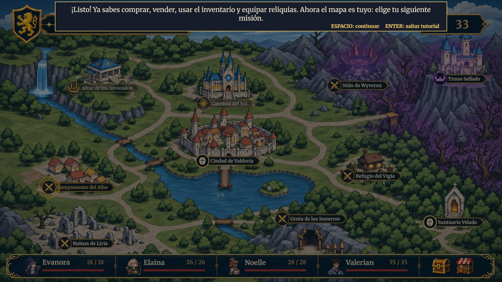

# UX y Flujo del Jugador

## Flujo principal

```text
Menú principal → Nueva partida → Introducción cinematográfica (se puede omitir)
   → Diálogo del Altar de los Invocados → Primer combate (P1) con tutorial guiado
   → Victoria → Mapa con tutorial interactivo (tienda, venta, inventario, reliquias)
   → P2 → P3 → P4 → B1 → La máscara rota → B2 → B3 → El informe del último vigía
   → C1 → C2 → Trono Sellado (capitán) → Victoria final → Epílogo → Créditos → Menú principal
```

Pausa disponible en el mapa, el diálogo y el combate (tecla Esc). Una derrota total lleva a la pantalla de Derrota y de ahí al menú principal. Al vencer al capitán, el botón Continuar de la pantalla de Victoria lleva a un epílogo en el Trono Sellado (diálogo de los cuatro héroes sobre el desenlace, que se puede omitir) y de ahí a los créditos; al terminar o saltarlos (ESPACIO, ENTER, ESC o clic) la partida se cierra y se vuelve al menú principal.

## Primeros minutos

| Momento | Qué ve | Qué aprende |
| --- | --- | --- |
| Menú principal | Tres botones: Nueva partida, Opciones y Salir, con música de menú | Que el juego se maneja con el ratón |
| Introducción | Escenas ilustradas con voz de narrador, subtítulos y efectos (lluvia, accidente, llegada a Aethel) | Quiénes son los cuatro héroes y por qué están en otro mundo; se puede omitir con el botón de salto |
| Altar de los Invocados | Diálogo tipo novela visual: retratos, placa de nombre y texto que aparece letra a letra con sonido | Quién guía al equipo (Dios), la misión inicial y cómo avanzar con ESPACIO |
| Primer combate (P1) | Tutorial guiado que oscurece la pantalla y resalta una zona cada vez | Orden de turno, posiciones, habilidades y su recarga, ficha de información, mover, consumibles y terminar turno |
| Primer retorno al mapa | Segundo tutorial, esta vez sobre el mapa | Abrir la tienda, comprar, vender, usar el inventario y equipar una reliquia arrastrándola a la ficha de un héroe |


*Tutorial del mapa: venta de un consumible en la tienda*


*Cierre del tutorial: el jugador elige su siguiente misión*

## Retroalimentación

Para cada acción importante: **Entrada → Respuesta visual → Respuesta sonora → Resultado**.

| Entrada | Respuesta visual | Respuesta sonora | Resultado |
| --- | --- | --- | --- |
| Elegir una habilidad | Marco rojo en los objetivos válidos (indicador verde para apoyo); la ficha de información muestra la habilidad | — | Se espera la elección del objetivo |
| Atacar | Barra de vida que baja, texto flotante con el daño, destello de impacto (tajo u onda de choque) | Efecto de corte o de embate de escudo en las habilidades de Valerian que lo tienen | Daño aplicado; el turno pasa |
| Crítico o esquiva | Marcador flotante «¡Crítico!» (con temblor) o «Esquiva» | — | El resultado se lee sin consultar el registro |
| Aplicar un estado | Icono sobre el sprite y marcador flotante con el nombre del estado | — | El estado se ve y se explica al pasar el cursor |
| Un héroe llega a 0 HP | El sprite se tumba, se atenúa y pasa a una casilla de la retaguardia | — | Queda caído hasta que lo curan |
| Derrotar a un enemigo | El sprite se oscurece, aparece una calavera y se desvanece | — | La formación enemiga se reordena |
| Comprar o vender | Las Coronas cambian y un mensaje confirma el resultado; los precios en rojo avisan de fondos insuficientes | — | Inventario actualizado |
| Pasar el cursor por un enemigo | La ficha de información muestra sus estadísticas, estados, habilidades y reliquia | — | El jugador decide con datos reales |
| Subir de nivel | La pantalla de victoria muestra, de forma discreta, qué estadísticas mejoraron | — | Vida restaurada al 100 % |

## Fricción intencional

**Dificultad que forma parte del diseño:**
- Las habilidades solo funcionan desde ciertas posiciones y alcanzan ciertas posiciones: obliga a pensar la formación.
- Los héroes caídos no se recuperan solos: obliga a administrar pociones y curaciones.
- Las Coronas y la tienda de reliquias son limitadas; hay que elegir entre consumibles y reliquias.
- La IA enemiga prepara ataques de área (Fuego de Supresión) con un turno de aviso.

**Dificultad que sería mala experiencia y se evita:**
- Ningún enemigo se salta su turno ni actúa fuera de él.
- Las acciones inválidas aparecen bloqueadas en vez de fallar al pulsarlas.
- Los tutoriales no pueden dejar al jugador atascado: ENTER los salta y, si una zona resaltada no existe, no se bloquean los clics.
- El tiempo entre acciones enemigas deja leer lo que ocurre (2 s antes y 3 s después de la acción).

## Descubrimiento

- **Qué hacer:** el panel de misión del mapa, el título narrativo de cada encuentro y el marcador de la siguiente ubicación disponible; la ayuda de la pausa resume controles, navegación, combates y objetivo.
- **Dónde ir:** las ubicaciones bloqueadas se ven distintas de las disponibles y completadas; el Trono Sellado cambia de estado al descubrir al capitán.
- **Qué se puede usar:** los elementos interactivos se agrandan o iluminan al pasar el cursor y muestran un recuadro con su descripción (reliquias, habilidades, consumibles, enemigos, héroes).
- **Qué ocurrió:** marcadores flotantes de daño, curación, crítico, esquiva y estados; mensajes de la tienda; pantalla de victoria con experiencia, Coronas y reliquia obtenidas.
- **Por qué ganó o perdió:** la pantalla de victoria desglosa la experiencia por héroe; la de derrota muestra a los héroes caídos sobre el escenario del encuentro perdido.

> **Navegación:** [[00 - Índice]] · ← [[05 - Audio y Música]] · [[02 - UI y Menús]] →
