# UI y Menús

## Mapa de navegación

```text
Menú principal
├── Nueva partida → Introducción → Diálogo del Altar → Combate P1 → Victoria → Mapa
├── Opciones
│   ├── Volumen general
│   └── Música
└── Salir

Mapa
├── Panel de ubicación / misión (Iniciar combate)
├── Tienda (Todo · Reliquias · Consumibles · Vender)
├── Inventario (reliquias y consumibles)
├── Ficha de héroe (estadísticas, habilidades, reliquias equipadas, inventario)
├── Eventos narrativos (diálogo)
└── Pausa (Regresar · Ayuda · Opciones · Menú principal)

Combate → Victoria → Mapa
Combate (capitán) → Victoria → Epílogo → Créditos → Menú principal
Combate → Derrota → Menú principal
```

## Pantallas

### Menú principal

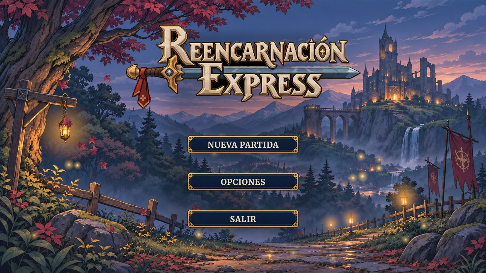
*Menú principal con el logo y los botones Nueva partida, Opciones y Salir*


**Propósito:** entrada al juego.

**Elementos:** logo, fondo animado con luces ambientales y tres botones: NUEVA PARTIDA, OPCIONES y SALIR.

**Acciones disponibles:** iniciar una partida nueva; abrir Opciones (VOLUMEN GENERAL, MÚSICA, VOLVER); salir.

**Estados:** normal, opciones abiertas.

**Transiciones:** Nueva partida lleva a la introducción.

### Introducción

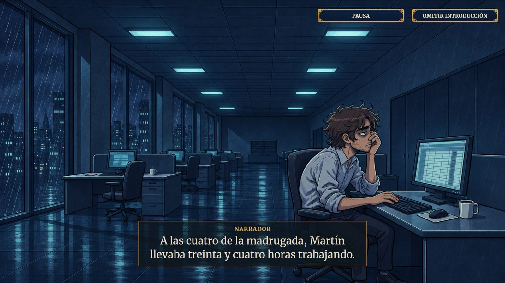
*Introducción cinematográfica con narrador y botones Pausa y Omitir introducción*

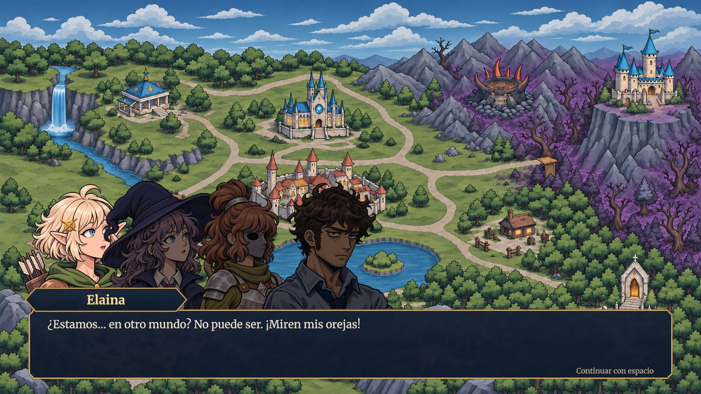
*Primer diálogo en el reino sobre el mapa, con retratos y cuadro de texto*


**Propósito:** contar el accidente y la reencarnación.

**Elementos:** escenas ilustradas con fundidos, voz de narrador y de Dios, subtítulos etiquetados y efectos de sonido.

**Acciones disponibles:** omitir con el botón de salto (fundido a negro) o pausar para omitir.

**Transiciones:** al terminar u omitir pasa al diálogo del Altar.

### Diálogo

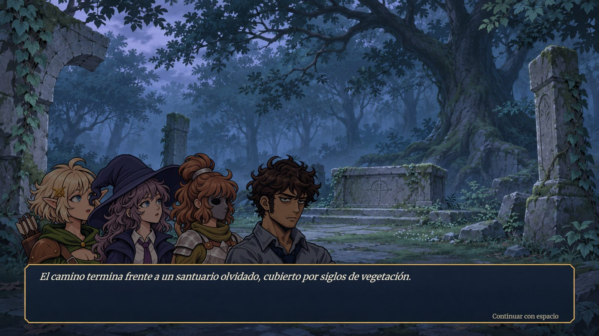
*Diálogo del santuario: retratos de los héroes, narración y aviso Continuar con espacio*


**Propósito:** escenas narrativas (Altar de los Invocados, La máscara rota, El informe del último vigía).

**Elementos:** retratos de los personajes, placa con el nombre de quien habla, cuadro de texto con efecto de escritura y sonido, pista «ESPACIO», luz y sonidos especiales en La máscara rota.

**Acciones disponibles:** ESPACIO completa el texto o avanza.

**Transiciones:** al terminar vuelve al mapa o inicia el combate asociado.

### Mapa

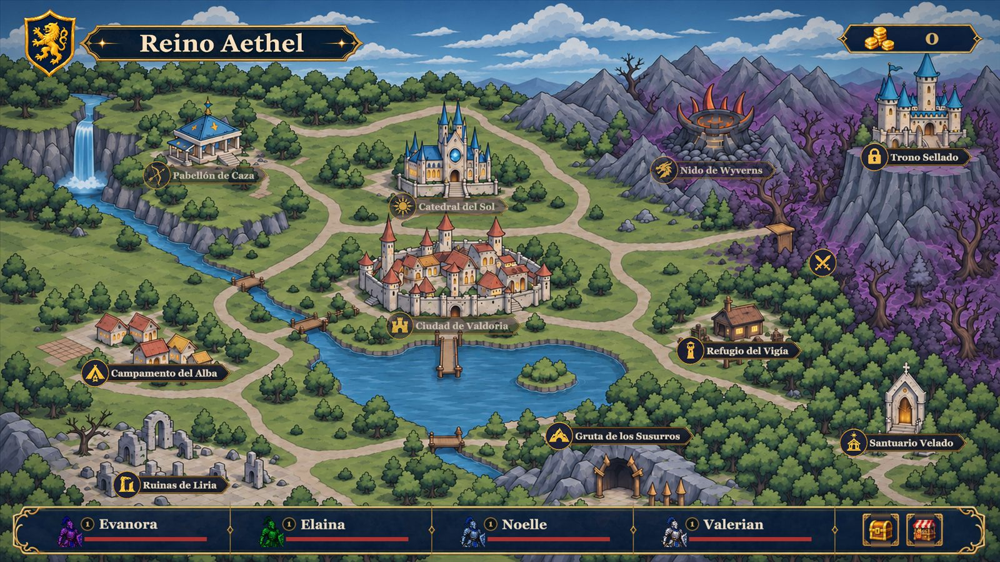
*Mapa del Reino Aethel con los nodos de cada región, las Coronas y la barra de héroes*


**Propósito:** elegir el siguiente encuentro y preparar al equipo.

**Elementos:** título «Reino Aethel», marcadores de ubicación con etiqueta, panel de misión con título, descripción, enemigos y recompensas, contador de Coronas (arriba a la derecha), barra inferior con las tarjetas de los cuatro héroes (nombre y vida) y los botones Inventario y Tienda, y el botón de pausa.

**Acciones disponibles:** seleccionar ubicación, Iniciar combate, abrir tienda, inventario o ficha, pausar.

**Estados:** ubicación disponible, bloqueada, completada o de evento.

### Tienda

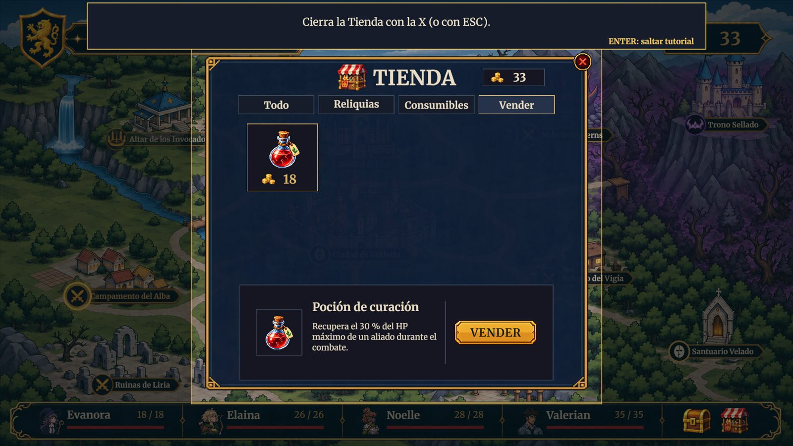
*Tienda con la pestaña Vender durante el tutorial interactivo*


**Propósito:** comprar y vender.

**Elementos:** título, contador de Coronas, cuatro pestañas (Todo, Reliquias, Consumibles, Vender), cuadrícula de tarjetas con icono y precio, recuadro emergente con la descripción, panel de detalle con el botón COMPRAR o VENDER y mensaje de estado.

**Estados:** producto seleccionado, agotado, ya poseída, fondos insuficientes (precio en rojo), reliquia equipada (en Vender).

**Transiciones:** se cierra con la X o Esc.

### Inventario y ficha de héroe

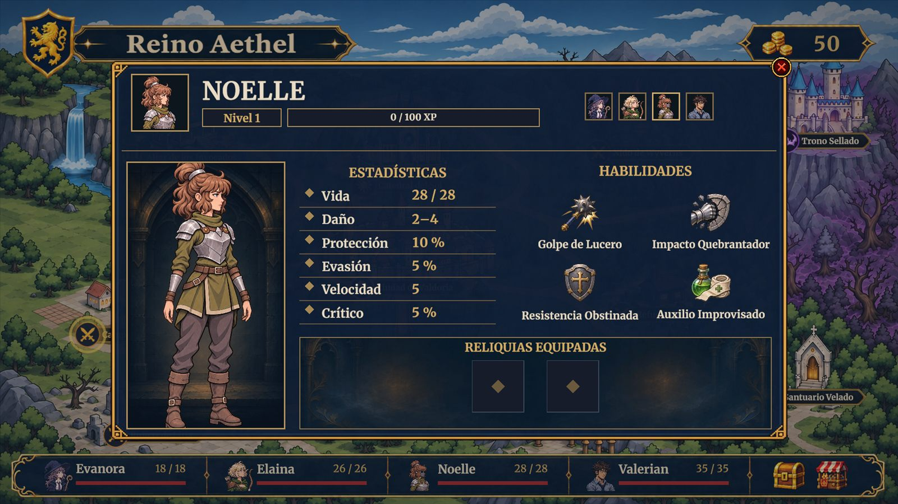
*Ficha de héroe: estadísticas, habilidades y casillas de reliquia*

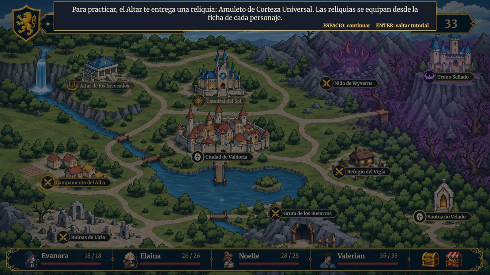
*Mensaje del tutorial tras recibir la primera reliquia en el Altar*


**Propósito:** consultar objetos y equipar reliquias.

**Elementos:** ventana de inventario con filtros (Todo, Reliquias, Consumibles) y cuadrícula de casillas; ficha con retrato, nivel, barra de experiencia, estadísticas, las cuatro habilidades y dos casillas de reliquia; selector para cambiar de héroe.

**Acciones disponibles:** arrastrar reliquias a una casilla o de vuelta al inventario; pasar el cursor para leer.

**Estados:** casilla vacía, equipada, destino válido (marco dorado) o inválido (marco rojo, con el motivo).

### Combate

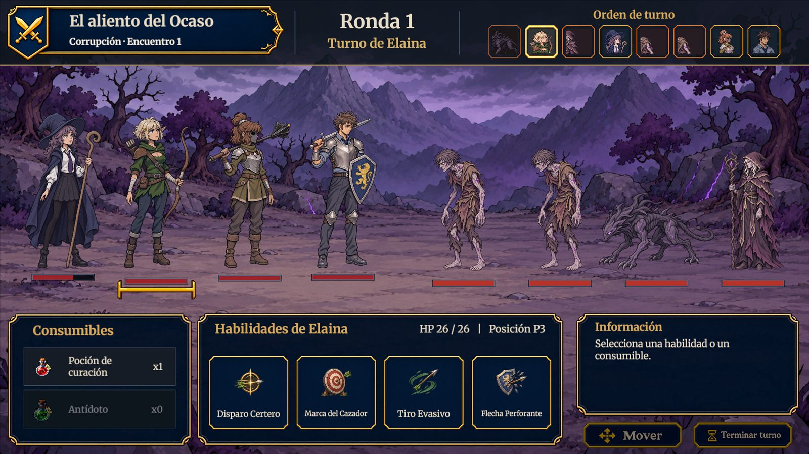
*Pantalla de combate: encabezado, orden de turno, consumibles, habilidades e información*


**Propósito:** resolver el encuentro por turnos.

**Elementos:** encabezado con el título del encuentro, la región, la ronda, el turno actual y la barra de orden de turno (retratos de héroes con marco azul y enemigos con marco rojo); campo con las barras de vida bajo cada unidad; panel Consumibles; panel de habilidades del héroe activo (nombre, recarga, HP y posición); panel de Información; botones Mover y Terminar turno.

**Acciones disponibles:** elegir habilidad y objetivo, mover al héroe una posición, usar un consumible (clic en la barra o en la imagen del héroe), terminar turno.

**Estados:** habilidad disponible, en recarga o fuera de posición (bloqueada), objetivo válido, héroe caído, enemigo con reliquia (icono junto a la barra).

### Victoria

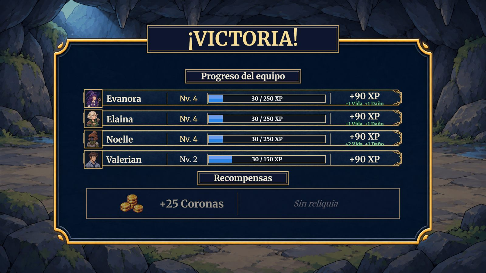
*Victoria con subida de nivel y bonos al equipo*


**Propósito:** mostrar el resultado y las recompensas.

**Elementos:** título enmarcado, fila por héroe con nivel, barra de experiencia y XP ganada, mejoras de estadísticas al subir de nivel (discretas), Coronas y reliquia obtenida con recuadro de descripción.

**Sonido:** al subir de nivel un héroe suena un efecto único (una sola vez aunque suban varios a la vez); la pantalla no lleva otra música ni efectos.

**Transiciones:** Continuar lleva al mapa (con tutorial la primera vez). Tras vencer al capitán lleva al epílogo y a los créditos.

### Derrota

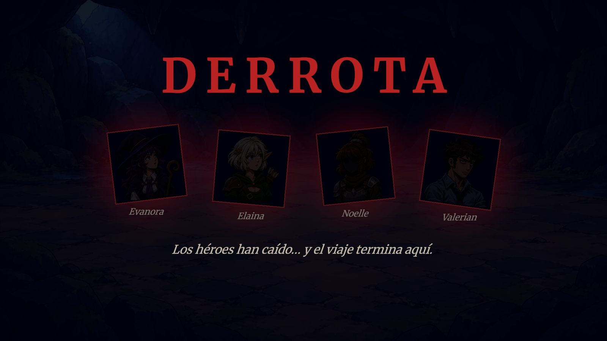
*Pantalla de derrota con los héroes caídos*


**Propósito:** cerrar la sesión.

**Elementos:** fondo oscuro del encuentro perdido, sombras de los héroes caídos, título y un único botón.

**Transiciones:** vuelve al menú principal y descarta la partida.

### Epílogo

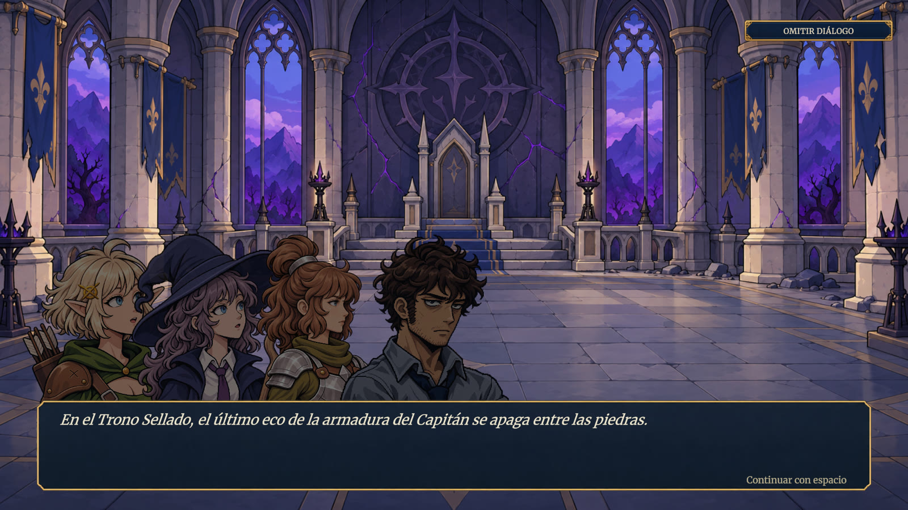
*Epílogo en el Trono Sellado tras vencer al capitán: los cuatro héroes, la línea de narración y el cuadro de diálogo*


**Propósito:** cerrar la historia de la demo sin mostrar la derrota del capitán.

**Elementos:** fondo del Trono Sellado, retratos de los cuatro héroes, cuadro de texto con efecto de escritura, narración en cursiva y botón para omitir el diálogo.

**Transiciones:** al terminar o al omitir lleva a los créditos.

### Créditos

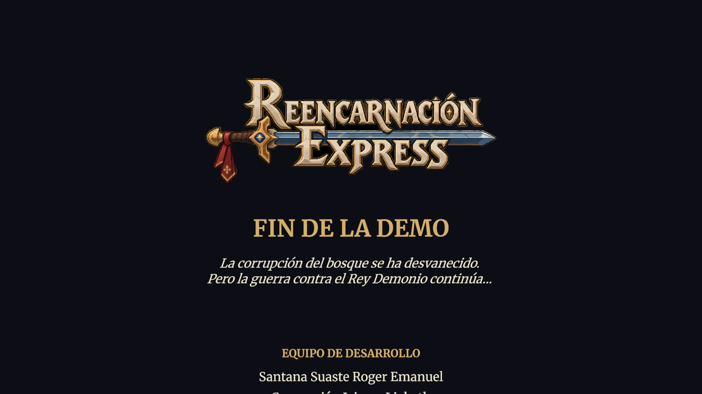
*Pantalla de créditos: logo, «Fin de la demo», frase de cierre y equipo de desarrollo sobre fondo oscuro*


**Propósito:** cerrar la demo y devolver al jugador al menú.

**Elementos:** logo del juego, texto que sube despacio (fin de la demo, equipo de desarrollo, estudio y agradecimiento) y música del menú.

**Transiciones:** al terminar o al pulsar ESPACIO, ENTER, ESC o clic, funde a negro, cierra la sesión y vuelve al menú principal.
### Pausa

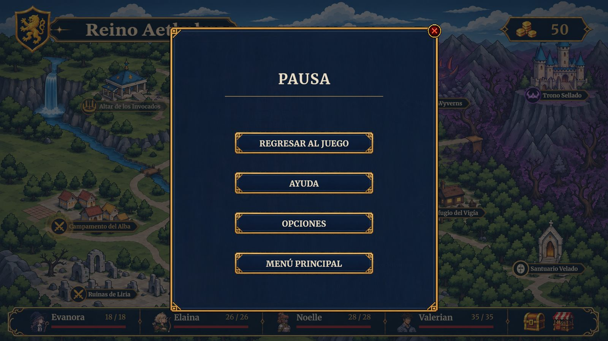
*Menú de pausa en el mapa*

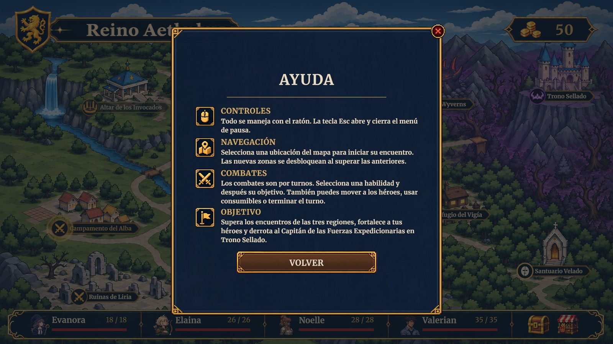
*Pantalla de ayuda abierta desde la pausa*

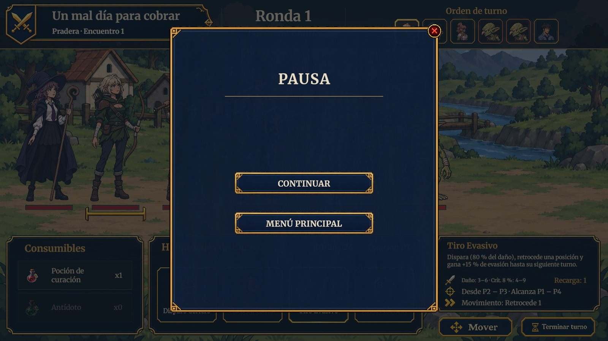
*Pausa durante un combate, con Continuar y Menú principal*


**Propósito:** detener el juego y consultar ayuda.

**Elementos:** cuatro botones (REGRESAR AL JUEGO, AYUDA, OPCIONES, MENÚ PRINCIPAL); la ayuda tiene cuatro apartados (Controles, Navegación, Combates, Objetivo); las opciones tienen VOLUMEN GENERAL y MÚSICA.

## Confirmaciones

- **Menú principal desde la pausa:** «¿Salir al menú principal? Se perderá el progreso de la partida.» (CONFIRMAR / CANCELAR).
- **Salir al escritorio:** misma advertencia; en el Editor muestra un aviso porque solo funciona en una build.
- Las compras y ventas no piden confirmación: se pueden repetir y el resultado se ve de inmediato.

> **Navegación:** [[00 - Índice]] · ← [[01 - UX y Flujo del Jugador]] · [[03 - Accesibilidad]] →
